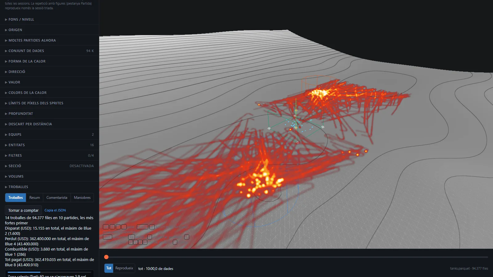
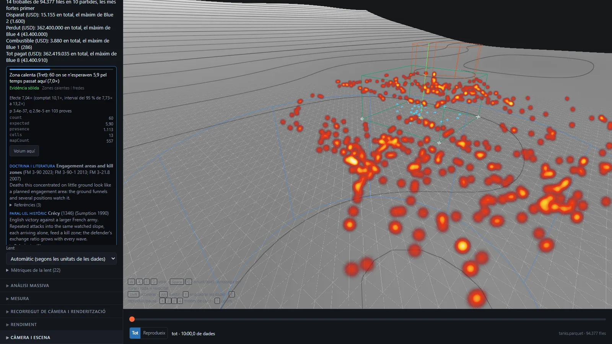
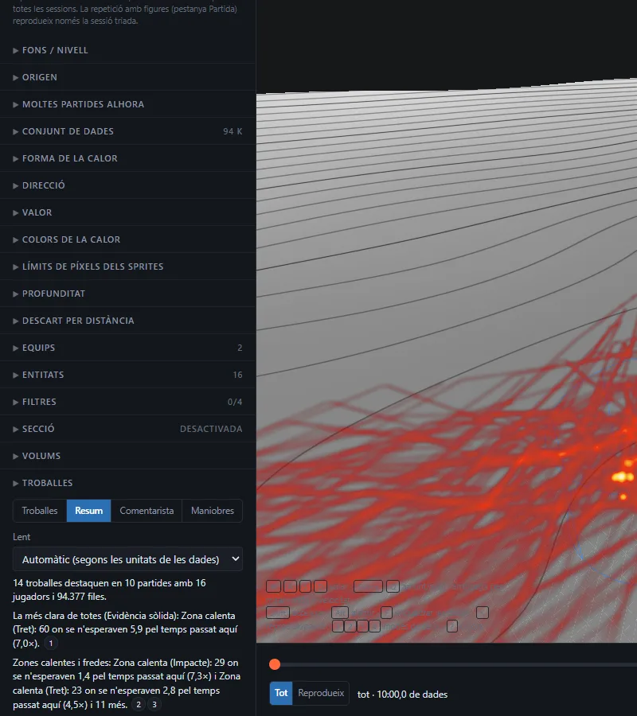
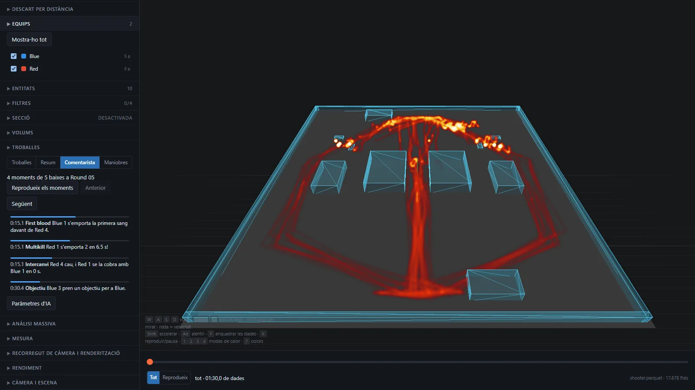

# Troballes

**Troballes** busca a les dades carregades el que destaca -posicions fortes, terreny mortal, trampes d'aparició, colls d'ampolla, jugadors molt per sobre dels seus iguals- i t'ho explica, el més fort primer, amb les proves. Serveix per entendre en un minut on es va guanyar o perdre una partida. Després pot escriure un resum, i en una sola repetició pot fer de comentarista que salta als grans moments.

Tot es compta al navegador. Res surt del teu ordinador tret que activis una IA externa (vegeu [IA externa](#external-ai)).

La secció **Troballes** és a la barra lateral de les pestanyes Mapa de calor i Partida. Té tres pestanyes: **Troballes**, **Resum** i **Comentarista**.

## Troballes {#findings}

1. Carrega dades i obre **Troballes**. Prem **Cercar troballes** («Comptant… n%» mostra el progrés).
2. Llegeix la llista. Cada troballa té una barra de força, una frase, com de bones són les proves (*Proves fortes*, *Bones proves* o *Algunes proves*), quin detector la va trobar, i la classe de vehicle quan hi importa.
3. **Fes clic a una troballa**: el visor aplica els seus filtres, porta la càmera al lloc i salta al moment, i obre el detall: l'efecte amb el seu interval del 95%, els valors de p i de q, les proves comptades, i **Volum aquí**, que dibuixa un [volum](volumes.md) al voltant del lloc.
4. **Restaura els filtres** et torna els teus filtres. **Copia el JSON** copia tot l'informe.

El recompte usa els filtres actuals, els grups amagats i la partida triada en tot l'interval de temps. Quan després canvies els filtres, una nota ho diu; prem **Torna a comptar**.

Les línies de dalt de la llista (per exemple els totals de diners) resumeixen el conjunt de dades abans de les troballes.

### Els detectors {#the-detectors}

| Detector | Què troba | Necessita a les dades |
|---|---|---|
| **Posicions de poder** | Llocs amb molt millors probabilitats de morts causades per mort que la resta del mapa, i *terreny segur* on mor poca gent pel temps que s'hi passa | esdeveniments de mort causada i de mort |
| **Zones calentes i fredes** | Llocs on un tipus d'esdeveniment (trets, impactes, captures ...) passa molt més o molt menys sovint del que prediu el temps que s'hi passa | una columna d'esdeveniments |
| **Terreny obert i cobertura** | Morts a l'obert contra geometria del nivell propera, i lentitud contra moviment ràpid | morts; un nivell 3D per a la part de la geometria |
| **Spawns** | Spawns forts, trampes d'aparició, spawns segurs, temps fins al primer contacte | temps i persones |
| **Classe per lloc** | Una classe de vehicle, o jugadors contra IA, que van molt millor o molt pitjor en una àrea | morts causades més una classe de vehicle o una columna de jugador/IA |
| **Jugadors** | Jugadors que maten o moren molt més o molt menys que els altres de la mateixa classe | persones i morts causades |
| **Colls d'ampolla i flancs** | Colls d'ampolla (molts més passos que el terreny del voltant) i rutes de flanqueig (poc usades, però que porten a morts) | persones |
| **Valor** | *Terreny car* i *Terreny rendible* | [columnes de valor](value-weighting.md) |
| **Què va decidir les rondes** | Què separava les rondes guanyades de les perdudes, i els jugadors que més probabilitat de victòria van afegir o van costar (vegeu [Qui va guanyar](#who-won-what-decided-the-rounds)) | rondes, eliminacions i morts, i les [columnes de resultat](data-formats.md#outcome-columns) (`won`) |

Els detectors que no poden funcionar amb les dades apareixen al final amb el motiu.

### Com s'ordenen les troballes {#how-findings-are-ranked}

Cada lloc o grup es prova contra la resta del mapa (proves binomials exactes o de taxa). La taxa de descobriments falsos es manté al 5% (Benjamini-Hochberg). El atzar pot semblar un patró; això manté baixes les falses alarmes: entre les troballes mostrades, s'espera que com a molt una de cada vint sigui atzar. Els efectes de pocs esdeveniments s'atreuen cap a «cap efecte» abans d'ordenar. Com a màxim es llisten 60 troballes, i cada detector té alguns llocs a la part alta.

### Qui va guanyar: què va decidir les rondes {#who-won-what-decided-the-rounds}

Quan les dades diuen qui va guanyar cada ronda (la [columna de resultat](data-formats.md#outcome-columns) `won`: CS2, Rainbow Six Siege, War Thunder ...), el resultat és el centre de les Troballes. Per a cada bàndol, divideix les rondes segons el que hi va passar i en compara les taxes de victòria:

| Factor | Les rondes del bàndol amb això | ... i sense |
|---|---|---|
| Duel d'obertura | va fer la primera eliminació | va morir primer |
| Compra | la seva compra era millor que la de l'altre bàndol | pitjor |
| Primera mort compensada | la seva primera mort es va compensar en 5 s | no compensada |
| Plantada | va plantar | cap plantada |
| Utilitat | més granades que en una ronda normal seva | menys |
| Contacte d'hora | el primer duel va arribar abans del temps mitjà de la partida | més tard |
| Un lloc mantingut | un jugador va estar al lloc 5 s o més | ningú |
| Un lloc assolit d'hora | un jugador hi va arribar en els primers 25 s (la ruta) | ningú |

Cada comparació és una diferència de dues taxes de victòria amb el seu interval del 95% (Newcombe), la p exacta de Fisher i una q sobre tots els factors provats (Benjamini-Hochberg). Un grup amb menys de 8 rondes es marca amb *poques rondes*. Els que queden per sota de la taxa de falsos descobriments del 5% es converteixen en troballes; els més forts es classifiquen per sobre dels dels altres detectors (una troballa de resultat pesa 1,35 vegades una altra amb el mateix efecte i la mateixa evidència).

Un exemple inventat sobre 40 rondes:

> **T** va guanyar el 79% de les 19 rondes en què va mantenir **Mid**, contra el 24% de 21 sense això (55 punts, 95% de 26 a 74) - q 0,004.

També segueix la **probabilitat de victòria** de la ronda - la possibilitat que tenia cada bàndol a cada moment, a partir dels jugadors vius, la plantada i el rellotge: ajustada a les rondes quan n'hi ha 30 o més, si no un model previ fix (i el text diu quin). D'aquí surten els **punts d'inflexió** (les eliminacions i plantades que més van moure la probabilitat) i la **probabilitat de victòria afegida** de cada jugador: les eliminacions i plantades que va fer compten a favor seu, les seves morts en contra, en valor de rondes al llarg de la partida, una ronda de mitjana amb el seu interval, provada contra zero. Els llocs reben el mateix balanç: quin bàndol va guanyar més en els duels que s'hi van lliurar.

Les dades necessiten rondes, eliminacions i morts amb els dos bàndols, i la columna `won`; llocs amb nom (`place`) per als llocs mantinguts, una columna `buy` per a la compra.

## Resum {#debrief}

La pestanya **Resum** escriu les troballes en un text curt: una entrada, la troballa més clara, una per a la tàctica, una per a l'equilibri, després - quan les dades diuen qui va guanyar - què va decidir les rondes, la resta agrupada per detector, i quantes es basen en una evidència més feble.

Què va decidir les rondes arriba en quatre paràgrafs: el marcador i d'on surten les probabilitats de victòria; els factors més forts amb els seus números, l'interval i la q (quan cap no passa la taxa de falsos descobriments el text diu *res és segur encara*, i igualment anomena el més fort); els tres punts d'inflexió més grans; i els jugadors que més probabilitat de victòria van afegir i van costar, amb els llocs que més van guanyar. Un exemple inventat:

> T ha guanyat 23 i CT ha guanyat 17 de 40 rondes amb resultat conegut (T: 58%, 95% de 42% a 72%). Les probabilitats de victòria venen d'un model ajustat a aquestes rondes.
>
> Què separava les rondes guanyades de les perdudes: T va guanyar el 79% de les 19 rondes en què va mantenir Mid, contra el 24% de 21 sense això (55 punts, 95% de 26 a 74) (q 0,004), ...
>
> Punts d'inflexió: ronda 17 a 48 s, una eliminació de CT al punt B va moure la seva probabilitat del 31% al 58%, i va guanyar la ronda, ...

Cada paràgraf té botons numerats que mostren les seves troballes. **Copia el text** el copia.

El narrador integrat funciona sense connexió, en el teu idioma. El selector **Lent** de sobre (vegeu [La lent del coneixement](knowledge.md)) decideix quina bibliografia citen els paràgrafs.

### IA externa {#external-ai}

**Paràmetres d'IA** permet que un model d'IA que triïs escrigui el resum:

| Configuració | Significat |
|---|---|
| **Proveïdor** | Anthropic (Claude), OpenAI (ChatGPT), OpenRouter, Ollama (local), LM Studio (local), servidor llama.cpp (local), o qualsevol punt final compatible amb OpenAI |
| **URL base**, **Model** | Els omple el proveïdor; **Llista els models** demana al servidor |
| **Clau d'API** | Només s'envia a la URL base. Mai no es registra, mai no es desa en vistes, exportacions o fitxers `.3dheat`. La majoria de servidors locals no en necessiten cap. |
| **Recorda la clau en aquest navegador** | Desactivat per defecte: la clau s'oblida quan es tanca la pàgina |
| **Fes servir una IA externa** | Desactivat per defecte |
| **Envia els noms dels jugadors** | Desactivat per defecte: els jugadors s'envien com a P1, P2 ... |

Després escriu una pregunta opcional i prem **Escriu amb IA**. Només s'envien les troballes i els seus números -mai les files de les dades. La resposta arriba a poc a poc; les troballes citades es converteixen en botons. Quan les dades diuen qui va guanyar, es demana al model que comenci per què va decidir les rondes, amb l'interval i la q de cada número, i que digui quan un factor es basa en poques rondes o quan les probabilitats de victòria venen del model previ.

## Comentarista {#caster}

Per a **una partida** (tria'n una si n'hi ha diverses carregades), el **Comentarista** troba els moments que val la pena veure: la primera sang, les eliminacions múltiples, els intercanvis, els clutchs, els canvis d'objectiu, les remuntades, els jugadors destacats, els trets llargs, i els **punts d'inflexió** - les eliminacions que més van moure la probabilitat d'un bàndol de guanyar la ronda (segons els jugadors que queden vius a cada bàndol, en rondes sense reaparició).

Quan les dades diuen qui va guanyar cada ronda, cada moment ho diu: *"Anna fa caure Ben: la probabilitat de T de guanyar la ronda passa del 38% al 62% - i guanyen la ronda."* Un moment del bàndol que després va guanyar compta més quan el comentarista tria quins es queda, i una remuntada es compta en rondes guanyades.

- Fes clic a un moment: la vista passa a la repetició, salta just abans, hi vola i segueix el jugador.
- **Reprodueix els moments** reprodueix cadascun fins al final i passa al següent; **Anterior** / **Següent** avancen pels moments.
- Amb una IA externa activada, **Comentaris de la IA** escriu un comentari a partir de la llista de moments (tipus, temps, noms o pseudònims, equips, classes, distàncies).

Necessita persones i esdeveniments de mort causada/mort (o de captura); una columna `other`/`victim` fa possibles les represàlies i els tirs llargs.

## La lent del coneixement {#knowledge-lens}

Una troballa es pot llegir a través d'una **lent** de coneixement establert: doctrina militar, combat aeri i naval, operacions urbanes, disseny de jocs i esports electrònics (o *Auto*, triat per les unitats de les dades). Una troballa oberta mostra aleshores l'entrada més propera de **doctrina i bibliografia** i un **paral·lel històric**, amb referències, i **Mètriques de la lent** calcula mesures d'aquesta bibliografia sobre les dades (ajustos de Lanchester, ràtios d'intercanvi, ràtios de forces, camps de tir, terreny clau, represàlies, iniciativa). El resum i la petició a la IA les inclouen. Tot sobre això: [La lent del coneixement](knowledge.md).

Les mètriques de la lent també mesuren com es comporten els jugadors com a multitud i com a grup -alineació i remolins, conducció de rutes, carrils i rastres, aglomeració, líders i seguidors, rezagats, el punt de ruptura sota pèrdues, risc després de perdre una vida, ratxes, acord en la compra i la resposta al foc que arriba- cadascuna contra el seu propi model nul: [Comportament col·lectiu](collective-behaviour.md).

## Dades que fan funcionar les troballes {#data-that-makes-insights-work}

- posicions amb una columna de **temps**, una de **persona** i una d'**equip**;
- una columna d'**esdeveniments** amb morts causades i morts (`kill`, `death`), i altres (`hit`, `fire`, `capture` ...);
- una columna de l'**altra part** (`other`, `victim`) per a represàlies i direccions;
- una columna de **vehicle** o de **tipus** per a classes; una columna `ai` per a jugadors contra IA;
- una columna de **sessió** / **partida** / **ronda** quan hi ha diverses partides.

Les [dades de demostració](demo-data.md) les tenen totes.
