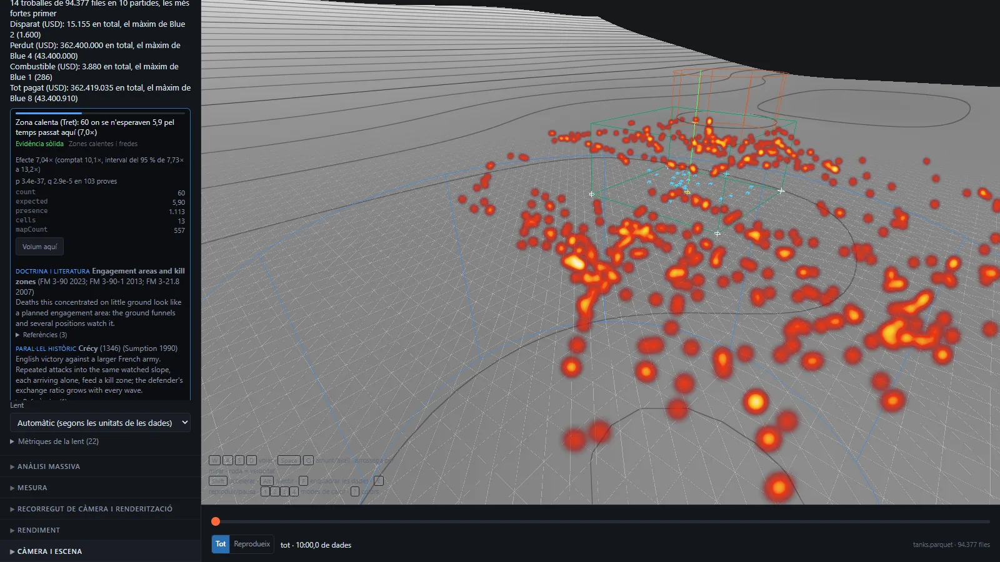

# La lent del coneixement

Quan [Troballes](insights.md) en troba alguna cosa, aquesta part l'explica amb idees de la història militar, del disseny de jocs i de l'anàlisi esportiva, i anomena el llibre o l'article d'on surt. Useu-la per aprendre *per què* importa un patró, no només que existeixi.

## Proveu-ho {#try-it}

1. Carregueu dades i obriu **Troballes**, després premeu **Cercar troballes**.
2. Feu clic en una troballa per obrir-la.
3. Llegiu **Doctrina i literatura** i **Paral·lel històric**; les referències completes són plegades a sota.
4. Canvieu la **Lent** (per exemple a *Doctrina militar*) per llegir la mateixa troballa a través d'un altre cos de literatura.

## Com funciona {#how-it-works}

El panell de Troballes jutja les seves troballes com ho faria un analista professional: a través de la doctrina militar i la recerca operativa, dels combats històrics, i de la literatura sobre disseny de jocs, disseny de nivells i analítica. Ho fa fora de línia, a partir d'una base de coneixement seleccionada dins del visor, i dona el mateix material a un model extern quan n'hi ha un que escriu el resum.

## Què mostra el panell {#what-the-panel-shows}

- **Lent** tria el cos de literatura amb què es llegeixen les troballes: *Auto* (triada segons els tipus d'unitats de les dades: avions, vaixells, vehicles terrestres, infanteria), *Doctrina militar*, *Combat aeri*, *Naval*, *Urbà*, *Disseny de jocs i equilibri*, *Esports*. Les entrades fora de la lent triada queden fora.
- Cada troballa oberta mostra la seva entrada més propera de **doctrina i literatura** i el seu **paral·lel històric** més proper, amb les referències completes plegades a sota.
- **Mètriques de la lent** enumera les mesures de l'anàlisi operativa calculades sobre les mateixes files (més avall), cadascuna amb el que significa i la seva literatura.
- El **Resum** afegeix línies per a les troballes principals i per a les mètriques de la lent: "Doctrina i literatura: ..." i "Paral·lel històric: ...", cadascuna amb les cites autor-any i les referències plegades sota seu.
- **Escriu amb IA** envia les entrades més pertinents (resum, lliçó, les troballes que s'hi relacionen, referències completes) amb l'informe, i demana al model que les citi pel seu id -`{concept.lanchester-square}`- i que no usi cap altra font.

Les etiquetes estan traduïdes; el coneixement en si és en anglès.

## Mètriques de la lent {#lens-metrics}

Calculades al treballador de troballes, en la mateixa passada sobre les files que els detectors (`src/insights/lensMetrics.ts`). Cada una queda fora quan les dades no la poden portar.

| Mètrica | Què mesura | Necessita |
|---|---|---|
| Ajust de Lanchester | Les pèrdues de cada bàndol per cada 20 s, regressades sobre les forces vives dels dos bàndols (Poisson, errors de quasi-versemblança); els exponents sobre la força enemiga i la pròpia, comprovats contra la llei quadrada (foc dirigit) i la llei lineal (foc d'àrea) | temps, equips, morts i baixes |
| Raó d'intercanvi | Baixes per mort per bàndol i per lloc; la part de morts al lloc més mortal del terreny que ocupa el 5 % del temps, comparada amb la part que dona només l'atzar amb aquell nombre de morts; Gini de les morts respecte al temps; I de Moran de les taxes de mort | baixes i morts |
| Raó de força local | Unitats pròpies i enemigues vives dins del rang de combat de cada baixa (rang fixat per les dades: el doble de la distància mediana a l'enemic més proper); la part de baixes del bàndol localment superior, i el seu excés sobre el que prediuen només els nombres | temps, equips, persones |
| Camps de tir | Els horitzons visibles dels llocs de baixes més concorreguts en una superfície d'obstrucció 2,5D (la geometria del nivell fins a l'alçada de les parets, o el terreny recorregut) comparats amb el lloc mitjà, i la correlació de rang entre la visió i la part de baixes | posicions; un nivell carregat la fa més precisa; no per a l'aire |
| Estat d'energia | Energia específica (l'altura més l'altura que la velocitat podria comprar) dels assassins i víctimes aeris, comparada amb l'estadístic de Mann-Whitney | classes d'avions, temps, altitud |
| Terreny clau | Amb quina freqüència cada lloc és entre els tres llocs de més baixes d'una partida | diverses partides |
| Suport mutu (intercanvis) | Morts contestades per una baixa d'un company dins del rang de combat i de 5 s | temps, equips |
| Primer cop | Enfrontaments -baixes agrupades per partida, per 20 s de calma i per tres rangs de combat de distància- guanyats pel bàndol que va marcar primer | temps, equips |
| Model de salvà | L'equació de salvà d'Hughes ajustada a períodes de 20 s de vaixells en contacte: vaixells posats fora de combat per cada vaixell atacant, i salvats per cada vaixell defensor; un ajust de Lanchester només sobre vaixells | classes de vaixell, temps, equips |
| Efectivitat de combat | Baixes per unitat-hora en acció de cada bàndol i la raó entre els dos més grans (un valor d'efectivitat de combat en el sentit de Dupuy) amb el seu interval del 95 %, i la part de baixes de cada bàndol amb nombres locals iguals | temps, equips |
| Rangs de combat | Distància a l'enemic més proper en les baixes, en els llançaments i en el primer tret de cada vida (detecció fins a combat), per tipus d'unitat | temps, equips; llançaments quan les dades els tenen |
| Cadena de baixa | Segons des de l'últim llançament de l'assassí fins a la baixa, i des del seu primer tret del combat fins a la baixa | temps; llançaments o esdeveniments de tret |
| Concentració o dispersió | En cada període de 20 s, l'extensió dels dos bàndols més grans i la part de baixes que pren el més compacte | temps, equips |
| Sortides | Per bàndol: sortides (enlairaments, o aparicions d'avions), aterratges, avions perduts i baixes per avió; taxa de pèrdua i baixes per sortida | classes d'avions; enlairaments o aparicions |

Les dades amb rondes afegeixen les mesures de combat proper i d'esports -probabilitat de guanyar la ronda, valor de les accions, duels d'obertura, intercanvis, qui avança contra qui aguanta, punteria, foc creuat, utilitats, avantatge d'home, remuntades, preparacions, després de la col·locació, embuts mortals i impacte del jugador: vegeu [Combat proper i rondes](close-quarters.md).

Els equips i les pistes afegeixen les mesures de comportament col·lectiu de la ciència de multituds, del moviment col·lectiu, de l'economia del comportament i de la psicologia militar -alineació i girs, conducció de rutes, carrils i rastres, aglomeració, líders i seguidors, rezagats, el punt de ruptura, risc després de pèrdues, ratxes, acord de compra i supressió, cadascuna contra el seu propi model nul: vegeu [Comportament col·lectiu](collective-behaviour.md).

Les armes, els enganys i els edificis no es compten com a unitats. Quan les files d'armes diuen la unitat que les llança (una columna `Shooter` o `Launcher`, com tenen les dades derivades de Tacview), el llançament s'atribueix a aquella unitat, identificada pel seu nom o pel seu id d'objecte.

## Com les troballes es troben amb la literatura {#how-findings-meet-the-literature}

Les entrades i les troballes es troben a través d'una **taxonomia de patrons** (`src/insights/knowledge/patterns.ts`): concentració, superioritat local, foc dirigit i d'àrea, colls d'ampolla, zones de mort, camps de tir, pendent invers, flanqueig, suport mutu, avantatge energètic, pressió d'aparició, equilibri, i així successivament. Cada tipus de detector i cada mètrica de la lent diu quins patrons mostren els seus números (`src/insights/lens.ts`); cada entrada de coneixement diu a quins patrons es refereix, amb un pes. La rellevància d'una entrada per a una troballa és la superposició ponderada, escalada per com encaixa el domini de l'entrada (terra, aire, mar, urbà) amb les dades i per la força pròpia de la troballa. La raó que es mostra és els números de la troballa en una frase, seguits de la lliçó de l'entrada.

## Catàleg {#catalogue}

Cada patró, concepte, mètode, cas històric, principi de disseny i estudi, amb la bibliografia: vegeu el [Catàleg de coneixement](knowledge-catalogue.md).

## Per als desenvolupadors {#for-developers}

### Afegir entrades {#adding-entries}

1. Trieu el fitxer segons el tipus: `concepts.ts` i `concepts-more.ts`, `methods.ts`, `cases.ts`, `cases-land.ts`, `cases-air-sea.ts`, `cases-esports.ts`, `design.ts` (principis de disseny) o `studies.ts` a `src/insights/knowledge/`.
2. Doneu-li un id nou `<tipus>.<slug>` (mai no reutilitzeu cap), les seves lents, dominis, i els patrons als quals es refereix amb pesos 0..1. Afegiu un patró a `patterns.ts` només quan una troballa el pugui mostrar, i mapegeu-lo des d'una troballa o mètrica a `lens.ts`.
3. Escriviu el resum i la lliçó **amb les vostres pròpies paraules**. Cites només de treballs de domini públic (`pd: true` a la referència), i curtes.
4. Citeu: afegiu qualsevol obra nova a `refs.ts` amb autors, any, títol i editorial (revista amb volum i pàgines); una URL o DOI quan hi ha un registre públic.
5. Executeu `npx vitest run src/insights/lens.test.ts` (ids únics, patrons coneguts, referències que resolen, cites de domini públic, casos amb data i resultat) i `node tools/knowledge-doc.mjs` per actualitzar el [catàleg](knowledge-catalogue.md).
