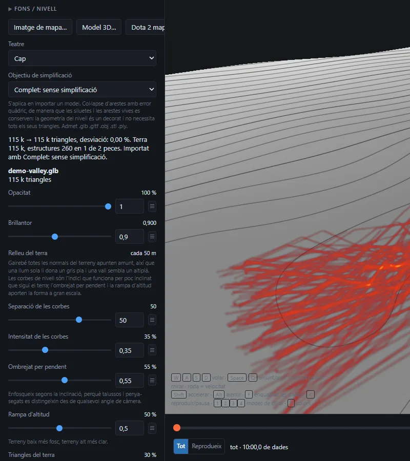

# Nivells i geometria de fons

Un nivell és el lloc 3D on va passar el joc -un mapa, un poble, un circuit. Posa'n un darrere de les teves dades i podràs veure *on* és la calor. El panell **Fons / nivell** (vegeu [Glossari](glossary.md) per a «nivell») ofereix tres tipus de context:

- una **imatge de mapa**, georeferenciada amb dos ancoratges -vegeu [Imatges de mapa](map-images.md);
- un **nivell 3D** -`.glb`, `.gltf`, `.obj`, `.stl` o `.ply`- dividit en terra, estructures i aigua i simplificat en importar-lo -vegeu [Nivells 3D](model-levels.md) i [Aspecte del nivell](level-appearance.md);
- un **fons del món** -per a una gravació que diu on és a la Terra (un fitxer ACMI de Tacview), el terreny real, carreteres, aigua, aeròdroms i edificis, descarregats de dades obertes- vegeu [Fons del món](world-backdrop.md).

Sense res carregat, l'escena és fosca amb una quadrícula i eixos de colors (**Quadrícula** i **Eixos** a [Càmera i escena](camera.md)), i el panell diu *Res carregat: l'escena mostra una quadrícula i eixos. Afegeix una imatge de mapa o una malla de nivell per donar context a la calor.*

El nivell és compartit per les tres pestanyes: un circuit carregat a la pestanya Anàlisi de curses és el mateix nivell que mostra el mapa de calor.

## Posa un nivell darrere de les teves dades {#put-a-level-behind-your-data}

1. Carrega primer les teves dades ([Carregar dades](getting-data-in.md)), perquè el nivell s'ajusti a elles.
2. Obre **Fons / nivell** a la barra lateral.
3. Prem **Imatge de mapa…** per a una imatge o **Model 3D…** per a un nivell 3D, i tria el fitxer. Per a una gravació del món real, usa **Fons del món real** o **Teatre** en lloc d'això.
4. Espera que acabi la línia de progrés. Un model gran se simplifica primer (vegeu **Objectiu de simplificació** més avall).
5. Prem **F** a la vista per enquadrar-ho tot. Usa **Opacitat** i **Brillantor** fins que la calor destaqui del nivell.
6. Prem **Desa a la biblioteca** si vols tornar a usar el nivell ([Biblioteca de nivells](level-library.md)).

## Què fa un nivell per a la calor {#what-a-level-does-for-the-heat}

- **Oculta**: els punts de dades darrere seu s'enfosqueixen segons la superfície, i els punts darrere del terreny s'amaguen ([Profunditat i retallada](depth-and-culling.md)). Sense nivell, no hi ha oclusió.
- La **talla** la [Llesca](slice.md) i, amb *Talla també el nivell*, la [retallada per distància](depth-and-culling.md#distance-culling), juntament amb la calor.
- És l'única cosa que desenfoca la [profunditat de camp](camera.md#depth-of-field), a part de la quadrícula i les caixes.
- Un nivell 3D **amplia el pla llunyà de la càmera** quan és més gran que les dades: el proper i el llunyà es calibren a partir del conjunt de dades, i un mapa exportat de diversos quilòmetres quedaria del tot darrere del pla llunyà i deixaria una vista buida. El pla llunyà passa a ser 3 × l'extensió horitzontal del nivell quan això és més gran, el pla proper es mou amb ell (com a mínim llunyà / 100.000) per mantenir la precisió de profunditat de la qual depèn l'oclusió, i la velocitat de vol es puja a almenys extensió / 12. Només s'amplia mai, mai no es redueix.

## El panell, de dalt a baix {#the-panel-top-to-bottom}

| Part | Detalls |
|---|---|
| **Imatge de mapa…**, **Model 3D…** | Carrega'n un; substitueix el nivell actual. |
| **Fons del món real**, **Oblida les tessel·les** | Només per a un conjunt de dades amb referència geogràfica: construeix com a nivell el lloc real que hi ha sota, o esborra les tessel·les descarregades. [Fons del món](world-backdrop.md) |
| **Objectiu de simplificació** | El pressupost de triangles per a la següent importació de model: *Complet - sense simplificar* (per defecte), *Alt - 8M*, *Mitjà - 3M*, *Baix - 800k*, *Silueta - 100k*. [Nivells 3D](model-levels.md#simplification) |
| Progrés i **Cancel·la** | Mentre es descodifica o s'importa. |
| Nota d'importació | Triangles abans i després, la divisió terra / estructures / aigua, el nivell de detall usat. |
| Nom i mida | `amplada×alçada px · x × z m/px` per a una imatge, `N triangles (de M)` per a un model. |
| **Opacitat**, **Brillantor** | Per als dos tipus. |
| Controls de la imatge | **Dessatura**, **Inverteix nord/sud**, **Col·locació** (dos ancoratges), **Ajusta als límits de les dades**, **Elevació**. [Imatges de mapa](map-images.md) |
| Controls del model | Relleu del terra, aigua, triangles del terra, filferro, textura, color capturat, estructures, classificació de parts. [Aspecte del nivell](level-appearance.md) |
| **Desa a la biblioteca**, **Elimina** | [Biblioteca de nivells](level-library.md); Elimina descarrega el nivell. |
| **Biblioteca** | Nivells guardats en aquest navegador. [Biblioteca de nivells](level-library.md) |

## Pàgines d'aquesta secció {#pages-in-this-section}

- [Imatges de mapa](map-images.md)
- [Nivells 3D](model-levels.md) - formats, parts, classificació, simplificació, textures
- [Aspecte del nivell](level-appearance.md) - cada control per a un nivell 3D
- [Biblioteca de nivells](level-library.md)
- [Fons del món](world-backdrop.md) - el món real sota una gravació, a partir de dades obertes

Com s'obtenen nivells dels jocs i dels motors és feina de les eines exportadores separades (vegeu el [README](https://github.com/Holdi601/3DHeat/blob/main/README.md) del repositori); el contracte al qual escriuen es resumeix a [Nivells 3D](model-levels.md#the-exporter-contract).
