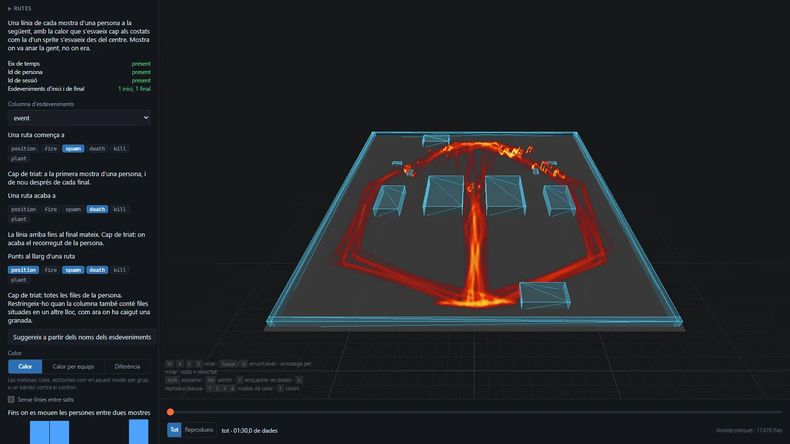

# Calor de línia

El calor mostra on eren les persones. Les línies mostren els camins que van recórrer.

**Línies** (tecla 4) és el calor de línia: una línia des de cada mostra d'una [persona](glossary.md) fins a la següent, esclafada amb la mateixa caiguda que té una [figura](glossary.md) -a través de la línia en lloc de al voltant d'un punt. Mostra on les persones *van anar* i no on eren: un corredor que passa una vegada és tan visible com una sala on s'ha acampat, i les mostres disperses d'un jugador ràpid s'uneixen en una ruta contínua en lloc d'un rastre de punts. Necessita una columna de persona i una columna de temps.

## Com s'usa {#how-to-use-it}

1. Premeu `4` (o trieu **Línies** a la barra de mode).
2. Obriu **Rutes** i reviseu la llista de verificació verda: l'eix de temps i l'id de persona han d'estar presents.
3. Premeu **Suggereix a partir dels noms dels esdeveniments** per omplir on comencen i acaben les rutes.
4. Llegiu la línia d'estadístiques: "N rutes, M d'elles arriben a un final".
5. Si les línies salten pel mapa, ajusteu el **Pas més llarg** (vegeu [El límit de salt](#the-jump-limit)).

Una línia només té sentit entre un començament i un final, així que el panell **Rutes**
diu què limita una ruta. Tot el que hi ha a partir de [Les regles d'una ruta](#the-rules-of-a-route)
és detall que podeu saltar.

## El panell Rutes {#the-routes-panel}

Es mostra sobre els panells de calor en el mode Línies.

### Què té la dada {#what-the-data-has}

Una llista de verificació, verda quan hi és, ambre quan no:

| Línia | Estats |
|---|---|
| **Eix de temps** | *present* / *falta - cal* |
| **Id de persona** | *present* / *falta - cal* |
| **Id de sessió** | *present* / *cap - totes les files són una sola sessió* |
| **Esdeveniments d'inici i de final** | *N inicis, M finals* / *cap triat - pistes senceres* (verd només amb una columna d'esdeveniments i almenys un inici i un final) |

### Controls {#controls}

| Control | Significat |
|---|---|
| **Columna d'esdeveniments** | Una columna de categoria els valors de la qual són esdeveniments (aparició, mort, posició, ...). *Cap - pistes senceres*: la pista de cada persona en cada sessió és una ruta, trencada on la pista té un buit. Només s'ofereixen les columnes guardades per filtrar en carregar. |
| **Una ruta comença a** | Valors d'esdeveniment que comencen una ruta (aparició, reaparició, desplegament). Cap triat: una ruta comença a la primera mostra d'una persona, i de nou després de cada final. |
| **Una ruta acaba a** | Valors d'esdeveniment que acaben una ruta (mort, extracció, teletransport). La línia arriba fins a la mateixa fila final. Cap triat: una ruta acaba on acaba la pista de la persona. |
| **Punts al llarg d'una ruta** | Valors d'esdeveniment les files dels quals estan al llarg de la ruta. Cap triat: cada fila de la persona. Reduïu-ho quan la columna també té files col·locades en un altre lloc, com on va caure una granada. |
| **Suggereix a partir dels noms dels esdeveniments** | Omple les tres llistes amb els noms dels valors (més avall). |
| **Color** | *Calor*, *Calor per equips* o *Diferència*. Les mateixes rutes en la coloració d'aquell mode: cada grup en el seu propi to, o un bàndol contra l'altre, amb la llista de grups, la divisió i les rampes funcionant com en aquells modes. Per defecte *Calor*. El calor per equips i la diferència necessiten una columna de grup. |
| **Sense línies entre salts** / **Pas més llarg** | Una mostra de la persona més lluny que això és una reaparició, un teletransport o una caiguda més que un lloc on hagi anat, així que cap línia uneix els dos. Es fixa en carregar quan la dada mostra un buit clar (més avall), i desactivat quan no. Funciona amb o sense columna d'esdeveniments. |
| Línia d'estadístiques | `N rutes, M d'elles arriben a un final, K segments`, actualitzada unes quantes vegades per segon. |

Cada llista és una fila de pastilles de commutació, una per valor, de més freqüent a menys. En passar el ratolí per sobre d'una pastilla es mostra el seu nombre de files. Com a màxim s'ofereixen 120 valors (*N valors més no mostrats*).

En triar una altra columna d'esdeveniments s'aplica el suggeriment quan aquest suggeriment tria la mateixa columna, i en cas contrari comença amb llistes buides.

### El suggeriment {#the-suggestion}

En cada càrrega, i en **Suggereix a partir dels noms dels esdeveniments** ([`suggestLineSettings`](https://github.com/Holdi601/3DHeat/blob/main/src/data/lines.ts)):

- **Columna d'esdeveniments:** la primera columna de categoria guardada anomenada `event`, `eventname` o `eventtype`; si no, `kind`, `type` o `action`; si no, qualsevol que contingui *event*, *kind*, *action* o *type*.
- **Inicis:** valors que contenen *spawn, deploy, join, enter, start, begin, respawn, revive, land/landed/landing, drop* -tret que també coincideixin amb una paraula de final.
- **Finals:** valors que contenen *death, died, dead, kill/killed, eliminat…, extract, evac, teleport, leave, left, disconnect, quit, exit, end, finish, downed* -excepte els valors `kill` i `kills` (un assassinat és una cosa que fa l'assassí, no el final de la seva ruta).
- **Punts:** valors que són exactament *position, location, player location, move, movement, tick, sample* o *pos*; quan se'n troba algun, els inicis i els finals també s'afegeixen als punts. Quan no se'n troba cap, els punts queden buits (cada fila).

### El límit de salt {#the-jump-limit}

Quan les persones salten, les longituds dels passos cauen en dos grups amb gairebé res entre ells: el que cobreix una persona entre dues mostres, i l'amplada del mapa. En carregar ([`suggestMaxJump`](https://github.com/Holdi601/3DHeat/blob/main/src/data/lines.ts)) els passos es compten per cada duplicació del seu quadrat de longitud, fins a 16 milions, i el límit va al mig del primer rang per sobre de la mediana que és com a mínim una duplicació de longitud d'ample, que conté menys del 0,02 % dels passos per cada interval, i que té passos més enllà. Sense cap rang així no es talla res, perquè no es podria distingir un salt d'un cotxe ràpid; activar el límit a mà aleshores comença a una desena part de la diagonal de la dada.

El gràfic sobre el límit mostra quant de llargs són realment els passos, amb una línia al límit: les barres a la dreta no es dibuixen. Els dos eixos són logarítmics, perquè els salts poden ser una centèsima part dels passos i mil vegades més llargs. Passeu el ratolí per sobre d'una barra per veure el seu rang i la seva part; feu clic al gràfic per posar-hi el límit. Sota, la part de passos per sobre del límit.

## Les regles d'una ruta {#the-rules-of-a-route}

Les files es recorren en ordre de temps, per persona ([`buildLines`](https://github.com/Holdi601/3DHeat/blob/main/src/data/lines.ts)):

1. Les files d'un [nom compartit](sessions-persons-groups.md#names-worn-by-several-things-at-once) s'ometen del tot.
2. Amb punts triats, una fila que no és ni un inici, ni un final, ni un punt, s'omet.
3. Les files se segueixen per persona i per sessió, de manera que una persona les sessions de la qual s'entrellacen en ordre de temps té una ruta a cada una. Una ruta es tanca quan la fila anterior no tenia successora (el seu [temps de vida](sessions-persons-groups.md#person) és "cap") -una ruta mai no creua un límit de sessió ni un buit que la càrrega ha decidit que no té cap mostra següent. La ruta on és una fila es calcula una vegada i es guarda, 4 bytes per fila, de manera que canviar el pas més llarg no repeteix aquella part.
4. Una fila d'**inici** tanca qualsevol ruta oberta i n'obre una de nova allà.
5. Amb inicis triats, una fila fora d'una ruta s'ignora. Sense inicis, qualsevol fila que no sigui final fora d'una ruta n'obre una.
6. Qualsevol altra fila dins d'una ruta afegeix un **segment** des de la fila anterior de la ruta fins a aquesta.
7. Una fila de **final** que estén una ruta la tanca després del seu segment; aquella ruta compta com a *arribar a un final*.
8. Un pas més llarg que el **Pas més llarg** tanca la ruta on era, i una ruta nova comença a l'extrem llunyà, tret que aquella fila sigui un final. No es dibuixa cap línia a través seu, i la línia d'estadístiques el compta.

Cada segment s'emmagatzema a la seva fila *final*, de manera que els segments es mantenen en ordre de temps, i la finestra de la [línia de temps](timeline.md), el mostrejador, els [filtres](filters.md), la visibilitat dels grups i el signe de la diferència hi funcionen com amb els punts. Per tant, un filtre s'aplica a la fila on acaba un segment.

## Reproducció {#playback}

En el mode **Tot** cada ruta es dibuixa sencera. En el mode **Reprodueix** cada persona és un punt que es mou entre les seves mostres, dibuixant la seva ruta darrere d'ella:

- un segment que comença després del capçal de reproducció no es dibuixa;
- el segment on la persona és a mig camí es dibuixa fins a la seva posició interpolada, amb un casquet final al cap;
- el calor s'esvaeix sobre la **cua**: amb l'historial *Acumulat* la cua és il·limitada i tota la ruta fins ara es manté; amb *Finestra* s'esvaeix del tot en la *Durada* (per defecte 30 s). Amb *Temps de vida* la cua també és la *Durada*, i en el mode Línies la línia de temps mostra la casella de *Durada* també per a aquest historial (en lloc de *Vida de reserva* i *Esvaïment*, que el calor de línia no usa).

Mentre es reprodueix, cada fotograma es dibuixa sencer en lloc d'acumular-se, perquè els caps es mouen a cada fotograma i una mitjana mòbil els esborraria en un ratllat.

## Per als desenvolupadors {#for-developers}

### Memòria {#memory}

Les rutes es construeixen al fil principal quan s'entra al mode Línies (o canvien els ajustos de ruta) i s'alliberen quan se n'surt: 5 bytes per fila a la memòria i 8 bytes per fila a la GPU (la posició inicial de cada segment, quantificada a 16 bits per eix dins de la capsa delimitadora de la dada, i els seus indicadors).

### Com es dibuixa una línia {#how-a-line-is-drawn}

Els dos backends dibuixen cada segment des de la seva fila final com a **18 vèrtexs** ([`lineHeatVs`](https://github.com/Holdi601/3DHeat/blob/main/src/render/webgl2/shaders.ts) i el seu bessó WGSL):

- La semiamplada a cada extrem és el [radi de la figura](sprite-shape.md#sprite-radius) a la distància d'aquell extrem, amb les limitacions de píxels aplicades. Una línia més estreta de 2,5 px es dibuixa de 2,5 px d'amplada amb el seu calor reduït en conseqüència, de manera que les línies fines ni desapareixen ni s'aclareixen.
- El calor cau **a través** de la línia amb la mateixa rampa que una figura -caiguda o corba, intensitat del centre i de la vora.
- Els casquets arrodonits només es dibuixen on comença o acaba una ruta, de manera que les unions entre segments consecutius no es converteixen en una cadena de perles.
- La geometria es construeix en l'espai de la pantalla i s'interpola linealment allà, de manera que la caiguda es manté centrada a la línia per on passi en profunditat. Un segment que creua el pla proper es talla allà en lloc de descartar-se.

El calor de punts i el de línia dipositen quantitats de calor molt diferents per fila, així que la saturació es torna a mesurar cada vegada que canvieu entre tots dos ([Color i exposició](colour-and-exposure.md#auto-exposure)).
