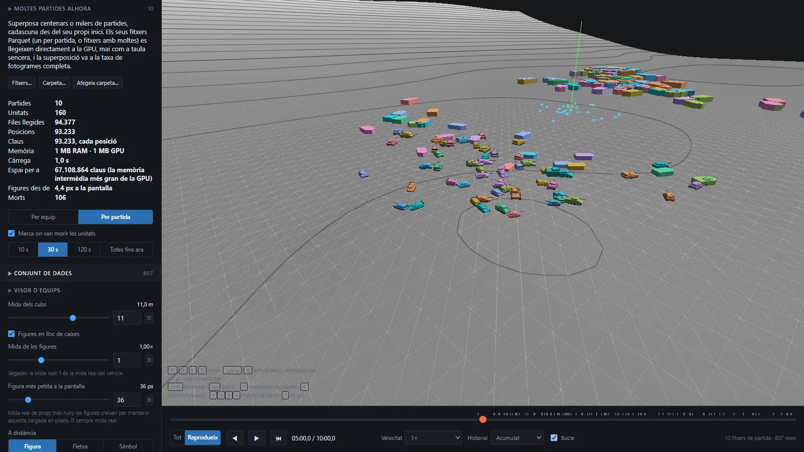

# Moltes partides alhora

**Moltes partides alhora** fa anar moltes partides una sobre l'altra, així que veus per on solen anar els jugadors de cada partida. Serveix per comparar centenars o milers de partides en una sola imatge.

Cada partida comença al seu propi inici i les seves unitats es mouen com a figures. Els fitxers van directament a la targeta gràfica i no es construeix cap taula completa, així que funciona fluïdament allà on una càrrega normal es quedaria sense memòria.

## Com s'usa {#how-to-use-it}

1. Obre **Moltes partides alhora** a la barra lateral de la pestanya Mapa de calor.
2. Prem **Fitxers…** (tria molts fitxers), **Carpeta…** (una carpeta i les seves subcarpetes) o **Afegeix carpeta…** (afegeix-les al que ja està carregat).
3. El visor passa a les figures superposades i comença a l'inici. Prem **Reprodueix**.

Cada fitxer és una partida (o en conté diverses). Funcionen els fitxers Parquet i els contenidors [`.3dheat`](container.md). Un fitxer necessita una columna de posició, de temps i d'unitat; les columnes de nom, de tipus i de bàndol es conserven. Els altres fitxers, i els fitxers auxiliars dels convertidors (vol, missatges, esdeveniments, xat, objectius), es salten. Per a una taula normal, vegeu [Carregar dades](getting-data-in.md).

## Configuració {#settings}

| Configuració | Què fa |
|---|---|
| **Per equip** / **Per partida** | Acolorir per bàndol, o un color per partida. |
| **Marca on van morir les unitats** | Una marca on ha mort cada unitat, durant 10 s, 30 s, 120 s, o totes les que hi ha hagut fins ara. |

El panell mostra quantes partides, unitats, files i posicions s'han llegit, la memòria usada i el temps de càrrega. *Espai per a* és quantes posicions més podria encara admetre la targeta gràfica. *Figures des de* és la mida a la pantalla per sota de la qual una unitat es dibuixa com una petita fletxa en lloc de la seva figura.

L'aspecte de les figures usa els mateixos controls que la [repetició de partida](match-replay.md#figures): **Mida de les figures**, **Figura més petita a la pantalla** i **A distància**.

## Consells {#tips}

- Quan tot no cabria a la memòria, les posicions s'aclareixen (només es guarda una posició cada uns quants metres) i el panell ho diu.
- Els modes de calor també funcionen amb les dades de la superposició.
- Per a estadístiques sobre milers de partides sense dibuixar-les, vegeu [Anàlisi massiva](mass-analysis.md).
