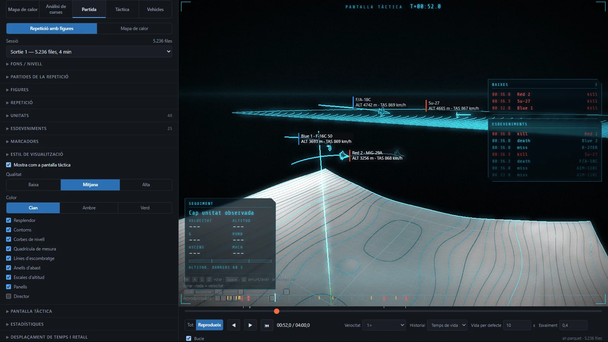

# Repetició de partida

La repetició és una pel·lícula de la partida amb cada jugador dibuixat com el que conduïa. Fes-la servir per tornar a veure un combat, seguir una unitat i veure qui va colpejar a qui.

Els trets, els impactes, els disparos i les destruccions es dibuixen sobre les unitats i els objectius del nivell. Les càmeres, les etiquetes i una pantalla tàctica t'ajuden a llegir el combat. Coneixes Tacview? [Paritat amb Tacview](tacview-parity.md) mostra on és cada una de les seves eines.

## Iniciar una repetició {#start-a-replay}

1. Carrega una gravació amb **Font → Fitxers…** o deixant-la caure sobre el panell Font (qualsevol taula amb una columna de **persona** i una de **temps**, un fitxer de Tacview, una repetició convertida, una partida [`.3dheat`](container.md)). Mira [Com entren les dades](getting-data-in.md).
2. Obre la pestanya **Partida** i tria **Repetició amb figures**, o tria **Figures superposades** a la barra de modes de la pestanya Mapa de calor.
3. A **Partides de la repetició** tria una partida, totes alhora, o diverses.
4. Prem **Reprodueix** a la línia de temps (o `K`). Arrossega la línia de temps per saltar.

Les figures substitueixen les caixes per a cada unitat el nom o el tipus de la qual és conegut (mira [Figures](figures.md)). Les dades sense columna de nom o de tipus es dibuixen com a soldats.

## Figures {#figures}

| Ajust (secció **Figures**) | Per defecte | Què fa |
|---|---|---|
| **Figures en lloc de caixes** | activat | Desactivat dibuixa caixes simples. |
| **Mida de les figures** (vegades la mida real) | 1 | 1 és la mida real; de 0,25 a 20 vegades (escala logarítmica). Més gran ajuda des de lluny. |
| **Figura més petita a la pantalla** | 36 px | Les figures llunyanes creixen per mantenir-se aquesta llargada, de 0 a 200 px; 0 manté la mida real. |
| **A distància**: Figura, Fletxa, Símbol | Figura | En què es converteix una unitat llunyana. |
| **Símbols** | NATO (APP-6) | NATO (APP-6), senyals tàctiques russes, icones de **Mapa de joc**, o **Només formes (apte per a daltònics)**. |
| **Mida del símbol**, **El meu bàndol**, **Hostil / Neutral**, **Marques de rumb** | 28 px (12 a 64), automàtic, hostil, activat | Com es veuen els símbols i quin bàndol és amic. |
| **Línies verticals** | activat | Una línia de cada unitat cap avall fins a terra, perquè les alçades es llegeixin en 3D. |
| **Línies a terra i etiquetes a les armes** | apagat | Línies fins a terra i etiquetes en míssils i bombes. |
| **Incendis a les unitats** | activat | Flames des del moment en què una unitat s'encén fins que s'apaga. |
| **Impactes a les unitats** | activat | Marques on van colpejar els trets (més avall). **Els impactes queden**: de 1 a 300 segons, o **Tota la vida**. **Marcadors flotants**: marques dibuixades per sobre de la superfície. |
| **Línies de mira i de torreta** | apagat | Discontínues: on mira el jugador; contínues: on apunta el canó. |
| **Edificis** | sòlids | Edificis sòlids o transparents, quan el nivell els pinta. |

### Símbols a distància {#symbols-at-a-distance}

Quan una unitat seria més petita que la **Figura més petita a la pantalla**, pot convertir-se en un símbol que es mantingui llegible. La forma diu el tipus (per exemple una caixa arrodonida amb una marca d'erugues per a un blindat); el color diu el bàndol. Obre el menú **Símbols** per canviar l'estil.

### Marques d'impacte, restes i incendis {#hit-marks-wrecks-and-fires}

- Les **marques d'impacte** es col·loquen sobre la superfície on va arribar el tret, a l'escala de la figura. El seu aspecte diu què va passar: un forat (va travessar), una esquitxada brillant (no va travessar), una ratlla (va rebotar), una estrella de sutge (projectil explosiu). Un anell de color diu què va fer: tret mortal, mòdul destruït, crític, greu, dany, sense dany, impacte. Passa el punter per sobre d'una marca per veure el nom del projectil.
- Una unitat destruïda es dibuixa **carbonitzada** com una runa des de la seva mort fins que reapareix o s'elimina; el seu símbol queda ratllat.
- Els **incendis** cremen en una unitat des del moment en què s'encén fins que s'apaga.
- Les **torretes** giren cap a on diuen les dades que apunta el canó (o, sense això, cap on mira el jugador).

### Armes, enganys i traçadors {#weapons-decoys-and-tracers}

Amb **Armes, trets i impactes** activat (secció Visor d'equips): els míssils, coets, bombes i torpedes volen com a figures pròpies amb una estela de fum; les bales i els projectils són traçadors; els impactes i les explosions fan un flaix. Un traçador dibuixat **en discontinu** s'ha deduït d'un impacte, perquè les dades no tenien el tret. Les bengales i el *chaff* es dibuixen com a enganys; s'amaguen de la llista d'unitats tret que *Enganys i projectils* estigui marcat.

## Càmeres {#cameras}

Fes clic en una unitat o la seva etiqueta per **seguir-la**; la secció **Repetició** ofereix **Persecució**, **Òrbita**, **Cabina** (amb una pantalla de cap alt, `H`), **Fixa**, **Fixació**, **Objectiu** i **Satèl·lit**. `V` les va recorrent, **Distància de la càmera** fixa com de lluny està. Esc atura.

- **Vista de dues unitats**: tria un **Objectiu** (o Ctrl/Alt-clic en una unitat) per mirar-lo des de la seguida; **Intercanvia** les posa a l'inrevés.
- **Mesura**: Shift-clic a dues unitats per al rumb, la distància i la diferència d'altura entre elles.
- **Mapa 2D** (`M`): racó o vista completa, amb rastres i noms.
- **Marcadors** (`B`): desa el moment i la càmera; també es llisten les baixes, morts i marques pròpies de la gravació.
- **Esdeveniments**: cada esdeveniment en ordre de temps; un clic hi salta. `Re Pàg` / `Av Pàg` salten entre esdeveniments; **Pausa a l'esdeveniment** s'atura a cadascun.

## Pantalla tàctica {#tactical-display}

La secció **Pantalla tàctica** dibuixa, per a cap unitat, les seleccionades, totes, o un tipus (aeronaus, terra, vaixells, armes): vectors de velocitat i la trajectòria que ve, línies de morro i de sustentació, cons de radar, bloqueigs, enllaços de dades, zones i línies d'enfrontament, línies de visió, on miren els jugadors (cons de visió), la mira de la torreta i la càmera enregistrada.

### Estil de pantalla {#display-style}

`T` (o l'interruptor **Mostra com a pantalla tàctica**) canvia l'aspecte a un estil de pantalla de radar: brillantor, contorns, línies de nivell, una graella de mesura, línies d'escaneig, anells de distància, escales d'altitud, panells amb morts i esdeveniments, i un **Director** que mou la càmera cap als esdeveniments per si mateix.

## Objectius {#objectives}

Quan una partida arriba amb els seus objectius, la secció **Objectius** els dibuixa sobre el nivell: zones de captura (amb propietari i progrés de captura), punts d'aparició, aeròdroms, àrees i objectius de bombardeig, cada capa es pot activar o desactivar, amb etiquetes. Es veuen a través del terra. Amb diversos modes de joc carregats, **Mode** filtra les partides per mode. Els objectius vénen del fitxer de partida d'un convertidor, al costat de la gravació o dins d'un contenidor [`.3dheat`](container.md).

## Etiquetes i estadístiques {#labels-and-statistics}

- **Etiquetes**: regles per tipus (**Seleccionades**, **Aeronaus**, **Terra**, **Vaixells**, **Armes**, **IA**): es mostren o no, quins valors, i una **Prioritat** per decidir qui té l'espai quan les etiquetes se superposen. **Separa les etiquetes** mou una etiqueta al costat de la seva unitat quan cobriria una altra, i la deixa fora quan no hi ha lloc. La **Mida de les etiquetes** va del 60 al 250 %. **Torna a nom, vehicle, altitud i velocitat** restableix les regles.
  - Les unitats terrestres comencen amb nom, vehicle i velocitat.
  - Les aeronaus comencen amb nom, vehicle, altitud i velocitat.
  - Els vaixells comencen amb nom, vehicle, velocitat i rumb.
  - Passa el punter sobre una unitat per veure tots els valors que té.
- **Estadístiques**: per equip i unitat: morts, baixes, trets, impactes, raó d'impactes, enlairaments, aterratges, temps en vol, velocitat màxima, altura i G, distància. Exportació a CSV.
- **Gràfics**: els valors d'una unitat al llarg del temps, dues unitats comparades, o un valor contra un altre.

## Moltes partides alhora {#many-matches-at-once}

Per superposar centenars o milers de partides, mira [Moltes partides alhora](many-matches.md). Detalls de les figures (fum, foc, altres efectes amb temps): [Figures a la superposició de figures](figure-replay.md). Llista de funcions de Tacview: [Paritat amb Tacview](tacview-parity.md), una pàgina filla d'aquesta.
