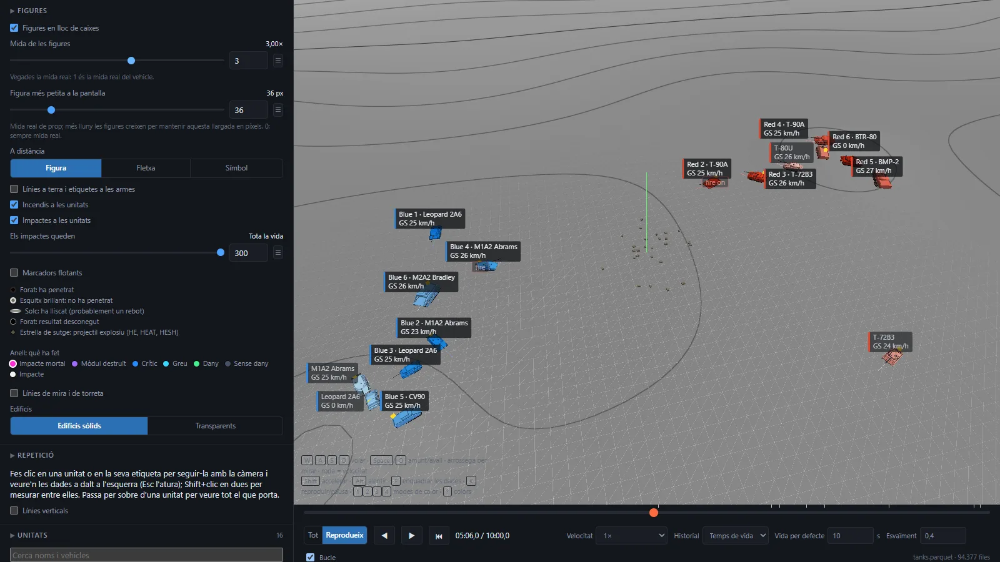
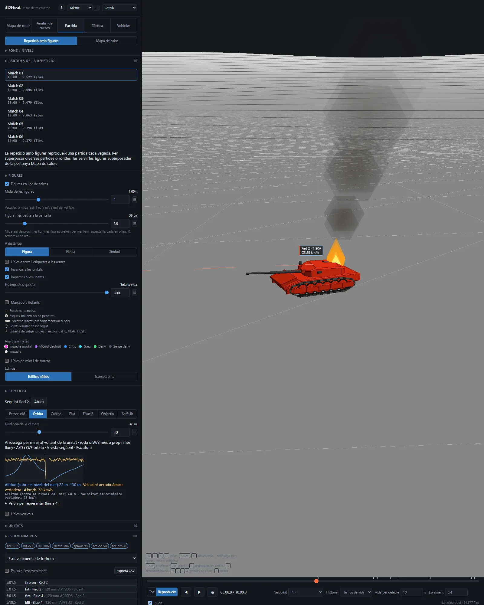
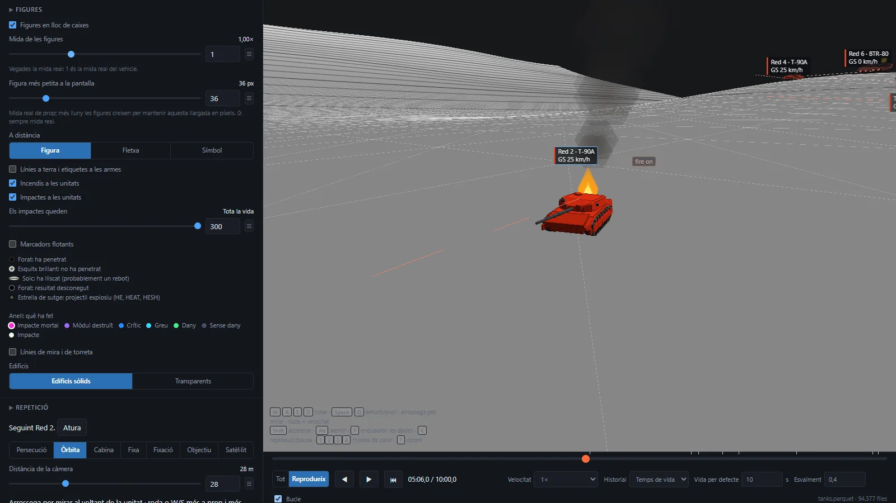
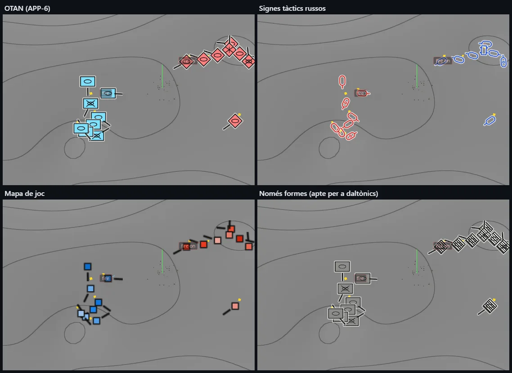
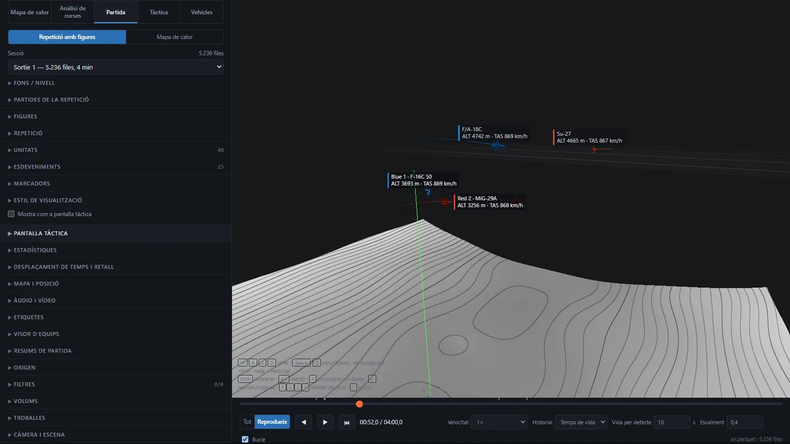

# Repetició de partida

La repetició és una pel·lícula de la partida amb cada jugador dibuixat com la cosa que conduïa. Serveix per tornar a veure un combat, seguir una unitat i veure qui ha tocat a qui.

Els trets, els impactes, els incendis i les restes es dibuixen sobre les unitats i els objectius del nivell. Les càmeres, les etiquetes i una pantalla tàctica t'ajuden a llegir el combat. Coneixes Tacview? [Paritat amb Tacview](tacview-parity.md) mostra on és cadascuna de les seves eines.

## Inicia una repetició {#start-a-replay}

1. Carrega una gravació amb **Origen → Fitxers…** o deixant-la caure al panell Origen (qualsevol taula amb una columna de **persona** i una de **temps**, un fitxer de Tacview, una repetició convertida, una partida [`.3dheat`](container.md)). Vegeu [Carregar dades](getting-data-in.md).
2. Obre la pestanya **Partida** i tria **Repetició amb figures**, o tria **Figures superposades** a la barra de modes de la pestanya Mapa de calor.
3. A **Partides de la repetició** tria una partida, totes alhora, o diverses.
4. Prem **Reprodueix** a la línia de temps (o `K`). Arrossega la línia de temps per saltar.

Les figures substitueixen les caixes per a cada unitat el nom o el tipus de la qual es coneix (vegeu [Figures](figures.md)). Les dades sense columna de nom o de tipus es dibuixen com a soldats.

## Figures {#figures}

| Configuració (secció **Figures**) | Per defecte | Què fa |
|---|---|---|
| **Figures en lloc de caixes** | activat | Desactivat dibuixa caixes simples. |
| **Mida de les figures** (vegades la mida real) | 1 | 1 és la mida real; de 0,25 a 20 vegades (escala logarítmica). Una mida més gran ajuda de lluny. |
| **Figura més petita a la pantalla** | 36 px | Les figures llunyanes creixen per no fer-se més petites que això, de 0 a 200 px; 0 manté la mida real. |
| **A distància**: Figura, Fletxa, Símbol | Figura | En què es converteix una unitat llunyana. |
| **Símbols** | NATO (APP-6) | NATO (APP-6), signes tàctics russos, icones de **Mapa de joc**, o **Només formes (apte per a daltònics)**. |
| **Mida del símbol**, **El meu bàndol**, **Hostil / Neutral**, **Marques de rumb** | 28 px (de 12 a 64), automàtic, hostil, activat | Com es veuen els símbols i quin bàndol és amic. |
| **Línies verticals** | activat | Una línia de cada unitat cap avall fins al terra, perquè les alçades es llegeixin en 3D. |
| **Línies a terra i etiquetes a les armes** | desactivat | Línies fins al terra i etiquetes a míssils i bombes. |
| **Incendis a les unitats** | activat | Flames des del moment en què una unitat s'encén fins que s'apaga. |
| **Impactes a les unitats** | activat | Marques on han xocat els trets (més avall). **Els impactes queden**: de 1 a 300 segons, o **Tota la vida**. **Marcadors flotants**: marques dibuixades per sobre de la superfície. |
| **Línies de mira i de torreta** | desactivat | A trossos: on mira el jugador; contínua: on apunta el canó. |
| **Edificis** | sòlid | Edificis sòlids o transparents, quan el nivell els pinta. |

### Símbols a distància {#symbols-at-a-distance}

Quan una unitat seria més petita que **Figura més petita a la pantalla**, pot convertir-se en un símbol que es llegeix bé. La forma indica el tipus (per exemple una caixa arrodonida amb una marca d'oruga per a blindats); el color indica el bàndol. Obre el menú **Símbols** per canviar l'estil.

### Marques d'impacte, restes i incendis {#hit-marks-wrecks-and-fires}

- Les **marques d'impacte** són sobre la superfície on va topar el tir, a l'escala de la figura. El seu aspecte diu què ha passat: un forat (ha travessat), una esquitxada brillant (no ha travessat), una ratllada (ha rebotat), una estrella de sutge (projectil explosiu). Un anell de color diu què ha fet: tret mortal, mòdul destruït, crític, greu, dany, sense dany, impacte. Posa el ratolí sobre una marca per veure el nom del projectil.
- Una unitat destruïda es dibuixa **carbonitzada** com una resta des de la seva mort fins que reapareix o es treu; el seu símbol queda ratllat.
- Els **incendis** cremen a una unitat des del moment en què s'encén fins que s'apaga.
- Les **torretes** giren cap on diuen les dades que apunta el canó (o, sense això, cap on mira el jugador).

### Armes, esquers i traçadors {#weapons-decoys-and-tracers}

Amb **Armes, trets i impactes** activat (secció Visor d'equips): els míssils, coets, bombes i torpedes volen com a figures pròpies amb una estela de fum; les bales i els obusos són traçadors; els impactes i les explosions fan llampec. Un traçador dibuixat **en trossos** s'ha calculat a partir d'un impacte, perquè les dades no tenien el tret. Les bengales i el chaff es dibuixen com a esquers; queden amagats de la llista d'unitats tret que estigui marcat *Esquers i obusos*.

## Càmeres {#cameras}

Fes clic a una unitat o a la seva etiqueta per **seguir-la**; la secció **Repetició** ofereix **Persecució**, **Òrbita**, **Cabina** (amb un display de cap alt, `H`), **Fixa**, **Fixació**, **Objectiu** i **Satèl·lit**. `V` les recorre, **Distància de la càmera** fixa com de lluny. Esc para.

- **Vista de dues unitats**: tria un **Objectiu** (o fes Ctrl/Alt-clic a una unitat) per mirar-la des de la que segueixes; **Intercanvia** les intercanvia.
- **Mesura**: Majúscules-clic a dues unitats per al rumb, la distància i la diferència d'alçada entre elles.
- **Mapa 2D** (`M`): vista de cantonada o completa, amb rastres i noms.
- **Marcadors** (`B`): desa el moment i la càmera; també es llisten les morts, les morts causades i les marques pròpies de la gravació.
- **Esdeveniments**: cada esdeveniment en ordre temporal; un clic hi salta. `Re pàg` / `Av pàg` salten entre esdeveniments; **Pausa a l'esdeveniment** s'atura a cadascun.

## Pantalla tàctica {#tactical-display}

La secció **Pantalla tàctica** dibuixa, per a cap unitat, les seleccionades, totes, o un tipus (aeronaus, terra, vaixells, armes): vectors de velocitat i la trajectòria endavant, línies de morro i de sustentació, cons de radar, bloquejos, enllaços de dades, zones i línies d'enfrontament, línies de visió, on miren els jugadors (cons de visió), la punteria de la torreta, i la càmera enregistrada.

### Estil de la pantalla {#display-style}

`T` (o l'interruptor **Mostra com a pantalla tàctica**) canvia l'aspecte a un estil de pantalla de radar: brillantor, contorns, línies de nivell, una quadrícula de mesura, línies d'exploració, anells de distància, escales d'altitud, panells amb morts i esdeveniments, i un **Director** que mou la càmera als esdeveniments per si sol.

## Objectius {#objectives}

Quan una partida ve amb els seus objectius, la secció **Objectius** els dibuixa sobre el nivell: zones de captura (amb propietari i progrés de captura), spawns, aeròdroms, àrees i objectius de bombardeig, cada capa commutable, amb etiquetes. Es veuen a través del terra. Amb diversos modes de joc carregats, **Mode** filtra les partides per mode. Els objectius surten del fitxer de partida d'un convertidor al costat de la gravació o dins d'un contenidor [`.3dheat`](container.md).

## Etiquetes i estadístiques {#labels-and-statistics}

- **Etiquetes**: regles per tipus (**Seleccionades**, **Aeronaus**, **Terra**, **Vaixells**, **Armes**, **IA**): mostrar-les o no, quins valors, i una **Prioritat** per decidir qui té lloc quan les etiquetes se solapen. **Separa les etiquetes** mou una etiqueta al costat de la seva unitat quan tapa una altra, i la deixa fora quan no hi ha lloc. **Mida de les etiquetes** és de 60 a 250 %. **Torna a nom, vehicle, altitud i velocitat** restableix les regles.
  - Les unitats terrestres comencen amb nom, vehicle i velocitat.
  - Les aeronaus comencen amb nom, vehicle, altitud i velocitat.
  - Els vaixells comencen amb nom, vehicle, velocitat i rumb.
  - Posa el ratolí sobre una unitat per veure tots els valors que té.
- **Estadístiques**: per equip i unitat: morts causades, morts, trets, impactes, proporció d'impactes, enlairaments, aterratges, temps en vol, velocitat màxima, alçada i G, distància. Exportació a CSV.
- **Gràfics**: els valors d'una unitat al llarg del temps, dues unitats comparades, o un valor contra un altre.

## Moltes partides alhora {#many-matches-at-once}

Per superposar centenars o milers de partides, vegeu [Moltes partides alhora](many-matches.md). Detalls de les figures (fum, foc, altres efectes amb temps): [Figures a la superposició de figures](figure-replay.md). Llista de funcions de Tacview: [Paritat amb Tacview](tacview-parity.md), una pàgina filla d'aquesta.
