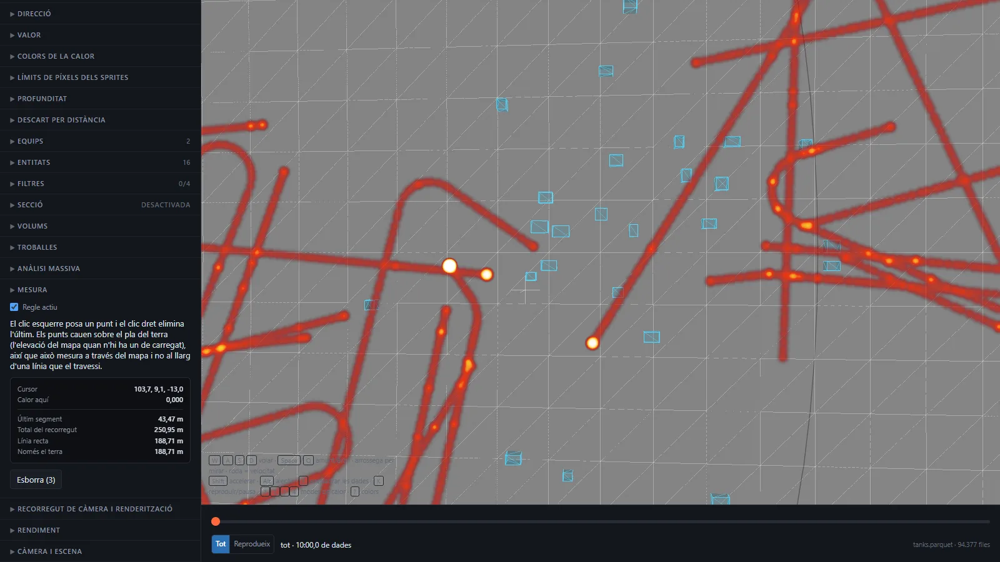

# Mesura

**Mesura** converteix el ratolí en una regle i t'indica quant de trànsit hi ha al punt sota el cursor. Usa-la per saber quina distància hi ha entre dos llocs, o quant trànsit té un punt.

## Prova-ho {#try-it}

1. Obre **Mesura** a la barra lateral i marca **Regle actiu**.
2. Fes clic amb el botó esquerre a tres llocs del mapa. Cada clic deixa un punt.
3. Llegeix **Total del recorregut** (la longitud de tot el camí) i **Últim segment** (l'últim tram).
4. Fes clic amb el botó dret per treure l'últim punt, o prem **Esborra (3)** per treure'ls tots.

| Acció | Efecte |
|---|---|
| Clic esquerre | Deixa un punt on el cursor toca el pla del terra. Un clic que s'ha mogut més de 4 píxels entre la pressió i l'alliberament és un arrossegament de la càmera, no un punt. |
| Clic dret | Treu l'últim punt. |
| Moure | La posició del cursor i la calor que hi ha sota s'actualitzen en directe. |

La càmera segueix funcionant mentre la regle està activada: arrossegar encara mira al voltant, i les tecles encara volen. Mentre la regle està activada rep tots els clics, així que el [clic per triar](camera.md#click-to-pick) espera que s'apagui.

**El pla del terra** és l'elevació de la [imatge del mapa](map-images.md) quan n'hi ha una de carregada; si no, la Y més baixa del conjunt de dades (0 si no n'hi ha). Els punts cauen sobre ell, de manera que la regle mesura a través del mapa, no per una línia que el travessi. Amb un nivell 3D, el pla continua sent la Y més baixa del conjunt de dades, no la superfície del nivell: per a un punt a la superfície real, apaga la regle i fes-hi clic ([clic per triar](camera.md#click-to-pick)), que llegeix les coordenades dels propis triangles del nivell.

## Lectures {#readouts}

| Línia | Significat |
|---|---|
| **Cursor** | X, Y, Z del món del punt sota el cursor, sobre el pla. |
| **Calor aquí** | Quanta calor hi ha al píxel del cursor. Un número més gran vol dir més trànsit en aquell punt. És el valor que rep la rampa de color abans que el punt de saturació el divideixi, de manera que el pots comparar amb el [Punt de saturació](colour-and-exposure.md#saturation-point). |
| **Últim segment** | Distància des de l'últim punt fins al cursor (o entre els dos últims punts). |
| **Total del recorregut** | Longitud de la línia poligonal que passa per cada punt i pel cursor. |
| **Línia recta** | Distància 3D des del primer punt fins al cursor (o l'últim punt). |
| **Només el terra** | El mateix, només amb X i Z. |
| **Clear (N)** | Treu tots els punts. |

Les distàncies es mostren en centímetres per sota d'1 unitat, en metres per sota de 1.000 i en quilòmetres per sobre, suposant que una unitat del món és un metre ([Eixos, unitats i temps](axes-units-and-time.md#unit-scale)). Les coordenades són coordenades del món, també quan un eix està [invertit per a la visualització](camera.md#invert-world-axis).

Els punts i la línia entre ells es dibuixen com una superposició a la vista, amb la mida del pas de la quadrícula. Els punts de la regle no es desen a les vistes; es mantenen quan carregues altres dades.

## Per als desenvolupadors {#for-developers}

**Calor aquí** es llegeix de la GPU com a molt cada 120 ms, perquè una lectura d'un sol píxel atura la canonada. Usa el mateix camí que `engine.readHeatProbe()`: dividit pel guany amb què es va escriure el fotograma, de manera que al camí d'acumulació de coma flotant de 16 bits (`?heat=f16`) està en les mateixes unitats que a un objectiu de 32 bits ([Acumulació de coma flotant de 16 bits](half-float-accumulation.md)).
