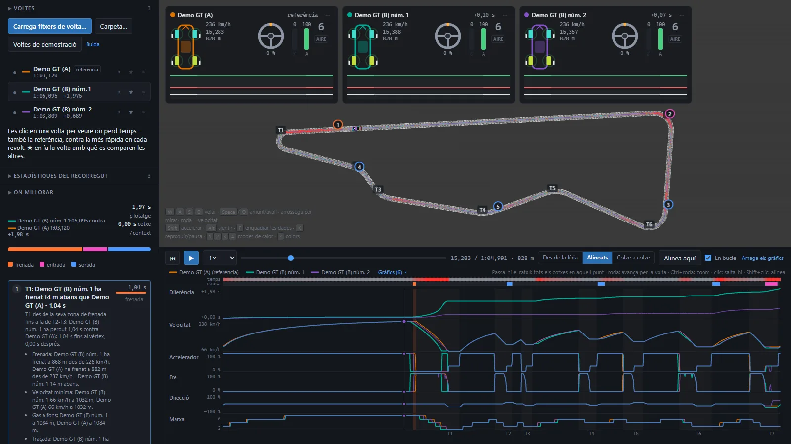

# Anàlisi de curses

Heu conduït el mateix circuit dues vegades. La pestanya **Anàlisi de curses** reprodueix les dues conduccions juntes en 3D, mostra on una volta va ser més lenta i us diu per què. Encara no hi ha voltes? Premeu **Voltes de demostració**.

La pestanya compara dues o més voltes d'un mateix recorregut. Comparteix el llenç, la càmera i el model del recorregut carregat (**Fons / nivell**) amb el mapa de calor; la resta és seva: la seva pròpia barra lateral i la seva pròpia barra sota la vista. Paraules com *volta*, *referència* i *vèrtex* són al [glossari](glossary.md).

Aquesta pàgina és el mapa de la pestanya. Cada part té la seva pròpia pàgina:

| Pàgina | Què cobreix |
|---|---|
| [Carregar voltes](race-loading-laps.md) | cada format de fitxer, carpetes i recorreguts, noms de cotxe, voltes de demostració, la llista de voltes, la referència i el focus |
| [Repetició i l'escena 3D](race-replay-and-scene.md) | la barra de transport, els tres modes de repetició, alinear cotxes, la càmera de persecució, les línies, els mapes, els cotxes, les etiquetes, els mons emmirallats |
| [Gràfics i HUD](race-charts-and-hud.md) | els gràfics de distància, el selector de gràfics, el ratolí i el zoom, les targetes dels cotxes, la taula de canals |
| [Esdeveniments de control del cotxe](race-control-events.md) | bloquejos, patinada de les rodes, sobreviratge, trompos, subviratge, cops, xocs, ABS/TC, fre de mà, aire: com es detecta cadascun, amb tots els llindars |
| [Anàlisi revolta a revolta](race-corner-analysis.md) | l'alineació per distància, els revolts i els segments, el compte de temps d'un revolt, cada causa i l'ordre en què es proven, la forma de la línia i el consell |
| [Perfils de cotxe i comparació](race-car-profiles.md) | què pot fer cada cotxe, mesurat a partir de les seves voltes; *Cotxes comparats*; què decideix el cotxe a cada revolt |
| [Estadístiques del recorregut](race-course-statistics.md) | moltes voltes d'un mateix recorregut: errors per revolt i per tipus, el mapa d'errors, l'exportació al mapa de calor, els límits de rendiment |
| [Analítica de curses: el mètode](race-analytics.md) | la recerca darrere de les regles, amb les fonts |
| [Altres jocs de curses](other-games.md) | què fa el visor amb les voltes de cada joc: lliscament i derrapada calculats quan un joc no els envia, mons emmirallats, els canals addicionals |

## La pantalla {#the-screen}

**Barra lateral**, de dalt a baix (les seccions es poden plegar):

1. **Voltes** -carregar, llistar, mostrar/amagar, referència, focus, persecució.
   Vegeu [Carregar voltes](race-loading-laps.md).
2. **Estadístiques del recorregut** -només a partir de tres voltes carregades.
   Vegeu [Estadístiques del recorregut](race-course-statistics.md).
3. **On millorar** -les troballes de la volta enfocada, revolt a revolt.
   Vegeu [Anàlisi revolta a revolta](race-corner-analysis.md).
4. **Revolt a revolt** (o *Revolt a revolt - classe X* amb diverses classes) -la volta més ràpida a través de cada revolt i la seva línia. Es mostra amb dues o més voltes.
5. **Control del cotxe** -els bloquejos, lliscaments, empentes i cops de la volta enfocada.
   Vegeu [Esdeveniments de control del cotxe](race-control-events.md).
6. **Cotxes comparats** (o **El cotxe** amb un sol cotxe) -vegeu
   [Perfils de cotxe i comparació](race-car-profiles.md).
7. **Vista** -quin mapa es pinta sobre la pista i què es dibuixa.
   Vegeu [Repetició i l'escena 3D](race-replay-and-scene.md).
8. Els panells compartits **Nivell** i **Càmera i escena** (model del recorregut, inversió d'eixos, càmera) -documentats amb el mapa de calor i [Càmera](camera.md).

**La vista** mostra el recorregut, les línies recorregudes, el mapa, els cotxes, les etiquetes
fixades a la pista, i fins a sis targetes de cotxe a dalt a l'esquerra (vegeu
[Gràfics i HUD](race-charts-and-hud.md)). Sense voltes carregades diu "No hi ha voltes carregades -
Deixeu anar aquí dos o més fitxers de volta, o carregueu les voltes de demostració des de la
barra lateral."

**La barra sota la vista** conté el transport de la repetició i, si no s'amaga, els gràfics de distància.

## Inici ràpid {#quick-start}

1. Obriu la pestanya **Anàlisi de curses** (al costat de **Mapa de calor**, a dalt de la barra lateral).
2. Porteu-hi voltes. Premeu **Voltes de demostració** per veure què fa la pestanya amb tres voltes inventades. Per a les vostres pròpies voltes, enregistreu-les primer
   ([formats de fitxer i enregistradors](race-loading-laps.md#file-formats)), després premeu
   **Carrega fitxers de volta…** o **Carpeta…**, o deixeu anar fitxers o carpetes sobre la vista.
3. La volta completa més ràpida esdevé la referència; l'altra volta més lenta es posa en focus. Feu clic en qualsevol volta de la llista per enfocar-la; ★ fa que una volta sigui la referència.
4. Llegiu **On millorar**. Feu clic en una troballa: els cotxes s'alineen 40 m abans, la càmera l'enquadra, la repetició la reprodueix i s'obren les mesures.
5. Passeu el ratolí pels gràfics per moure cada cotxe a aquell metre; Majúscules+clic per alinear-los allà.

## Teclat {#keyboard}

Mentre la pestanya Curses és oberta:

| Tecla | Fa |
|---|---|
| **K** | reprodueix / atura la repetició |
| **Home** | torna a l'inici de la repetició |
| tecles de dígits | res (al mapa de calor canvien de mode) |

Les tecles escrites en un camp de text o en una llista desplegable s'ignoren. Les tecles de càmera
funcionen com al mapa de calor (**W A S D**, **Espai** amunt, **Q** avall, **Majúscules** més ràpid,
**Alt** més lent, ratolí per mirar; tot a [Càmera](camera.md)); **F** enquadra les voltes carregades
(igual que fa en carregar voltes).

## Moltes voltes {#many-laps}

- Totes les voltes carregades s'analitzen i es compten; desenes triguen un segon o dos.
- A partir de **8** voltes (`SHOW_ALL_UP_TO`), les voltes afegides només es dibuixen quan són la
  referència, la volta enfocada, o la millor volta de la classe de la volta enfocada.
  *Mostra-ho tot* / *Només les que mires* canvien això.
- A partir de **10** cotxes visibles (`PLAIN_PAST`), les voltes que no es miren (ni el focus, ni el
  cotxe perseguit, ni la referència) es dibuixen amb les línies aprimades a un punt cada 6 m en lloc
  de cada 1,5 m, i amb cotxes simples.
- Els gràfics dibuixen com a màxim **8** voltes; el HUD mostra com a màxim **6** targetes.
- Les estadístiques del recorregut apareixen a partir de **3** voltes.

Detalls: [Estadístiques del recorregut](race-course-statistics.md#performance-with-many-laps).

## Ajustos de vista per defecte {#default-view-settings}

| Ajust | Per defecte |
|---|---|
| Mapa | Mapa de temps |
| Línies recorregudes, Cotxes, Pneumàtics i suspensió, Etiquetes, Pista a partir de les voltes | activat |
| Tots els valors a les targetes | desactivat |
| Mida del cotxe | 1× |
| Gràfics | mostrats |
| Mode de repetició | Des de la línia |
| Velocitat de repetició | 1× |
| Bucle | activat |

Cap d'aquests no es desa; un recàrrega comença amb els valors per defecte. El que es recorda al
navegador: l'idioma, i els noms de cotxe après dels fitxers de volta (vegeu
[Carregar voltes](race-loading-laps.md#car-names)).

## Per als desenvolupadors {#for-developers}

### Què passa quan es carreguen voltes {#what-happens-when-laps-are-loaded}

Cada vegada que canvia el conjunt de voltes, la referència o l'idioma, es refà tota l'anàlisi
(`analyse` a [`src/race/analysis.ts`](https://github.com/Holdi601/3DHeat/blob/main/src/race/analysis.ts)):

1. S'afegeixen canals derivats a cada volta on el joc no els envia: angle de derrapada, lliscament de les rodes a partir de les velocitats de les rodes, en l'aire, terreny solt, velocitat de guinyada ([`derive.ts`](https://github.com/Holdi601/3DHeat/blob/main/src/race/derive.ts)).
2. Es tria la referència i cada volta es projecta sobre el seu camí i es remostreja cada 2 m ([`align.ts`](https://github.com/Holdi601/3DHeat/blob/main/src/race/align.ts)).
3. Es calcula a partir de les voltes si el món del joc és emmirallat ([`handedness.ts`](https://github.com/Holdi601/3DHeat/blob/main/src/race/handedness.ts)).
4. Els revolts es troben a la referència, i s'agrupen en segments d'una zona de frenada a la següent ([`segments.ts`](https://github.com/Holdi601/3DHeat/blob/main/src/race/segments.ts)).
5. Per cotxe: la seva envolupant (grip, frenada, tracció per velocitat), el seu perfil, les seves corbes de pneumàtics ([`envelope.ts`](https://github.com/Holdi601/3DHeat/blob/main/src/race/envelope.ts),
   [`profile.ts`](https://github.com/Holdi601/3DHeat/blob/main/src/race/profile.ts),
   [`control.ts`](https://github.com/Holdi601/3DHeat/blob/main/src/race/control.ts)).
6. Per volta i segment: què va fer (punt de frenada, punt més lent, acceleració a fons, ...) i la línia que va seguir ([`line.ts`](https://github.com/Holdi601/3DHeat/blob/main/src/race/line.ts)).
7. Per volta: els seus esdeveniments de control del cotxe, cadascun comparat amb la volta amb què es compara en aquell punt.
8. Per volta i segment: el compte de temps contra la seva volta de comparació i la troballa en paraules.
9. El mapa de temps i el mapa de causes per volta.

Els textos es produeixen en l'idioma actual; canviar d'idioma torna a executar l'anàlisi (i reanomena
les voltes de demostració). Un error de l'anàlisi es mostra sota els botons **Voltes** com a error, i
les voltes es mantenen carregades.

### Fitxers de codi {#source-files}

| Fitxer | Paper |
|---|---|
| `src/race/adapters.ts`, `ibt.ts` | llegir fitxers de volta |
| `src/race/lap.ts`, `carNames.ts`, `synthetic.ts` | el tipus de volta, els noms, les voltes de demostració |
| `src/race/derive.ts`, `handedness.ts` | canals derivats, mons emmirallats |
| `src/race/align.ts`, `segments.ts`, `line.ts` | eix de distància, revolts, línies |
| `src/race/analysis.ts` | revolts comparats, causes, troballes |
| `src/race/envelope.ts`, `profile.ts` | què pot fer un cotxe |
| `src/race/control.ts`, `impacts.ts` | control del cotxe, cops i xocs |
| `src/race/stats.ts` | moltes voltes |
| `src/race/replay.ts`, `scene.ts`, `glyph.ts`, `geometry.ts` | repetició i dibuix |
| `src/race/schema.ts`, `graphs.ts` | la taula de canals, les files dels gràfics |
| `src/ui/race/*` | la barra lateral, els gràfics, el HUD, les etiquetes |
| `src/state/raceStore.ts` | l'estat de la pestanya i el rellotge de la repetició |
