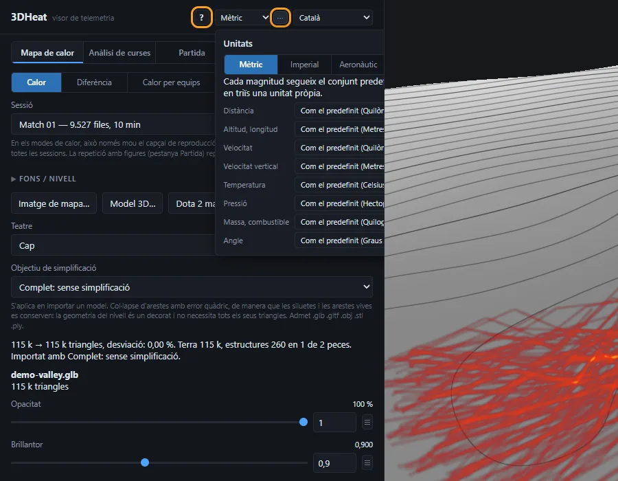
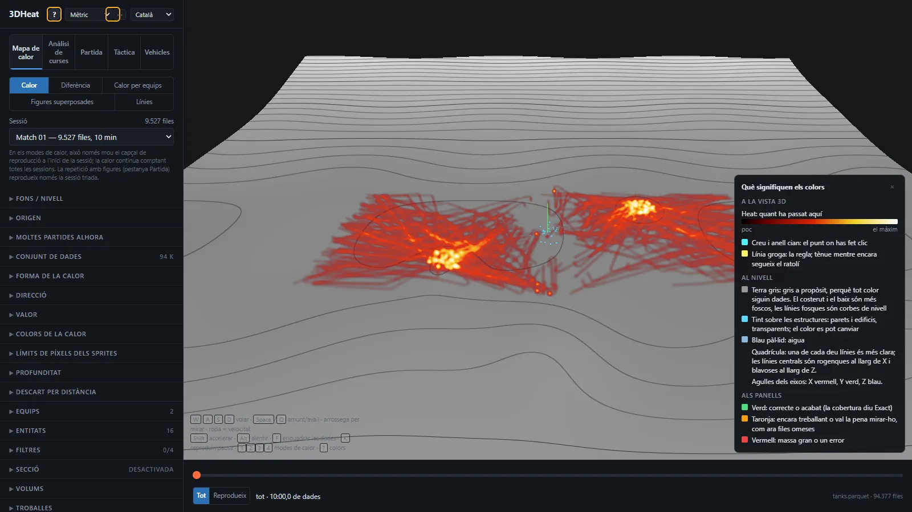
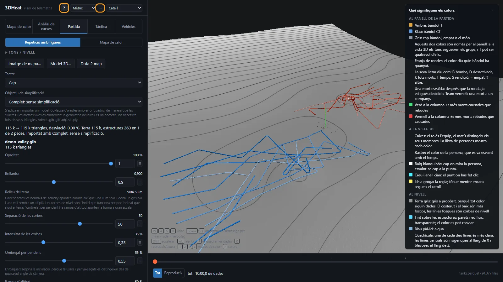

# Configuració, unitats i tecles

Els petits controls a dalt de la barra lateral canvien la manera com el visor es comunica amb tu: l'idioma, les unitats (metres o peus, km/h o nusos) i un mode d'ajuda que explica els colors. Les teves eleccions es recorden al teu navegador.

## La capçalera {#the-header}

A dalt de la barra lateral:

| Control | Què fa |
|---|---|
| **?** | Mode d'ajuda: què vol dir cada color (també `?` o `F1`) |
| Menú **Unitats** | Mètric, Imperial, Aviació o Nàutic |
| Botó **...** al costat de **Unitats** | Obre «Tria una unitat per a cada magnitud»: un desplegable per magnitud |
| Menú **Idioma** | L'idioma del visor: [40 idiomes](languages.md), o el del navegador |

Els números que escrius en una casella poden usar punt o coma (`0.35` o `0,35`). El visor els llegeix tots dos i mostra els números com els escriu l'idioma del visor.

## Unitats {#units}

1. Tria un predefinit al menú **Unitats**. Totes les magnituds canvien alhora.
2. Per canviar només una magnitud, fes clic al botó **...** al costat i tria una unitat per a aquesta magnitud. El menú aleshores mostra un `*` després del predefinit.
3. Una magnitud que no has fixat segueix el predefinit. Tria «Com el predefinit» per tornar enrere.

| Magnitud | Mètric (per defecte) | Imperial | Aviació | Nàutic |
|---|---|---|---|---|
| Distància | km | mi | NM | NM |
| Altitud, longitud | m | ft | ft | m |
| Velocitat | km/h | mph | kt | kt |
| Velocitat vertical | m/s | ft/min | ft/min | m/s |
| Temperatura | °C | °F | °C | °C |
| Pressió | hPa | inHg | hPa | hPa |
| Massa, combustible | kg, l | lb, gal | lb, gal | t, m³ |
| Angle | graus | graus | graus | graus |

Altres unitats que pots triar per a una magnitud: distància km, mi, NM; velocitat km/h, m/s, kt, mph; velocitat vertical m/s, ft/min, m/min; temperatura °C, °F, K; pressió hPa, inHg, mmHg, psi; massa kg, lb, t; angle graus o mils NATO (6400 per volta). Les unitats són les mateixes a tot el visor: etiquetes, targetes, gràfics, estadístiques.

## Mode d'ajuda {#help-mode}

Prem `?` o `F1`, o fes clic al botó **?**. Mostra *Què volen dir els colors*: llegendes per a la vista 3D, les rampes de calor, els colors dels equips, els colors del nivell, els colors d'estat dels panells, el panell de la partida i la vista de la cursa. Es queda activat fins que el desactivis. A la pestanya Partida també explica els colors del panell de la partida.

## Què recorda el navegador {#what-the-browser-remembers}

Aquests ajustos es guarden al teu navegador entre visites (no s'envia res enlloc):

- l'idioma, les unitats i el mode d'ajuda;
- els ajustos de la figura, el símbol, l'etiqueta, la càmera i la visualització tàctica de la repetició;
- la velocitat de reproducció i el mirall;
- els marcadors per gravació, els volums per conjunt de dades, les capes d'objectius;
- els ajustos de la IA externa (la clau només si marques *Recorda*).

Els ajustos de calor, els filtres i el mode comencen de nou a cada càrrega. La llista completa i generada: [Ajustos desats](ref-settings-storage.md).

## Tecles que el visor conserva del navegador {#keys-the-viewer-keeps-from-the-browser}

Una sessió amb dades grans triga a carregar-se, així que el visor evita que el navegador la descarti per accident:

- `Ctrl`/`Cmd` + lletres que imprimirien, desarien, obririen, recarregarien, tancarien o obririen finestres noves no fan res fora de les caselles de text; `F1`, `F3`, `F5`, `F6` i `F7` no fan res.
- Tancar o recarregar la pestanya amb dades o un nivell carregats pregunta primer.
- En pantalla completa el visor bloqueja les tecles que usa (W, T, N, S, R, P, Q, Esc), perquè el navegador no se les quedi.

La llista exacta: [Tecles del navegador](ref-browser-keys.md). Totes les tecles pròpies del visor: [Referència de teclat i ratolí](keyboard-reference.md).
