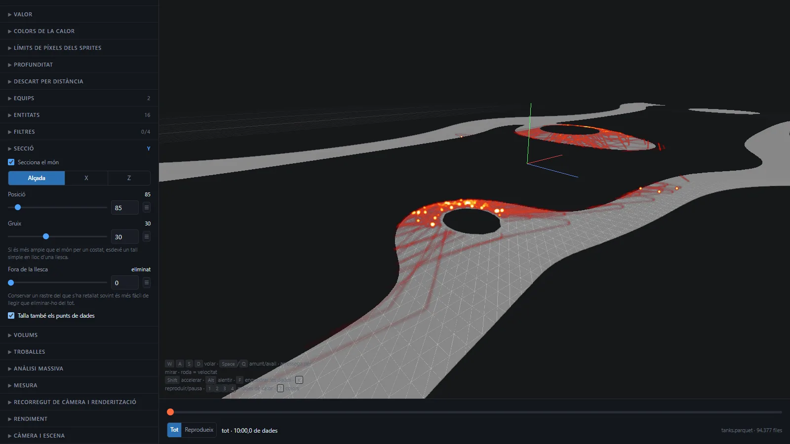

# Secció

**Secció** talla el món com una llesca de pastís, perquè puguis mirar dins els edificis. Usa-la quan les parets amaguen la calor interessant, per exemple per veure una planta d'un edifici.

## Prova-ho {#try-it}

1. Carrega un nivell i unes dades, i obre **Secció**.
2. Marca **Secciona el món**. L'eix és **Alçada**.
3. Arrossega **Posició** amunt i avall: la llesca es mou pel nivell.
4. Fes **Gruix** prim per a un plànol de planta, o ampli per a «tot per sota d'aquí».
5. Deixa **Fora de la llesca** a 0 per treure la resta, o puja'l per mantenir una traça tènue.



La llesca talla **la geometria del nivell i els punts de dades junts**: seccionar només el nivell deixaria la calor surant on hi havia el seu edifici. És la contrapartida de l'[oclusió per profunditat](depth-and-culling.md): quan el nivell amaga bé el que hi ha darrere, l'interior d'un edifici també queda amagat. El panell es mostra quan hi ha alguna cosa per seccionar (un conjunt de dades o un nivell 3D); la seva capçalera mostra l'eix mentre està activat, *off* en cas contrari.

```
vista lateral      Posició = on és la llesca
 ----------       Gruix = l'alçada de la llesca
 | planta 3 |
 |=========|  <--- llesca (es manté)
 | planta 2 |  <--- fora: treit (o tènue)
 | planta 1 |
 ----------
```

## Controls {#controls}

| Control | Per defecte | Significat |
|---|---|---|
| **Secciona el món** | desactivat | Activa la llesca. Mentre la posició és encara al seu 0 inicial i el gruix al seu 500 inicial, en activar-lo els mou al mig de l'eix i al 15 % del seu rang. |
| Eix | **Alçada** | *Alçada* (Y), *X* o *Z*. Canviar l'eix mou la llesca al mig del nou eix. |
| **Posició** | el mig | Centre de la llesca, en unitats del món, al llarg del rang de l'eix (500 passos). |
| **Gruix** | 15 % del rang | De 1/500 del rang a dos cops el rang, en passos logarítmics. Mostra *més enllà del món* quan és tan ampla com el rang: aleshores un costat arriba més enllà del món i és un tall simple en lloc d'una llesca. |
| **Fora de la llesca** | 0, *treit* | Quanta part del que hi ha fora es manté visible, de 0 a 100 %. Una traça tènue del que s'ha tallat sovint es llegeix millor que treure-ho del tot. |
| **Talla també els punts de dades** | activat | Desactivat deixa la calor sencera, de manera que es veu a través del tall: útil per veure què hi ha per sobre i per sota de la llesca. |

El rang d'un eix és el del nivell 3D quan n'hi ha un de carregat, si no el del conjunt de dades.

La secció és independent del [retall per distància](depth-and-culling.md#distance-culling), que talla en la direcció de la vista en lloc d'un eix del món; tots dos es combinen. Un canvi a qualsevol ajust de la secció reinicia l'acumulació de calor.

## Per als desenvolupadors {#for-developers}

La llesca es prova a la posició al món de cada fila al shader de vèrtexs: una fila fora d'ella té la seva contribució multiplicada pel valor de *Fora*, de manera que a 0 es rebutja abans que es dibuixi cap fragment. Els shaders del nivell apliquen la mateixa prova a cada fragment del terra, les estructures i l'aigua.
