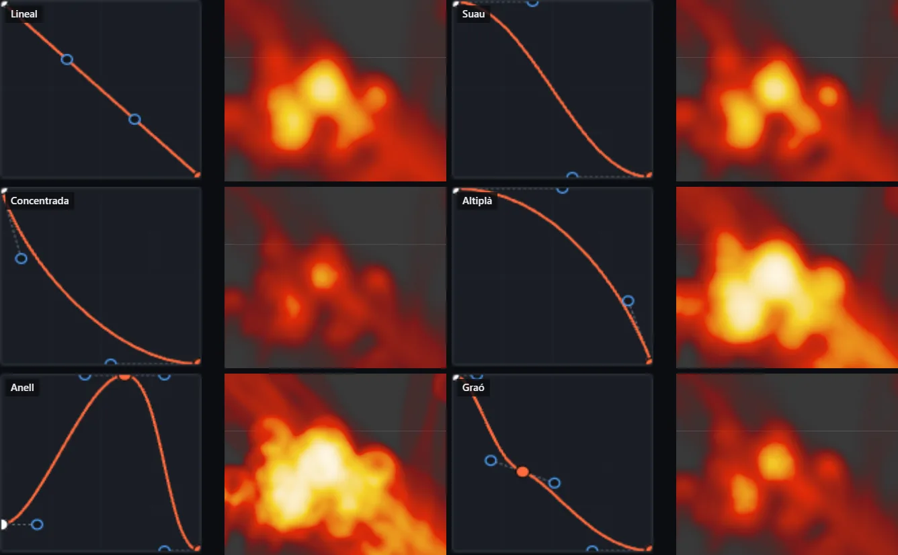

# Forma de l'sprite

Cada fila es dibuixa com un sprite rodó que sempre mira a la càmera. La seva mida i el perfil des del seu centre fins a la vora - la **rampa** - decideixen si un punt calent es llegeix com un punt concentrat, un núvol suau, un disc o un anell. Aquests controls són a les seccions **Forma de la calor** i **Límits de píxels dels sprites** de la barra lateral, i s'apliquen a [Calor](heat.md), [Diferència](difference.md), [Calor per equips](team-heat.md) i, com a mig amplada d'una línia, a [Calor en línies](line-heat.md).

Canviar-ne qualsevol reinicia l'acumulació (el camp s'ha de tornar a dibuixar amb la nova forma).

Pensa en cada punt com una taca suau de llum. Una taca petita mostra punts individuals; una taca gran fon els veïns en un núvol. La forma decideix com de suau és la vora.



## Radi de l'sprite {#sprite-radius}

El radi de l'sprite en **unitats del món** (etiquetades en metres). Per defecte 6, i a cada càrrega l'extensió horitzontal de les dades / 120 - prou gran perquè les mostres veïnes al llarg d'un camí es fonguin en una franja en lloc de llegir-se com un cabell. Control lliscant logarítmic de 0,05 a 2000, el mànec arriba fins a 50.000.


Les coses lluny es veuen més petites, de manera que un sprite es fa més petit a la pantalla amb la distància. Amb la projecció paral·lela és igual a tot arreu, i en part per això la vista paral·lela és la correcta per comparar punts calents ([Càmera](camera.md#projection)).

## Límits de píxels {#pixel-clamps}

Els **Límits de píxels dels sprites** (tancats per defecte) limiten el radi a la pantalla després de la conversió anterior.

| Control | Per defecte | Rang (roda) | Per què |
|---|---|---|---|
| **Radi mínim en píxels** | 1 px | 0-16 (512) | Evita que les dades llunyanes desapareguin per sota d'un píxel. |
| **Radi màxim en píxels** | 96 px | 2-1024, logarítmic (8192) | La protecció contra el sobredibuix. Un sprite que cobreix N píxels costa N operacions de barreja, així que un radi sense límit prop de la càmera és el que converteix un fotograma ràpid en un de lent. Passada l'alçada del viewport, ja no talla res. |

**Mateixa densitat a qualsevol zoom** (a la secció Forma de la calor, activat per defecte) funciona amb els límits. Un sprite que un límit fa més gran (lluny) o més petit (de prop) conserva la calor que sumaria la seva mida real, de manera que un color significa el mateix nombre de files per àrea de terra a qualsevol zoom. Amb això desactivat, un sprite limitat suma tot el seu pes amb la seva mida limitada, i la imatge canvia quan t'hi acostes volant.

## Intensitat del centre i de la vora {#centre-and-edge-intensity}

La calor que un sprite suma al seu centre exacte (**Intensitat al centre**, per defecte 1, 0-10, roda 1000) i a la seva vora (**Intensitat a la vora**, per defecte 0, -2-10, roda 1000). El valor de rampa *t* (1 al centre, 0 a la vora, format per l'atenuació o per la corba de sota) fa la interpolació entre tots dos (la fórmula és a [Per a desenvolupadors](#for-developers)).

Una **intensitat de vora negativa** fa que la vora resti, cosa que retalla un halo fred al voltant de cada punt calent i aguditza els grups els uns contra els altres. La visibilitat inclou l'[oclusió](depth-and-culling.md) i el [tall](slice.md); l'esvaïment és l'esvaïment de [Temps de vida](timeline.md#history); el signe és ±1 a [Diferència](difference.md).

## Forma de la rampa: Atenuació o Corba {#ramp-shape-falloff-or-curve}

**Forma de la rampa** canvia entre dues maneres de donar forma a *t* a través del sprite. Amb *d* la distància des del centre (0) fins a la vora (1):

### Atenuació {#falloff}

Es mostra quan està seleccionat *Atenuació* (per defecte).

- **Atenuació** (per defecte 1,6, 0,1-8, roda 64): `t = (1 - d) ^ atenuació`. 1 és una rampa lineal recta; més alt atreu la calor cap al centre i concentra el punt calent; per sota de 1 l'aplana en un disc.
- **Rampa suau** (per defecte activat): aplica una corba en S de suavitzat a *t*, de manera que el sprite s'esvaeix a la vora en lloc d'acabar en una vora visible.

### L'editor de corbes {#the-curve-editor}

Es mostra quan està seleccionada *Corba*. Una secció transversal literal d'un sprite: la distància des del centre a través (*centre* a l'esquerra, *vora* a la dreta), calor cap amunt. La corba és una Bézier cúbica per trossos que passa per punts de control, cadascun amb dues nanses.

| Acció | Efecte |
|---|---|
| Doble clic sobre el gràfic | Afegeix un punt a aquella distància (es manté entre 0,02 i 0,98), sobre la corba i amb el pendent de la corba allà, de manera que afegir-lo no canvia res fins que l'arrossegues. |
| Arrossegar un punt | El mou. Les alçades es mantenen entre 0 i 1. |
| Arrossegar un cercle petit | Doblega el segment del seu costat (mou aquella nansa). |
| Alt-clic o clic dret sobre un punt | El elimina. Els dos extrems no es poden eliminar. |
| Un botó de preajust | Substitueix la corba pel preajust. |

Els extrems es fixen al centre i a la vora; la seva alçada encara és cosa teva.

**Preajustos** ([`curve.ts`](https://github.com/Holdi601/3DHeat/blob/main/src/state/curve.ts)):

| Preajust | Forma | Ús |
|---|---|---|
| **Lineal** | Recta de 1 a 0 | Idèntic a *Atenuació* 1 amb *Rampa suau* desactivat. |
| **Suau** | Corba en S | La corba per defecte; el que dona *Rampa suau* amb atenuació 1. |
| **Concentrada** | Un nucli empinat, una cua llarga i tènue | Dades disperses. |
| **Altiplà** | Pla, i després una caiguda ràpida | Es llegeix com un disc en lloc d'una taca. |
| **Anell** | 0,15 al centre, 1 al 62% del radi, 0 a la vora | Un sprite buit: mostra on passen els camins en lloc d'on s'aturen. |
| **Graó** | Caiguda en dues etapes, 0,45 al 35% | Separa un nucli dens dels seus voltants. |

## Aplana sobre el pla del terra {#flatten-onto-ground-plane}

**Aplana sobre el pla del terra** (per defecte desactivat) ignora l'alçada de cada fila i dibuixa tota la calor a una sola alçada - la Y més baixa de les dades - el mapa de calor 2D clàssic. Amb això activat, l'oclusió per profunditat i *Amaga darrere del terreny* es desactiven (cada punt quedaria just sobre la superfície contra la qual es prova), i la secció Profunditat ho indica.

## Per a desenvolupadors {#for-developers}

### Fórmules {#formulas}

Radi a la pantalla en píxels: `radi × P[1][1] / w × alçada del viewport / 2`, on `P` és la matriu de projecció i `w` és la profunditat de vista del punt.

La calor que suma un sprite:

```
heat added = mix(edge, centre, t) × sample weight × sign × fade × visibility
```

### La corba {#the-curve}

Les nanses es limiten horitzontalment al seu propi segment, de manera que la corba és sempre una funció de la distància: arrossegar una nansa molt més enllà del punt següent l'aplana contra ell en lloc de plegar la corba cap enrere, cosa que faria que el resultat depengués de quina arrel trobés un solver.

### Com es dibuixa la corba {#how-the-curve-is-drawn}

La corba es fon en una taula de 256 entrades cada vegada que canvia, es puja com a textura de coma flotant de 16 bits, i es mostreja per fragment amb filtratge lineal i una separació de mig texel perquè els dos extrems quedin exactes. Resoldre una Bézier per a x necessita iteració, que no té lloc al shader més calent del programa, i a més una consulta a la taula és més barata que el `pow()` que usa l'atenuació. 16 bits i no 8 perquè 8 bits mostra bandes quan han sumat milers de sprites; el coma flotant de mitja precisió de 16 bits és filtrable al WebGL2 bàsic, mentre que el de 32 bits necessita una extensió.
