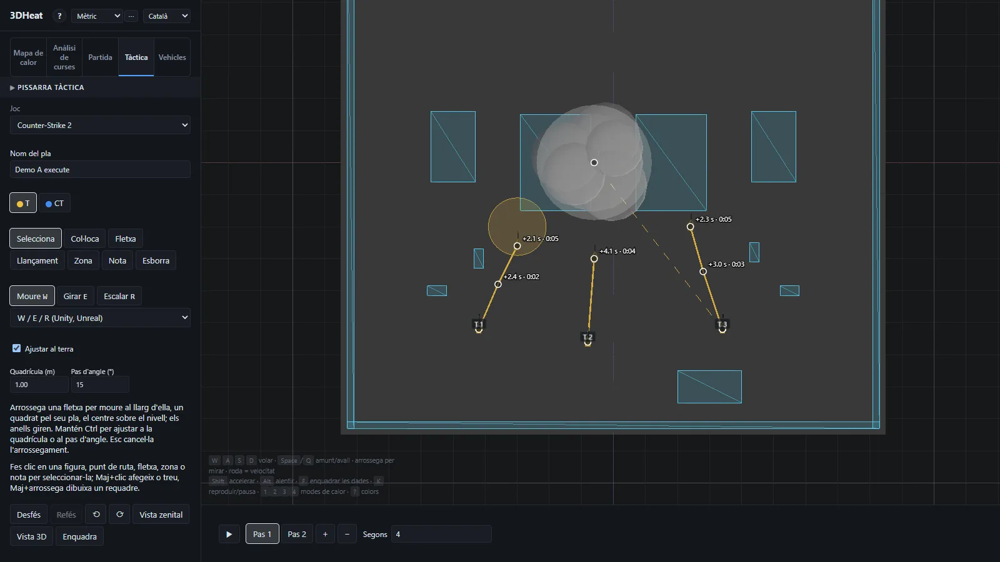

# Pissarra tàctica

La pestanya **Tàctica** és una pissarra de dibuix per a un pla d'equip: poseu petites figures en un mapa, dibuixeu fletxes per on han d'anar i premeu reproduir per veure-ho passar. Useu-la per planejar una ronda o un atac abans de jugar. Comparteix el llenç, la càmera i el [nivell](levels.md) amb les altres pestanyes i res més; un pla no són dades i no dibuixa cap calor.

## El teu primer pla {#your-first-plan}

1. Obriu la pestanya **Tàctica**. Trieu el **Joc** (per exemple Counter-Strike 2) i, per a Valorant, premeu **Carrega els mapes de Valorant** i trieu un **Mapa**. O carregueu primer un [nivell](levels.md).
2. Trieu un **Bàndol** (en marca el color) i premeu **Vista zenital**.
3. Trieu **Lloc**, escolliu una figura a **Figures** (useu **Cerca figures** per trobar-ne una) i feu clic al mapa. Poseu-ne dues o tres.
4. Trieu **Fletxa**, feu clic en una figura, feu clic al llarg del camí que ha de seguir i premeu **Enter** per acabar la fletxa.
5. Premeu **+** sota la vista per afegir el pas 2. Cada figura comença on acabava la seva fletxa. Dibuixeu-hi més fletxes.
6. Premeu **▶** (o `K`) per reproduir el pla des del pas mostrat fins al final.
7. Doneu nom al pla a **Nom del pla** i premeu **Desa**.

## Començar un pla {#starting-a-plan}

| Control | Què fa |
|---|---|
| **Joc** | Tria els bàndols i les figures que ofereix la paleta: Counter-Strike 2 (T, CT; jugadors i utilitats), Valorant (Atac, Defensa; jugadors i habilitats genèriques), Battlefield, Squad, Arma (infanteria, vehicles terrestres, avions, vaixells), DCS / War Thunder / IL-2 (reactors, avions d'hèlix, helicòpters, defensa antiaèria, terra, vaixells, armes) i Altres. Un pla que ja té figures manté els seus bàndols quan canvia el joc. |
| **Nom del pla** | El nom amb què es desa el pla. |
| **Mapa**, **Carrega els mapes de Valorant** | Amb Valorant triat: **Carrega els mapes de Valorant** obté la llista de mapes de [valorant-api.com](https://valorant-api.com); **Mapa** després posa el minimapa del mapa triat com a nivell, enquadrat des de dalt. La imatge es baixa en triar-la i mai no s'envia amb el visor. L'avís de Riot es mostra mentre és a la pantalla (vegeu més avall). |
| **Bàndol** | El bàndol al qual pertany la següent figura, fletxa o àrea; pren el color del bàndol. |

Sense nivell, la pissarra és el pla del terra. Carregueu un nivell sota **Nivell** per planejar sobre un mapa real: un mapa de CS2 exportat amb l'eina de CS2, un nivell de la biblioteca o una imatge de mapa.

## Eines {#tools}

| Eina | Clic | Notes |
|---|---|---|
| **Selecciona** | Una figura, un punt de pas, una fletxa, una àrea o una nota la selecciona. | Majúscules+clic afegeix o lleva; Majúscules+arrossegar dibuixa una caixa al voltant del que cal afegir. La selecció rep un giny de transformació (vegeu més avall); `Delete` o `Backspace` l'esborra. `M` mou la figura seleccionada al següent clic. |
| **Lloc** | Posa a terra la figura triada. | Una figura es tria a la paleta **Figures** (amb **Cerca figures**). Sense res seleccionat, `R` gira la següent figura 15° abans de posar-la (`Majúscules+R` en sentit contrari). |
| **Fletxa** | Cada clic afegeix un punt; Enter, un doble clic o un clic dret l'acaben, Esc la descarta. | **Mou**, **Atac** (punta més ampla) o **Vigilar** (una línia fina a l'altura dels ulls). Una fletxa que comença sobre una figura és la ruta d'aquella figura en aquest pas: reproduïda, la figura la camina, i el pas següent comença on ha acabat. |
| **Llançament** | El llançador, i després on cau. | Una línia de punts entre l'un i l'altre, i l'utilitat triada (fum, flaix, còctel molotov, ...) apareix on cau i es queda des d'aquest pas en endavant. |
| **Àrea** | El centre, i després la vora. | Un disc del color del bàndol. |
| **Nota** | On va la nota; demana el seu text. | Es mostra com un marcador, i el seu text per sobre. |
| **Esborra** | Una figura, fletxa, àrea o nota. | La lleva des d'aquest pas en endavant; en el seu primer pas, la lleva. |

**Desfés** i **Refés** (`Ctrl+Z`; `Ctrl+Y` o `Ctrl+Majúscules+Z`) recorren cada canvi. Una línia sota el pla indica quantes figures, fletxes i passos té. **Vista zenital** mira cap avall en línia recta (ortogràfica), **Vista 3D** torna a la perspectiva, **Fotograma** ajusta el pla, o el nivell quan el pla és buit.

**Mida de les figures** escala totes les figures de la pissarra; 1× és la mida real, que des de molt amunt són uns quants píxels per a una persona.

## Moure, girar i escalar {#moving-turning-and-scaling}

Tot el que hi ha a la pissarra es pot moure com en un editor 3D: figures, utilitats, marcadors, punts de pas individuals i fletxes senceres, àrees i notes. El que està seleccionat rep un giny al seu centre:

| Mode | Tecles | Anses |
|---|---|---|
| **Mou** | W (o G) | Una fletxa per eix (X vermell, Y verd i amunt, Z blau) es mou al llarg seu; un quadrat es mou en el seu pla; el centre es mou sobre el nivell sota el punter. |
| **Gira** | E (o R) | Un anell per eix gira al seu voltant. Els anells d'una figura sola són el seu propi guinyament, capcineig i balanceig; un grup gira al voltant dels eixos del món pel seu centre. |
| **Escala** | R (o S) | Estén o recull la selecció des del seu centre en un eix o en totes les direccions; el radi d'una àrea creix amb ella. |

**Tecles** canvia entre W / E / R (Unity, Unreal) i G / R / S (Blender); les tecles trien el mode només quan hi ha alguna cosa seleccionada, i en cas contrari fan volar la càmera. Així, `R` vol dir **Escala** amb les tecles W / E / R i **Gira** amb les tecles G / R / S quan hi ha alguna cosa seleccionada, i gira la següent figura a posar quan no n'hi ha cap. Totes les tecles de la pissarra són a la [referència de teclat](keyboard-reference.md#tactics-board). Mantingueu **Ctrl** mentre arrossegueu per ajustar un moviment a la **Quadrícula** (metres) o un gir al **Pas d'angle**. **Ajustar al terra** (activat per defecte) posa les persones, vehicles, marcadors, punts de pas i àrees mogudes sobre la superfície del nivell; els avions i helicòpters mantenen l'altura, i un arrossegament al llarg de la fletxa Y mai no s'ajusta. Arrossegar un ansa mai no mou la càmera. **Esc** cancel·la un arrossegament, i cada canvi és un pas de Desfés.

Els punts de pas es mostren com a punts sobre les fletxes del pas mostrat: feu clic en un per seleccionar-lo, arrossegueu-lo per moure'l, Delete per treure'l. La secció **Seleccionades** mostra el lloc de la selecció en metres, el guinyament, capcineig i balanceig d'una figura en graus, i el radi d'una àrea, cadascun per escriure.

## Temps {#timing}

La ruta d'una figura té temps: cada tram triga la seva longitud sobre el nivell -mostrejat a la superfície cada un parell de metres, de manera que un turó o unes escales entre dos punts també compten- a la velocitat de la **manera de moure's** d'aquella figura en aquell joc, més qualsevol **espera** en un punt de pas. La infanteria s'arrossega, s'ajup, camina (en silenci), corre o esprinta; els vehicles i vaixells s'arrosseguen, van amb precaució, amb normalitat o s'apressen; els avions i helicòpters volen lents, de creuer, a velocitat de combat o al màxim. Una manera que el joc no té (CS2 no té esprint) pren la més propera que sí que té. Com frena una pendent depèn del joc: a CS2 i Valorant només compta la distància horitzontal, com en els jocs; els simuladors militars frenen la infanteria en pujada (la funció d'excursionisme de Tobler) i els vehicles segons el pendent.

Les velocitats surten de taules per joc amb les seves fonts (vegeu [Velocitats de moviment](tactics-speeds.md)): CS2 per l'arma que porta, segons les definicions d'armes del joc; Valorant per arma; Battlefield, Squad, Arma i els jocs aeris per tipus de vehicle i classe. **Es mou com** tria el perfil d'una figura (una arma, un tipus de vehicle); **Pròpia (m/s)** substitueix qualsevol mode per a aquella figura. Els modes tenen el nom que els dona la pissarra: *Arrossegar*, *Ajupir*, *Caminar (en silenci)*, *Córrer*, *Esprintar*; *Amb precaució*, *Normal*, *Apressat*; *Lent*, *Creuer*, *Combat*, *Màxim*.

Cada punt de pas mostra el temps des de l'anterior i el temps des de l'inici del pla ("+3,9 s · 0:12"). La ruta de la figura seleccionada enumera cada tram amb el seu mode, longitud i temps, l'espera i l'arribada. **Arribades** sota **Temps** posa cada figura amb ruta en una mateixa línia de temps, primer la primera arribada a dalt. Amb **Reprodueix en temps real** (activat per defecte) un pas dura fins que arriba la ruta més lenta i cada figura es mou a la seva pròpia velocitat; **Segons** és aleshores la longitud mínima del pas. **Unitats del nivell per metre** diu en quines unitats està el nivell: 39,37 per als mapes de CS2 (unitats del joc), 1 per als mapes en metres.

## Compara amb les dades de partida {#compare-with-match-data}

**Carrega fitxers de partida…** llegeix les taules de partides de CS2 del mapa (els fitxers Parquet de l'eina de CS2, tants com es vulgui; només les columnes necessàries, en segon pla); **Usa les dades carregades** agafa les dades carregades al visor. Després:

- **Arribada més primerenca al mapa** acoloreix el mapa segons el temps des de l'inici de la ronda en què un jugador va arribar per primera vegada a cada lloc -el botó **Més ràpid** mostra el més ràpid de totes les rondes, **Típic (mediana)** la ronda del mig- verd d'hora a vermell tard, per a un bàndol o per als dos. Mostra què és possible i quan.
- La ruta seleccionada es compara amb el que els jugadors van aconseguir des del seu inici (o des de l'inici de la ronda) fins al seu final, cada final un disc del radi fixat: "Més ràpid observat 14,2 s, p10 15,0 s, mediana 18,3 s en 41 intents; el teu pla 15,1 s".
- Les velocitats a les quals els jugadors es movien de veritat -corrent, caminant, ajupits, de les columnes de caminar i d'ajupir de les taules- en m/s.

## Passos {#steps}

La barra sota la vista conté els passos. Un pla en comença amb un; **+** n'afegeix un, i cada figura el comença on acabava la seva ruta de l'últim pas; **−** lleva el que es mostra. **Segons** és quant dura el pas mostrat quan es reprodueix. **▶** (K) reprodueix des del pas mostrat fins al final: les figures amb ruta la camina, les figures mogudes a un lloc nou en el pas següent s'hi desplacen, la resta es queda quieta. Mentre es mostra un pas, el lloc de cada figura en el pas següent es dibuixa com un fantasma tènue, i les fletxes de l'últim pas es veuen febles sota les d'aquest.

## Desar {#saving}

La secció **Fitxer** té **Desa**, **Obert** i **Esborra**. **Desa** escriu el pla com a `<nom>.h3dplan.json` (JSON simple: bàndols, passos, figures amb un lloc per pas, fletxes, àrees, notes); **Obert** el llegeix de nou. Un fitxer d'una altra versió, o que no és un pla, es rebutja amb el motiu. **Esborra** buida el pla; Desfés el torna.

## Figures {#figures}

Cada figura la construeix el mateix visor: formes simples de la mida publicada de cada tipus, amb les característiques que la distingeixen de les veïnes -les rodes de carretera i la torreta d'un tanc, els canons, míssils i radars d'un vehicle de defensa antiaèria, la planta de l'ala, la cua i els motors d'un avió, els rotors i les ales curtes d'un helicòpter. No es treu res d'un joc. Un disseny que un joc va inventar es mostra com la figura genèrica de la seva classe. Vegeu [Figures](figures.md#which-figure-a-unit-gets) per saber com les dades troben la seva figura.

## L'avís de Riot {#riots-notice}

Els mapes de Valorant es mostren amb la política "Legal Jibber Jabber" de Riot Games, que permet als projectes comunitaris gratuïts fer-los servir i demana aquest avís allà on apareixen: *3DHeat es va crear amb la política "Legal Jibber Jabber" de Riot Games fent servir recursos propietat de Riot Games. Riot Games no avala ni patrocina aquest projecte.* Les habilitats de la pissarra són formes genèriques, no l'art de Riot.
