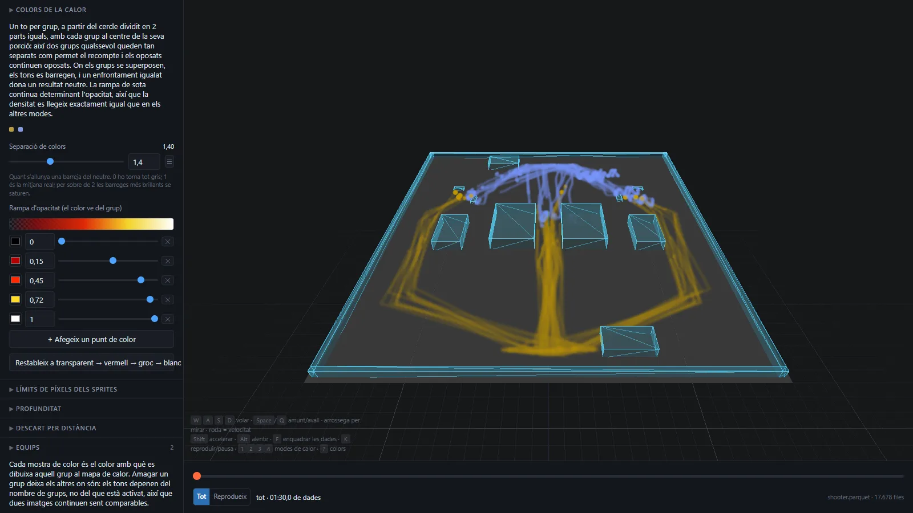

# Calor per equips

La calor per equips mostra on era cada equip, cada equip amb el seu propi color. On els equips se solapen, els colors es barregen.

La **Calor per equips** (tecla 3) és el camp de densitat de la [Calor](heat.md) amb cada [grup](glossary.md) amb el seu propi to. On els grups se solapen, els seus tons es barregen; una competició igualada surt neutral. L'opacitat encara porta la densitat exactament igual que als altres modes, de manera que la imatge respon *quant* i *de qui* alhora. Necessita una columna de grup.

No és la [superposició de figures](box-replay.md): aquella dibuixa una figura per persona; això és un camp de calor acolorit per la mateixa columna.

## Com usar-la {#how-to-use-it}

1. Prem `3` (o tria **Calor per equips** a la barra de modes).
2. Obre **Colors de la calor**. Les mostres mostren el color de cada grup; passa el ratolí per una mostra per veure el nom de l'equip.
3. Si tot es veu gris, puja la **Separació de colors**.
4. Desmarca un grup a la [Llista d'equips](teams-list.md) per treure'l; els altres colors es queden on eren.

## Controls {#controls}

A la secció **Colors de la calor**:

| Control | Per defecte | Significat |
|---|---|---|
| Mostres | | El color de cada grup, per als primers 12 grups, i després *+N més*. Passa el ratolí per veure el nom del grup i el color. |
| **Separació de colors** | 1,4 | Quant s'empeny una barreja lluny del neutre, de 0 a 4. Amb 0 tot és gris; 1 és la mitjana real; passat d'uns 2 les barreges més brillants surten del rang mostrable i se subjecten canal per canal, cosa que desplaça el seu to. |
| **Rampa d'opacitat (el color ve del grup)** | la rampa de calor per defecte | Aquí només s'usa l'**alfa** de la rampa: transparent on no hi ha res, opac a dalt. Els seus colors s'ignoren. |

Un grup l'etiqueta del qual vol dir «cap grup» (`0`, buida, `none`, `unknown`, `null` o `-1`) es dibuixa en gris.

Tots els altres controls de calor —forma, saturació, resposta, calor mínima, profunditat, retall— funcionen com a la [Calor](heat.md).

La [Llista d'equips](teams-list.md) mostra el color de calor per equips de cada grup com a mostra en aquest mode. Amagar un grup deixa el color de tots els altres grups on era: els tons vénen del nombre total de grups, no del que està activat, de manera que dues imatges es mantenen comparables.

## Per als desenvolupadors {#for-developers}

### La paleta {#the-palette}

De [`colors.ts`](https://github.com/Holdi601/3DHeat/blob/main/src/render/colors.ts):

- Els colors viuen al pla de color **Oklab** a una lluminositat fixa (0,7) i croma (0,115), de manera que cada grup és igual de brillant i un grup vermell no es llegeix com més calent que un de blau.
- Amb *n* grups, el cercle de tons es divideix en *n* parts iguals i el grup *i* pren el **centre** de la seva part, `(i + 0,5) / n` d'una volta. Dos grups qualssevol estan tan separats com permet el nombre, i els oposats es mantenen oposats sigui quin sigui el nombre.
- Com a màxim s'usen **16** tons diferents. Amb més grups, els identificadors se situen per divisió repetida (identificadors amb bits invertits: 0, ½, ¼, ¾, ⅛, …) perquè els identificadors veïns no comparteixin to; els grups més enllà de 16 necessàriament en comparteixen.
- Un grup l'etiqueta del qual vol dir «cap grup» —`0`, buida, `none`, `unknown`, `null` o `-1`, sense distingir majúscules— es dibuixa **gris neutre** en lloc de prendre un tros del cercle. Només la primera etiqueta així a la llista de grups es tracta d'aquesta manera.

La separació per defecte és 1,4 i no 1 perquè, a 1, una barreja de cinc tons repartits uniformement *és* gris: correcte i il·legible. Una mica per sobre de 1 manté els empats honestos alhora que fa visible una divisió de 60/40.

### Com funciona {#how-it-works}

L'objectiu de calor té quatre canals en aquest mode. Cada sprite afegeix la seva densitat *v* al primer canal i *v* × les coordenades Oklab *a* i *b* del grup al segon i al tercer. En el moment de la composició, la barreja del píxel és la mitjana ponderada per densitat: *a* = G / R, *b* = B / R, escalada per la separació de colors i convertida a sRGB a la lluminositat de la paleta. Dividir per la densitat acumulada fa que el to sigui independent de quanta dada hi ha, i per això tots els controls de densitat continuen actuant només sobre l'opacitat.

El objectiu de quatre canals costa quatre vegades la memòria de GPU de l'objectiu de calor d'un sol canal a la mateixa resolució.
