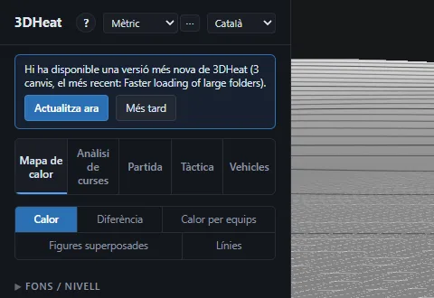

# Actualitzacions

El visor us diu quan existeix una versió més nova, i només s'actualitza si ho dieu. No es canvia res al vostre ordinador sense la vostra resposta.

## Actualitzar el visor {#update-the-viewer}

1. **A la pàgina.** Quan existeix una versió més nova, apareix un quadre sota el nom de dalt de la barra lateral: "Hi ha una versió nova de 3DHeat disponible". Feu clic a **Actualitza ara**. La pàgina es recarrega sola quan acaba. **Més tard** amaga el quadre fins que torneu a recarregar la pàgina.
2. **Si diu que executeu restart.bat**, tanqueu la finestra del servidor (la finestra negra que va obrir `start.bat`) i feu doble clic a `restart.bat`.
3. **En iniciar el visor.** `start.bat` també ho comprova. Si existeix una versió més nova, pregunta **Update now? [Y/N]**. Premeu `Y` per actualitzar. Premeu `N`, o espereu 60 segons sense respondre, per iniciar la versió que teniu.



Una còpia amb canvis propis mai no s'actualitza per a vosaltres; el quadre només us diu que hi ha una actualització esperant, i us diu que feu commit o stash dels vostres canvis i executeu `git pull`. Una còpia que no s'ha instal·lat amb git (un fitxer zip, per exemple) no mostra res.

Com funciona la comprovació, pas a pas:

```
page ---(after 4 s, then every 6 h)---> dev server ---> git fetch
   behind?  no  -> nothing is shown
            yes -> your own changes or commits?  yes -> tell you only
                                                 no  -> [Update now] -> git pull
                                                        -> reload, or "run restart.bat"
```

## Les regles de seguretat {#the-safety-rules}

- **Només avanç ràpid** (`git pull --ff-only`): una actualització mai no fusiona,
  no rebasa ni reescriu res.
- **Sense canvis locals**: una còpia amb canvis no confirmats en fitxers seguits
  (`git status --porcelain --untracked-files=no` no buit) mai no s'actualitza
  automàticament -el treball de ningú no és una cosa que una actualització hagi de
  sobreescriure. Només se li diu que hi ha una actualització esperant. Els fitxers
  no seguits (dades, exportacions) no compten com a canvis.
- **Sense commits locals**: una còpia amb commits que la font no té ("divergent") no
  s'actualitza -un avanç ràpid no la pot posar al dia, i la fusió és per a `git pull`
  fet a mà. La pàgina i `start.bat` ho diuen amb les mateixes paraules, i `start.bat`
  inicia la versió que hi ha allà.
- **Només des de la mateixa pàgina**: la petició d'actualització del servidor de
  desenvolupament ha de portar una capçalera pròpia i, quan el navegador envia un
  `Origin`, ha de venir de l'amfitrió propi del servidor (més avall).
- Només s'actualitza una còpia de git amb una branca d'origen; qualsevol altra cosa
  (una còpia sense `.git`, sense git instal·lat, una compilació estàtica) es deixa
  estar i no diu res.

## Què fa start.bat {#what-startbat-does}

`start.bat` (feu-hi doble clic; la finestra és el servidor) fa, en ordre:

1. Troba Node.js -al `PATH`, o si no a `%ProgramFiles%\nodejs`,
   `%ProgramFiles(x86)%\nodejs` o `%LOCALAPPDATA%\Programs\nodejs`- i ofereix
   instal·lar-lo amb `winget install -e --id OpenJS.NodeJS.LTS` quan no hi és
   (pregunta, Y/N; després cal tornar a obrir la finestra perquè Windows
   reculli el nou `PATH`).
2. **Actualitzacions**, quan git està instal·lat i la carpeta té `.git`:
   - `git fetch --quiet` (sense xarxa o sense origen: es salta en silenci);
   - compta `git rev-list --count HEAD..@{u}`; si no va per darrere, no diu res;
   - canvis locals: "A newer version of 3DHeat is available (N changes), but
     this copy has local changes, so it is not updated. Commit or stash them,
     then run git pull." -i inicia la versió que hi ha;
   - commits propis (`git rev-list --count @{u}..HEAD` no és 0): "A newer
     version of 3DHeat is available (N changes), but this copy has commits of
     its own that the newest version does not, so it is not updated. Update it
     with git pull." -i inicia la versió que hi ha;
   - si no, "A newer version of 3DHeat is available (N changes)." i la pregunta **Update now? [Y/N]**. `N`, o cap resposta durant 60 segons, imprimeix "Not updated; starting the version you have." i inicia la versió que teniu. Amb `Y`: "Updating...", indica si canvien `package.json` o `package-lock.json`,
     executa `git pull --ff-only` (si encara falla -la xarxa, per exemple:
     "The update did not go through; starting the version you have."), després
     `git submodule update --init` (les eines fixades, vegeu [Manteniment de la documentació](maintaining.md#the-tools-under-exporters)), després `npm install` quan han canviat els fitxers del paquet i existeix `node_modules`, i "Updated."
3. No deixa iniciar un segon servidor: quan ja hi ha alguna cosa escoltant al port
   **5273** ho diu i remet a `restart.bat` / `stop.bat`.
4. En la primera execució (sense `node_modules`), pregunta abans de baixar les
   dependències (uns 300 MB a `node_modules\`, res a tot el sistema).
5. Inicia el servidor de desenvolupament a `127.0.0.1:5273` (`--strictPort`) i obre el
   navegador quan està a punt.

`restart.bat` atura el servidor (pel port) i torna a executar `start.bat`, així que fa la mateixa pregunta. `stop.bat` només l'atura.


## Per als desenvolupadors {#for-developers}

### Mentre s'executa: la ruta d'actualització {#while-it-runs-the-update-route}

El servidor de desenvolupament (el connector de Vite `heat3d-self-update` a `vite.config.ts`)
serveix `/__heat3d/update`. Només existeix al servidor de desenvolupament -no en una
compilació estàtica ni a `vite preview`.

**`GET /__heat3d/update`** respon si la còpia va per darrere:

```json
{ "checkout": true, "upstream": "origin/main", "behind": 3, "ahead": 0, "dirty": false, "latest": "the newest commit's subject" }
```

- `checkout: false` quan la carpeta no és una còpia de git;
- executa `git fetch --quiet` **com a màxim cada 30 minuts** (les peticions entremig
  responen amb el que es va obtenir per última vegada);
- `behind` / `ahead` de `git rev-list --count HEAD..@{u}` / `@{u}..HEAD`,
  `dirty` de `git status --porcelain --untracked-files=no`, `latest` l'assumpte del
  commit més nou de la font;
- sense branca d'origen, `upstream: null` i `behind: 0`.

**`POST /__heat3d/update/apply`** posa la còpia al dia:

1. Rebutjada amb `403 { ok: false, reason: "forbidden" }` tret que la petició porti la
   capçalera `X-Heat3d-Update: 1` i, quan porta un `Origin`, l'amfitrió d'aquell origen
   sigui el `Host` de la petició. Un formulari d'un altre lloc no pot enviar una
   capçalera pròpia sense una comprovació prèvia de CORS, que aquest servidor mai no
   concedeix.
2. Res a fer (no és una còpia, no hi ha origen, no va per darrere):
   `{ ok: true, updated: false }`.
3. Canvis locals: `{ ok: false, reason: "dirty" }`; commits locals:
   `{ ok: false, reason: "diverged" }`.
4. Si no: anota els fitxers que canvien (`git diff --name-only HEAD @{u}`),
   `git pull --ff-only` (límit de 2 min), `git submodule update --init`
   (els fallos s'ignoren), `npm install` quan han canviat `package.json` o
   `package-lock.json` (límit de 15 min), i respon
   `{ ok: true, updated: true, restart }` -`restart` diu per què el servidor en marxa
   no pot recollir l'actualització: `"dependencies"` quan s'han tornat a instal·lar,
   `"config"` quan només ha canviat un fitxer `vite.config`, `false` quan no cal
   reiniciar res.
5. Una ordre de git o npm que falla respon `{ ok: false, reason: "<l'error, fins a 300 caràcters>" }`.

Les respostes són JSON amb `Cache-Control: no-store`. El servidor escolta només a
`127.0.0.1`, de manera que la ruta no és accessible des de la xarxa.

### L'avís a la pàgina {#the-notice-in-the-page}

`UpdateBanner`, sota el nom de dalt de la barra lateral:

- Pregunta a la ruta **4 segons** després de carregar la pàgina (no en els primers segons: la pàgina té un conjunt de dades per carregar i una GPU per iniciar) i de nou **cada 6 hores** mentre la pàgina està oberta.
- No mostra **res** quan no hi ha aquesta ruta (una compilació estàtica), la carpeta no és una còpia, o no hi ha res de més nou -un avís a cada inici és un que la gent aprèn a ignorar.
- Va per darrere, sense canvis locals: "Hi ha una versió nova de 3DHeat disponible (N canvis, la més nova: <assumpte>)." amb **Actualitza ara** i **Més tard** (*Més tard* l'amaga fins a recarregar la pàgina).
- Va per darrere, amb canvis locals: la mateixa frase i "Aquesta còpia té canvis locals, així que no s'actualitza automàticament; feu-ne commit o stash i després executeu git pull." -sense botó.
- **Actualitza ara** envia una petició a `/apply` ("Actualitzant..."). Després:
  - "Actualitzat. La pàgina es recarrega." -i es recarrega 1,5 s més tard (el servidor ja serveix els fitxers nous);
  - quan s'han tornat a instal·lar les dependències: "Actualitzat. Les seves dependències han canviat: tanqueu la finestra del servidor i executeu **restart.bat** per acabar.";
  - quan només han canviat els ajustos del servidor: "Actualitzat. Els seus ajustos de servidor han canviat: tanqueu la finestra del servidor i executeu **restart.bat** per acabar.";
  - res per portar al dia després de tot (`updated: false` -la còpia ja s'ha posat al dia mentrestant, per `start.bat` potser): "Res a actualitzar: aquesta còpia ja és la versió més nova." -i no es recarrega;
  - rebutjada: la frase de *canvis locals*, o "Aquesta còpia té commits propis que la versió més nova no té; actualitzeu-la amb git pull.", o "L'actualització no s'ha completat: <motiu>".
