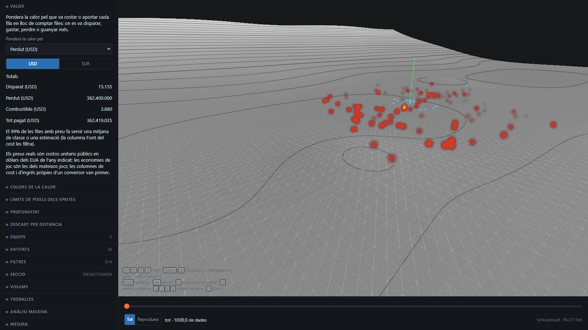

# Ponderació per valor

Cada tret, munició, vehicle perdut i litre de combustible té un preu. El visor calcula què va costar o què va guanyar cada fila, i pot ponderar la calor amb això, de manera que el mapa mostra **on van anar els diners** en lloc d'on són les files.

## Com usar-la {#how-to-use-it}

1. Carrega dades amb esdeveniments (trets, morts, eliminacions) i noms de vehicles o armes.
2. Obre **Valor** a la barra lateral de Calor.
3. Tria **Pondera la calor per**, per exemple *Perdut (USD)*. La calor ara suma el preu de cada fila en lloc de 1.
4. Llegeix **Totals**: la suma de totes les columnes de valor per al que es mostra (els filtres i la finestra de temps s'apliquen).
5. Quan els preus són diners reals, apareix un interruptor **USD / EUR**.

Tria la primera entrada en blanc del menú per tornar a comptar files.

## Què es pot ponderar {#what-can-be-weighed}

Les columnes de valor s'afegeixen en carregar, una per tipus i moneda:

| Tipus | Files on cau | Com es valora |
|---|---|---|
| **Disparat** | trets i llançaments | l'arma, si no una mitjana per al tipus de munició |
| **Gastat** | compra, aparició | columnes de diners del joc (per exemple, el menú de compra d'un shooter) |
| **Perdut** | morts, destruïts | el vehicle propi, si no la mitjana de la seva classe |
| **Destruït** | eliminacions | el vehicle objectiu |
| **Dany causat** | impactes | una part del valor de l'objectiu |
| **Combustible** | posicions | combustible usat, des d'una columna de combustible o estimat per la classe i el temps |
| **Tot pagat** | | disparat + gastat + perdut + combustible |
| **Guanyat** | recompenses | les columnes de recompensa del propi joc (`earn_…`) |
| **Net** | | guanyat menys pagat; es dibuixa com a calor amb signe (rampa positiva on s'ha guanyat més, negativa on s'ha pagat més) |

Els noms de columna són `cost_<tipus>_<moneda>`, `earn_<moneda>` i `net_<moneda>`. Un convertidor que coneix la moneda pròpia del joc (per exemple, un convertidor de repeticions que escriu en crèdits del joc) té prioritat sobre les taules de preus integrades.

## Les taules de preus {#the-price-tables}

| Taula | Moneda |
|---|---|
| Militar del món real: míssils, bombes, munició, contramesures, avions, helicòpters, vehicles terrestres, vaixells, combustible | USD (EUR = USD × 0,92, la constant fixa `EUR_PER_USD` de [`cost.ts`](https://github.com/Holdi601/3DHeat/blob/main/src/data/cost.ts); no és un tipus de canvi en directe) |
| Menús de compra de shooters i recompenses per eliminació | els crèdits del joc |
| Jocs de tancs i de vaixells | els crèdits del joc |
| Jocs d'estratègia (diversos recursos) | una columna per recurs més una de combinada |
| Jocs de guerra | punts |

El joc es reconeix pels noms de les dades. Els preus del món real surten de fonts públiques (documents de pressupost, enciclopèdies) o estan marcats com a estimacions; no s'ajusten per la inflació. La llista generada de taules és a [Taules de valor](ref-value-tables.md).

## Estimacions {#estimates}

La columna de categoria addicional **Font del cost** diu com es va valorar cada fila: `table`, `class average`, `estimate` o `none`. La secció Valor mostra quina part de les files valorades són mitjanes o estimacions. Per quedar-te només amb les files valorades exactament, desmarca *estimate* i *class average* a **Font del cost** dels [Filtres](filters.md).

## On més es mostra el valor {#where-else-value-shows}

- [Anàlisi](insights.md): les troballes *Terreny costós* i *Terreny que guanya*.
- [Desglossament](breakdown.md): diners de Guanyat, Perdut i Net per equip, jugador o arma.
- [Volums](volumes.md): les columnes de valor a les estadístiques i a la comparació.
