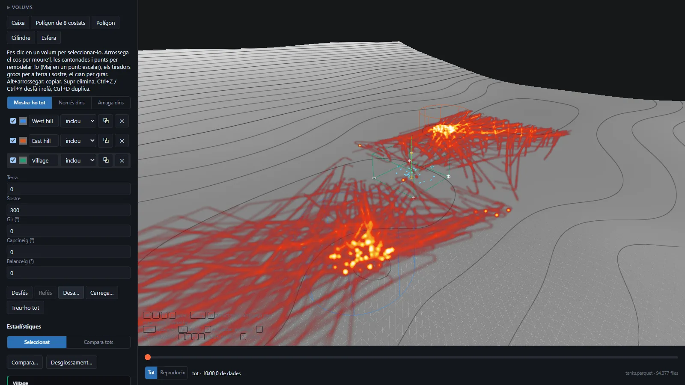
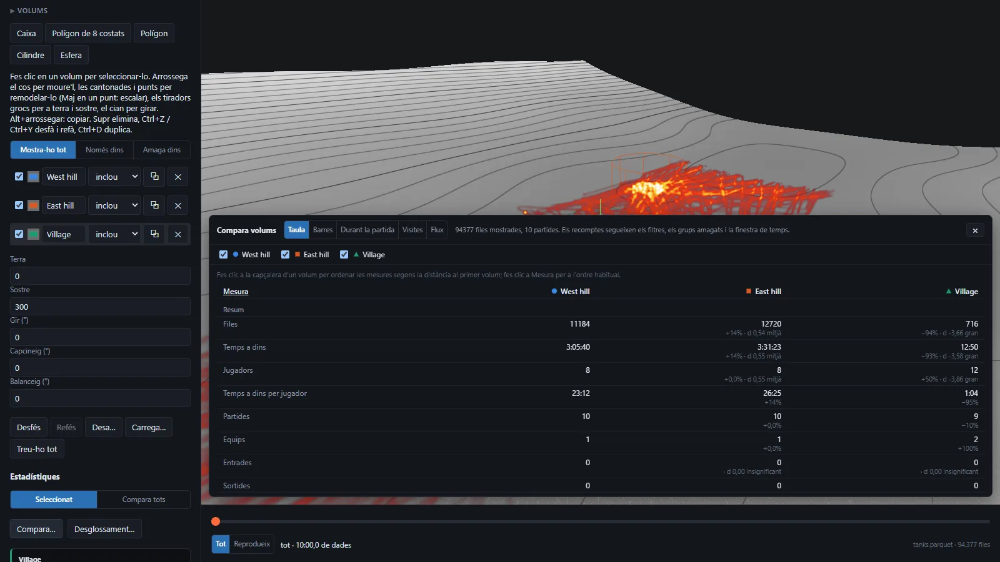
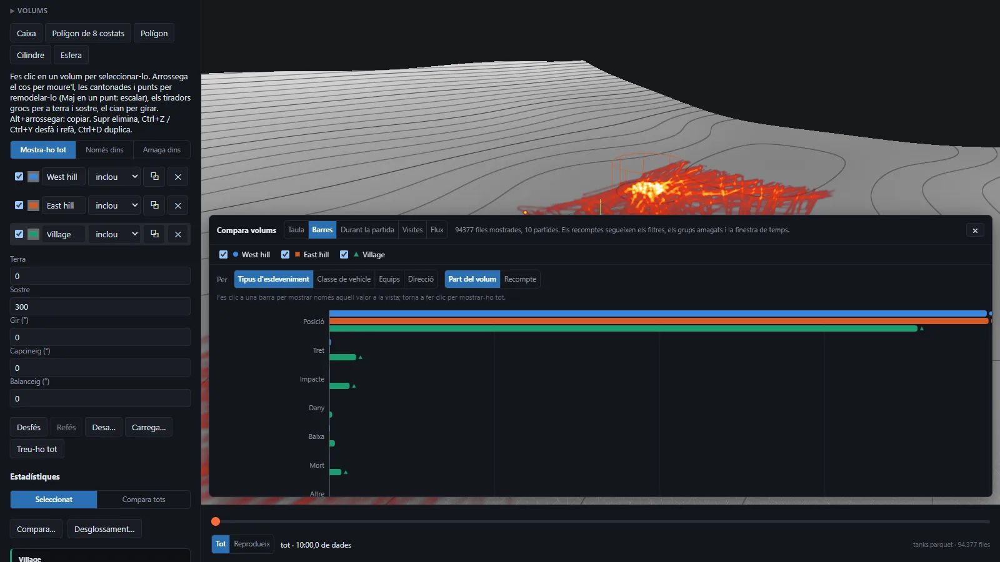

# Volums i comparació

Un **volum** és una caixa invisible (o un cilindre, o una esfera) que dibuixes al voltant d'un lloc, per preguntar: què ha passat aquí dins? Serveix per comptar morts en un pont, per comparar dos turons, o per mostrar només l'activitat d'una àrea.

```
 vista des de dalt        Dibuixes una forma ->  el visor compta
 +------------+           el que hi ha a dins:
 |   ( A )    |            files, jugadors, morts, temps ...
 |        [B] |           Compara A amb B, un al costat de l'altre.
 +------------+
```



Els volums mesuren el que passa dins, filtren la vista fins a ells, exporten les seves files, i es poden comparar un al costat de l'altre. Vegeu també el [glossari](glossary.md) per a fila, persona i partida.

## Dibuixa un volum {#draw-a-volume}

1. Obre **Volums** a la barra lateral.
2. Tria una eina i dibuixa a la vista 3D o al mapa 2D. El terra i el sostre comencen a partir de les dades de sota. Esc cancel·la.
3. Fes clic al volum per seleccionar-lo; apareixen les seves **Estadístiques**.

| Eina | Com es dibuixa |
|---|---|
| **Caixa** | Arrossega un rectangle (Majúscules: un quadrat). Un clic posa una caixa per defecte. |
| **n-gon** | Arrossega des del centre (Majúscules el manté regular). *Vèrtexs* fixa n, de 3 a 64 (per defecte 8, així que el botó diu **8-gon**). |
| **Polígon** | Fes clic als vèrtexs; tanca amb un doble clic, Intro o un clic al primer vèrtex. Retrocés treu l'últim vèrtex. |
| **Cilindre** | Arrossega el radi. |
| **Esfera** | Arrossega el radi; descansa sobre el terra. |

## Edita {#edit}

- Fes clic a un volum per seleccionar-lo. Arrossega el seu cos per moure'l, els vèrtexs per reformar-lo (Majúscules sobre un vèrtex escala).
- Les nanses **grogues** fixen el terra i el sostre, la nansa **cian** el gira.
- Alt+arrossegar copia, Supr elimina, Ctrl+Z / Ctrl+Y desfan i refan, Ctrl+D duplica. **Treu-ho tot** elimina tots els volums.
- Valors exactes: Terra, Sostre, Gir / Capcineig / Balanceig (caixes), Radi (esferes, cilindres).

Cada fila de volum té una casella de mostrar, un color, un nom, **inclou** o **exclou**, duplicar i eliminar. Els volums es desen al navegador per a cada conjunt de dades, i **Desa...** / **Carrega...** escriuen i llegeixen un fitxer `volumes.json`.

## Filtra la vista {#filter-the-view}

| Filtre | Efecte |
|---|---|
| **Mostra-ho tot** (per defecte) | Els volums només mesuren. |
| **Només dins** | La calor, la repetició i l'[anàlisi d'impactes](hit-analysis.md) només dibuixen el que és dins dels volums inclosos i fora dels exclosos. |
| **Amaga dins** | Just el contrari. |

El filtre de la GPU admet fins a 8 volums amb 64 punts de contorn en total; un «!» marca un volum més enllà d'això. Les estadístiques i l'exportació el continuen comptant.

## Estadístiques {#statistics}

L'àrea **Estadístiques** segueix els filtres, la finestra temporal i els grups amagats. *Seleccionat* mostra el volum seleccionat, *Compara tots* posa tots els volums un al costat de l'altre. Mostra:

- **Files dins (mostrades)** i **Files dins (totes les dades)**, **Jugadors**, **Equips**, **Partides**, **Temps a dins**, **Entrades / sortides**, **Calor màxima**, **Calor mitjana**, **Volum / empremta** i un histograma **Quan**;
- **Taxa de victòria**, si les dades diuen qui va guanyar ([columnes de resultat](data-formats.md#outcome-columns)): de les rondes amb un jugador a dins, comptant la ronda de cada jugador una vegada, la part que va guanyar el seu bàndol - atreta cap a la taxa sobre tot el que es mostra amb 4 rondes, com fa el [desglossament](breakdown.md) - amb les rondes guanyades i jugades i aquesta taxa global;
- per columna: categories amb **Ràtio (lift)** (la proporció a dins dividida per la proporció en totes les dades mostrades), i números amb interval, mediana i percentils 5 i 95.

**Estadístiques com a CSV / JSON** les desa. **Exporta les dades de dins** escriu les files de dins com a CSV o Parquet (*Només les files mostrades* activat per defecte), un volum o tots, amb una columna que indica quin volum conté cada fila.

## Compara volums {#compare-volumes}

Amb dos o més volums visibles, prem **Compara...**.

1. Dibuixa tres volums, per exemple Turó oest, Turó est i Poble.
2. Prem **Compara...** sota Estadístiques.
3. A **Taula**, llegeix la diferència de cada valor respecte del primer volum.
4. Canvia a **Barres** per veure les proporcions com a barres.



| Vista | Mostra |
|---|---|
| **Taula** | Files, temps a dins, jugadors, partides, equips, entrades, sortides, visites, durada de les visites, morts causades, morts, morts causades per mort, morts causades per minut, temps per jugador, columnes de valor; agrupat per esdeveniments, classe de vehicle, jugador o IA, equip i direcció. Cada valor mostra la seva diferència respecte del primer volum i una mida de l'efecte (negligible, petit, mitjà, gran). Fes clic a la capçalera d'un volum per ordenar segons la distància al primer. |
| **Barres** | Recomptes o proporcions per esdeveniment, classe, actor, equip o direcció. Fes clic a una barra per filtrar la vista fins a ella. |
| **Durant la partida** | Un gràfic per volum al llarg dels minuts de la partida: presència, files o morts causades. Fes clic per anar-hi. |
| **Visites** | Gràfics de caixa i de violí de quant duren les visites (escala logarítmica). |
| **Flux** | On van els recorreguts en sortir de cada volum: una matriu de transicions o cintes de flux. |



## Consells {#tips}

- Comença per una troballa: a [Troballes](insights.md), **Volum aquí** afegeix un cilindre al voltant del lloc de la troballa.
- **Desglossament...** obre el [Desglossament](breakdown.md) per al volum seleccionat: qui i què funciona millor a dins.
- La [calor direccional](directional-heat.md) pot fer un gràfic de les direccions dins del volum seleccionat.
- La [pestanya Vehicles](hit-analysis.md#restrict-to-an-area) fa servir els mateixos volums com a filtre d'àrea.
