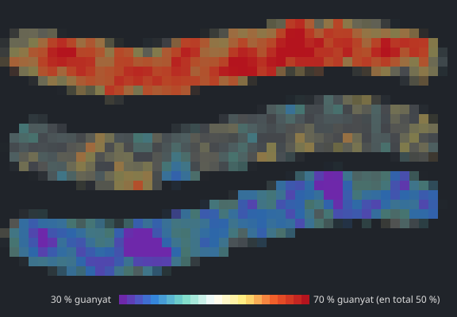

# Taxa de victòria: amb quina freqüència guanya un lloc, una ruta o una jugada

On es col·loca un jugador, cap on va, on llança les seves granades - i amb quina freqüència el seu bàndol guanya després la ronda. El **mapa de taxa de victòria** acoloreix cada lloc segons la part de les files d'allà que pertanyen a rondes que va guanyar el bàndol de la fila, comparada amb aquesta part sobre tot el que es mostra: càlid on és més alta, fred on és més baixa, res on és igual.

*La imatge són dades inventades: tres rutes en un nivell buit, amb el 68%, el 50% i el 33% de les seves files en rondes guanyades.*

Necessita dades que diguin qui va guanyar: les [columnes de resultat](data-formats.md#outcome-columns) (`won`, `matchWon`, `roundEndReason`). Els convertidors de CS2 i War Thunder les escriuen; qualsevol fitxer les pot tenir.

## Prova-ho {#try-it}

1. Carrega partides amb una columna de resultat i prem `2` (**Diferència**).
2. A **Divisió de diferència**, prem **Taxa de victòria per ronda** (o **Taxa de victòria per partida**). Posa les rondes guanyades a **+** i les perdudes a **−**, i canvia el tauler a **Part de +**.
3. Llegeix els colors. El tauler diu la part global: *En total, 52,0 % de 1.200.000 files són a +.*
4. Afina-ho amb els [filtres](filters.md): un bàndol (T o CT), un tipus d'esdeveniment (*Posició* per on era la gent, *Tret* o *Llançament (míssil, coet, bomba)* per des d'on van disparar o llançar), una compra, un mapa.

Un lloc càlid amb files de *Posició* és un lloc on qui el tenia acostumava a guanyar la ronda. Amb files de *Baixa* és un lloc on les baixes que s'hi van fer van portar a rondes guanyades.

## La configuració {#the-settings}

| Opció | Què fa | Per defecte |
|---|---|---|
| **Diferència** / **Part de +** | la diferència mateixa, o la part del bàndol + de les files de tots dos bàndols | Diferència |
| **Color ple a** | com de per sobre o per sota de la part global es mostra un lloc amb color ple, en punts | ± 20 punts |
| **Mínim de files per acolorir un lloc** | un lloc amb menys files no s'acoloreix; apareix gradualment a partir de la meitat | 12 |
| **Atracció cap a la part global (files)** | cada lloc comença amb aquestes files a la part global, perquè un lloc amb 3 files, totes guanyades, no es mostri com a 100% | 12 |

Totes tres actuen sobre la imatge acabada: arrossegar-les mai no reinicia l'acumulació.

La part és la de qualsevol divisió, no només de victòries: *Part de +* amb una divisió per bàndol mostra on els T eren la part més gran de la presència, i amb una divisió pels fitxers de dos mapes, on les files d'un fitxer pesen més que les de l'altre.

## Files, no rondes {#rows-not-rounds}

El mapa compta files. Un jugador que es queda vint segons en un punt afegeix una fila a cada mostra, totes d'una sola ronda, així que l'evidència en un lloc són les files a prop seu, no les rondes. Per això el mínim i l'atracció són en files, i per això són més grans que el que aporta una ronda.

Per a les rondes mateixes:

- **[Desglossament](breakdown.md)** d'un punt, la vista o un volum: *Victòries %* compta la ronda de cada jugador una vegada, atreta cap a la taxa global del lloc de la mateixa manera (4 rondes).
- Estadístiques de **[Volums](volumes.md)**: *Taxa de victòria* - les rondes amb un jugador dins del volum, cadascuna una vegada, atreta cap a la taxa sobre tot el que es mostra, amb els recomptes.

## Filtres de resultat {#outcome-filters}

El tauler [Filtres](filters.md) mostra les columnes de resultat just després de les del visor: **Resultat de la ronda** i **Resultat de la partida** (*Qualsevol*, *Guanyada*, *Perduda*) i **Com va acabar la ronda** (Eliminació, La bomba ha esclatat, Bomba desactivada, S'ha acabat el temps, Rendició, Empat, Objectiu, Zones mantingudes, Tiquets perduts, Tots els vehicles perduts), en l'idioma del visor.

## Per a desenvolupadors {#for-developers}

La passada de calor escriu tres sumes a l'objectiu de quatre canals que fa servir la calor per equips: la calor `R = Σ|v|`, la calor del bàndol + `P`, i `S = Σ v²/w`, amb `w` el pes de la passada (pes de mostreig per guany del fotograma). La composició llegeix la part `P/R` (una mitjana ponderada pel nucli) i les files en què es basa, `n = R²/S` (la mida efectiva de mostra de Kish), atreu la part cap a la global, `p = (n·P/R + m·r0)/(n + m)`, i acoloreix `p - r0` sobre l'interval amb les rampes de diferència.

`n` elimina tots els factors comuns a les files d'un píxel - el guany del fotograma, el pes de mostreig, el pes d'àrea d'un sprite limitat - així que la imatge és la mateixa a qualsevol zoom i densitat de mostreig, i els fotogrames de cada k-èsima fila s'uneixen en el total sense que els colors saltin. La part global surt dels recomptes per bàndol de la CPU, amb precisió de dècimes de percentatge; no es llegeix res de tornada de la GPU. L'aritmètica i les seves comprovacions: [`render/rateMap.ts`](https://github.com/Holdi601/3DHeat/blob/main/src/render/rateMap.ts) i la seva prova.

Costa el mateix que la calor per equips: l'objectiu de quatre canals quadruplica l'amplada de banda de barreja de la passada de calor, només mentre *Part de +* està activat.
