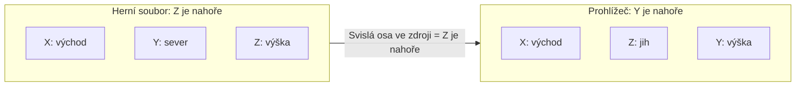

# Osy, jednotky a čas

Hry a mapy se neshodnou na tom, kterým směrem je nahoře, jak dlouhá je jednotka a jak se píše čas. Tato stránka ukazuje tři nastavení, díky kterým vaše data stojí, mají správné měřítko a běží správným směrem.

Když vaše mapa stojí jako zeď místo aby ležela jako podlaha, přepněte **Svislá osa ve zdroji**.

S nesprávnou **Svislou osou ve zdroji** mapa stojí jako zeď; se správnou leží jako podlaha.

## Svět, do kterého prohlížeč kreslí {#the-world-the-viewer-draws-in}

Svět prohlížeče je **Y nahoře**: X a Z jsou rovina země, Y je výška. Většina herních enginů je **Z nahoře**: pro ně jsou X a Y země a Z je výška. Některé enginy jsou navíc zrcadlové (levotočivé). Mapování říká, jak převést osy souboru na osy prohlížeče. (Technicky je prohlížeč pravotočivý, jak je zvykem v three.js.)

### Svislá osa {#up-axis}

**Svislá osa ve zdroji** v [Mapování sloupců](column-mapping.md):

| Nastavení | Soubor (x, y, z) se stane světem (X, Y, Z) |
|---|---|
| *Z je nahoře (většina herních enginů)* – výchozí | (x, **z**, **y**): Z ze souboru se stane výškou a Y ze souboru se stane Z světa |
| *Y je nahoře (grafická konvence)* | (x, y, z) beze změny |

U dat se Z nahoře se tři pole přejmenují místo kopírování ([`remapAxesInPlace`](https://github.com/Holdi601/3DHeat/blob/main/src/data/ingest.ts)), což u velkých načtení ušetří stovky megabajtů. Odhad se dělá podle vzorku: ten ze sloupců Y a Z, který má menší rozptyl, je nahoře.

### Převrácení {#flips}

**Převrátit X**, **Převrátit Y**, **Převrátit Z** znegují *osu souboru* s tímto názvem, ještě před přejmenováním – takže u Z nahoře *Převrátit Y* znegeuje to, co skončí jako Z světa. Převrácení mění načtená data: souřadnice ukazované [měřítkem](measure.md), řezem a pozicí kamery jsou ty převrácené.

Chcete-li zrcadlový svět vykreslit správně **bez změny** dat, použijte místo toho **Kamera a scéna → Obrátit osu světa** ([Kamera](camera.md#invert-world-axis)). To je lepší volba pro hry, jejichž svět je levotočivý, protože každá souřadnice, kterou nástroje ukazují, zůstane vlastní souřadnicí hry.

### Měřítko jednotek {#unit-scale}

**Měřítko jednotek** násobí každou pozici. *1 (m)* nastaví 1, *0,01 (cm→m)* nastaví 0,01 (jednotky Unreal Engine jsou centimetry, takže použijte 0,01; jednotky enginu Source jsou palce, takže použijte 0,0254; ani jedny nejsou metry), a pole přijme jakoukoli hodnotu. Napsaná 0 nebo hodnota, která není číslo, se nahradí 1.

Prohlížeč označuje vzdálenosti v metrech (poloměr sprite, meze ořezu, měřítko, rychlost letu), což platí jen tehdy, když je přeškálovaná jednotka světa metr. Když není, nic se nerozbije; popisky jen říkají „m“ pro to, čím jednotka je.

## Čas {#time}

### Jednotky času {#time-units}

Pravidlo palce: hodnoty jako 17000000000 (deset nebo více číslic) jsou Unixová časová značka; hodnoty jako 0, 0,25, 0,5 jsou sekundy od začátku.

| Jednotka času (popisek v nabídce) | Čte se jako | Zobrazený čas na hodinách |
|---|---|---|
| *Sekundy (relativní)* | hodnota × 1 s | ne |
| *Milisekundy (relativní)* | hodnota × 0,001 s | ne |
| *Mikrosekundy (relativní)* | hodnota × 10^-6 s | ne |
| *Nanosekundy (relativní)* | hodnota × 10^-9 s | ne |
| *Unixová časová značka (s)* | sekundy od 1970-01-01 UTC | ano |
| *Unixová časová značka (ms)* | milisekundy od 1970-01-01 UTC | ano |
| *Textový řetězec ISO-8601* | text jako `2026-03-14T18:02:11.250Z`, načtený `Date.parse` prohlížeče | ano |

S absolutní jednotkou (poslední tři) si datová sada ponechá okamžik na hodinách svého nejdřívějšího řádku a časová osa ukazuje vedle hlavy přehrávání aktuální čas dne v UTC (`HH:MM:SSZ`).

**Sloupce Parquet `TIMESTAMP` a `DATE`** se dekódují na skutečné okamžiky, takže jejich nastavení jednotky se ignoruje a panel to říká. Sloupec `DATE` je celý den: každý řádek jednoho dne sdílí jeden okamžik a přehrávání skáče po dnech, na což panel upozorní.

**Řetězce ISO-8601 fungují stejně v CSV i v Parquetu.** Textový časový sloupec s jednotkou ISO se rozebere jednou pro každý různý řetězec; když se žádný nerozebere, načtení selže hlášením *V mapovaném časovém sloupci nejsou žádné rozebratelné časové značky ISO-8601.* – a mapování už odmítne začít, když se žádná z vzorkovaných hodnot nerozebere. Sloupec Parquet `TIMESTAMP` se čte jako časová značka bez ohledu na nastavenou jednotku a číselný sloupec Parquet s jednotkou ISO se čte jako Unixové milisekundy. Textový časový sloupec s číselnou jednotkou se před načtením odmítne: každá hodnota by se četla jako NaN.

### Jak se čas ukládá {#how-time-is-stored}

Při slučování souborů jsou časy 64bitové sekundy, takže absolutní epocha si zachová podsekundové detaily. Když jsou všechny soubory v pořádku, nejdřívější čas celého výběru se stane 0 a každý řádek ukládá 32bitové sekundy od něj. 32bitový float má 24 bitů mantisy: rozpětí až zhruba jeden a půl dne se rozliší lépe než na 1/100 s, rozpětí půl roku zhruba na sekundu. Řádek, jehož čas chybí nebo není číslo, se umístí na 0, na začátek.

Řádky se pak seřadí podle času, což dělá časovou osu levnou: časové okno se najde dvěma binárními hledáními (viz [Vzorkování a rozpočty](sampling-and-budgets.md)).

### Uplynulý čas a čas na hodinách {#elapsed-time-versus-wall-clock}

Časový sloupec jako `match_time` nebo `round_time` počítá od začátku každého zápasu. Když ho vyberete, každý zápas dostane jednu společnou osu – dobré pro porovnání toho, co se děje v 3. minutě každého zápasu – a panel na to upozorňuje. Sloupec podle hodin na nástěnných hodinách ukazuje zápasy v pořadí, v jakém se skutečně odehrály, překrývající se tam, kde se překrývaly.

## Směr pohledu {#look-direction}

Směr pohledu používá jen [přehrání krychlí](box-replay.md) (paprsky z každé krychle). Ukládá se jako dva úhly, stáčení (yaw) a sklon (pitch), v radiánech.

- **Sloupce stáčení / sklonu** se čtou tak, jak jsou, převedené ze stupňů, když je zvolen *Stupně*. Nepřizpůsobují se svislé ose ani převrácením.
- **Sloupce směrového vektoru** projdou stejným přejmenováním a převrácením jako pozice a pak se stanou stáčením = atan2(x, -z) a sklonem = atan2(y, √(x² + z²)) v osách světa, takže paprsek ukazuje, kam krychle směřuje, i ve světě se zrcadlovým zdrojem.

Pokud sloupce stáčení / sklonu po převrácení, u směrového vektoru nebo u upravených úhlů ukazují špatným směrem, řešením je ten přepočet.
