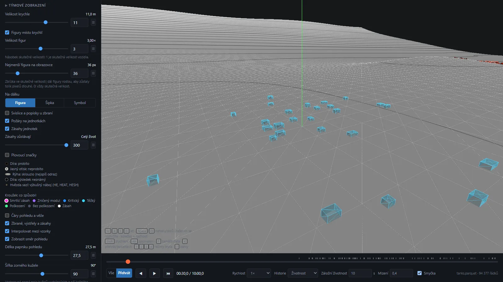

# Překryv figur (přehrání krychlí)

Malý film: jedna figura pro každou osobu, pohybuje se, jak čas běží, a za sebou má stopu.

Režim se v pruhu režimů jmenuje **Překryv figur**. Tato stránka se dřív jmenovala „přehrání krychlí“, protože předtím, než existovaly figury, byla každá osoba krychle; „přehrávání figur“ a „přehrání krychlí“ znamenají totéž. **Překryv figur** nemá číselnou klávesu: vyberte ho v pruhu režimů. Kreslí jednu figuru (nebo krychli) na [osobu](glossary.md), pohybující se podél [časové osy](timeline.md), s volitelnými paprsky pohledu a stopami. Je to přehrávání, a ne hustota: *kdo byl kde, kdy*. Potřebuje sloupec osoby; bez sloupce času se každý vzorek nakreslí najednou.

## Jak to použít {#how-to-use-it}

1. Načtěte data se sloupcem osoby a sloupcem času.
2. Vyberte **Překryv figur** v pruhu režimů.
3. Přepněte časovou osu na **Přehrát** a stiskněte přehrávání (`K`).
4. Otevřete **Týmové zobrazení**, abyste změnili **Délku ocasu**, velikost figur nebo paprsky pohledu.

V tomto režimu se žádné teplo nekreslí a adaptivní rozpočet spritů je nečinný.

Ve výchozím nastavení se každá osoba kreslí jako figura toho, čím je, a ne jako krychle – viz [Figury](figures.md), která figura jednotka dostane, a [Přehrání zápasu](match-replay.md) pro popisky, kameru sledování, měření mezi dvěma jednotkami a seznam událostí.

## Panel Týmové zobrazení {#the-team-viewer-panel}

Zobrazí se místo panelů tepla v tomto režimu.

| Ovládací prvek | Výchozí | Rozsah (posun) | Význam |
|---|---|---|---|
| **Figury místo krychlí** | zapnuto | | Každá osoba jako figura toho, čím je: voják pěšky, tank nebo letadlo, které data pojmenovávají. Co data neříkají, zůstane krychlí. |
| **Velikost figur** | 1× | | 1× je skutečná velikost. |
| **Nejmenší figura na obrazovce** | 36 px | 0 = vždy skutečná velikost | Zblízka skutečná velikost; dál figury rostou, aby zůstaly tolik pixelů dlouhé. |
| **Zbraně, výstřely a zásahy** | zapnuto | | Zbraně v letu s kouřem, stopovače, nárazy, zásahy a zabití. Stopovače odvozené ze zásahu jsou přerušované. |
| **Velikost krychle** | velikost entity, nebo rozsah / 500, při načtení | 0,05–200 m, logaritmicky (5000) | Délka hrany každé krychle. Viz [velikost entity](sessions-persons-groups.md#entity-size). |
| **Interpolovat mezi vzorky** | zapnuto | | Mezi dvěma vzorky téže osoby ve stejné relaci umístí krychli úměrně mezi ně. Nikdy přes hranici relace. |
| **Zobrazit směr pohledu** | zapnuto | | Paprsek z každé krychle ve směru pohledu osoby (potřebuje [sloupce pohledu](axes-units-and-time.md#look-direction)). |
| **Délka paprsku pohledu** | velikost entity × 4, nebo rozsah / 200, při načtení | 0,5–500 m, logaritmicky (20 000) | Zobrazí se, když je směr pohledu zapnutý. |
| **Délka ocasu** | 8 s | 0–300 s (86 400); 0 = vypnuto | Sekundy historie kreslené za každou osobou. |
| **Kreslit každý surový vzorek** | vypnuto | | Krychle na každý uložený vzorek v okně, místo jedné interpolované krychle na osobu. Podvzorkováno, aby zůstalo interaktivní. |

Nápovědy v panelu vysvětlují, že interpolace a stopy spojují vzorky jen uvnitř jedné relace, a když načtení obsahuje [sdílená jména](sessions-persons-groups.md#names-worn-by-several-things-at-once), kolik jmen se kreslí jako jednotlivé vzorky.

## Přehrávaná relace {#the-session-being-played}

Když je sloupec relace, výběr **Relace** nahoře v postranním panelu ([Relace](sessions-persons-groups.md#the-session-picker)) rozhoduje, který zápas se přehrává. Při načtení se vybere nejrušnější. Krychlemi a stopami se stanou jen řádky této relace a časová osa běží přes rozsah té relace místo přes celou datovou sadu. *Všechny relace* přehrají všechny relace najednou, stále bez spojování vzorků přes relace.

## Co se kreslí kdy {#what-is-drawn-when}

Z [`TrackCursor`](https://github.com/Holdi601/3DHeat/blob/main/src/data/tracks.ts):

**Živé krychle** (režim Přehrát, surové vzorky vypnuté). Pro každou viditelnou osobu jejich nejnovější vzorek na hlavě přehrávání nebo před ní:

- Když osoba má další vzorek, je ve stejné relaci a jméno není sdílené, krychle se umístí mezi ty dva vzorky úměrně času, se stáčením interpolovaným nejkratší cestou a sklonem lineárně (když je *Interpolovat* zapnuto).
- Jinak krychle zůstane u posledního vzorku po dobu **Záložní životnosti** časové osy (výchozí 10 s) a pak zmizí, takže vyřazení hráči nezůstávají viset.

**Režim Vše** ignoruje hlavu přehrávání a kreslí každý vzorek v rozsahu jako krychli.

**Surové vzorky** kreslí krychli na každý uložený vzorek v okně: *rozsah* u historie *Okno*, jinak vše až po hlavu přehrávání. Nejvýš 65 536 krychlí; při více vzorcích se kreslí každý *k*-tý.

**Stopy** (když je délka ocasu nad 0 a surové vzorky se nekreslí): čára mezi každou dvojicí po sobě jdoucích vzorků osoby v posledních *délka ocasu* sekundách až po hlavu přehrávání, s průhledností blednoucí od 80 % k průhlednému podle stáří. Stopa se zastaví při změně relace a pro sdílená jména se nekreslí. Nejvýš 131 072 vrcholů; při více se řádky rovnoměrně přeskakují.

**Kdo je viditelný:** osoba je skrytá, když je jejich skupina odškrtnutá v [seznamu týmů](teams-list.md) (jejich skupina je ta, ke které patří jejich první řádek), když skupinový filtr ji vyloučí, nebo když panel [Entity](entities.md) má výběr, který ji nezahrnuje. [Filtry](filters.md) sloupců se na krychle nevztahují.

## Barvy {#colours}

Jeden odstín na skupinu a jeden tón na člena, takže jedním pohledem poznáte, na které straně někdo je ([`teamMemberColor`](https://github.com/Holdi601/3DHeat/blob/main/src/render/colors.ts)). Odstíny skupin se střídají v pevném seznamu deseti – modrá, červená, zelená, jantarová, fialová, azurová, purpurová, limetková, oranžová, indigo – a členové skupiny jsou rozloženi přes světlost 42–76 % a sytost 90–65 %.

## Poznámky {#notes}

- Překryv figur přestaví své figury jen tehdy, když se něco změní; nečinný snímek překreslí poslední.
- Řádek *Krychle* v [přehledu statistik](performance-and-stats.md) počítá krychle na obrazovce.
- Překryv figur se kreslí ve stejné scéně jako level, takže [hloubka ostrosti](camera.md#depth-of-field) rozmaže krychle, ale nikdy teplo.
