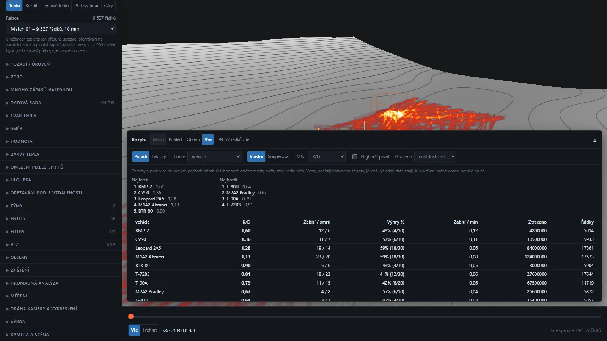
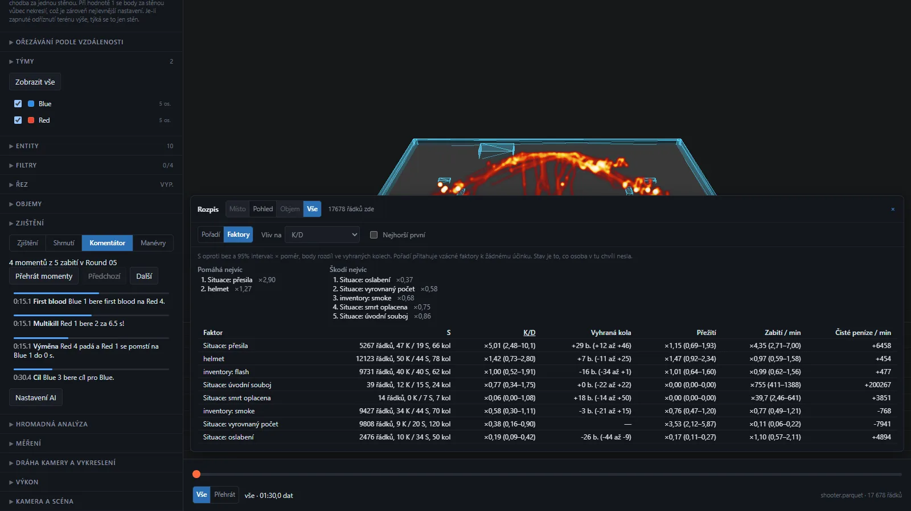

# Rozpis: kdo a co si v kterém místě vede nejlépe

**Rozpis** odpovídá na jednu otázku: na tomto místě, která vozidla, hráč nebo zbraň si vede nejlépe? Použijte ho, když chcete najít tank, který vyhrává u mostu, nebo zjistit, jestli přilba opravdu pomáhá.

Seřadí, co se děje na jednom místě (vybrané místo, pohled, objem, nebo všechno zobrazené) podle libovolné kategorie, a měří každý stavový faktor s a bez něj.

## Vyzkoušejte to {#try-it}

1. Načtěte zápas se zabitími a smrtmi a otevřete **Objemy**.
2. Nakreslete objem kolem místa, na kterém vám záleží, a vyberte ho.
3. Stiskněte **Rozpis...** pod Statistikami.
4. V **Podle** vyberte *Vozidlo* a vyberte měřítko *K/D* (zabití na smrt).
5. Přečtěte seznam, nejlepší první. Stiskněte **Nejhorší první**, abyste ho otočili. Kliknutím na jméno zúžíte pohled na něj; kliknutím znovu to zrušíte.

## Jak se otevře {#open-it}

| Odkud | Oblast, ze které začíná |
| --- | --- |
| **Rozpis...** v [Objemech](volumes.md) (Statistiky) | vybraný objem |
| **Rozpis zde** na kartě výběru, po kliknutí na bod | koule kolem toho bodu (**Poloměr**, výchozí 3 % velikosti dat) |
| dělený panel **Rozdíl** | pohled |

Záhlaví přepíná oblast: **Místo**, **Pohled** (co kamera viděla při posledním počítání; po pohybu **Spočítat znovu**), **Objem** (vyberte jeden) nebo **Vše**. Počítá na pozadí; stavový řádek říká, kolik řádků je v oblasti.

## Řazení {#ranking}

Vyberte, podle čeho řadit, a měřítko:

| Měřítko | Co je to |
| --- | --- |
| A, B | řádky na každé straně mapy rozdílu, rozdělené tak, jak je rozděluje teplo |
| A / B, A - B, A / (A + B) | dvě vrstvy proti sobě |
| K/D | zabití proti smrtem |
| Výhra % | vyhrané kola (nebo zápasy), tam, kde data říkají, kdo vyhrál |
| Zabití / min | zabití za přítomnou minutu (mezery ve vzorcích pohybu) |
| Získáno, Ztraceno, Čistý zisk | součty sloupců `earn_*` a `cost_*`; výběr určí měnu |

Zabití, smrti, přítomnost, výhry a peníze počítají každý řádek, který pohled na tom místě ukazuje, na kterékoli straně rozdělení, nebo na žádné.

Poměry a rychlosti se u malých počtů táhnou k hodnotě celého místa, takže 2 zabití v 1 životě nevyhrají první místo. Počty se ukazují vedle nich.

Můžete řadit podle skupin, hráčů a zápasů, podle libovolného sloupce kategorie (vozidlo, zbraň, strana, typ nákupu, agent nebo sada), podle libovolného číselného sloupce v rozsazích (pancíř, hodnota výbavy), podle **třídy** sloupce zbraní (puška, odstřelovačka, SMG, pistole...) a podle toho, kolik kusů **užitných předmětů** obsahuje seznamový sloupec jako `inventory`.

**Vlastní** řadí podle vlastní hodnoty řádku. **Soupeřova** řadí podle hodnoty druhé strany: zbraň oběti u zabití, zbraň vraha u smrti (potřebuje sloupec `other` / `victim`, který je pojmenovává).

## Stav v daný čas {#state-at-the-time}

Hodnota řádku je jeho vlastní, pokud řádek žádnou nezaznamenává (řádek události bez výbavy), nebo pokud jde o smrt (jejíž sloupec zbraně může pojmenovat zbraň vraha); pak je to to, co tatáž osoba nesla naposledy dříve v zápase.

## Faktory: s proti bez {#factors-with-against-without}

Přepněte z **Řazení** na **Faktory**, vyberte **Vliv na** a přečtěte *Nejvíc pomáhá* a *Nejvíc škodí*:

Vliv každého faktoru na K/D, vyhrané kola, přežití (minuty na smrt), zabití za minutu a čistý zisk za minutu, s 95% intervalem: poměry jako x, vyhrané kola jako rozdíl bodů. Řazení táhne každý odhad k nulovému vlivu podle jeho vlastní nejistoty, takže vzácný faktor potřebuje jasný účinek, aby se dostal vysoko; zobrazený interval je netažený.

Data s koly přidají situace z blízkého boje ([Blízký boj a kola](close-quarters.md)), spočítané jednou pro datovou sadu: *oslepen* (sloupec `state_flashed` řádku, nebo nepřátelský záblesk do 15 m za posledních 3 s), *smrt oplacena*, *úvodní souboj* a *převaha*, *stejné počty* nebo *podpočet* (hráči naživu na straně řádku proti nepříteli). Smrt se počítá do situace, ve které byla její oběť těsně předtím.

V jednom průchodu se měří nejvýš 256 faktorů.

## Pro vývojáře {#for-developers}

### Tahání malých vzorků {#pulling-small-samples}

Hodnota pro řazení je `(n + m*r0) / (d + m)`: `n` a `d` jsou počty, `r0` poměr celého místa a `m` váha té apriorní hodnoty.

### Pro autory převodníků: pojmenování sloupců faktorů {#for-converter-authors-naming-factor-columns}

Převodník přidá faktor tím, že pojmenuje jeho sloupec:

| Sloupec | Faktor |
| --- | --- |
| `state_<name>` číslo | zapnuto, dokud je nenulové (`state_scoped`, `state_suppressor`) |
| `state_<name>` kategorie | jeden faktor na hodnotu (`state_ammo` = AP, HE...) |
| `active_<name>` | totéž pro něco zapnutého nebo nedávno použitého: schopnost, ultimátum, pomůcka, posilovač (`active_ult`, `active_stim`) |
| seznamový sloupec (`inventory`, `loadout`, `perks`, `abilities`, `attachments`, `modules`, `buffs`, `debuffs`, `upgrades`, nebo název `state_`/`active_` končící na `s`) | jeden faktor na položku hodnoty `a\|b\|c` |
| příznaky výbavy, které jsou už běžné (`helmet`, `defuser`, `armor`, `scoped`, `airborne`, `duck`, `flashed`...) | zapnuto, dokud je nenulové |
| `ammoType`, `shellType`, `ammoName` | náboj, který padl naposledy |

Výsledky: sloupec `won` s 0/1 (strana řádku vyhrála kolo nebo zápas) a sloupec `round`. Peníze: `earn_<měna>` a `cost_<druh>_<měna>`; příjem jen podle druhu (`earn_round_cs2`, přesné odměny za kolo od převodníku) nahradí jen odhad příjmu daného druhu z modelu nákladů (`round` pokrývá i zasazení a odzbrojení) a model ocení zbytek.

Mapování tyto sloupce načte samo vedle seznamu sloupců souboru: každý `state_*`, `active_*`, `won`, `round` a seznamový sloupec, kromě těch, které statistiky souboru Parquet ukazují jako jednu hodnotu v celém průběhu (každý načtený sloupec stojí 4 bajty na řádek).
