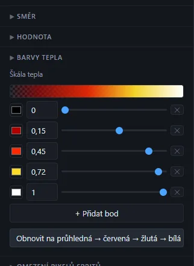

# Barva a expozice

Tyto ovládací prvky určují, jaké množství tepla dostane jakou barvu. **Bod nasycení** je množství tepla, které se počítá jako bíle žhavé.

## Rychlé opravy {#quick-fixes}

- Všechno je bílé: zvyšte **Bod nasycení**, nebo stiskněte **Automatická expozice z pole**.
- Nic není vidět: snižte **Bod nasycení**, nebo stiskněte **Automatická expozice z pole**.
- Vidíte jen pár samostatných teček: zvyšte **Minimální teplo**.

Každý ovládací prvek na této stránce se uplatní, když se teplo mění na barvu, takže když ho potáhnete, obraz se hned překreslí a **nikdy nerestartuje akumulaci**.

## Bod nasycení {#saturation-point}

**Bod nasycení** (sekce Tvar tepla): množství nahromaděného tepla, které odpovídá hornímu konci barevné škály (u odezvy *Lineární*; k ostatním se dostanete níže). Logaritmický posuvník 0,1 až 4000, táhlo lze posunout až na 10 000 000, protože nahromaděné teplo roste s počtem řádků. Výchozí hodnota je 24; při každém načtení se nejdřív spočítá **analytický odhad** a potom se hodnota **změří** podle obrazu.

Správná hodnota rozhoduje o tom, jestli uvidíte teplotní mapu, nebo prázdnou (nebo bílou) plochu. Nelze ji spolehlivě odvodit, protože telemetrie se shlukuje tak silně – spawn, dveře, úzké místo – že poměr špičkové a průměrné hustoty se mezi datovými sadami a mezi úhly kamery liší o řád.

## Automatická expozice {#auto-exposure}

**Automatická expozice z pole** měří pole, které shader skutečně vytvořil. Prázdné pixely ignoruje, vezme 98. percentil osvětlených pixelů a umístí ho do 85 % cesty k bodu nasycení, takže horní konec škály zůstane pro skutečné špičky.

Panel potom ukáže *změřeno X % snímku; 98. percentil R umístěn blízko horního konce škály*. U odezvy *Saturační* hodnota na 85 % bodu nasycení skončí zhruba na 69 % škály, a ne na 85 %.

Spouští se také **automaticky**:

- 8 vykreslených snímků po načtení datové sady;
- 8 snímků po změně [filtrů](filters.md) (filtr, který sníží každou pozici na sto událostí, změní hustotu o řády);
- 8 snímků po přepnutí mezi bodovým teplem a [teplem čar](line-heat.md), nebo po změně tras, které teplo čar kreslí, protože čára uloží na vzorek mnohem méně tepla než sprite.

Když není nic osvětleno, automatické měření nechá nasycení být; tlačítko se vrátí k analytickému odhadu a napíše *nic k měření - použit analytický odhad*.

### Sledovat pohled {#follow-the-view}

**Sledovat pohled** (sekce Tvar tepla, výchozí zapnuto) měří znovu pokaždé, když se kamera zastaví, takže oblast, do které vletíte, využije celou barevnou škálu, a ne měřítko změřené pro celou mapu. Malé změny se ignorují a měřítko plynule přejde, neskočí. Běží ve čtyřech režimech tepla, ne v překryvu figur.

Vypněte to, když chcete měřítko zamknout a porovnat místa na jednom měřítku. Ruční tažení za **Bod nasycení** ho také zamkne.

## Odezva na hustotu {#density-response}

**Odezva na hustotu** – jak se *k* (teplo / nasycení) promítá na škálu:

| Odezva | Vzorec | Použití |
|---|---|---|
| **Saturační** (výchozí) | t = 1 - e^(-k) | Blíží se hornímu konci škály asymptoticky, jako když se kladou průhledné sprite. Nic se nikdy neořízne na plnou bílou, což je bezpečná volba u neznámých dat. |
| **Lineární** | t = k | Jediné zobrazení, kde stejná barva znamená stejný počet. Použijte ho, když chcete porovnat dvě datové sady nebo dvě časová okna. |
| **Logaritmická** | t = log₂(1 + 7k) / 3 | Stlačí dlouhý ocas, takže jedno extrémní horké místo přestane srážet všechno ostatní ke dnu škály. Zvedne řídké oblasti. |

## Minimální teplo {#minimum-heat}

**Minimální teplo** (výchozí vypnuto, 0–100 %): každý pixel, který nese jakékoli teplo, se zvedne alespoň na tuto hodnotu škály. Zvyšte ho a zmenšete poloměr sprite, abyste viděli, *kde se něco vůbec stalo* – jednotlivé datové body pak jsou jasně vidět, místo aby seděly těsně nad průhledností. Když posuzujete hustotu, nechte ho vypnuté, protože podle návrhu zplošťuje spodek škály. Práh (k > 0,0001) udrží skutečně prázdné pixely prázdné.

## Editor škály {#the-ramp-editor}

V sekci **Barvy tepla**. Jeho popisek říká, k čemu škála slouží: *Škála tepla* u Tepla a Čar, *Kladná (přičítající týmy)* u Rozdílu, *Škála krytí (barva pochází ze skupiny)* u [Týmového tepla](team-heat.md), kde se používá jen její průhlednost.



Pruh nahoře ukazuje náhled škály. Pod ním je jeden řádek pro každý bod:

| Část | Význam |
|---|---|
| Barevný vzorek | Barva bodu (výběr barvy prohlížeče). |
| Číslo | Pozice bodu na škále, 0 až 1 (0 = žádné teplo). |
| Posuvník | Krytí bodu, 0–100 %. |
| ✕ | Odstraní bod; je vypnuté, když zbyjí jen dva. |

**+ Přidat bod** přidá bod doprostřed mezi poslední dva body, s barvou a krytím posledního bodu. **Obnovit na průhledná → červená → žlutá → bílá** vrátí výchozí stav.

Body mohou být zadány v libovolném pořadí; při sestavení škály se seřadí. **Alfa** je to, co smíchá teplo s scénou, a proto je nulový konec výchozí škály zcela průhledný.

### Výchozí škály {#the-default-ramps}

| Pozice | Kladná (Teplo, Čáry, Rozdíl +) | Záporná (Rozdíl −) |
|---|---|---|
| 0,00 | černá, alfa 0 | černá, alfa 0 |
| 0,15 | rgb(180, 0, 0), alfa 0,55 | rgb(0, 170, 60), alfa 0,55 |
| 0,45 | rgb(255, 40, 0), alfa 0,85 | rgb(0, 190, 200), alfa 0,85 |
| 0,72 | rgb(255, 220, 40), alfa 0,95 | rgb(40, 80, 255), alfa 0,95 |
| 1,00 | bílá, alfa 1 | rgb(170, 60, 255), alfa 1 |

## Když se kamera hýbe {#while-the-camera-moves}

Když se kamera hýbe, akumulace se restartuje v každém snímku. Se zapnutým **Kreslit každý řádek v každém snímku** (výchozí) je každý pohybující se snímek stále přesný; když je vypnuto, pohybující se snímek ukáže jeden vzorkovaný odhad – jasnější shluky s vahou – který se při zastavení sblíží s hladším skutečným obrazem. To je očekávané; viz [Akumulace](accumulation.md).

## Pro vývojáře {#for-developers}

### Kompozitní průchod {#the-composite-pass}

Po nahromadění tepla se hodnota každého pixelu změní na barvu v jediném kompozitním průchodu ([`COMPOSITE_FS`](https://github.com/Holdi601/3DHeat/blob/main/src/render/webgl2/shaders.ts)). Kroky jsou:

```
k = |teplo| / bod nasycení
t = odezva(k)                           omezeno na 0..1
pokud minimální teplo > 0 a k > 0.0001:  t = minimum + (1 - minimum) × t
barva, alfa = škála(t)                  (záporná škála, když teplo < 0, jen u Rozdílu)
pixel = mix(scéna, barva, alfa)
```

### Analytický odhad {#the-analytic-estimate}

**Analytický odhad** ([`estimateSaturation`](https://github.com/Holdi601/3DHeat/blob/main/src/data/calibrate.ts)) předpokládá, že řádky jsou rozprostřeny přes půdorys dat v rovině X-Z: průměrné teplo = řádky × (π r² / plocha půdorysu) × 1/3 × intenzita ve středu (1/3 je průměr lineárního přechodu přes kruh), vynásobené předpokládaným poměrem špička / průměr 25 a omezené na 0,1 až 1 000 000. Musí být jen v rámci řádu správně.

### Měření {#metering}

[`exposure.ts`](https://github.com/Holdi601/3DHeat/blob/main/src/render/exposure.ts):

1. cílová hodnota tepla se přečte zpět z GPU a podvzorkuje se na nejvýš 40 000 hodnot;
2. prázdné pixely (teplo ≤ 0,0001) se zahodí – většina pole tepla je prázdná a jejich zprůměrování by všechno podexponovalo, stejně jako když expozimetr míří na černé pozadí;
3. referencí je 98. percentil osvětlených pixelů;
4. bod nasycení se stane referencí / 0,85, takže referenční hodnota sedí na 85 % cesty k bodu nasycení a horní konec škály zůstane pro skutečné špičky.

### Tabulka barev {#the-colour-table}

Škála se zapeče do tabulky RGBA 256 × 2 (kladná škála v prvním řádku, záporná ve druhém) ([`buildColorLut`](https://github.com/Holdi601/3DHeat/blob/main/src/render/colors.ts)). Barvy se interpolují v lineárním světle a ukládají se jako sRGB; krytí se interpoluje lineárně.
