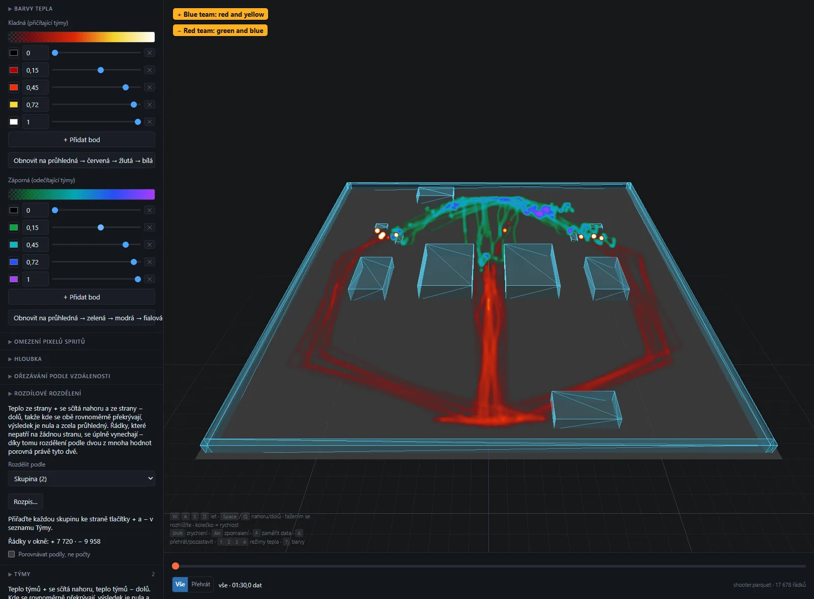

# Rozdíl

Červeně tam, kde byl tým A víc, zeleně a modře tam, kde byl tým B, a nic tam, kde byly stejně.

**Rozdíl** (klávesa 2) je teplo se znaménkem. Řádky jedné populace teplo přidávají; řádky jiné populace ho odečítají. Kde se obě překrývají rovnoměrně, je výsledek nula a zcela průhledný; kde jedna převládá, ukazuje se barvami té strany - ve výchozím nastavení teplejšími (průhledná → červená → žlutá → bílá) pro stranu **+** a chladnějšími (průhledná → zelená → modrá → fialová) pro stranu **−**.

## Jak to použít {#how-to-use-it}

1. Stiskněte `2` (nebo vyberte **Rozdíl** v liště režimů).
2. V postranním panelu otevřete **Rozdílové rozdělení**.
3. Vyberte, co **Rozdělit podle**: obvykle *Skupiny*.
4. Jednu skupinu (nebo hodnotu) dejte na **+** a jinou na **−**.
5. Čtěte barvy: teplejší znamená stranu +, chladnější stranu −. Panel varuje, když jedna strana nemá žádné řádky (viz [Zprávy, které můžete vidět](#messages-you-may-see)).

*Které dvě populace* jsou celá otázka, takže rozdělení může být podle libovolného ponechaného sloupce, ne jen podle skupin. Řádky, které spadnou na **žádnou** stranu, se **vynechají**, nepočítají se jako nula: díky tomu rozdělení přes dvě z mnoha hodnot porovná přesně tyto dvě a kombinuje se s [filtry](filters.md) - vyfiltrujete jednu mapu a to pak rozdělíte podle verze.

Režim potřebuje dvě strany: sloupec skupiny s aspoň dvěma skupinami, nebo rozdělení přes sloupec ponechaný pro filtrování. U dat s méně než dvěma skupinami začne načtení rozdělením podle sloupce - nejdřív sloupec *Zdrojový soubor* u načtení z více souborů, jinak první kategoriální sloupec se dvěma hodnotami, jinak první číselný sloupec s rozpětím - takže *porovnání dvou načtení* funguje i u dat bez skupin. Režim je nedostupný jen u dat bez obojího; stejně tak u rozdělení sloupce, kde na jedné straně nic nezůstalo.

## Panel Rozdílové rozdělení {#the-difference-split-panel}

Zobrazuje se v režimu Rozdíl, pod panely tepla.

**Rozdělit podle** nabízí:

| Volba | Zobrazeno jako | Pravidlo rozdělení |
|---|---|---|
| Skupiny | *Skupina (N)* (když existuje sloupec skupiny) | Každá skupina na +, − nebo na žádné, nastaveno v [Seznamu týmů](teams-list.md) |
| Kategoriální sloupec | *sloupec (N hodnot)* | Hodnoty na +, − nebo na žádné |
| Číselný sloupec | *sloupec (číselný)* | Rozsah hodnot pro každou stranu |
| Soubor původu | *Zdrojový soubor - porovnání dvou načtení* (když bylo načteno více souborů) | Soubory na +, − nebo na žádné |

Nabízejí se jen sloupce ponechané pod *Zachovat pro filtrování* při načítání.

### Porovnávat podíly, ne počty {#compare-shares-not-counts}

**Porovnávat podíly, ne počty** (výchozí vypnuto) váží každou stranu jedničkou děleno počtem jejích vlastních řádků, takže strana s pětinásobným počtem řádků nevyhraje jen čísly. Barva pak ukazuje, kde je každá strana úměrně častější než ta druhá. Použijte to, když mají obě strany hodně různá množství dat, například dvě relace různé délky.

### Zprávy, které můžete vidět {#messages-you-may-see}

Panel varuje, když obrázek není skutečný rozdíl:

| Zpráva | Význam |
|---|---|
| *N + / M −* (nebo *N + / M − / K nepoužito*) | Kolik hodnot je na každé straně (a na žádné). |
| Žádný řádek v okně není na straně **+** | Kreslí se jen strana **−**. Posuňte okno časové osy nebo změňte rozdělení. |
| Žádný řádek v okně není na straně **−** | Kreslí se jen strana **+**. |
| Žádná hodnota není na žádné straně | Rozdíl nekreslí nic. Dejte aspoň jednu hodnotu na **+** nebo **−**. |
| *sloupec nejde rozdělit tímto způsobem* | Zvolený sloupec se k rozdělení nehodí. Vyberte sloupec znovu. |
| Sloupec rozdělení se nevešel do paměti GPU pro N z M částí | Tyto řádky se nekreslí. Zvyšte rozpočet GPU v Výkon → Rozpočty prostředků, nebo načtěte méně řádků. |

### Podle skupiny {#by-group}

Panel jen ukazuje na [Seznam týmů](teams-list.md), kde má každá skupina tlačítka **+** a **−**. Při každém načtení se první polovina skupin (zaokrouhleno nahoru) dá na +, zbytek na −; **Rozdělit rovnoměrně** v Seznamu týmů to udělá znovu. Skupina na žádné straně nebo skrytá svým zaškrtávátkem nepřispívá.

### Podle hodnot kategorie {#by-category-values}

| Část | Význam |
|---|---|
| `a + / b − / c nepoužito` | Kolik hodnot je na každé straně a na žádné. |
| **Vymazat** | Dá každou hodnotu na žádnou stranu. |
| Seznam hodnot | Každá hodnota s tlačítky **+** a **−** (kliknutím na aktivní ji z dané strany odeberete). Prázdná hodnota se uvádí jako *(chybí)*. |
| Poznámka o limitu | Vypisuje se jen prvních 200 hodnot: *Zobrazeno prvních 200 z N hodnot. Tak široký sloupec je lepší nejdřív zúžit filtrem, nebo rozdělit podle rozsahu, pokud jsou jeho hodnoty seřazené.* |

Výběr sloupce dá jeho první hodnotu na + a druhou na −. Když nemá žádná strana hodnotu, rozdělení se vrátí ke skupinám, místo aby ukázalo prázdný rámec. *Zdrojový soubor* funguje stejně, jedna hodnota na soubor - takto se porovnávají dva exporty, dva testovací běhy nebo dvě verze.

### Podle rozsahu {#by-range}

| Část | Význam |
|---|---|
| Nápověda | Nejmenší a největší hodnota sloupce. |
| **Kladný rozsah (+)**, **od** / **do** | Řádky s hodnotou v tomto rozsahu, včetně obou konců, přidávají. |
| **Záporný rozsah (−)**, **od** / **do** | Řádky v tomto rozsahu odečítají. |
| **Rozdělit v polovině** | Nastaví + na [minimum, střed] a − na [střed, maximum] - totéž udělá i výběr sloupce. |

Hodnota v obou rozsazích se počítá jako +. Rozsahy nemusí pokrývat celý sloupec; hodnoty mimo oba se vynechají. *První dvě minuty proti posledním dvěma* je rozdělení podle rozsahu u sloupce podobného času.

## Barvy {#colours}

Sekce **Barvy tepla** v tomto režimu ukazuje dva editory škál: **Kladná (přičítající týmy)** a **Záporná (odečítající týmy)**, každý se svým tlačítkem obnovení (*Obnovit na průhledná → červená → žlutá → bílá*, *Obnovit na průhledná → zelená → modrá → fialová*). Složení bere absolutní hodnotu čistého tepla přes [bod nasycení a odezvu](colour-and-exposure.md), a tam, kde je čisté teplo pod nulou, použije zápornou škálu. Viz [Barva a expozice](colour-and-exposure.md#the-ramp-editor).

Použijte *Lineární* odezvu na hustotu, když záleží na velikosti rozdílu: je to jediná odezva, kde stejná barva znamená stejný počet.

## Jak to funguje {#how-it-works}

Každý řádek dostane ve vertex shaderu znaménko +1, -1 nebo 0 ([`POINT_HEAT_VS`](https://github.com/Holdi601/3DHeat/blob/main/src/render/webgl2/shaders.ts)); 0 odmítne řádek dřív, než se nakreslí jakýkoli fragment.

- Podle skupiny znaménko pochází z tabulky skupin se 4 096 položkami indexované id skupiny řádku (id skupiny jede ve čtvrtém kanálu pozičního texelu řádku).
- Podle kategorie znaménko pochází z druhé tabulky se 4 096 položkami, plněné pro každou hodnotu kategorie, a hodnota řádku se čte z filtrační textury sloupce; hodnota za koncem tabulky se odmítne na obou backendech.
- Podle rozsahu se hodnota řádku porovná se dvěma rozsahy.

Změna rozdělení restartuje akumulaci.

**Skryté skupiny zůstávají skryté při každém rozdělení.** Při rozdělení podle sloupce tabulka skupin už nenese znaménka; drží 1 pro zobrazenou skupinu a 0 pro skrytou ([`frameSignTables`](https://github.com/Holdi601/3DHeat/blob/main/src/render/filterTables.ts)), a obě tabulky se dostanou do shaderu společně - dva řádky jedné textury znamének na WebGL2, dvě poloviny jednoho storage bufferu na WebGPU. Řádek se kreslí jen tehdy, když je jeho skupina zobrazena *a* jeho hodnota sloupce je na některé straně. Skupina odškrtnutá v [Seznamu týmů](teams-list.md), nebo vynechaná zaměřením strany na kartě Zápas, tedy nepřispívá, ať je rozdělení jakékoli.
