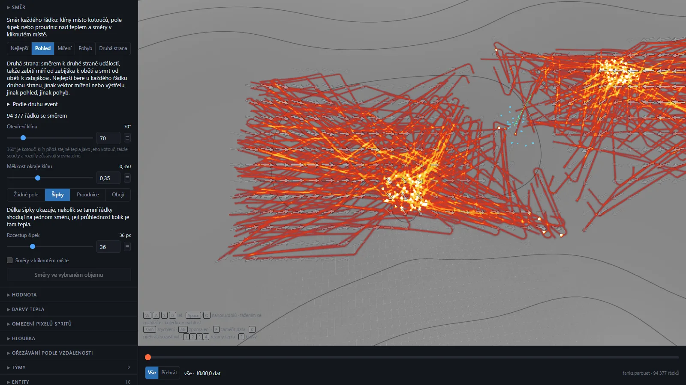

# Směrové teplo

Obyčejné teplo říká **kde** se věci dějí. Směrové teplo říká také **kterým směrem**: kam se lidé dívali, na co mířili, kam se pohybovali, nebo kde byla druhá strana boje.

Normální sprite je celý kotouč (360 stupňů). S **Otevřením klínu** 70 stupňů se stejný sprite změní na úzký klín, který ukazuje směr, kterým byl řádek otočen, a přidá stejné celkové teplo.

## Jak to použít {#how-to-use-it}

1. Načtěte data se směrem (viz [Co dává řádku směr](#what-gives-a-row-a-direction)).
2. V pruhu režimů vyberte **Teplo**, **Rozdíl** nebo **Týmové teplo**.
3. Otevřete v postranním panelu sekci **Směr**.
4. Vyberte **zdroj** (který směr použít) a pak zapněte kreslení:
   - snižte **Otevření klínu** pod 360° a každý řádek se nakreslí jako klín, který ukazuje jeho směrem, místo kotouče;
   - vyberte **Pole**, abyste přes teplo nakreslili šipky nebo proudnice;
   - zaškrtněte **Směry v kliknutém místě** a klikněte na teplo, abyste dostali polární graf toho místa.

Stavový řádek říká, kolik řádků má směr z vybraného zdroje.

## Nastavení {#settings}

| Nastavení | Výchozí | Co dělá |
|---|---|---|
| Zdroj: **Nejlepší**, **Pohled**, **Míření**, **Pohyb**, **Druhá strana** | Nejlepší | Který směr každý řádek dostane. *Nejlepší* vezme u každého řádku druhou stranu, jinak míření, jinak pohled, jinak pohyb. |
| **Podle druhu události** | jak výše | Jiný zdroj pro každý druh události, například *Druhá strana* u zabití a *Pohled* u pozic. Zobrazí se, když data mají sloupec události s nejvýš 40 hodnotami. |
| **Otevření klínu** | 360° | 360° je normální kotouč (vypnuto). Menší hodnota je užší klín. Klín přidá tolik tepla, kolik jeho kotouč, takže součty a rozdíly zůstávají srovnatelné. |
| **Měkkost okraje klínu** | 0,35 | 0 je klín s ostrým okrajem, 1 měkký vějíř. |
| **Pole**: Bez pole, Šipky, Proudnice, Obojí | Bez pole | Šipky: délka šipky je, jak moc se tam řádky shodují na jednom směru, její krytí, kolik tam je tepla. Šipky se ukazují jen tam, kde je teplo. |
| **Rozestup šipek** | 28 px | Vzdálenost mezi šipkami na obrazovce. |
| **Animovat proudnice** | zapnuto | Proudnice proudí, když je zapnuto. |
| **Směry v kliknutém místě** | vypnuto | Kliknutím na teplo uvidíte směry tam (níže). |
| **Směry ve vybraném objemu** | | Stejný graf pro všechno uvnitř vybraného [objemu](volumes.md). |

## Polární graf v místě {#the-polar-chart-at-a-spot}

Se zapnutým **Směry v kliknutém místě** klikněte na teplo. Řádky blízko toho bodu (do 1,5 poloměru spritu) se seskupí do růžice 24 výseků po 15°:

- **oranžové** lístky: odchozí směry (kam řádky ukazují);
- **modré** lístky: příchozí směry (odkud přišly);
- **plocha** lístku roste s jeho počtem; šipka ukazuje hlavní směr;
- čáry pod grafem dávají hlavní směr, jak silně se řádky shodují (R, 0 až 1), rozptyl ve stupních a počet řádků.

0° je na grafu nahoře, což je světové −Z (sever u nahrávek Tacview). Místo je také označeno ve 3D pohledu šipkou a kroužkem.

## Co dává řádku směr {#what-gives-a-row-a-direction}

| Zdroj | Potřebuje v datech |
|---|---|
| Pohled | sloupec stáčení (namapovaný jako směr pohledu): `yaw`, `heading`, `azimuth`, `view_yaw`, `rot_z` |
| Míření | dvojice čísel jako `aim_x`/`aim_y`, `shot_x`/`shot_y`, `fire_x`/`fire_y`, `hit_dir_x`/`hit_dir_y` (volitelně `…_z`) |
| Pohyb | nic navíc: krok od předchozího vzorku téže osoby (nejvýš 10 s předtím, stejná relace) |
| Druhá strana | sloupec, který pojmenovává druhou stranu události (`other`, `victim`, `target`, `killer`, `attacker`, `shooter`, `other_player` ...), jehož hodnoty jsou jména osob; zabití ukazuje od vraha k oběti, smrt od oběti k vrahovi |

## Tipy {#tips}

- Klíny potřebují na obrazovce nějakou velikost; pod několik pixelů se zase kreslí jako kotouče.
- Použijte *Druhou stranu* u řádků zabití, abyste viděli, **odkud** se boje vyhrávaly, a *Pohled* u řádků pozic, abyste viděli, **kam lidé hledí**.
- S **Rozdílem** klíny obou stran ukazují svými směry, takže sporné palebné linie vynikají.
