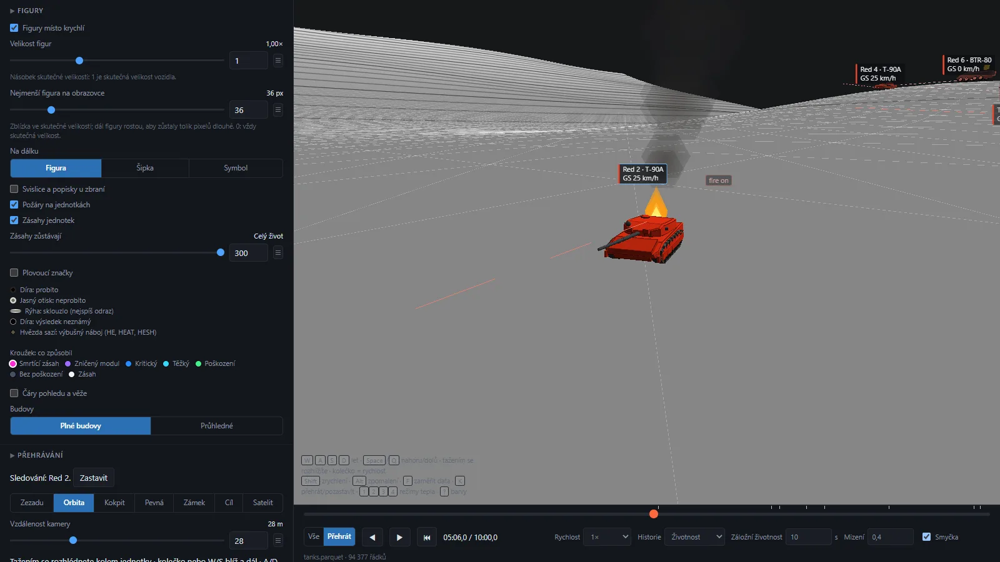

# Figury

**Figura** je malý 3D model toho, čím jednotka skutečně je: tank, tryskáč, loď, voják. [Přehrávání](match-replay.md) kreslí každou jednotku jako její figuru ve skutečné velikosti místo prosté krabice.

Je jich asi 2 000 pojmenovaných vozidel, letadel, lodí, zbraní a vojáků, všechny je vytvořil sám prohlížeč.

## Co je v katalogu {#what-is-in-the-catalogue}

| Oblast | Příklady |
|---|---|
| Lidé | voják ve stoje, v dřepu, vleže; odstřelovač, protitankový, zdravotník, osádka |
| Pozemní | tanky, bojová vozidla pěchoty, protiletadlová obrana, dělostřelectvo, nákladní auta a auta, vlaky a tramvaje |
| Vzdušné | stíhačky, útočná letadla, bombardéry, dopravní letadla, vrtulníky, od dvouplošníků po moderní trysková letadla |
| Námořní | válečné lodě podle třídy, letadlové lodě, ponorky, čluny, obchodní lodě |
| Zbraně | střely, rakety, bomby, torpéda, světlice a plevy |
| Značky | kouřové, zábleskové a zápalné granáty, položené bomby, vlajky, místa zrodu, body trasy |
| Boj zblízka | vojáci v nosičích plátů s útočnou puškou, samopalem, brokovnicí, DMR, LMG, pistolí nebo štítem; drony, kamery, ostnatý drát, štíty, zpevnění zdí, barikády, průrazné nálože, pasti, okna, granáty, zneškodňovač |

## Jak se figury vyrábějí {#how-the-figures-are-made}

- **Stavěné podle zveřejněných rozměrů.** Většinu figur vytvoří stavitel figur v prohlížeči z veřejných čísel: délka, šířka, výška, pojezdová kola, věž a kanón, křídla a ocas. Jejich tvar se pak doladí podle veřejných fotografií, výkresů a zveřejněných rozměrů. Nepoužívá se žádný model z her.
- **Volné modely.** Několik figur používá volné 3D modely (CC0 nebo CC BY) tam, kde jsou věrnější, někdy spojené s vlastním trupem. Autoři děl CC BY jsou uvedeni v [Poděkování za figury](figure-credits.md); díla CC0 uvádění nevyžadují a tam nejsou vypsána.
- Každá figura má plnou, hrubou a vzdálenou verzi (úrovně detailu, LOD), takže lze kreslit tisíce najednou.

## Jakou figuru jednotka dostane {#which-figure-a-unit-gets}

Prohlížeč se dívá na vlastní sloupce dat:

1. **Názvy** – sloupce nazvané *Name*, *Vehicle*, *Unit*, *Unit type*, *Model*, *Aircraft*, *Plane*, *Tank*, *Ship*, *Craft*, *Loadout*, *Kit* nebo *Figure* – se porovnají s katalogem: přesně, přes asi 4 000 aliasů (herní id jednotek několika her), podle nejdelšího známého začátku (`F-16C_50` je F-16C), nebo podle nejkratšího názvu figury, který s ním začíná.
2. Název, jehož figura nesedí na **typ** jednotky, se nepoužije (nákladní auto zvané *Typhoon* není stíhačka).
3. **Typy** – sloupce nazvané *Type*, *Class*, *Kind*, *Category*, *Icon*, *Role* nebo *Domain* – dají třídovou figuru: značky Tacview (`Air+FixedWing`, `Ground+Heavy+Armor+Vehicle+Tank`, `Sea+Watercraft+Warship`, `Weapon+Missile`), ikony map, nebo prosté slova (tank, vrtulník, pěchota).
4. Data bez obojího jsou data o lidech: každý je voják.

Nejsnazší způsob, jak dostat správné figury, je tedy sloupec `vehicle` se skutečnými názvy, nebo sloupec `type` se značkami Tacview.

**Moje jednotka se ukazuje jako krabice nebo voják.** Přidejte sloupec `vehicle` se skutečným názvem, nebo sloupec `type` se značkou Tacview. Najetím na jednotku uvidíte, který název se shodl. Data, která takové sloupce mají, ale o jednotce nic neříkají, ji nechají jako krabici; data bez nich se kreslí jako vojáci.

## Figury pro boj zblízka (Rainbow Six Siege) {#close-quarters-figures-rainbow-six-siege}

Tabulky zapsané jako ty ze čtečky záznamů Rainbow Six Siege (sloupce `operator`, `pawn`, `primaryClass`, `side`) dostanou vlastní figury:

- **Hráči** jsou svým operátorem: každý ze 78 operátorů má vlastní figuru, vysokou asi 1,8 m, ve vlastním oblečení. Dvě nebo tři barvy bundy, kalhot a výstroje odpovídají jeho obvyklému veřejnému vzhledu (černá, olivová, písková, městská šedá, bílá, námořnická modrá, s červenou, oranžovou nebo petrolejovou výstrojí). Má i vlastní tvary, o třetinu větší než ve skutečnosti tam, kde musí být vidět shora: pokrývku hlavy (helmy, hledí nebo těžkou helmu, kšiltovky, čepice, barety, široký klobouk do buše nebo kožešinovou čepici, kapuce, šály, vlasy), obličej (ochranné brýle, plynovou masku, brýle, masku, vousy, brýle se třemi skly), lehkou, střední nebo těžkou postavu (těžcí jsou širocí, s velkými ramenními pláty a límcem), dlouhý kabát nebo oblek, maskovací oblek ghillie, to, co nese na zádech (kladivo, nálože, drony, kanystry, palivovou nádrž, odpalovací tubus, kuši, panely, rušičku, štít) nebo na paži (odpalovač, kovovou paži), vlastní štít (vysoký, policejní, se světly) a barvu akcentu na ramenou. Drží třídu své primární zbraně. Operátor, kterého prohlížeč nezná, je obyčejný voják v nosiči plátů v barvě týmu.
- **Strana** je vidět odděleně od oblečení: kruh na zemi pod každým operátorem, **jantarový pro útok, světle azurový pro obranu**, s barvou týmu uvnitř, a pásky na paži a na hlavě ve stejné barvě. Sloupec `stance` (stand, crouch, prone) jim dává postoj; bez něj stojí.
- **Rozlišitelní na vzdálenost záznamu:** vykreslení ve výšce 48 pixelů shora a ze tříčtvrtečního pohledu se každí dva operátoři jedné strany liší jasným rozdílem barvy nebo jiným tvarem (ověřují to testy prohlížeče).
- **Popisky** uvádějí hráče a operátora, kterého v tu chvíli hraje, s rolí operátora jako symbolem: ✸ tvrdý průraz, ⚒ měkký průraz, ➤ vstup, ✦ fragger, ✚ podpora, ⬟ štít, ◉ průzkum, ◇ flexibilní, ↺ hlídka boku, ⚓ kotva, ✕ pastičkář, ⇄ roamer, ↯ proti gadgetům, ▣ proti průrazu.
- **Drony** jsou házecí dron na dvou kolech, asi 30 cm široký. Každý je vlastní stopa, pojmenovaná podle majitele („Ash · drone 2“).
- **Umístěné gadgety** stojí tam, kam byly položeny, od té chvíle do konce kola. Každý je figurou toho, co dělá: kamera, ostnatý drát, rozkládací štít, průrazná nálož, těžká průrazná nálož, malá přilnavá nálož, podlahová past, mina claymore se spouštěcím laserem, jednosměrné okno, pancéřový panel, granát, plynová bomba, rušička, senzor, laserová brána, bedna se zásobami. Jedna figura slouží všem gadgetům, které dělají stejnou práci. Gadget, jehož druh data neuvádějí, je malé zařízení se světlem.
- **Zneškodňovač** stojí tam, kde byl položen, po svých 45 sekund.

Každý dron a každý gadget se při načtení souboru stane vlastní stopou. Figura hráče tak zůstane na jeho těle. Operátoři jsou zjednodušené tvary podle jejich veřejných popisů a obrázků (co nosí, zařízení, které je jejich schopností). Gadgety mají tvar podle toho, co dělají. To vše jsou vlastní návrhy prohlížeče ve skutečné velikosti dané věci (mina claymore asi 22 cm široká, panel velikosti dveří 1 m × 2,1 m), ne modely ze hry.

## Nastavení {#settings}

Sekce **Figury** v postranním panelu přehrávání nastaví velikost, nejmenší velikost na obrazovce, čím se vzdálené jednotky stanou (figura, šipka, symbol) a efekty, které se na nich kreslí. Viz [Přehrávání zápasu](match-replay.md#figures). Kouř, oheň a jiné časované efekty: [Figury v překryvu figur](figure-replay.md).

## Volitelný místní balík figur {#an-optional-local-figure-pack}

Na svém počítači si můžete ponechat volitelný balík vlastních figur. Jeho figury nahradí figury z katalogu se stejnými názvy. Nikdy není součástí repozitáře ani zveřejněné verze; bez něj se nic nemění.
