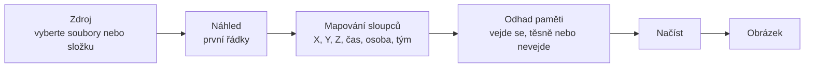

# Jak nahrát data

Než 3DHeat něco nakreslí, potřebuje tabulku: každý řádek říká, kde něco bylo a, pokud to víte, kdy a kdo to byl. Tato část ukazuje, jak se soubor změní v obrázek. Zatím nemáte data? Zkuste [ukázková data](demo-data.md).

**Udělejte hned:**

1. V postranním panelu Teplotní mapy otevřete **Zdroj** a stiskněte **Soubory…** (nebo přetáhněte soubor či složku na zónu pro přetažení).
2. Podívejte se na **Mapování sloupců**: pole bývají už vyplněná.
3. Zkontrolujte, že **Odhad paměti** říká *vejde se*.
4. Stiskněte **Načíst**.

Všechno, co ukazuje karta Teplotní mapa, pochází z jediné **datové sady**: tabulky řádků, z nichž každý má pozici a volitelně čas, osobu, skupinu, relaci, směr pohledu a libovolný počet dalších sloupců ponechaných pro filtrování. Tato část vysvětluje, jak se datová sada vytváří.

## Cesta od souborů k obrázku {#the-path-from-files-to-picture}

1. **Vyberte soubory** v panelu **Zdroj** - jeden soubor, více souborů, strom složek, nebo je přetáhněte. Přijímají se Parquet, CSV, Tacview, GPS stopy a další; úplný seznam je v [Datové formáty](data-formats.md#files). Viz [Načítání souborů](loading-files.md).
2. **Náhled.** Otevře se první soubor výběru: jeho názvy sloupců, prvních 50 řádků, které sloupce vypadají číselně, a (u Parquet) logický typ každého sloupce a vlastní čtecí pokyny souboru, položka zápatí `heat3d`.
3. **Automatické mapování.** Sloupce se přiřadí rolím - X, Y, Z, čas, osoba, relace, skupina, směr pohledu - a několik se ponechá pro filtrování. Každý odhad je vidět v panelu **Mapování sloupců** a dá se změnit. Viz [Mapování sloupců](column-mapping.md) a [Osy, jednotky a čas](axes-units-and-time.md).
4. **Počítání.** Počet řádků každého souboru se načte (u Parquet přesně z patiček souboru, u CSV odhadem), takže panel může ještě před načtením říct, kolik paměti načtení potřebuje a zda se vejde. Pokud ne, navrhne načíst každý *N*-tý řádek. Viz [Paměť a rozpočty](memory-and-budgets.md).
5. **Načíst.** Pracovní proces na pozadí zpracuje jen namapované sloupce každého souboru - několik souborů najednou, až do rozpočtu [vláken čtení](memory-and-budgets.md#parser-threads) - a sloučí je v pořadí výběru do jediné datové sady: jeden společný slovník osob, skupin a relací napříč všemi soubory, jeden společný počátek času, všechny řádky seřazené podle času. Viz [Relace, osoby a skupiny](sessions-persons-groups.md).
6. **Nahrání.** Hlavní vlákno oznámí „Nahrávání N řádků do GPU“ na jeden snímek a pak řádky zabalí do paměti GPU v rámci rozpočtu GPU. Viz [Rezidence paměti GPU](gpu-memory.md).
7. **První obrázek.** Kamera zarámuje data, poloměr sprite a sytost se nastaví podle rozsahu dat a počtu řádků, a po 8 vykreslených snímcích se sytost změří z obrazu samotného ([Barva a expozice](colour-and-exposure.md)).

## Požadavky kontrolované před načtením {#requirements-checked-before-a-load}

| Potřeba | Co se stane bez ní |
|---|---|
| **Aspoň dvě z X / Y / Z** | Načtení se odmítne. Při přesně dvou je třetí osa 0 a data se kreslí jako plochá rovina v 3D scéně - což chce mapa tepla shora. |
| Sloupec času | Volitelný. Bez něj je časová osa vypnutá, pohled zůstane v režimu **Vše** a postranní panel to řekne. |
| Sloupec osoby | Volitelný. Potřebný pro [překryv figur](box-replay.md) (figura pro každou osobu), [čárové teplo](line-heat.md) (trasa každé osoby), interpolaci, stopy a historii **Životnost**. |
| Sloupec skupiny | Volitelný. Potřebný pro [týmové teplo](team-heat.md) a pro režim [rozdílu](difference.md) (aspoň dvě skupiny). |

Režim, který načtená data neumí podržet, je v liště režimů šedý; když na něj najedete, řekne proč.

## Bez vlastních dat {#without-your-own-data}

Panel **Datová sada** (pod **Zdrojem**) má [syntetický generátor](synthetic-generator.md), který vytvoří datovou sadu ve tvaru battle royale libovolné velikosti; hodí se k vyzkoušení prohlížeče a k ověření, co stroj zvládne.

## Stránky v této části {#pages-in-this-section}

- [Načítání souborů](loading-files.md) - výběr souborů, složky, přetažení, sloučení více souborů, pravidlo pohybových souborů, průběh a zrušení
- [Mapování sloupců](column-mapping.md) - každé pole panelu mapování, jak automatické mapování hádá, nápovědy `heat3d`
- [Osy, jednotky a čas](axes-units-and-time.md) - svislá osa, převrácení, měřítko jednotek, časové jednotky, směr pohledu
- [Relace, osoby a skupiny](sessions-persons-groups.md) - co každá dělá, limity, sdílené názvy, velikost entit, panel Datová sada
- [Syntetický generátor](synthetic-generator.md)
- [Paměť a rozpočty](memory-and-budgets.md) - model paměťové stopy, kontrola, proředění, strop řazení, rozpočty prostředků
