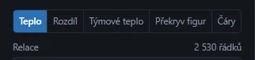

# Režimy tepla

Každá tečka přidá trochu záře, záře se sčítají a hromada se obarví barvami. Režimy jsou pět způsobů, jak ji obarvit, a každý odpovídá na jednu otázku.

Lišta režimů nahoře v postranním panelu karty Teplotní mapa určuje, jak se [datová sada](glossary.md) kreslí. Klávesy 1-4 vybírají Teplo, Rozdíl, Týmové teplo a Čáry. Překryv figur nemá klávesu.

| Režim | Na jakou otázku odpovídá |
|---|---|
| **Teplo** | Kde se to stalo a kolik toho bylo? |
| **Rozdíl** | Která strana toho udělala víc? |
| **Týmové teplo** | Čí to bylo? |
| **Čáry** | Kterými směry lidé šli? |
| **Překryv figur** | Kdo byl kde a kdy? |

| Režim (popisek na liště) | Klávesa | Co kreslí | Potřebuje |
|---|---|---|---|
| **Teplo** | 1 | Aditivní hustota: každý viditelný řádek přidá radiální sprite natočený ke kameře. [Teplo](heat.md) | datovou sadu |
| **Rozdíl** | 2 | Hustota se znaménkem: jedna populace přidává, druhá odečítá. [Rozdíl](difference.md) | dvě strany: aspoň dvě skupiny, nebo rozdělení přes ponechaný sloupec |
| **Týmové teplo** | 3 | Hustota obarvená podle skupiny: odstín pro každou skupinu, smíchaný tam, kde se skupiny překrývají. [Týmové teplo](team-heat.md) | sloupec skupiny |
| **Překryv figur** | - | Jedna figura (nebo kvádr) na osobu, pohybující se po časové ose: přehrání. [Překryv figur](box-replay.md), [Přehrání zápasu](match-replay.md) | sloupec osoby |
| **Čáry** | 4 | Čárové teplo: čára od každého vzorku osoby k jejímu dalšímu, teplo slábne do stran. [Čárové teplo](line-heat.md) | sloupec osoby a sloupec času |

Režim, který data neunesou, je šedý a jeho nápověda řekne proč, například *Nedostupné - režim Rozdíl potřebuje dvě skupiny nebo ponechaný sloupec k rozdělení; tato data mají jednu skupinu.* Když nová datová sada nepodporuje aktuální režim, pohled se vrátí k **Teplo**.

Klávesy 1-4 se kontrolují vůči datům stejně: klávesa pro šedý režim nedělá nic.

## Které panely který režim ukazuje {#which-panels-each-mode-shows}

| Panel | Teplo | Rozdíl | Týmové teplo | Překryv figur | Čáry |
|---|---|---|---|---|---|
| Trasy ([čárové teplo](line-heat.md)) | | | | | ano |
| Tvar tepla (s **Sledovat pohled** a **Stejná hustota při každém přiblížení**), Barvy tepla, Omezení pixelů sprite, Hloubka, Vyřazení podle vzdálenosti | ano | ano | ano | | ano |
| Směr ([směrové teplo](directional-heat.md)), Hodnota ([vážení hodnotou](value-weighting.md)) | ano | ano | ano | | ano |
| Týmové zobrazení ([překryv figur](box-replay.md)) | | | | ano | |
| Rozdílové rozdělení ([rozdíl](difference.md)) | | ano | | | |
| [Týmy](teams-list.md), [Entity](entities.md), [Filtry](filters.md), Pozadí / úroveň, [Řez](slice.md), [Měření](measure.md), Trasa kamery a vykreslení, Výkon, Kamera a scéna | ano | ano | ano | ano | ano |

## Co sdílejí všechny režimy tepla {#what-every-heat-mode-shares}

Všechny čtyři režimy tepla (vše kromě překryvu figur) jsou tentýž stroj s různými vstupy ([`engine.ts`](https://github.com/Holdi601/3DHeat/blob/main/src/render/engine.ts)):

1. **Které řádky.** [Časové okno](timeline.md) vybere souvislý rozsah řádků seřazených podle času; [filtry](filters.md), viditelnost skupin, rozdělení rozdílu, [vyřazení podle vzdálenosti](depth-and-culling.md#distance-culling) a [řez](slice.md) rozhodují u každého řádku ve vertex shaderu, zda a jak silně přispívá.
2. **Splatting.** Každý přispívající řádek se nakreslí jako sprite (nebo v režimu Čáry jako úsečka) do **cíle tepla** v plovoucí desetinné čárce a přidá svou hodnotu z křivky. Když je řádků víc, než jeden snímek unese, kreslí se stratifikovaný vzorek řádků, vážený tak, aby se to vykompenzovalo. Viz [Vzorkování a rozpočty](sampling-and-budgets.md).
3. **Akumulace.** Dokud se nic nemění, snímky se slučují, dokud každý řádek nepřispěje přesně jednou. Viz [Akumulace](accumulation.md).
4. **Složení.** Akumulovaná hodnota v každém pixelu se vydělí **bodem nasycení**, tvaruje **odezvou na hustotu**, zvedne o **minimální teplo** a vyhledá v **škále barev**, jejíž průhlednost ji mísí s obrazem scény. Viz [Barva a expozice](colour-and-exposure.md).

Všechno v kroku 4 se použije při složení, takže tažení těchto ovládacích prvků nikdy nerestartuje akumulaci; cokoli v krocích 1-2 ano.

## Stránky v této části {#pages-in-this-section}

- [Teplo](heat.md) - prostý režim tepla a přehled jeho panelů
  - [Tvar sprite](sprite-shape.md) - poloměr, intenzity, útlum, editor křivky, omezení pixelů, zploštění
  - [Barva a expozice](colour-and-exposure.md) - editor škály, bod nasycení, automatická expozice, minimální teplo, odezva na hustotu
  - [Hloubka a vyřazování](depth-and-culling.md) - zakrytí úrovní, skrytí za terénem, vyřazení podle vzdálenosti
- [Rozdíl](difference.md) - rozdělení rozdílu
- [Týmové teplo](team-heat.md)
- [Čárové teplo](line-heat.md) - trasy
- [Překryv figur](box-replay.md) - režim přehrání (soubor se stále jmenuje box replay)
- [Směrové teplo](directional-heat.md)
- [Vážení hodnotou](value-weighting.md)
