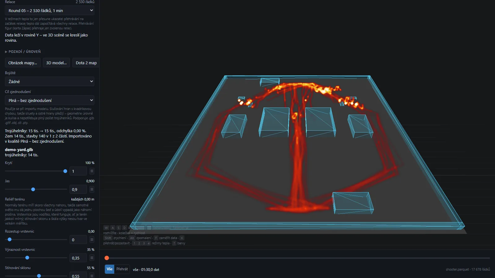
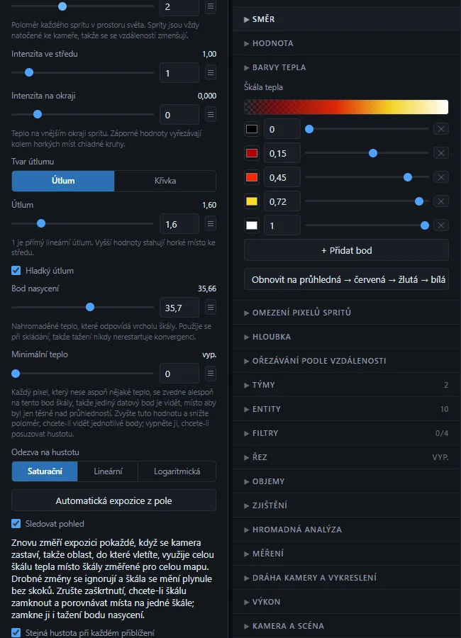

# Teplo

Teplo maluje místa, kde se stalo hodně věcí: červeně, kde se stalo trochu, bíle žhavě, kde hodně. Odpovídá na otázku „kde se to děje a kolik“.

**Teplo** (klávesa 1) je výchozí režim. Každý viditelný [řádek](glossary.md) přispívá kulatým [spritem](glossary.md), otočeným ke kameře; překrývající se sprity se sčítají v bufferu s plovoucí řádovou čárkou; součet se promítne přes barevnou škálu – výchozí průhledná → červená → žlutá → bílá – a nakreslí se přes scénu.

Obrázek ukazuje teplo střílecího kola na levelu s budovami: horká místa sedí v místnostech a na schodech, ne jen na zemi.

## Jak to použít {#how-to-use-it}

1. Načtěte data a stiskněte `1` (nebo vyberte **Teplo** v pruhu režimů).
2. Když je všechno bílé nebo prázdné, stiskněte **Automatická expozice z pole** v sekci **Tvar tepla**.
3. Měňte **Poloměr spritu**, dokud se sousední tečky nespojí do pásů: menší ukáže jednotlivé skvrny, větší oblasti.
4. Otevřete **Barvy tepla** a změňte barvy, nebo **Hloubku**, aby kopce a zdi schovávaly teplo za sebou.

Stejné panely tvarují [Rozdíl](difference.md), [Týmové teplo](team-heat.md) a [Teplo čar](line-heat.md); liší se v tom, co se přidává (se znaménkem, barevně, nebo podél čar), ne jak.

## Panely a jejich výchozí hodnoty {#the-panels-and-their-defaults}

Každý ovládací prvek je vysvětlen na vlastní stránce; sloupec Podrobnosti odkazuje na ni. Posuvníky mají vedle sebe zadávací pole a úchyt pro tažení (malá rukojeť vpravo: táhněte nahoru nebo dolů, dál je rychleji, Shift pro jemné nastavení); kde dráha posuvníku končí dřív než skutečná mez, úchyt ji může přetáhnout až za *strop posunu* uvedený tady. Hodnoty označené *při načtení* se přepočítají pro každou novou datovou sadu.

### Tvar tepla (otevřeno) {#heat-shape-open}

| Ovládací prvek | Výchozí | Rozsah (strop posunu) | Podrobnosti |
|---|---|---|---|
| **Poloměr spritu** | 6 m; při načtení rozsah / 120 | 0,05–2000 m, logaritmicky (50 000) | [Tvar sprite](sprite-shape.md#sprite-radius) |
| **Intenzita ve středu** | 1 | 0–10 (1000) | [Tvar sprite](sprite-shape.md#centre-and-edge-intensity) |
| **Intenzita na okraji** | 0 | -2–10 (1000) | [Tvar sprite](sprite-shape.md#centre-and-edge-intensity) |
| **Tvar útlumu** | *Útlum* | *Útlum* / *Křivka* | [Tvar sprite](sprite-shape.md#ramp-shape-falloff-or-curve) |
| **Útlum** (jen u Útlumu) | 1,6 | 0,1–8 (64) | [Tvar sprite](sprite-shape.md#falloff) |
| **Hladký útlum** (jen u Útlumu) | zapnuto | | [Tvar sprite](sprite-shape.md#falloff) |
| Editor křivky (jen u Křivky) | předvolba *Hladká* | | [Tvar sprite](sprite-shape.md#the-curve-editor) |
| **Bod nasycení** | 24; při načtení odhad, potom změřeno | 0,1–4000, logaritmicky (10 000 000) | [Barva a expozice](colour-and-exposure.md#saturation-point) |
| **Minimální teplo** | vypnuto (0) | 0–100 % | [Barva a expozice](colour-and-exposure.md#minimum-heat) |
| **Odezva na hustotu** | *Saturační* | *Saturační* / *Lineární* / *Logaritmická* | [Barva a expozice](colour-and-exposure.md#density-response) |
| **Automatická expozice z pole** | | tlačítko | [Barva a expozice](colour-and-exposure.md#auto-exposure) |
| **Sledovat pohled** | zapnuto | | Znovu změří expozici pokaždé, když se kamera zastaví, takže oblast, do které vletíte, využije celou barevnou škálu. Malé změny se ignorují a měřítko plynule přejde. Vypněte to, nebo potáhněte za **Bod nasycení**, abyste měřítko zamkli a porovnali místa na jednom měřítku. [Barva a expozice](colour-and-exposure.md#follow-the-view) |
| **Stejná hustota při každém přiblížení** | zapnuto | | Barva znamená stejný počet řádků na plochu země, ať jste jakkoli blízko. Sprite, který omezení pixelů zvětší (zdálky) nebo zmenší (zblízka), si zachová teplo, které by přidala jeho skutečná velikost, takže obraz změřený zdálky při přeletu nezeslábne. Vypnuto: omezený sprite přidá svou plnou váhu ve své omezené velikosti. [Tvar sprite](sprite-shape.md#pixel-clamps) |
| **Zploštit na rovinu země** | vypnuto | | [Tvar sprite](sprite-shape.md#flatten-onto-ground-plane) |

### Barvy tepla (zavřeno) {#heat-colours-closed}

| Ovládací prvek | Výchozí | Podrobnosti |
|---|---|---|
| Vzorky skupin a **Oddělení barev** (jen Týmové teplo) | 1,4 | [Týmové teplo](team-heat.md) |
| Editor **Škála tepla** (*Kladná (přičítající týmy)* u Rozdílu, *Škála krytí* u Týmového tepla) | průhledná → červená → žlutá → bílá | [Barva a expozice](colour-and-exposure.md#the-ramp-editor) |
| **Obnovit na průhledná → červená → žlutá → bílá** | | |
| Škála **Záporná (odečítající týmy)** (jen Rozdíl) | průhledná → zelená → modrá → fialová | [Rozdíl](difference.md#colours) |

### Omezení pixelů spritů (zavřeno) {#sprite-pixel-clamps-closed}

| Ovládací prvek | Výchozí | Rozsah (strop posunu) | Podrobnosti |
|---|---|---|---|
| **Min. poloměr v pixelech** | 1 px | 0–16 (512) | [Tvar sprite](sprite-shape.md#pixel-clamps) |
| **Max. poloměr v pixelech** | 96 px | 2–1024, logaritmicky (8192) | [Tvar sprite](sprite-shape.md#pixel-clamps) |

### Hloubka (otevřeno) {#depth-open}

| Ovládací prvek | Výchozí | Podrobnosti |
|---|---|---|
| **Skrýt za terénem** | zapnuto | [Hloubka a vyřazování](depth-and-culling.md#hide-behind-terrain) |
| **Skryté za geometrií** | 0,8 (*o 80 % ztmavené*) | [Hloubka a vyřazování](depth-and-culling.md#hidden-behind-geometry) |

### Ořezávání podle vzdálenosti (zavřeno) {#distance-culling-closed}

| Ovládací prvek | Výchozí | Rozsah (strop posunu) | Podrobnosti |
|---|---|---|---|
| **Blízko** | vypnuto (0) | 0,5–5000 m, logaritmicky, spodek dráhy = vypnuto (200 000) | [Hloubka a vyřazování](depth-and-culling.md#distance-culling) |
| **Daleko** | vypnuto (0) | 1–200 000 m, logaritmicky, spodek = vypnuto (10 000 000) | [Hloubka a vyřazování](depth-and-culling.md#distance-culling) |
| **Řezat rovinou** | zapnuto | | [Hloubka a vyřazování](depth-and-culling.md#distance-culling) |
| **Řezat i úroveň** | zapnuto | | [Hloubka a vyřazování](depth-and-culling.md#distance-culling) |

Klávesy: `[` a `]` posouvají vzdálenější mez dovnitř a ven, `\` ji přepíná ([Hloubka a vyřazování](depth-and-culling.md#keyboard)).

### Směr a Hodnota {#direction-and-value}

Pod Tvarem tepla jsou ještě dvě sekce. **Směr** kreslí každý řádek jako klín a přidává šipky: viz [Směrové teplo](directional-heat.md). **Hodnota** váží teplo tím, co každý řádek stál nebo vynesl: viz [Vážení hodnoty](value-weighting.md).

## Co se ukládá {#what-is-saved}

Výše uvedená nastavení tepla se mezi relacemi neukládají: načtení stránky obnoví výchozí hodnoty. V prohlížeči se uchovávají dvě věci: poslední rychlost přehrávání (`heat3d.speed`, viz [Časová osa](timeline.md)) a nastavení vzdálených figur [překryvu figur](box-replay.md) (styl symbolů, velikost, značky zásahů a tak dál). Stejně tak jazyk, [obrácené osy světa](camera.md#invert-world-axis), zapamatovaná jména aut na záložce závodu a [knihovna levelů](level-library.md). Úplný seznam je na [Uložená nastavení](ref-settings-storage.md).
