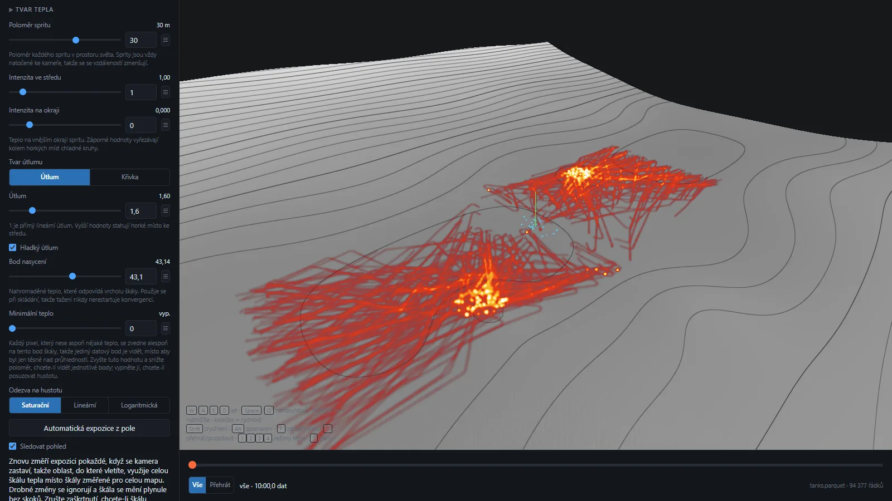
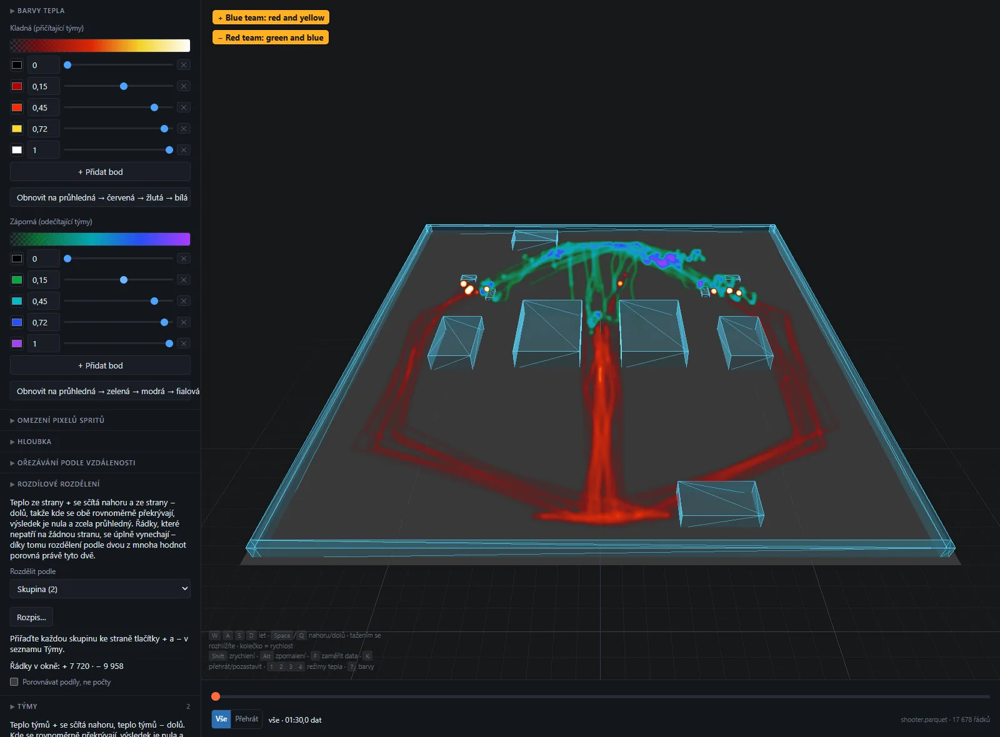
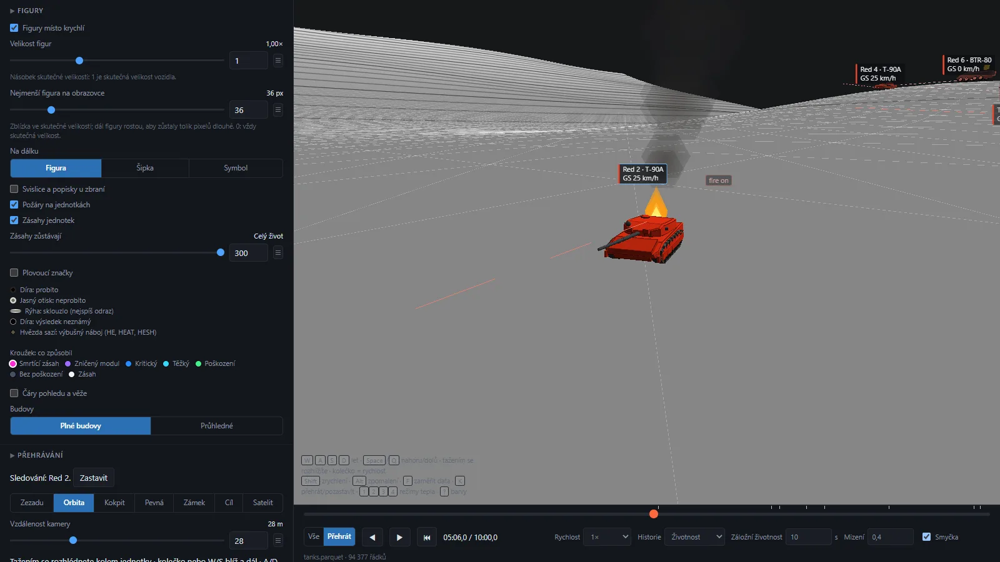
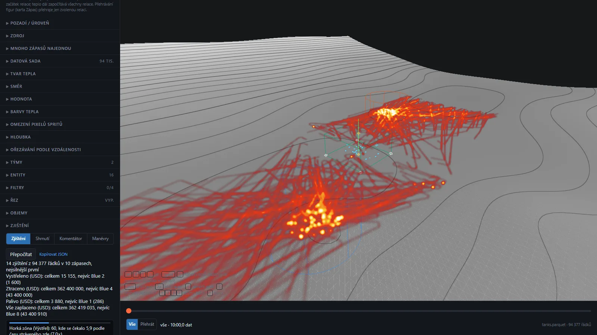
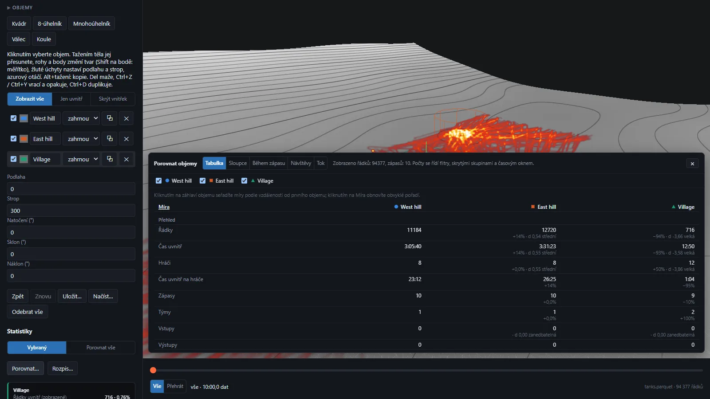
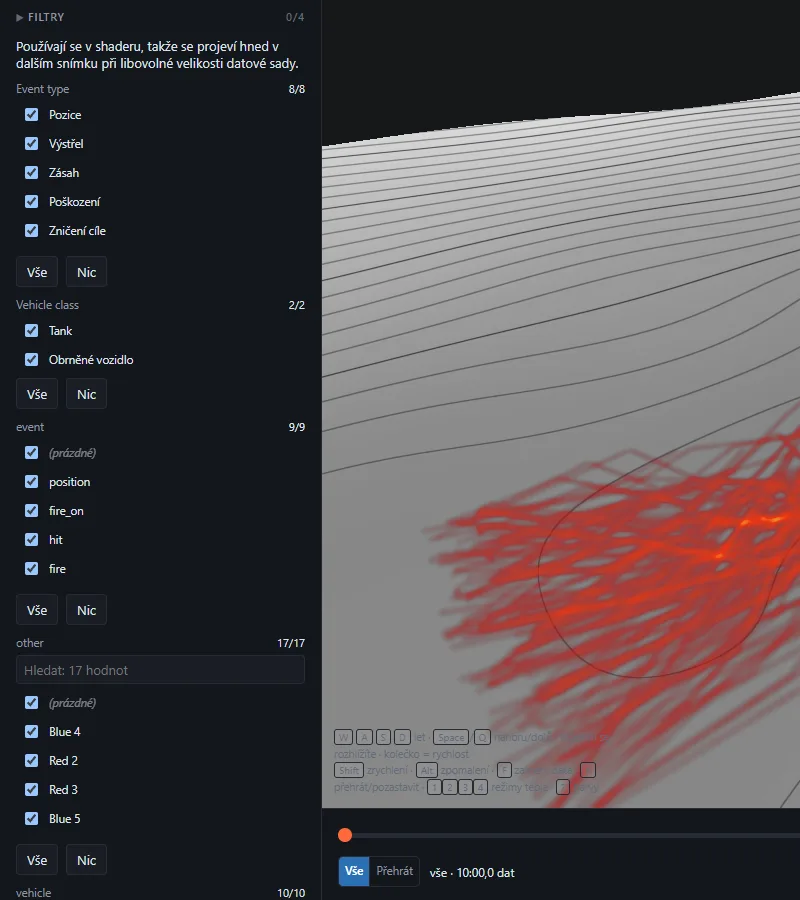
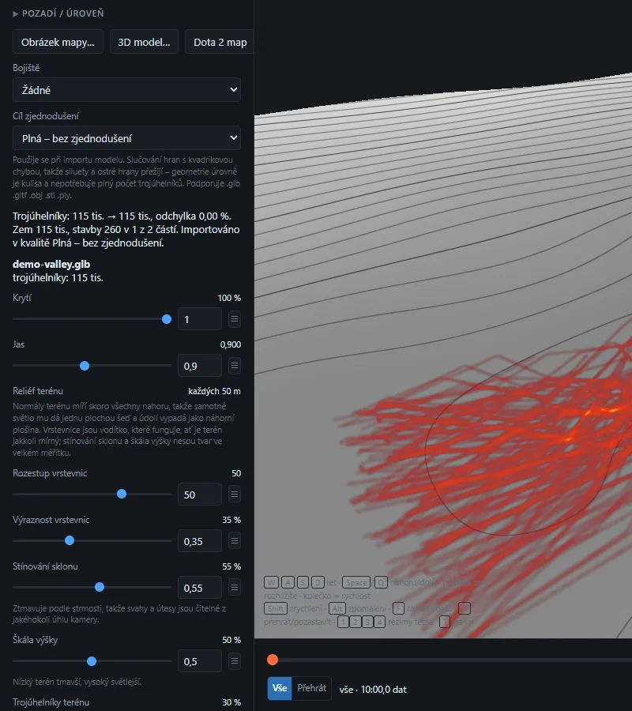

# 3DHeat

3DHeat ukazuje, kde se ve hře něco stalo - kam hráči chodili, kde bojovali a kde padli - jako svítící barvy, kterými můžete proletět, nebo jako malé 3D figury, které zápas přehrají znovu.

Načtěte pozice - CSV, Parquet, záznamy Tacview, převedené replaye, jeden soubor, složku nebo tisíce zápasů - a uvidíte je jako **teplotní mapu, kterou můžete proletět**, jako **figury, které přehrávají zápas**, jako čáry podél tras, kudy lidé šli, nebo jako jednu skupinu proti druhé. Sama najde, co vyniká, a běží celá ve vašem prohlížeči: nic se nikam nenahrává.



**Jste tu poprvé?** Vytvořte si [ukázková data](demo-data.md) a projděte jejich sedm kroků. Každý obrázek na těchto stránkách byl pořízen s nimi.

## Co umí {#what-it-does}

| | |
|---|---|
|  | **[Režimy tepla](heat-modes.md)** - teplo, [rozdíl](difference.md) (červeně tam, kde byla víc jedna strana, zeleně a modře tam, kde byla víc druhá), [týmové teplo](team-heat.md), [čárové teplo](line-heat.md); [směrové teplo](directional-heat.md) s výseky, poli šipek a polárními grafy; teplo [vážené hodnotou](value-weighting.md): kolik stojí zbraně, vozidla a palivo. |
|  | **[Přehrání zápasu](match-replay.md)** - každá jednotka jako [figura](figures.md) toho, čím je, symboly NATO nebo ruské z dálky, rakety a stopy, značky zásahů, vraky, požáry, věže, cíle, kamery ve stylu Tacview a taktický displej; [mnoho zápasů najednou](many-matches.md). |
|  | **[Zjištění](insights.md)** - silné pozice, smrtící terén, pasti na místech oživení, úzká místa a vynikající hráči, nalezení a seřazení s důkazy; psaný závěrečný rozbor, volitelně od AI podle vaší volby; komentátor pro jeden zápas; [čočka znalostí](knowledge.md). |
|  | **[Objemy](volumes.md)** - kreslete kvádry, hranoly, válce a koule, filtrujte podle nich, počítejte, co se uvnitř stalo, exportujte to a porovnávejte místa vedle sebe; [rozpis](breakdown.md), kdo a co si na místě vede nejlépe. |
|  | **[Filtry](filters.md)** - podle typu události, hráče nebo AI, třídy vozidla, hodnoty, libovolného sloupce, v grafické kartě při jakékoli velikosti dat. |
|  | **[Levely](levels.md)** - obrázky map, 3D levely vytvořené [datovými nástroji](#related-repositories), zjednodušení, [pozadí světa](world-backdrop.md) se skutečným terénem pro letová data. |

Dále: karta [Analýza závodu](race-analysis.md) pro kola závodních her, karta [Zápas](match-analysis.md) pro souhrny Counter-Strike 2, [taktická tabule](tactics-board.md) pro plány na levelu, [analýza zásahů](hit-analysis.md) podle vozidla, [hromadná analýza](mass-analysis.md) tisíců zápasů, [trasy kamery a video](camera-path-and-video.md), [40 jazyků](languages.md), [metrické nebo imperiální jednotky](settings.md).

## Karty {#the-tabs}

Karty jsou nahoře v postranním panelu, pod názvem, jednotkami a nabídkou jazyka.

| Karta | K čemu slouží |
|---|---|
| **Teplotní mapa** | Jakákoli tabulka pozic: režimy tepla, překryv figur, filtry, objemy, zjištění, levely, měření a video. |
| **Analýza závodu** | Dvě nebo více kol jedné trati: kde se ztrácí čas, proč, a co změnit. |
| **Zápas** | Přehrání zápasu pomocí figur a souhrny zápasů Counter-Strike 2. |
| **Taktika** | Plány na levelu: figury, trasy, vržené pomůcky, oblasti a poznámky v krocích, které se přehrávají. |
| **Vozidla** | Kde byla každá jednotka zasažena, kým a čím. |

## Instalace a spuštění {#install-and-run}

3DHeat můžete volně používat, upravovat a sdílet (licence MIT), stejně jako každý nástroj uvedený v [Související repozitáře](#related-repositories).

### Windows, snadno {#windows-the-easy-way}

Kořen repozitáře obsahuje tři dávkové soubory.

| Soubor | Co dělá |
|---|---|
| `start.bat` | Spustí prohlížeč. Najde Node.js, i když není v `PATH` (hledá v `%ProgramFiles%\nodejs`, `%ProgramFiles(x86)%\nodejs` a `%LOCALAPPDATA%\Programs\nodejs`). Když Node.js chybí, nabídne instalaci verze LTS příkazem `winget install -e --id OpenJS.NodeJS.LTS`. Při prvním spuštění se před stažením závislostí zeptá (asi 300 MB do složky `node_modules\` uvnitř této složky, nic v systému). Když už něco naslouchá na portu 5273, nespustí se a odkáže na `restart.bat`. Když je složka git kopií bez místních změn a existuje novější verze, zeptá se, zda aktualizovat (A/N; bez odpovědi za 60 s zůstane tato verze; viz [Aktualizace](updates.md)). Pak spustí vývojový server na `http://127.0.0.1:5273/` a otevře prohlížeč. **Okno je server**: nechte ho otevřené; zavřením nebo stiskem Ctrl+C se zastaví. |
| `restart.bat` | Spustí `stop.bat quiet` a pak `start.bat`. Potřeba jen po změně `vite.config.ts`, přidání závislosti nebo když server zamrzne - změny zdrojového kódu se načítají za chodu. |
| `stop.bat` | Zastaví to, co naslouchá na portu 5273, podle čísla procesu zjištěného přes `netstat`, nikdy podle názvu obrazu, takže ostatní procesy Node.js v počítači zůstanou nedotčené. Čeká asi dvě sekundy, až se soket uvolní. S argumentem `quiet` na konci nepozastaví. |

### Ručně (jakýkoli OS) {#by-hand-any-os}


```bash
git clone --recursive https://github.com/Holdi601/3DHeat.git
cd 3DHeat
npm install
npm run dev      # http://127.0.0.1:5273
```

Složka `exporters/` obsahuje samostatné datové nástroje jako git submoduly, každý vlastní repozitář; po prostém klonu spusťte `git submodule update --init`. Samotný prohlížeč je k běhu nepotřebuje. Složka `exporters/ext/` obsahuje volitelné převodníky (War Thunder, World of Tanks, World of Warships, replaye Squadu; mapy DCS a IL-2), oddělené, aby problém s jedním z nich neovlivnil nic jiného.

S žádným z toho nepřichází herní data: levely, mapy a záznamy se vytvářejí na vašem počítači pomocí nástrojů, z her, které vlastníte.

### Skripty npm {#npm-scripts}

| Skript | Co spouští |
|---|---|
| `npm run dev` | Vývojový server Vite na portu 5273, vázaný na `127.0.0.1`. |
| `npm run build` | Kontrola typů (`tsc --noEmit`) a produkční balík do `dist/`. |
| `npm run preview` | Podává produkční balík. |
| `npm run typecheck` | Samotná kontrola typů. |
| `npm test` / `npm run test:watch` | Jednotkové a integrační testy (vitest). |
| `npm run smoke` | Ovládá skutečnou aplikaci v bezhlavém Chromiu a kontroluje, že plátno obsahuje barevné pixely; snímky jdou do `tools/.smoke/`. Předpokládá, že běží vývojový server. |
| `npm run smoke:f16` | Stejná sada s `?heat=f16`, která vynutí cestu akumulace v half-float (viz [Akumulace v half-float](half-float-accumulation.md)). |
| `npm run bench` | Benchmark načítání, zapíše `tools/.smoke/ingest-bench.json`. |
| `npm run test:heavy` | Testy, které potřebují velké soubory skutečných dat; samy se přeskočí, když soubory chybí. |
| `npm run inspect -- <file.parquet>` | Vypíše schéma souboru Parquet a několik řádků (`tools/inspect-parquet.mjs`). |

### Co přidává vývojový server {#what-the-dev-server-adds}

Prohlížeč je statická webová stránka, ale vývojový server (viz `vite.config.ts`) přidává dvě místní trasy, které statické nasazení `dist/` nemá:

- `/__host/memory` hlásí nainstalovanou a volnou RAM počítače a tam, kde ji umí přečíst, paměť grafické karty (z `nvidia-smi`, nebo ve Windows z registru displejového adaptéru). Díky tomu [rozpočty paměti](memory-and-budgets.md) používají skutečná čísla místo odhadů prohlížeče, které jsou omezené.
- `/__heat3d/update` zjistí, zda je kopie za novější verzí, a umí ji přetočit vpřed ([Aktualizace](updates.md)).

Server se váže jen na `127.0.0.1`, takže se k těmto trasám nedostanete ze sítě. Otevřete ho jako `http://127.0.0.1:5273`: `localhost` se může přeložit na IPv6 smyčku `::1`, kde nic neposlouchá. Neposílá hlavičky izolace mezi počátky (COOP/COEP): nic v prohlížeči nepoužívá `SharedArrayBuffer` a pracovní procesy předávají data přenosem, který je nepotřebuje.

## Požadavky na prohlížeč a grafickou kartu {#browser-and-gpu-requirements}

- **Prohlížeč s WebGPU nebo WebGL2.** Nejdřív se zkouší WebGPU (Chrome a Edge ho mají); bez něj se použije backend WebGL2. WebGL2 musí nabízet `EXT_color_buffer_float` (kreslení do float textur), jinak prohlížeč ukáže „Cannot initialise the renderer.“ Viz [Dva backendy](backends.md). Prohlížeč se vyvíjí a testuje v Chromiu; ostatní prohlížeče nejsou ověřené.
- **Zapnutá hardwarová akcelerace.** Když prohlížeč kreslí na procesoru (SwiftShader, llvmpipe, Microsoft Basic Render Driver a podobně), nahoře v postranním panelu se objeví červený pruh, který to řekne a napoví, jak to opravit. Viz [Detekce softwarového vykreslování](software-rendering.md).
- **Samostatná grafická karta pomáhá, ale není nutná.** Oba backendy žádají vysoce výkonný adaptér. Množství dat, které se může držet v grafické kartě, je rozpočet, který vidíte a můžete měnit ([Paměť a rozpočty](memory-and-budgets.md)).
- **Volitelné funkce** používají další rozhraní prohlížeče: vykreslování videa potřebuje WebCodecs `VideoEncoder` s VP9 nebo VP8 ([Trasa kamery a video](camera-path-and-video.md)); zjednodušení sítě levelů potřebuje WebAssembly; přetažení složek používá File and Directory Entries API; knihovna levelů používá IndexedDB; gamepady používají Gamepad API.

## Mapa dokumentace {#documentation-map}

**Začátek**: [Ukázková data](demo-data.md) · [Jak nahrát data](getting-data-in.md) ([načítání souborů](loading-files.md), [mapování sloupců](column-mapping.md), [osy, jednotky a čas](axes-units-and-time.md), [relace, osoby a skupiny](sessions-persons-groups.md), [Tacview](tacview-acmi.md), [převodníky](converters.md), [.3dheat](container.md), [paměť a rozpočty](memory-and-budgets.md))

**Podívat se**: [Režimy tepla](heat-modes.md) ([teplo](heat.md), [tvar sprite](sprite-shape.md), [barva a expozice](colour-and-exposure.md), [hloubka a vyřazování](depth-and-culling.md), [rozdíl](difference.md), [týmové teplo](team-heat.md), [čárové teplo](line-heat.md), [přehrání krychlí](box-replay.md), [směrové teplo](directional-heat.md), [vážení hodnot](value-weighting.md)) · [Časová osa](timeline.md) · [Levely](levels.md) ([obrázky map](map-images.md), [3D levely](model-levels.md), [vzhled](level-appearance.md), [knihovna](level-library.md), [pozadí světa](world-backdrop.md), [jeho zdroje](world-backdrop-sources.md)) · [Kamera](camera.md) ([gamepad](gamepad.md), [klávesy](keyboard-reference.md)) · [Trasa kamery a video](camera-path-and-video.md)

**Analyzovat**: [Filtry a nástroje](filters-and-tools.md) ([filtry](filters.md), [týmy](teams-list.md), [entity](entities.md), [řez](slice.md), [měření](measure.md), [objemy](volumes.md), [rozpis](breakdown.md)) · [Zjištění](insights.md) ([čočka znalostí](knowledge.md)) · [Hromadná analýza](mass-analysis.md)

**Přehrání**: [Přehrání zápasu](match-replay.md) · [Mnoho zápasů najednou](many-matches.md) · [Figury](figures.md) ([v překryvu figur](figure-replay.md), [zdroje](figure-credits.md)) · [Parita s Tacview](tacview-parity.md) · [Analýza zásahů](hit-analysis.md)

**Ostatní karty**: [Analýza závodu](race-analysis.md) ([metoda](race-analytics.md), [ostatní hry](other-games.md)) · [Analýza zápasu](match-analysis.md) · [Taktická tabule](tactics-board.md) ([rychlosti](tactics-speeds.md))

**Prohlížeč**: [Slovníček](glossary.md) · [Nastavení, jednotky a klávesy](settings.md) · [Jazyky](languages.md) · [Aktualizace](updates.md) · [Vnitřní fungování vykreslování](rendering-internals.md) ([backendy](backends.md), [akumulace](accumulation.md), [vzorkování a rozpočty](sampling-and-budgets.md), [half-float](half-float-accumulation.md), [paměť GPU](gpu-memory.md), [softwarové vykreslování](software-rendering.md), [výkon a statistiky](performance-and-stats.md)) · [Datové formáty](data-formats.md) · [Reference](reference.md) · [Údržba dokumentace](maintaining.md)

## Související repozitáře {#related-repositories}

Prohlížeč čte data; tyto nástroje je vytvářejí. Každý je vlastní veřejný repozitář (MIT) s vlastní dokumentací. Žádný z nich nepřináší herní data: levely, mapy a záznamy se vytvářejí na vašem počítači, z her, které vlastníte.

| Repozitář | Co dělá | K čemu je dobrý |
|---|---|---|
| [3DHeat-GameFiles](https://github.com/Holdi601/3DHeat-GameFiles) | Čte tratě a levely z archivů, které hry dodávají (Forza Horizon, BeamNG, Assetto Corsa Rally; čtečky pro Unreal, Unity, Frostbite a Source 2), jako glTF | 3D level pod vaším teplem nebo přehráním |
| [3DHeat-GameCapture](https://github.com/Holdi601/3DHeat-GameCapture) | Zaznamenává telemetrii kol z rozhraní, která závodní hry zveřejňují, a rekonstruuje levely z videa hry | kola pro Analýzu závodu; level tam, kde nejde číst soubory |
| [3DHeat-UnrealExporter](https://github.com/Holdi601/3DHeat-UnrealExporter) | Plugin pro Unreal Editor, který exportuje level jako jeden soubor glTF | levely vašich vlastních projektů Unreal |
| [3DHeat-CS2](https://github.com/Holdi601/3DHeat-CS2) | Dema Counter-Strike 2 na tabulky tepla a souhrny zápasů, mapy CS2 na geometrii | teplo CS2, přehrávání a karta Zápas |
| [3DHeat-Watcher](https://github.com/Holdi601/3DHeat-Watcher) | Na pozadí zaznamenává vaši hru z toho, co hry zveřejňují: telemetrii, integrace stavu hry, logy, replaye | vaše vlastní statistiky bez ručního zadávání |
| [3DHeat-Ext-WarThunder](https://github.com/Holdi601/3DHeat-Ext-WarThunder) | Replaye War Thunder (`.wrpl`) na tabulky: letecké a pozemní stopy, výstřely, zásahy, zabití, věže, cíle | replaye War Thunder, značky zásahů a zjištění |
| [3DHeat-Ext-WoT](https://github.com/Holdi601/3DHeat-Ext-WoT) | Replaye World of Tanks na tabulky: pozice každého vozidla, smrti a zabití | teplo a replaye World of Tanks |
| [3DHeat-Ext-WoWs](https://github.com/Holdi601/3DHeat-Ext-WoWs) | Replaye World of Warships na tabulky: pozice každé lodi a potopení | teplo a replaye World of Warships |
| [3DHeat-Ext-Squad](https://github.com/Holdi601/3DHeat-Ext-Squad) | Dema serveru Squad na tabulky: pozice, tým a squad každého hráče | teplo a replaye Squadu |
| [3DHeat-Ext-DCS](https://github.com/Holdi601/3DHeat-Ext-DCS) | Terény DCS World z vaší vlastní instalace na levely: země, silnice, města, letiště, pole, voda | DCS a záznamy Tacview na jejich skutečném terénu |
| [3DHeat-Ext-IL2](https://github.com/Holdi601/3DHeat-Ext-IL2) | Mapy IL-2 Great Battles na levely | záznamy IL-2 na jejich mapě |

## Stručně o rozložení zdrojů {#source-layout-briefly}

| Složka | Obsah |
|---|---|
| [`src/data/`](https://github.com/Holdi601/3DHeat/tree/main/src/data) | Výběr souborů, načítání CSV a Parquet, automatické mapování, kontrola, model paměti, stavitel datové sady, čtení modelů, klasifikace, zjednodušení, knihovna levelů |
| [`src/render/`](https://github.com/Holdi601/3DHeat/tree/main/src/render) | Smyčka snímků (`engine.ts`), vzorkování, oba backendy, kamera, gamepad, měření, trasa kamery, nahrávání videa |
| [`src/state/`](https://github.com/Holdi601/3DHeat/tree/main/src/state) | Stav aplikace (`store.ts`) se všemi výchozími hodnotami, typy domény (`types.ts`), křivka sprite |
| [`src/ui/`](https://github.com/Holdi601/3DHeat/tree/main/src/ui) | Panely postranního panelu, časová osa, překryvy |
| [`src/race/`](https://github.com/Holdi601/3DHeat/tree/main/src/race), [`src/match/`](https://github.com/Holdi601/3DHeat/tree/main/src/match) | Karty Analýza závodu a Zápas |
| [`src/i18n/`](https://github.com/Holdi601/3DHeat/tree/main/src/i18n) | Překlady |
| [`src/insights/`](https://github.com/Holdi601/3DHeat/tree/main/src/insights) | Zjištění: detektory, závěrečný rozbor, komentátor, poskytovatelé AI, čočka znalostí |
| [`src/mass/`](https://github.com/Holdi601/3DHeat/tree/main/src/mass) | Hromadná analýza mnoha zápasů |
| [`src/volumes/`](https://github.com/Holdi601/3DHeat/tree/main/src/volumes) | Objemy, jejich statistiky, export a porovnání |
| [`src/breakdown/`](https://github.com/Holdi601/3DHeat/tree/main/src/breakdown) | Rozpis a faktory |
| [`src/overlay/`](https://github.com/Holdi601/3DHeat/tree/main/src/overlay) | Překryv pro mnoho zápasů |
| [`src/figures/`](https://github.com/Holdi601/3DHeat/tree/main/src/figures) | Katalog figur a jeho stavitel |
| [`src/vehicle/`](https://github.com/Holdi601/3DHeat/tree/main/src/vehicle) | Analýza zásahů (karta Vozidla) |
| [`src/tactics/`](https://github.com/Holdi601/3DHeat/tree/main/src/tactics) | Taktická tabule |
| [`src/world/`](https://github.com/Holdi601/3DHeat/tree/main/src/world) | Pozadí světa |
| [`src/units/`](https://github.com/Holdi601/3DHeat/tree/main/src/units) | Měrné jednotky |
