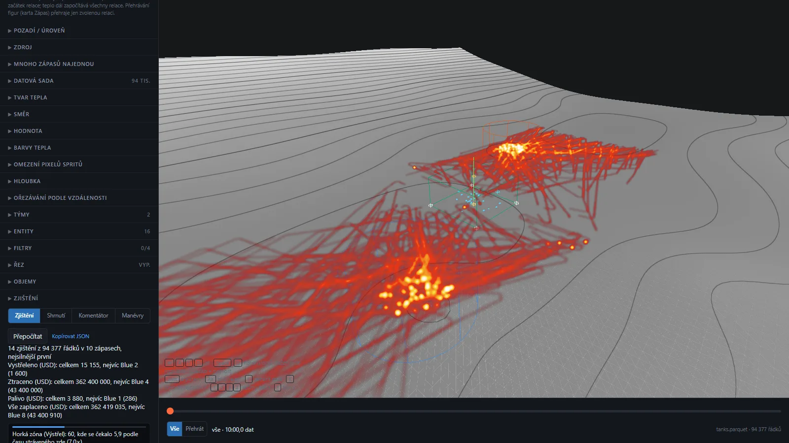
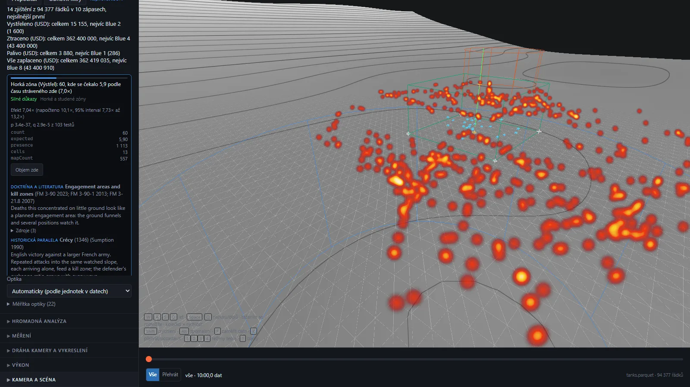
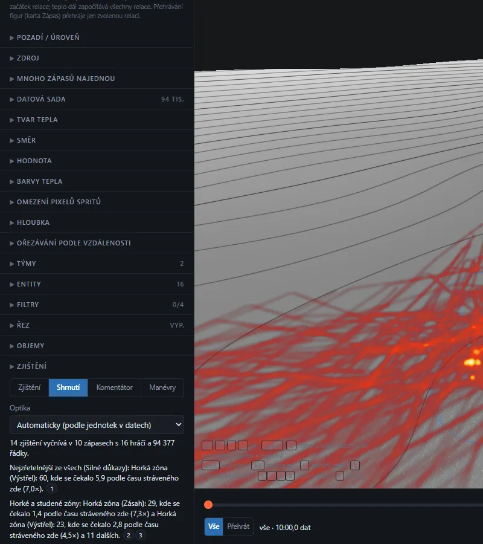
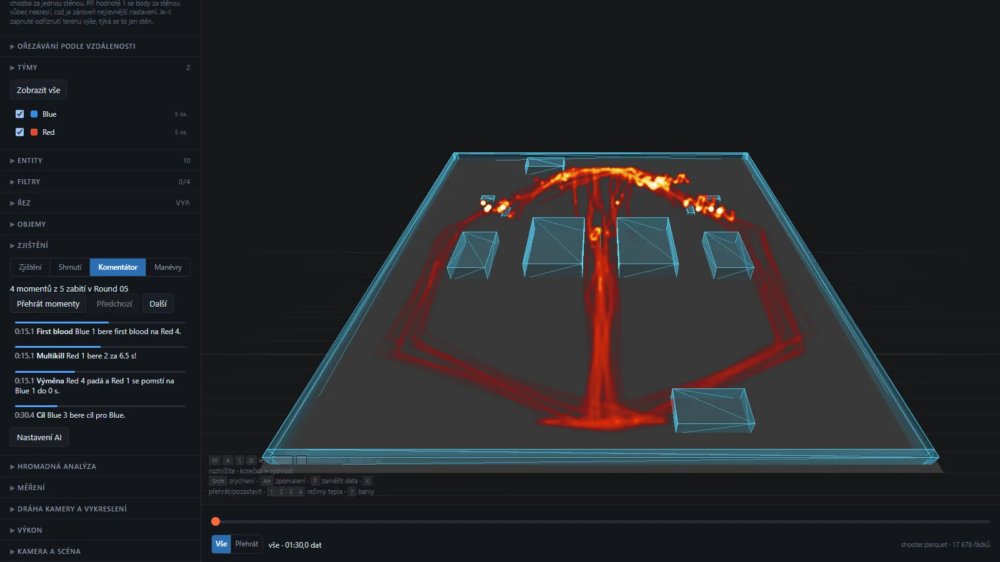

# Zjištění

**Zjištění** prohledá načtená data a hledá, co vyniká - silné pozice, smrtící terén, pasti na místech oživení, úzká místa, hráče daleko nad svými vrstevníky - a řekne vám to, nejsilnější jako první, s důkazy. Slouží k tomu, abyste se za minutu dozvěděli, kde se zápas vyhrál nebo prohrál. Pak může napsat shrnutí a v jediném přehrání může působit jako komentátor, který přeskakuje k velkým okamžikům.

Všechno se počítá ve vašem prohlížeči. Nic neopustí váš počítač, pokud nezapnete externí AI (viz [Externí AI](#external-ai)).

Sekce **Zjištění** je v postranním panelu karet Teplotní mapa a Zápas. Má tři záložky: **Zjištění**, **Shrnutí** a **Komentátor**.

## Zjištění {#findings}

1. Načtěte data a otevřete **Zjištění**. Stiskněte **Najít zjištění** („Počítání… n%“ ukazuje průběh).
2. Přečtěte si seznam. Každé zjištění má pruh síly, větu, jak dobré jsou důkazy (*Silné důkazy*, *Dobré důkazy* nebo *Nějaké důkazy*), který detektor ho našel, a třídu vozidla, kde na tom záleží.
3. **Klikněte na zjištění**: prohlížeč použije jeho filtry, kamera doletí na místo a přeskočí na čas, a otevřou se podrobnosti: efekt s jeho 95% intervalem, hodnoty p a q, spočítané důkazy a **Objem zde**, který kolem místa nakreslí [objem](volumes.md).
4. **Obnovit filtry** vrátí vaše filtry zpět. **Kopírovat JSON** zkopíruje celou zprávu.

Počítání používá aktuální filtry, skryté skupiny a vybraný zápas přes celé časové rozmezí. Když pak filtry změníte, poznámka to řekne; stiskněte **Spočítat znovu**.

Řádky nahoře v seznamu (například součty peněz) shrnují celá data před zjištěními.

### Detektory {#the-detectors}

| Detektor | Co najde | Co potřebuje v datech |
|---|---|---|
| **Silné pozice** | Místa s mnohem lepším poměrem zabití ku smrti než zbytek mapy a *bezpečný terén*, kde za čas strávený zemře málo lidí | události zabití a smrti |
| **Horké a studené zóny** | Místa, kde se druh události (výstřely, zásahy, dobytí ...) děje mnohem častěji nebo řidčeji, než by předpověděl čas strávený tam | sloupec události |
| **Otevřený terén a krytí** | Smrti na otevřeném prostoru proti blízké geometrii levelu a pomalost proti rychlému pohybu | smrti; 3D level pro část geometrie |
| **Spawny** | Silné spawny, pasti na spawnech, bezpečné spawny, čas do prvního kontaktu | čas a osoby |
| **Třída podle místa** | Třída vozidla, nebo hráči proti AI, kteří si v oblasti vedou mnohem lépe nebo hůř | zabití plus sloupec třídy vozidla nebo hráč/AI |
| **Hráči** | Hráči, kteří zabíjejí nebo umírají mnohem víc nebo méně než ostatní ve stejné třídě | osoby a zabití |
| **Úzká místa a boky** | Úzká místa (mnohem víc průchodů než okolní terén) a boční trasy (používají se zřídka, ale vedou k zabití) | osoby |
| **Hodnota** | *Drahý terén* a *Výdělečný terén* | [hodnotové sloupce](value-weighting.md) |
| **Co rozhodlo kola** | Co oddělilo vyhraná kola od prohraných a hráči, kteří nejvíce přidali nebo ubrali pravděpodobnost výhry (viz [Kdo vyhrál](#who-won-what-decided-the-rounds)) | kola, zabití a smrti a [sloupce výsledku](data-formats.md#outcome-columns) (`won`) |

Detektory, které na datech nemohou běžet, jsou uvedeny dole s důvodem.

### Jak se zjištění řadí {#how-findings-are-ranked}

Každé místo nebo skupina se testuje proti zbytku mapy (přesné binomické nebo poměrové testy). Míra falešných objevů je držena na 5 % (Benjamini-Hochberg). Náhoda může vypadat jako vzor; tohle drží falešné poplachy nízko: mezi ukázanými zjištěními se očekává nejvýš zhruba jedno z dvaceti jako náhoda. Efekty z malého počtu událostí se před řazením přitáhnou k „žádnému efektu“. Vypisuje se nejvýš 60 zjištění a každý detektor dostane několik míst nahoře.

### Kdo vyhrál: co rozhodlo kola {#who-won-what-decided-the-rounds}

Kde data říkají, kdo vyhrál každé kolo ([sloupec výsledku](data-formats.md#outcome-columns) `won`: CS2, Rainbow Six Siege, War Thunder ...), jde ve Zjištěních o výsledek. Pro každou stranu rozdělí kola podle toho, co se v nich stalo, a porovná podíly výher:

| Faktor | Kola strany s ním | ... a bez něj |
|---|---|---|
| Otevírací souboj | získala první zabití | zemřela první |
| Nákup | její nákup byl lepší než nákup druhé strany | horší |
| Oplacená první smrt | její první smrt byla oplacena do 5 s | neoplacena |
| Položení | položila | žádné položení |
| Granáty a vybavení | víc granátů než v jejím obvyklém kole | méně |
| Brzký kontakt | první souboj přišel před mediánem času zápasu | později |
| Držené místo | hráč stál na místě 5 s nebo déle | nikdo |
| Brzy dosažené místo | hráč se tam dostal během prvních 25 s (trasa) | nikdo |

Každé srovnání je rozdíl dvou podílů výher s 95% intervalem (Newcombe), Fisherovým přesným p a q přes všechny vyzkoušené faktory (Benjamini-Hochberg). Větev s méně než 8 koly je označená *málo kol*. Ty pod 5% mírou falešných objevů se stanou zjištěními; nejsilnější se řadí nad zjištění ostatních detektorů (zjištění o výsledku váží 1,35krát víc než zjištění se stejným efektem a důkazy).

Vymyšlený příklad ze 40 kol:

> **T** vyhrálo 79 % z 19 kol, kdy drželo **Mid**, oproti 24 % z 21 bez něj (55 bodů, 95 % 26 až 74) - q 0,004.

Sleduje také **pravděpodobnost výhry** kola - šanci, kterou každá strana měla v každém okamžiku, podle živých hráčů, položení a času: přizpůsobenou kolům, když jich je 30 nebo víc, jinak pevný předem daný model (a text řekne který). Z ní plynou **zlomové okamžiky** (zabití a položení, která šanci posunula nejvíc) a **přidaná pravděpodobnost výhry** každého hráče: zabití a položení, která udělal, se počítají pro něj, jeho smrti proti němu, v kolech za celý zápas, průměrně na kolo s intervalem, testováno proti nule. Místa dostanou stejnou bilanci: která strana nejvíc získala v soubojích, které se tam odehrály.

Data potřebují kola, zabití a smrti s oběma stranami a sloupec `won`; pojmenovaná místa (`place`) pro držená místa, sloupec `buy` pro nákup.

## Shrnutí {#debrief}

Záložka **Shrnutí** sepíše zjištění do krátkého textu: úvod, nejjasnější zjištění, jedno pro taktiku, jedno pro vyvážení, pak - kde data říkají, kdo vyhrál - co rozhodlo kola, zbytek seskupený podle detektoru a kolik jich stojí na slabších důkazech.

Co rozhodlo kola, popisují čtyři odstavce: skóre a odkud pocházejí pravděpodobnosti výhry; nejsilnější faktory s jejich čísly, intervalem a q (když žádný neprojde mírou falešných objevů, text řekne *nic z toho ještě není jisté* a i tak jmenuje ten nejsilnější); tři největší zlomové okamžiky; a hráči, kteří nejvíc přidali a ubrali pravděpodobnost výhry, s místy, která nejvíc získala. Vymyšlený příklad:

> T vyhrálo 23 a CT vyhrálo 17 ze 40 kol se známým výsledkem (T: 58 %, 95 % 42 % až 72 %). Pravděpodobnosti výhry pocházejí z modelu přizpůsobeného těmto kolům.
>
> Co oddělilo vyhraná kola od prohraných: T vyhrálo 79 % z 19 kol, kdy drželo Mid, oproti 24 % z 21 bez něj (55 bodů, 95 % 26 až 74) (q 0,004), ...
>
> Zlomové okamžiky: kolo 17 ve 48 s, zabití od CT na B site posunulo jeho šanci z 31 % na 58 % a kolo získalo, ... Každý odstavec má očíslovaná tlačítka, která ukážou jeho zjištění. **Kopírovat text** ho zkopíruje.

Vestavěný vypravěč funguje offline, ve vašem jazyce. Výběr **Optika** nad ním (viz [Čočka znalostí](knowledge.md)) určuje, kterou literaturu odstavce citují.

### Externí AI {#external-ai}

**Nastavení AI** nechá napsat shrnutí místo toho model AI podle vašeho výběru:

| Nastavení | Význam |
|---|---|
| **Poskytovatel** | Anthropic (Claude), OpenAI (ChatGPT), OpenRouter, Ollama (místní), LM Studio (místní), server llama.cpp (místní), nebo jakýkoli koncový bod kompatibilní s OpenAI |
| **Základní URL**, **Model** | Vyplní poskytovatel; **Vypsat modely** se zeptá serveru |
| **Klíč API** | Posílá se jen na základní URL. Nikdy se nezaznamenává, nikdy se neukládá do pohledů, exportů ani souborů `.3dheat`. Většina místních serverů žádný nepotřebuje. |
| **Zapamatovat klíč v tomto prohlížeči** | Ve výchozím nastavení vypnuto: klíč se zapomene, když se stránka zavře |
| **Použít externí AI** | Ve výchozím nastavení vypnuto |
| **Posílat jména hráčů** | Ve výchozím nastavení vypnuto: hráči se posílají jako P1, P2 ... |

Pak napište volitelnou otázku a stiskněte **Napsat pomocí AI**. Posílají se jen zjištění a jejich čísla - nikdy řádky vašich dat. Odpověď přichází postupně; citovaná zjištění se stanou tlačítky. Kde data říkají, kdo vyhrál, dostane model pokyn začít tím, co rozhodlo kola, s intervalem a q u každého čísla, a říct, když faktor stojí na málo kolech nebo pravděpodobnosti výhry pocházejí z předem daného modelu.

## Komentátor {#caster}

Pro **jeden zápas** (vyberte jeden, pokud je načtených více) **Komentátor** najde okamžiky stojící za sledování: první krev, násobná zabití, výměny, clutche, změny cílů, návraty, vynikající hráče, dlouhé výstřely a **zlomové okamžiky** - zabití, která nejvíc posunula šanci strany vyhrát kolo (podle hráčů, kteří na každé straně zůstali naživu, v kolech bez respawnů).

Kde data říkají, kdo vyhrál každé kolo, říká to každý okamžik: *„Anna sundá Bena: šance T vyhrát kolo stoupne z 38 % na 62 % - a kolo získají.“* Okamžik strany, která pak vyhrála, má větší váhu, když komentátor vybírá, které si ponechá, a návrat se počítá ve vyhraných kolech.

- Klikněte na okamžik: pohled přepne na přehrání, přeskočí těsně před něj, doletí tam a sleduje hráče.
- **Přehrát momenty** přehraje každý až do konce a jde dál; **Předchozí** / **Další** procházejí jimi.
- Při zapnuté externí AI napíše **Komentář od AI** komentář ze seznamu okamžiků (druhy, časy, jména nebo pseudonymy, týmy, třídy, vzdálenosti).

Potřebuje osoby a události zabití/smrti (nebo dobytí); sloupec `other`/`victim` umožňuje výměny a dlouhé výstřely.

## Čočka znalostí {#knowledge-lens}

Zjištění lze číst přes **čočku** ověřených znalostí: vojenská doktrína, letecký a námořní boj, městské operace, herní design a esporty (nebo *Auto*, zvolené podle jednotek v datech). Otevřené zjištění pak ukáže nejbližší položku **doktríny a literatury** a **historickou paralelu** s odkazy, a **Měřítka optiky** spočítá z té literatury míry na datech (Lanchesterovy fity, poměry výměny, poměry sil, palebná pole, klíčový terén, výměny, iniciativa). Shrnutí a výzva pro AI je obsahují. Vše o tom: [Čočka znalostí](knowledge.md).

Měřítka optiky také měří, jak se hráči chovají jako dav a jako skupina - shodu a bloudění, vedení trasami, pruhy a stopy, tlačení, vůdce a následovníky, opožděné, bod zlomu při ztrátách, riziko po ztracení života, série, shodu v nákupech a reakci na palbu - každé proti vlastnímu nulovému modelu: [Kolektivní chování](collective-behaviour.md).

## Data, se kterými zjištění fungují {#data-that-makes-insights-work}

- pozice s **časem**, sloupcem **osoby** a **týmu**;
- sloupec **události** se zabitími a smrtmi (`kill`, `death`) a dalšími (`hit`, `fire`, `capture` ...);
- sloupec **protistrany** (`other`, `victim`) pro výměny a směry;
- sloupec **vozidla** nebo **typu** pro třídy; sloupec `ai` pro hráče proti AI;
- sloupec **relace** / **zápasu** / **kola**, když je zápasů víc.

[Ukázková data](demo-data.md) je všechny mají.
