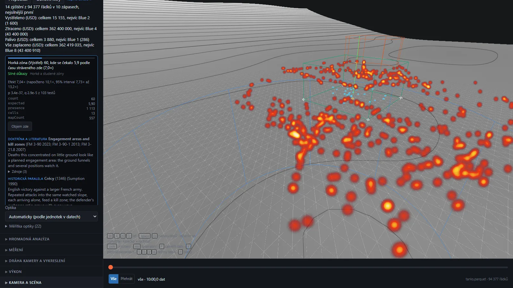

# Čočka znalostí

Když [Zjištění](insights.md) něco najde, tato část to vysvětlí pomocí myšlenek z vojenských dějin, herního designu a analýzy sportu a řekne, z které knihy nebo práce to pochází. Slouží k tomu, abyste se naučili *proč* na vzoru záleží, ne jen že existuje.

## Vyzkoušejte to {#try-it}

1. Načtěte data, otevřete **Zjištění** a stiskněte **Najít zjištění**.
2. Kliknutím na nález ho otevřete.
3. Přečtěte **Doktrína a literatura** a **Historická paralela**; úplné odkazy jsou sbalené pod nimi.
4. Změňte **Optika** (například na *Vojenskou doktrínu*), abyste stejný nález četli přes jiný okruh literatury.

## Jak to funguje {#how-it-works}

Panel Zjištění posuzuje své nálezy tak, jak by to dělal profesionální analytik: přes vojenskou doktrínu a operační výzkum, historická střetnutí a literaturu o herním designu, designu úrovní a analytice. Dělá to offline, z kurátorované znalostní báze v prohlížeči, a stejný materiál předá externímu modelu, když ten píše shrnutí.

## Co panel ukazuje {#what-the-panel-shows}

- **Optika** vybere okruh literatury, přes který se nálezy čtou: *Auto* (vybráno podle druhů jednotek v datech: letadla, lodě, pozemní vozidla, pěchota), *Vojenská doktrína*, *Vzdušný boj*, *Námořní*, *Městský*, *Herní design a vyvážení*, *E-sport*. Položky mimo zvolenou optiku se vynechají.
- Každý otevřený nález ukazuje svou nejbližší položku **doktríny a literatury** a svou nejbližší **historickou paralelu**, s úplnými odkazy sbalenými pod nimi.
- **Měřítka optiky** vypisuje míry operační analýzy počítané nad týmiž řádky (níže), každou s tím, co znamená, a její literaturou.
- **Shrnutí** přidá řádky pro hlavní nálezy a měřítka optiky: „Doktrína a literatura: ...“ a „Historická paralela: ...“, každé s citacemi autor–rok a odkazy sbalenými pod nimi.
- **Napsat pomocí AI** pošle s přehledem nejrelevantnější položky (shrnutí, poučení, nálezy, ke kterým se vztahují, úplné odkazy) a požádá model, aby je citoval podle id – `{concept.lanchester-square}` – a žádné jiné zdroje nepoužíval.

Popisky jsou přeložené; samotné znalosti jsou v angličtině.

## Měřítka optiky {#lens-metrics}

Počítají se v pracovním procesu zjištění, ve stejném průchodu řádků jako detektory (`src/insights/lensMetrics.ts`). Každé se vynechá, když data nemohou nést to, co potřebuje.

| Měřítko | Co měří | Potřebuje |
|---|---|---|
| Lanchesterova shoda | Ztráty každé strany na 20 s regresované na životní síly obou stran (Poissonovo rozdělení, chyby kvazi-věrohodnosti); exponenty na nepřátelskou a vlastní sílu, testované proti čtvercovému zákonu (mířená palba) a lineárnímu zákonu (plošná palba) | čas, týmy, vyřazení a smrti |
| Poměr výměny | Vyřazení na smrt podle strany a místa; podíl smrtí na nejsmrtonosnější zemi, která drží 5 % času, proti podílu, který by dala jen náhoda při tolika smrtích; Giniho koeficient smrtí v čase; Moranovo I měr úmrtnosti | vyřazení a smrti |
| Místní poměr sil | Spojenečtí a nepřátelští živí jednotky v dosahu boje každého vyřazení (dosah nastavený z dat: dvojnásobek mediánu vzdálenosti k nejbližšímu nepříteli); podíl vyřazení místně silnější strany a její přebytek nad tím, co předpovídají samotná čísla | čas, týmy, osoby |
| Pole palby | Výhledy nejrušnějších míst vyřazení na 2,5D povrchu překážek (geometrie úrovně až do výšky zdi, nebo prošlý terén) proti průměrnému místu a pořadová korelace výhledu a podílu vyřazení | pozice; načtená úroveň to zpřesní; ne pro vzduch |
| Energetický stav | Specifická energie (výška plus výška, kterou by rychlost koupila) vzdušných zabijáků a vzdušných obětí, porovnaná Mann-Whitneyho statistikou | třídy letadel, čas, výška |
| Klíčový terén | Jak často je každé místo mezi třemi nejrušnějšími místy vyřazení zápasu | několik zápasů |
| Vzájemná podpora (výměny) | Smrti, na které odpoví vyřazení spoluhráče v dosahu boje a do 5 s | čas, týmy |
| První úder | Střetnutí – vyřazení seskupená podle zápasu, podle 20 s klidu a podle tří dosahů boje – vyhraná stranou, která skórovala první | čas, týmy |
| Model salv | Hughesova rovnice salv přizpůsobená 20s obdobím lodí ve styku: lodě vyřazené z boje na jednu útočící loď a zachráněné na jednu bránící se loď; Lanchesterova shoda jen na lodích | třídy lodí, čas, týmy |
| Bojová účinnost | Vyřazení na jednotko-hodinu v akci každé strany a poměr dvou největších (hodnota bojové účinnosti v Dupuyho smyslu) s 95% intervalem, a podíl každé strany na vyřazeních při vyrovnaných místních počtech | čas, týmy |
| Dosahy střetnutí | Vzdálenost k nejbližšímu nepříteli při vyřazeních, při výstřelech odpalovaných zbraní a při prvním výstřelu každého života (zjištění až střetnutí), podle druhu jednotky | čas, týmy; odpaly, kde je data mají |
| Řetěz zabití | Sekundy od posledního odpalu zabijáka po vyřazení a od jeho prvního výstřelu v boji po vyřazení | čas; odpaly nebo události střelby |
| Koncentrace nebo rozptyl | V každém 20s období rozptyl dvou největších stran a podíl vyřazení, který vezme těsnější z nich | čas, týmy |
| Výpady | Na stranu: výpady (vzlety, nebo objevení letadel), přistání, ztracená letadla a vyřazení letadly; míra ztrát a vyřazení na výpad | třídy letadel; vzlety nebo objevení |

Data s koly přidávají měření boje zblízka a e-sportu – pravděpodobnost výhry kola, hodnotu akcí, úvodní souboje, výměny, hráč vykukující proti držiteli, mířění, křížovou palbu, pomůcky, výhodu v počtu, zvraty, rozestavení, situaci po položení bomby, smrtící nálevky a vliv hráče: viz [Boj zblízka a kola](close-quarters.md).

Stopy a týmy přidávají měření kolektivního chování z vědy o davech, kolektivního pohybu, behaviorální ekonomie a vojenské psychologie – sladění a kroužení, stádní vedení po trase, pruhy a stezky, shlukování, vůdci a následovníci, opozdilci, bod zlomu, riziko po ztrátách, série, shoda na nákupu a potlačení, každé proti vlastnímu nulovému modelu: viz [Kolektivní chování](collective-behaviour.md).

Zbraně, návnady a budovy se nepočítají jako jednotky. Kde řádky zbraní jmenují svou odpalující jednotku (sloupec `Shooter` nebo `Launcher`, jaký mají data odvozená z Tacview), připisuje se odpal té jednotce, podle jejího jména nebo id objektu.

## Jak nálezy potkávají literaturu {#how-findings-meet-the-literature}

Položky a nálezy se potkávají přes **taxonomii vzorů** (`src/insights/knowledge/patterns.ts`): koncentrace, místní převaha, mířená a plošná palba, úzká místa, zóny zabití, pole palby, odvrácený svah, boky, vzájemná podpora, energetická výhoda, tlak při oživení, vyvážení a tak dále. Každý druh detektoru a každé měřítko optiky říká, které vzory jeho čísla ukazují (`src/insights/lens.ts`); každá položka znalostí říká, kterých vzorů se týká, s váhou. Relevance položky k nálezu je vážený překryv, vynásobený tím, jak dobře doména položky (souš, vzduch, moře, město) sedí na data, a silou samotného nálezu. Zobrazený důvod je čísla nálezu ve větě a za ní poučení z položky.

## Katalog {#catalogue}

Každý vzor, pojem, metoda, historický případ, principy designu a studie s bibliografií: viz [Katalog znalostí](knowledge-catalogue.md).

## Pro vývojáře {#for-developers}

### Přidávání položek {#adding-entries}

1. Vyberte soubor podle druhu: `concepts.ts` a `concepts-more.ts`, `methods.ts`, `cases.ts`, `cases-land.ts`, `cases-air-sea.ts`, `cases-esports.ts`, `design.ts` (principy designu) nebo `studies.ts` v `src/insights/knowledge/`.
2. Dejte jí nové id `<druh>.<slug>` (nikdy nepoužívejte znovu), její optiky, domény a vzory, které se týká, s váhami 0..1. Přidejte vzor do `patterns.ts` jen tehdy, když ho může ukázat nějaký nález, a namapujte ho z nálezu nebo měřítka v `lens.ts`.
3. Napište shrnutí a poučení **vlastními slovy**. Citáty jen z děl ve veřejné doméně (`pd: true` v odkazu) a krátké.
4. Citujte: přidejte každé nové dílo do `refs.ts` s autory, rokem, názvem a vydavatelem (časopis s ročníkem a stránkami); URL nebo DOI, kde existuje veřejný záznam.
5. Spusťte `npx vitest run src/insights/lens.test.ts` (jedinečná id, známé vzory, řešitelné odkazy, citáty z veřejné domény, případy s datem a výsledkem) a `node tools/knowledge-doc.mjs`, aby se obnovil [katalog](knowledge-catalogue.md).
