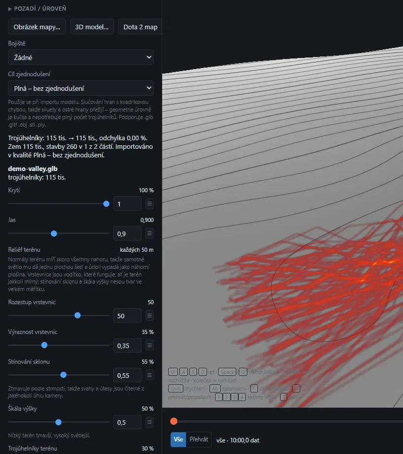

# Levely a geometrie pozadí

Level je 3D místo, kde se hra odehrála – mapa, město, trať. Položíte-li ho za svá data, uvidíte, *kde* je teplo. Panel **Pozadí / úroveň** (viz [Slovníček](glossary.md) pro „level“) dává tři druhy kontextu:

- **obrázek mapy**, georeferencovaný dvěma kotvami – viz [Obrázky map](map-images.md);
- **3D level** – `.glb`, `.gltf`, `.obj`, `.stl` nebo `.ply` – rozdělený na zemi, stavby a vodu a při importu zjednodušený – viz [3D levely](model-levels.md) a [Vzhled levelu](level-appearance.md);
- **pozadí světa** – pro nahrávku, která říká, kde na Zemi je (soubor Tacview ACMI): skutečný terén, silnice, vodu, letiště a budovy, stažené z otevřených dat – viz [Pozadí světa](world-backdrop.md).

Když není nic načteno, scéna je tmavá s mřížkou a barevnými osami (**Mřížka** a **Osy** v [Kamera a scéna](camera.md)) a panel říká *Nic není načteno – scéna ukazuje mřížku a osy. Přidejte obrázek mapy nebo síť levelu, aby teplo mělo kontext.*

Level sdílejí všechny tři záložky: závod načtený na záložce Analýza závodu je tentýž level, jaký ukazuje teplotní mapa.

## Položte level za svá data {#put-a-level-behind-your-data}

1. Nejdřív načtěte svá data ([Načítání dat](getting-data-in.md)), aby se k nim level přizpůsobil.
2. Otevřete v postranním panelu **Pozadí / úroveň**.
3. Stiskněte **Obrázek mapy…** pro obrázek nebo **3D model…** pro 3D level a vyberte soubor. Pro nahrávku ze skutečného světa použijte místo toho **Skutečný svět jako pozadí** nebo **Bojiště**.
4. Počkejte, až dojde řádek průběhu. Velký model se nejdřív zjednoduší (viz níže **Cíl zjednodušení**).
5. Stiskněte ve pohledu **F**, aby se vše zarámovalo. Použijte **Krytí** a **Jas**, dokud teplo nevynikne proti levelu.
6. Stiskněte **Uložit do knihovny**, pokud level použijete znovu ([Knihovna levelů](level-library.md)).

## Co level dělá s teplem {#what-a-level-does-for-the-heat}

- **Zakrývá**: datové body za ním se ztmavují podle ploch a datové body za terénem jsou skryté ([Hloubka a vyřazování](depth-and-culling.md)). Bez levelu zakrytí není.
- **Řeže** ho [Řez](slice.md) a s *Řezat i úroveň* také [ořezávání podle vzdálenosti](depth-and-culling.md#distance-culling), společně s teplem.
- Je jediná věc, kterou [hloubka ostrosti](camera.md#depth-of-field) rozmazává, kromě mřížky a krychlí.
- 3D level **rozšíří daleký plán kamery**, když je větší než data: blízký a daleký plán se kalibrují podle datové sady, a exportovaná mapa široká několik kilometrů by jinak celá ležela za dalekým plánem a nechala prázdný pohled. Daleký plán se stane 3 × vodorovným rozsahem levelu, když je to větší, blízký plán se s ním posune (nejméně daleký / 100 000), aby zůstala přesnost hloubky, na které zakrytí závisí, a rychlost letu se zvýší nejméně na rozsah / 12. Plán se jen rozšiřuje, nikdy nezužuje.

## Panel shora dolů {#the-panel-top-to-bottom}

| Část | Podrobnosti |
|---|---|
| **Obrázek mapy…**, **3D model…** | Načte jeden; nahradí aktuální level. |
| **Skutečný svět jako pozadí**, **Zapomenout dlaždice map** | Jen pro datovou sadu s geografickým odkazem: postaví skutečné místo pod daty jako level, nebo smaže stažené dlaždice. [Pozadí světa](world-backdrop.md) |
| **Cíl zjednodušení** | Rozpočet trojúhelníků pro další import modelu: *Plný – bez zjednodušení* (výchozí), *Vysoký – 8M*, *Střední – 3M*, *Nízký – 800k*, *Silueta – 100k*. [3D levely](model-levels.md#simplification) |
| Průběh a **Zrušit** | Během dekódování nebo importu. |
| Poznámka k importu | Trojúhelníky před a po, rozdělení na zemi / stavby / vodu, použitá úroveň detailu. |
| Název a velikost | `šířka×výška px · x × z m/px` u obrázku, `N trojúhelníků (z M)` u modelu. |
| **Krytí**, **Jas** | Oba druhy. |
| Ovládací prvky obrázku | **Odbarvení**, **Převrátit sever/jih**, **Umístění** (dvě kotvy), **Přizpůsobit rozsahu dat**, **Výška**. [Obrázky map](map-images.md) |
| Ovládací prvky modelu | Reliéf terénu, voda, trojúhelníky terénu, drátový model, textura, zachycená barva, stavby, zařazení částí. [Vzhled levelu](level-appearance.md) |
| **Uložit do knihovny**, **Odebrat** | [Knihovna levelů](level-library.md); Odebrat level uvolní. |
| **Knihovna** | Levely uložené v tomto prohlížeči. [Knihovna levelů](level-library.md) |

## Stránky v této sekci {#pages-in-this-section}

- [Obrázky map](map-images.md)
- [3D levely](model-levels.md) – formáty, části, zařazení, zjednodušení, textury
- [Vzhled levelu](level-appearance.md) – každý ovládací prvek pro 3D level
- [Knihovna levelů](level-library.md)
- [Pozadí světa](world-backdrop.md) – skutečný svět pod nahrávkou, z otevřených dat

Jak dostat levely z her a enginů, je úkolem samostatných nástrojů exportéru (viz [README](https://github.com/Holdi601/3DHeat/blob/main/README.md) repozitáře); smlouva, do které zapisují, je shrnuta v [3D levely](model-levels.md#the-exporter-contract).
