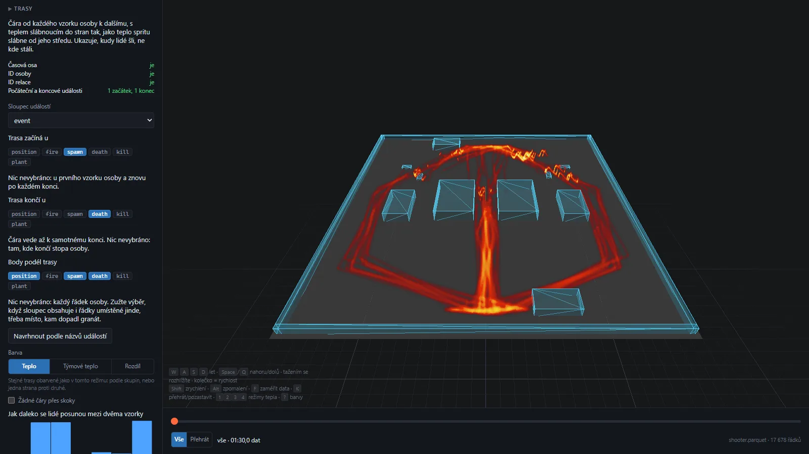

# Čárové teplo

Teplo ukazuje, kde lidé stáli. Čáry ukazují cesty, po kterých šli.

**Čáry** (klávesa 4) jsou čárové teplo: čára od každého vzorku [osoby](glossary.md) k jejímu dalšímu, rozprostřená se stejným úbytkem, jaký má [sprite](glossary.md) – napříč čáry místo kolem bodu. Ukazuje, kam lidé *šli*, a ne kde stáli: chodba proběhnutá jednou je stejně vidět jako místnost, ve které se kempovalo, a řídké vzorky rychlého hráče se spojí do souvislé trasy místo tečkované stopy. Potřebuje sloupec osoby a sloupec času.

## Jak se to používá {#how-to-use-it}

1. Stiskněte `4` (nebo vyberte **Čáry** v liště režimů).
2. Otevřete **Trasy** a zkontrolujte zelený seznam: musí být přítomna časová osa a ID osoby.
3. Stiskněte **Navrhnout podle názvů událostí**, aby se doplnilo, kde trasy začínají a končí.
4. Přečtěte řádek statistik: „N tras, M z nich dosáhne konce“.
5. Když čáry přeskakují přes mapu, upravte **Nejdelší krok** (viz [Limit skoku](#the-jump-limit)).

Čára dává smysl jen mezi začátkem a koncem, takže panel **Trasy** říká, co trasu ohraničuje. Všechno od [Pravidel trasy](#the-rules-of-a-route) dál je podrobnost, kterou můžete přeskočit.

## Panel Trasy {#the-routes-panel}

Zobrazuje se nad panely tepla v režimu Čáry.

### Co data mají {#what-the-data-has}

Zaškrtávací seznam, zelený, když je položka přítomna, oranžový, když není:

| Řádek | Stavy |
|---|---|
| **Časová osa** | *přítomna* / *chybí – potřebná* |
| **ID osoby** | *přítomno* / *chybí – potřebné* |
| **ID relace** | *přítomno* / *žádné – všechny řádky jsou jedna relace* |
| **Počáteční a koncové události** | *N začátků, M konců* / *žádné nevybrány – celé stopy* (zeleně jen se sloupcem událostí a aspoň jedním začátkem a jedním koncem) |

### Ovládací prvky {#controls}

| Ovládací prvek | Význam |
|---|---|
| **Sloupec událostí** | Sloupec kategorie, jehož hodnoty jsou události (spawn, smrt, pozice, ...). *Žádný – celé stopy*: stopa každé osoby v každé relaci je jedna trasa, přerušená tam, kde má stopa mezeru. Nabízejí se jen sloupce ponechané pro filtrování při načtení. |
| **Trasa začíná u** | Hodnoty událostí, které začínají trasu (spawn, respawn, nasazení). Nic nevybráno: trasa začíná u prvního vzorku osoby a znovu po každém konci. |
| **Trasa končí u** | Hodnoty událostí, které trasu končí (smrt, evakuace, teleport). Čára vede až k samotnému řádku konce. Nic nevybráno: trasa končí tam, kde končí stopa osoby. |
| **Body podél trasy** | Hodnoty událostí, jejichž řádky leží podél trasy. Nic nevybráno: každý řádek osoby. Zúžte to, když sloupec obsahuje i řádky umístěné jinde, například kde dopadla granát. |
| **Navrhnout podle názvů událostí** | Vyplní tři seznamy podle názvů hodnot (níže). |
| **Barva** | *Teplo*, *Teplo týmů* nebo *Rozdíl*. Tytéž trasy v barvení toho režimu: každá skupina ve svém odstínu, nebo jedna strana proti druhé, se seznamem skupin, rozdělením a škálami fungujícími jako v těch režimech. Výchozí *Teplo*. Teplo týmů a rozdíl potřebují sloupec skupiny. |
| **Žádné čáry přes skoky** / **Nejdelší krok** | Další vzorek osoby vzdálenější než tohle je oživení, teleport nebo pád, a ne místo, kam šla; takže žádná čára nespojí ty dva. Doplní se při načtení, když data ukážou jasnou mezeru (níže), a jinak se nechá vypnuté. Funguje se sloupcem událostí i bez něj. |
| Řádek statistik | `N tras, M z nich dosáhne konce, K úseků`, aktualizuje se několikrát za sekundu. |

Každý seznam je řada přepínacích štítků, jeden na hodnotu, nejčastější první; když na štítek najedete, ukáže počet jeho řádků. Nabízí se nejvýš 120 hodnot (*dalších N hodnot se nezobrazuje*).

Když vyberete jiný sloupec událostí, návrh se použije, jen pokud návrh vybírá ten samý sloupec; jinak se začne s prázdnými seznamy.

### Návrh {#the-suggestion}

Při každém načtení a při **Navrhnout podle názvů událostí** ([`suggestLineSettings`](https://github.com/Holdi601/3DHeat/blob/main/src/data/lines.ts)):

- **Sloupec událostí:** první zachovaný sloupec kategorie s názvem `event`, `eventname` nebo `eventtype`; jinak `kind`, `type` nebo `action`; jinak jakýkoli obsahující *event*, *kind*, *action* nebo *type*.
- **Začátky:** hodnoty obsahující *spawn, deploy, join, enter, start, begin, respawn, revive, land/landed/landing, drop* – pokud také neodpovídají slovu konce.
- **Konce:** hodnoty obsahující *death, died, dead, kill/killed, eliminat…, extract, evac, teleport, leave, left, disconnect, quit, exit, end, finish, downed* – kromě hodnot `kill` a `kills` (zabití je něco, co dělá zabiják, ne konec jeho trasy).
- **Body:** hodnoty, které jsou přesně *position, location, player location, move, movement, tick, sample* nebo *pos*; když se některá najde, přidají se k bodům i začátky a konce. Když se žádná nenajde, body zůstanou prázdné (každý řádek).

### Limit skoku {#the-jump-limit}

Tam, kde lidé skáčou, se délky kroků rozpadnou do dvou skupin s téměř ničím mezi nimi: co osoba urazí mezi dvěma vzorky, a šířka mapy. Při načtení ([`suggestMaxJump`](https://github.com/Holdi601/3DHeat/blob/main/src/data/lines.ts)) se kroky počítají podle každého zdvojnásobení jejich čtvercové délky, až 16 milionů, a limit se dá doprostřed prvního rozsahu nad mediánem, který je široký aspoň jedno zdvojnásobení délky, drží méně než 0,02 % kroků na přihrádku a za sebou má kroky. Když takový rozsah není, nic se neřeže, protože by nebylo poznat skok od rychlého auta; zapnutí limitu ručně pak začíná na desetině úhlopříčky dat.

Graf nad limitem ukazuje, jak dlouhé kroky skutečně jsou, s čárou u limitu: sloupce napravo od ní se nekreslí. Obě osy jsou logaritmické, protože skoky mohou tvořit setinu kroků a být tisíckrát delší. Najetí na sloupec ukáže jeho rozsah a podíl; klik na graf dá limit sem. Pod ním je podíl kroků nad limitem.

## Pravidla trasy {#the-rules-of-a-route}

Řádky se procházejí v pořadí času, pro každou osobu ([`buildLines`](https://github.com/Holdi601/3DHeat/blob/main/src/data/lines.ts)):

1. Řádky [sdíleného názvu](sessions-persons-groups.md#names-worn-by-several-things-at-once) se přeskočí úplně.
2. Když jsou body vybrány, řádek, který není ani začátek, ani konec, ani bod, se přeskočí.
3. Řádky se sledují pro každou osobu a relaci zvlášť, takže osoba, jejíž relace se v pořadí času prolínají, má jednu trasu v každé. Trasa se uzavře, když předchozí řádek neměl následníka (jeho [životnost](sessions-persons-groups.md#person) je „žádná“) – trasa nikdy nepřekročí hranici relace ani mezeru, o které načtení rozhodlo, že nemá další vzorek. Na které trase řádek leží, se spočítá jednou a uloží, 4 bajty na řádek, takže změna nejdelšího kroku tu část neopakuje.
4. Řádek **začátku** uzavře každou otevřenou trasu a tam otevře novou.
5. Když jsou vybrány začátky, řádek mimo trasu se ignoruje. Bez začátků otevře trasu každý řádek, který není koncem, a je mimo trasu.
6. Každý jiný řádek uvnitř trasy přidá **úsek** od předchozího řádku trasy k tomuto.
7. Řádek **konce**, který trasu prodlužuje, ji uzavře po jejím úseku; ta trasa se počítá jako *dosahující konce*.
8. Krok delší než **Nejdelší krok** uzavře trasu tam, kde byla, a nová trasa začne na vzdáleném konci, pokud ten řádek není konec. Přes něj se nekreslí žádná čára a řádek statistik ho počítá.

Každý úsek se ukládá na svůj řádek *konce*, takže úseky zůstávají v pořadí času, a [časová osa](timeline.md), vzorkovač, [filtry](filters.md), viditelnost skupin i znaménko rozdílu s nimi pracují stejně jako s body. Filtr se tedy použije na řádek, kde úsek končí.

## Přehrávání {#playback}

V režimu **Vše** se každá trasa kreslí celá. V režimu **Přehrát** je každá osoba bod, který se pohybuje mezi svými vzorky, a za sebou kreslí svou trasu:

- úsek, který začíná za hlavou přehrávání, se nekreslí;
- úsek, uprostřed kterého je osoba, se kreslí až k její interpolované pozici, s koncovým zakončením na hlavě;
- teplo mizí na **ocasu**: při historii *Kumulativně* je ocas neomezený a celá dosavadní trasa zůstane; při *Okně* mizí během *Rozsahu* (výchozí 30 s). Při *Životnosti* je ocasem také *Rozsah* a v režimu Čáry ukáže časová osa pro tuto historii také pole *Rozsah* (místo *Záložní životnost* a *Doznívání*, které čárové teplo nepoužívá).

Při přehrávání se každý snímek kreslí celý, ne se sčítá, protože hlavy se hýbou každý snímek a klouzavý průměr by každou rozmazal do čáry.

## Pro vývojáře {#for-developers}

### Paměť {#memory}

Trasy se sestavují na hlavním vlákně, když se vstoupí do režimu Čáry (nebo se změní nastavení tras), a uvolní se, když se z něj odejde: 5 bajtů na řádek v paměti a 8 bajtů na řádek na GPU (počáteční pozice každého úseku, kvantovaná na 16 bitů na osu v ohraničujícím rámci dat, a jeho příznaky).

### Jak se čára kreslí {#how-a-line-is-drawn}

Oba backendy kreslí každý úsek od svého řádku konce jako **18 vrcholů** ([`lineHeatVs`](https://github.com/Holdi601/3DHeat/blob/main/src/render/webgl2/shaders.ts) a jeho WGSL dvojče):

- Poloviční šířka na každém konci je [poloměr spritu](sprite-shape.md#sprite-radius) na vzdálenosti toho konce, s uplatněnými pixelovými mezemi. Čára užší než 2,5 px se kreslí 2,5 px široká, s teplem zmenšeným tak, aby odpovídalo, takže tenké čáry ani nezmizí, ani nezesvětlají.
- Teplo klesá **napříč** čárou se stejnou škálou jako sprite – úbytek nebo křivka, intenzita ve středu a na okraji.
- Kulaté zakončení se kreslí **jen** tam, kde trasa začíná nebo končí, aby se spoje mezi sousedními úseky nerozpadly na řetěz perlí.
- Geometrie se staví v prostoru obrazovky a tam se lineárně interpoluje, takže úbytek zůstává vystředěný na čáře, ať jde jakkoli do hloubky. Úsek, který protíná blízkou rovinu, se tam přeřízne, místo aby se zahodil.

Čárové a bodové teplo ukládají na řádek velmi různá množství tepla, takže se sytost při přepnutí mezi nimi znovu měří ([Barva a expozice](colour-and-exposure.md#auto-exposure)).
