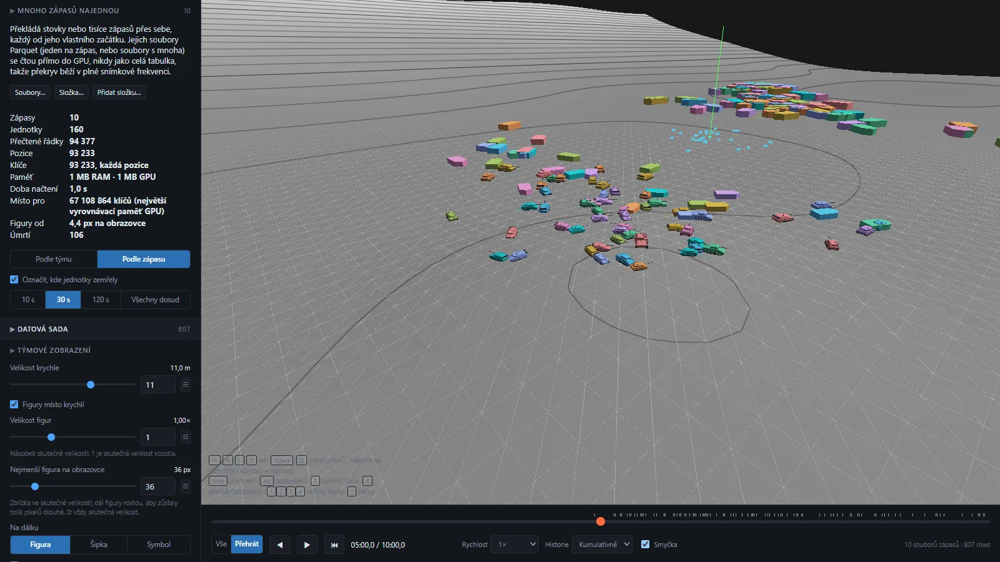

# Mnoho zápasů najednou

**Mnoho zápasů najednou** přehraje spoustu zápasů přes sebe, takže vidíte, kam hráči každého zápasu obvykle chodí. Slouží k porovnání stovek nebo tisíců zápasů v jednom obrázku.

Každý zápas začíná na svém vlastním začátku a jeho jednotky se pohybují jako figury. Soubory jdou přímo do grafické karty a nevytváří se žádná úplná tabulka, takže to běží plynule tam, kde by běžné načtení došlo paměť.

## Jak to použít {#how-to-use-it}

1. V postranním panelu Teplotní mapy otevřete **Mnoho zápasů najednou**.
2. Stiskněte **Soubory…** (vyberte mnoho souborů), **Složka…** (složka a její podsložky) nebo **Přidat složku…** (přidat k tomu, co je načteno).
3. Prohlížeč přepne na překryv figur a začne na začátku. Stiskněte **Přehrát**.

Každý soubor je jeden zápas (nebo jich obsahuje několik). Fungují soubory Parquet a kontejnery [`.3dheat`](container.md). Soubor potřebuje sloupec pozice, času a jednotky; sloupce jména, typu a strany se ponechají. Ostatní soubory a vedlejší soubory převodníků (let, zprávy, události, chat, cíle) se přeskočí. Pro běžnou tabulku viz [Jak nahrát data](getting-data-in.md).

## Nastavení {#settings}

| Nastavení | Co dělá |
|---|---|
| **Podle týmu** / **Podle zápasu** | Barva podle strany, nebo barva na zápas. |
| **Označit, kde jednotky zemřely** | Značka, kde každá jednotka zemřela, po dobu 10 s, 30 s, 120 s, nebo všechny dosud. |

Panel ukazuje, kolik zápasů, jednotek, řádků a pozic bylo načteno, jakou paměť to zabralo a jak dlouho to trvalo. *Místo pro* je, kolik dalších pozic by grafická karta ještě pojala. *Figury od* je velikost na obrazovce, pod kterou se jednotka kreslí jako malý šipkový značkovač místo své figury.

Vzhled figur používá tytéž ovládací prvky jako [přehrání zápasu](match-replay.md#figures): **Velikost figur**, **Nejmenší figura na obrazovce** a **Na dálku**.

## Tipy {#tips}

- Když by se všechno do paměti nevešlo, pozice se proředí (zachová se jen pozice každých několik metrů) a panel to řekne.
- Režimy tepla fungují i na datech překryvu.
- Statistiky přes tisíce zápasů bez jejich kreslení: viz [Hromadná analýza](mass-analysis.md).
