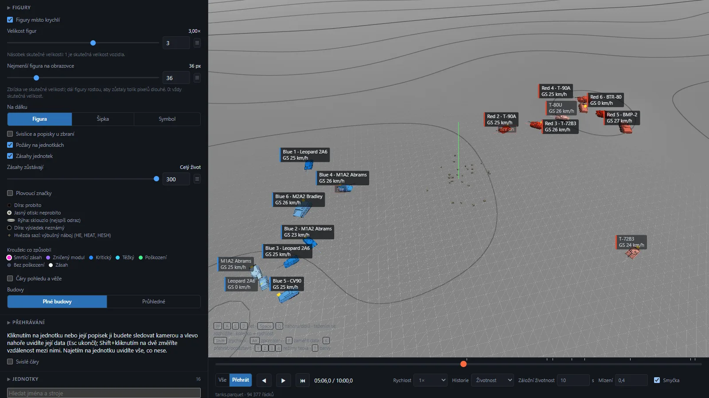
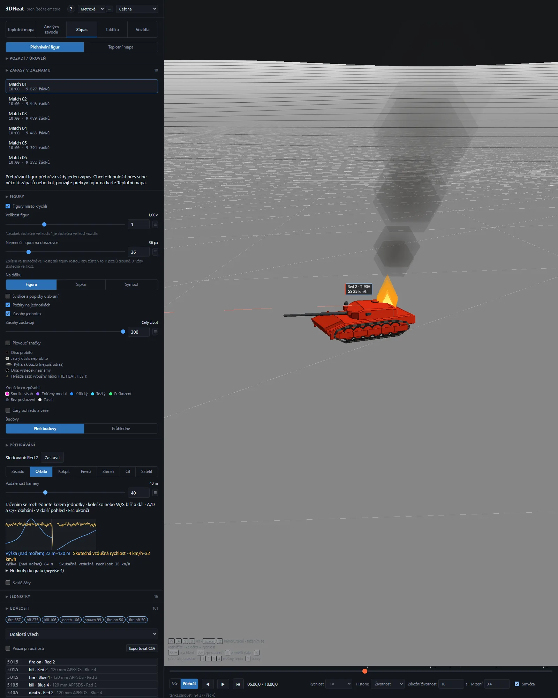
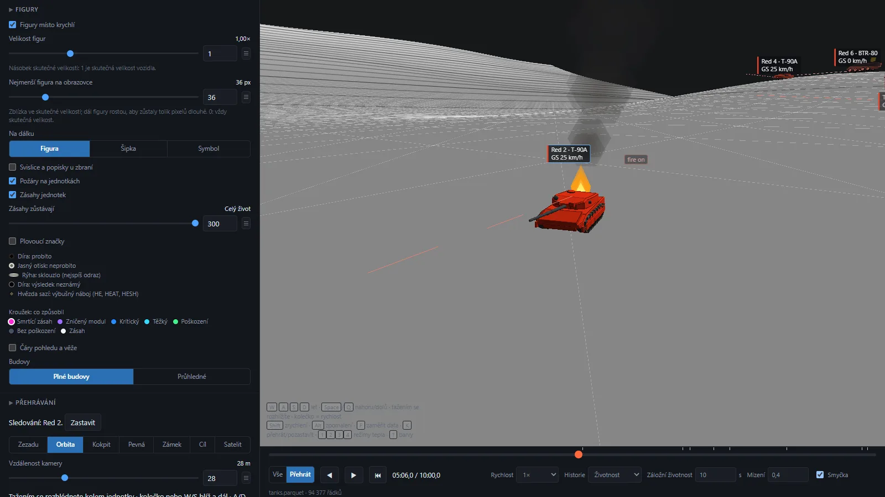
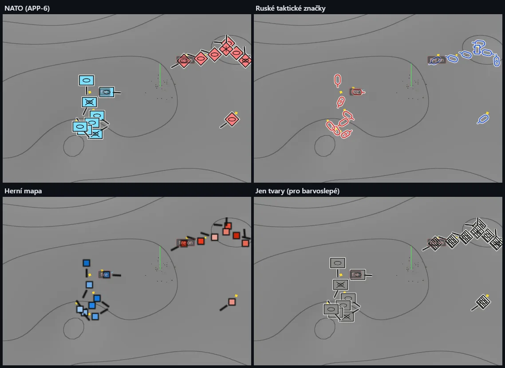
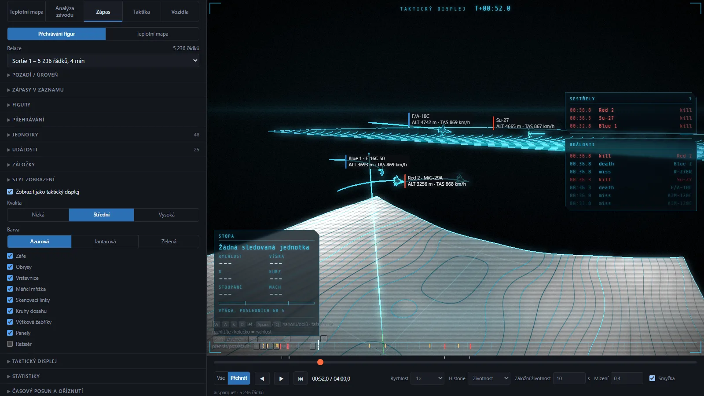
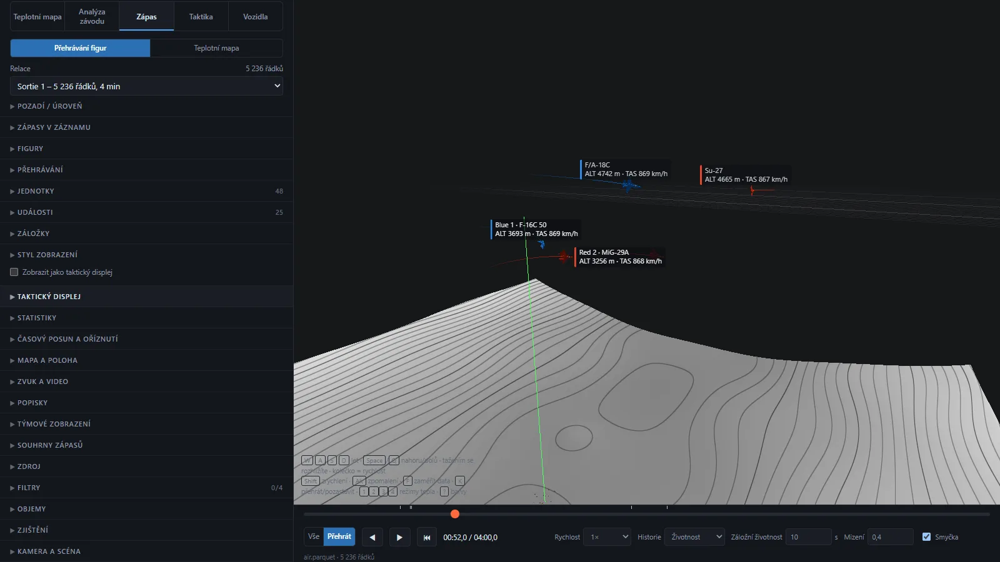

# Přehrání zápasu

Přehrání je film zápasu, kde je každý hráč nakreslen jako to, co řídil. Použijte ho, když chcete znovu sledovat boj, jednu jednotku a vidět, kdo koho zasáhl.

Výstřely, zásahy, požáry a vraky jsou nakreslené na jednotkách a cílech na levelu. Kamery, popisky a taktický displej vám pomáhají boj číst. Znáte Tacview? [Parita s Tacview](tacview-parity.md) ukazuje, kde je každý z jeho nástrojů.

## Spuštění přehrání {#start-a-replay}

1. Načtěte záznam přes **Zdroj → Soubory…** nebo ho přetáhněte na panel Zdroj (libovolná tabulka se sloupcem **osoba** a **čas**, soubor Tacview, převedené přehrání, zápas v [`.3dheat`](container.md)). Viz [Načítání dat](getting-data-in.md).
2. Otevřete záložku **Zápas** a vyberte **Přehrávání figur**, nebo vyberte **Překryv figur** v pruhu režimů záložky Teplotní mapa.
3. V části **Zápasy v záznamu** vyberte jeden zápas, všechny najednou, nebo několik.
4. Stiskněte **Přehrát** na časové ose (nebo `K`). Přetažením časové osy přeskočíte.

Figury nahradí krychle u každé jednotky, jejíž jméno nebo typ je znám (viz [Figury](figures.md)). Data bez sloupce se jménem nebo typem se kreslí jako vojáci.

## Figury {#figures}

| Nastavení (sekce **Figury**) | Výchozí | Co dělá |
|---|---|---|
| **Figury místo krychlí** | zapnuto | Vypnuto kreslí obyčejné krychle. |
| **Velikost figur** (násobek skutečné velikosti) | 1 | 1 je skutečná velikost; 0,25 až 20násobek (logaritmická stupnice). Větší pomáhá z dálky. |
| **Nejmenší figura na obrazovce** | 36 px | Vzdálené figury zvětší, aby zůstaly tak velké; 0 až 200 px; 0 drží skutečnou velikost. |
| **Na dálku**: Figura, Šipka, Symbol | Figura | Čím se stane vzdálená jednotka. |
| **Symboly** | NATO (APP-6) | NATO (APP-6), ruské taktické značky, ikony **Herní mapa**, nebo **Jen tvary (pro barvoslepé)**. |
| **Velikost symbolu**, **Moje strana**, **Nepřátelské / Neutrální**, **Značky kurzu** | 28 px (12 až 64), automaticky, nepřátelské, zapnuto | Jak symboly vypadají a která strana je přátelská. |
| **Svislé čáry** | zapnuto | Čára od každé jednotky přímo dolů k zemi, aby se výšky četly v 3D. |
| **Svislice a popisky u zbraní** | vypnuto | Čáry k zemi a popisky u raket a bomb. |
| **Požáry na jednotkách** | zapnuto | Plameny od okamžiku, kdy jednotka začne hořet, až do uhašení. |
| **Zásahy jednotek** | zapnuto | Značky, kde výstřely zasáhly (níže). **Zásahy zůstávají**: 1 až 300 sekund, nebo **Celý život**. **Plovoucí značky**: značky nakreslené nad povrchem. |
| **Čáry pohledu a věže** | vypnuto | Přerušované: kam hráč kouká; plné: kam míří zbraň. |
| **Budovy** | plné | Plné nebo průhledné budovy, když je level vykresluje. |

### Symboly na dálku {#symbols-at-a-distance}

Když by jednotka byla menší než **Nejmenší figura na obrazovce**, může se změnit na symbol, který zůstane čitelný. Tvar říká druh (například zaoblená krychle s pásovou značkou u obrněnce); barva říká stranu. Otevřete nabídku **Symboly** a změňte styl.

### Značky zásahů, vraky a požáry {#hit-marks-wrecks-and-fires}

- **Značky zásahů** sedí na povrchu, kam výstřel dopadl, v měřítku figury. Jejich vzhled říká, co se stalo: díra (prošlo), světlá šlehnutí (neprošlo), rýha (odrazilo se), hvězda od sazí (výbušná střela). Barevný kroužek říká, co to udělalo: smrtící zásah, modul zničen, kritický, vážný, poškození, bez poškození, zásah. Najeďte na značku, a uvidíte název střely.
- Zničená jednotka se kreslí **spálená** jako vrak od své smrti, dokud se neoživí nebo nezmizí; její symbol je přeškrtnutý.
- **Požáry** hoří na jednotce od okamžiku, kdy začne hořet, až do uhašení.
- **Věže** se otáčejí tam, kam data ukazují, že zbraň míří (nebo, když takový údaj není, kam hráč kouká).

### Zbraně, návnady a stopovače {#weapons-decoys-and-tracers}

Když je zapnuto **Zbraně, výstřely a zásahy** (sekce Týmové zobrazení): rakety, střely, bomby a torpéda letí jako vlastní figury s kouřovou stopou; kulky a granáty jsou stopovače; nárazy a výbuchy blikají. Stopovač nakreslený **přerušovaně** byl odvozen ze zásahu, protože data neměla výstřel. Světlice a plevy se kreslí jako návnady; jsou skryté v seznamu jednotek, pokud není zaškrtnuto *Návnady a granáty*.

## Kamery {#cameras}

Klikněte na jednotku nebo na její popisek, abyste ji **sledovali**; sekce **Přehrání** nabízí **Zezadu**, **Orbita**, **Kokpit** (s zobrazením na čelním skle, `H`), **Pevná**, **Zámek**, **Cíl** a **Satelit**. `V` je přepíná v kruhu, **Vzdálenost kamery** nastaví, jak daleko. Esc zastaví.

- **Pohled na dvě jednotky**: vyberte **Cíl** (nebo klikněte na jednotku s Ctrl/Alt), abyste se na ni dívali ze sledované jednotky; **Prohodit** je vymění.
- **Měření**: Shift-klikněte na dvě jednotky pro směr, vzdálenost a rozdíl výšky mezi nimi.
- **2D mapa** (`M`): v rohu nebo na celý pohled, se stopami a jmény.
- **Záložky** (`B`): uložte okamžik a kameru; i zabití, smrti a značky z přehrávání jsou uvedeny.
- **Události**: každá událost v časovém pořadí; kliknutím na ni tam přeskočíte. `Page Up` / `Page Down` přeskakují mezi událostmi; **Pauza při události** se zastaví u každé z nich.

## Taktický displej {#tactical-display}

Sekce **Taktický displej** kreslí, u žádné jednotky, u vybraných, u všech, nebo u jednoho druhu (letadla, pozemní, lodě, zbraně): vektory rychlosti a dráhu před sebou, čáry nosu a vztlaku, kužely radaru, zámky, datová spojení, zóny a čáry zapojení, zorné linie, kam hráči kouknou (kužely pohledu), namíření věže a zaznamenanou kameru.

### Styl zobrazení {#display-style}

`T` (nebo přepínač **Zobrazit jako taktický displej**) přepne vzhled na styl radarové obrazovky: záře, obrysy, vrstevnice, mřížka měření, skenovací čáry, kroužky dosahu, žebříky výšek, panely se zabitími a událostmi a **Režisér**, který kameru sám přesouvá k událostem.

## Cíle {#objectives}

Když záznam přichází s cíli, sekce **Cíle** je nakreslí na level: zóny dobývání (s vlastníkem a postupem dobývání), spawny, letiště, oblasti a cíle bombardování; každou vrstvu lze přepnout a mají popisky. Vidí se skrz zemi. Když je načteno více herních režimů, **Režim** filtruje zápasy podle režimu. Cíle pocházejí ze souboru zápasu od převodníku vedle záznamu, nebo uvnitř kontejneru [`.3dheat`](container.md).

Zápasy Rainbow Six Siege přinášejí svá místa pro bombu: dvě místnosti každého místa se kreslí na jejich podlahu jako obrysy s názvy, odvozené z toho, kde stáli hráči, zatímco hra místnost jmenovala; místo na mapě, které se v zápase nehrálo, pochází z tabulky míst převodníku jako kruh. V záznamu se místo kola na pozici přehrávání rozsvítí jantarově, ostatní zůstanou šedá. Patří do vrstvy zón k obsazení.

## Popisky a statistiky {#labels-and-statistics}

- **Popisky**: pravidla podle druhu (**Vybrané**, **Letadla**, **Pozemní**, **Lodě**, **Zbraně**, **AI**): zobrazit nebo ne, které hodnoty, a **Priorita** pro to, kdo dostane místo, když se popisky překrývají. **Nepřekrývat popisky** přesune popisek vedle jednotky, když by zakryl jinou, a vynechá ho tam, kde není místo. **Velikost popisků** je 60 až 250 %. **Zpět na jméno, stroj, výšku a rychlost** vrátí pravidla na výchozí.
  - Pozemní jednotky začínají jménem, strojem a rychlostí.
  - Letadla začínají jménem, strojem, výškou a rychlostí.
  - Lodě začínají jménem, strojem, rychlostí a kurzem.
  - Najetím na jednotku uvidíte všechny hodnoty, které má.
- **Statistiky**: pro každý tým a jednotku: zabití, smrti, výstřely, zásahy, poměr zásahů, vzlety, přistání, čas ve vzduchu, nejvyšší rychlost, výška a G, vzdálenost. Export do CSV.
- **Grafy**: hodnoty jednotky v čase, dvě jednotky porovnané, nebo jedna hodnota proti druhé.

## Mnoho zápasů najednou {#many-matches-at-once}

Pro položení stovek nebo tisíců zápasů přes sebe viz [Mnoho zápasů najednou](many-matches.md). Podrobnosti o figurách (kouř, oheň, jiné efekty s časem): [Figury v překryvu figur](figure-replay.md). Seznam funkcí Tacview: [Parita s Tacview](tacview-parity.md), podstránka této stránky.
