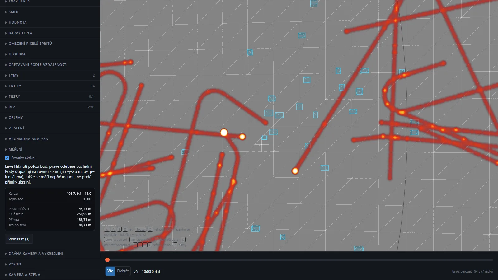

# Měření

**Měření** promění myš v pravítko a řekne vám, jak rušné je místo pod kurzorem. Použijte ho, když chcete zjistit, jak daleko od sebe jsou dvě místa, nebo kolik provozu má jedno místo.

## Vyzkoušejte {#try-it}

1. Otevřete **Měření** v postranním panelu a zaškrtněte **Pravítko aktivní**.
2. Levým kliknutím označte na mapě tři místa. Každé kliknutí položí bod.
3. Přečtěte si **Celou trasu** (délku celé cesty) a **Poslední úsek** (poslední etapu).
4. Pravým kliknutím odeberete poslední bod, nebo stiskněte **Vymazat (3)**, abyste odstranili všechny.

| Akce | Účinek |
|---|---|
| Levé kliknutí | Položí bod tam, kde se kurzor setká se zemní rovinou. Kliknutí, při kterém se mezi stisknutím a uvolněním pohnulo víc než o 4 pixely, je tažení kamery, ne bod. |
| Pravé kliknutí | Odebere poslední bod. |
| Pohyb | Pozice kurzoru a teplo pod ním se aktualizují živě. |

Kamera funguje, i když je pravítko zapnuté: tažením se stále rozhlížíte, klávesy stále létají. Když je pravítko zapnuté, bere každé kliknutí, takže [výběr kliknutím](camera.md#click-to-pick) čeká, až se vypne.

**Zemní rovina** je [výška obrazu mapy](map-images.md), je-li načten obraz mapy; jinak nejnižší Y datové sady (bez ní 0). Body na ni dopadají, takže pravítko měří přes mapu, ne po přímce skrz ni. U 3D úrovně je rovina pořád nejnižší Y datové sady, ne povrch úrovně; pro bod na skutečném povrchu vypněte pravítko a klikněte na něj ([výběr kliknutím](camera.md#click-to-pick)), který čte souřadnice z vlastních trojúhelníků úrovně.

## Údaje {#readouts}

| Řádek | Význam |
|---|---|
| **Kurzor** | Světové X, Y, Z bodu pod kurzorem, na rovině. |
| **Teplo zde** | Kolik tepla je na pixelu kurzoru. Větší číslo znamená více provozu na tom místě. Je to hodnota, která jde do barevné škály, než ji nasycení vydělí, takže ji můžete porovnat s [Bodem nasycení](colour-and-exposure.md#saturation-point). |
| **Poslední úsek** | Vzdálenost od posledního bodu ke kurzoru (nebo mezi posledními dvěma body). |
| **Celá trasa** | Délka lomené čáry přes každý bod a kurzor. |
| **Přímka** | 3D vzdálenost od prvního bodu ke kurzoru (nebo od posledního bodu). |
| **Jen po zemi** | Totéž, jen na X a Z. |
| **Vymazat (N)** | Odstraní všechny body. |

Vzdálenosti se ukazují v centimetrech pod 1 jednotkou, v metrech pod 1 000, v kilometrech nad tím – za předpokladu, že jedna jednotka světa je metr ([Osy, jednotky a čas](axes-units-and-time.md#unit-scale)). Souřadnice jsou světové, i když je osa [převrácena pro zobrazení](camera.md#invert-world-axis).

Body a čára mezi nimi se kreslí jako překryv v zobrazení, s velikostí podle rozestupů mřížky. Body pravítka se v pohledech neukládají; zůstanou, i když načtete jiná data.

## Pro vývojáře {#for-developers}

**Teplo zde** se z GPU čte nejvýš každých 120 ms, protože čtení jednoho pixelu zastaví pipeline. Používá stejnou cestu jako `engine.readHeatProbe()`: vydělené zesílením, se kterým byl snímek zapsán, takže na cestě akumulace half-float (`?heat=f16`) je ve stejných jednotkách jako na 32bitovém cíli ([Akumulace v half-float](half-float-accumulation.md)).
