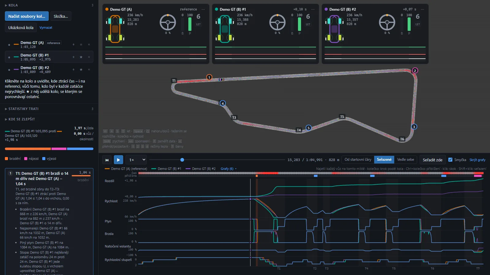

# Analýza závodu

Projeli jste stejnou trať dvakrát. Karta **Analýza závodu** přehraje obě jízdy spolu v 3D, ukáže, kde bylo jedno kolo pomalejší, a řekne vám proč. Zatím žádná kola? Stiskněte **Ukázková kola**.

Karta porovnává dvě nebo více kol jedné trati. Sdílí plátno, kameru a načtený model trati (**Pozadí / úroveň**) s teplotní mapou; všechno ostatní je vlastní: vlastní postranní panel a vlastní lišta pod pohledem. Pojmy jako *kolo*, *reference* a *apex* jsou ve [slovníčku](glossary.md).

Tato stránka je mapou karty. Každá část má vlastní stránku:

| Stránka | Co pokrývá |
|---|---|
| [Načítání kol](race-loading-laps.md) | každý formát souboru, složky a tratě, jména vozů, ukázková kola, seznam kol, reference a zaměření |
| [Přehrání a 3D scéna](race-replay-and-scene.md) | lišta přehrávání, tři režimy přehrání, seřazení aut, kamera za autem, čáry, mapy, auta, popisky, zrcadlové světy |
| [Grafy a HUD](race-charts-and-hud.md) | grafy podle vzdálenosti, výběr grafu, najetí a přiblížení, karty aut, tabulka kanálů |
| [Události ovládání vozu](race-control-events.md) | zablokování kol, prokluz, přetáčivost, smyky, nedotáčivost, nárazy, havárie, ABS/TC, ruční brzda, vzduch - jak se každá zjišťuje, se všemi prahy |
| [Analýza zatáčku po zatáčce](race-corner-analysis.md) | zarovnání podle vzdálenosti, zatáčky a úseky, časová bilance zatáčky, každá příčina a pořadí, v němž se zkoušejí, tvar stopy a rada |
| [Profily vozidel a porovnání](race-car-profiles.md) | co každé auto umí, změřeno z jeho kol; *Srovnání vozů*; co auto rozhoduje v každé zatáčce |
| [Statistiky trati](race-course-statistics.md) | mnoho kol jedné trati: chyby podle zatáčky a druhu, mapa chyb, export teplotní mapy, limity výkonu |
| [Analytika závodů: metoda](race-analytics.md) | výzkum za pravidly, se zdroji |
| [Ostatní závodní hry](other-games.md) | co prohlížeč dělá s koly z každé hry: skluz a drift tam, kde ho hra neposílá, zrcadlové světy, dodatečné kanály |

## Obrazovka {#the-screen}

**Postranní panel**, shora dolů (sekce se dají sbalit):

1. **Kola** - načtení, seznam, zobrazení/skrytí, reference, zaměření, honička.
   Viz [Načítání kol](race-loading-laps.md).
2. **Statistiky trati** - jen od tří načtených kol.
   Viz [Statistiky trati](race-course-statistics.md).
3. **Kde se zlepšit** - nálezy zaměřeného kola, zatáčku po zatáčce.
   Viz [Analýza zatáčku po zatáčce](race-corner-analysis.md).
4. **Zatáčka po zatáčce** (nebo *Zatáčka po zatáčce - třída X*, když je více tříd) - nejrychlejší kolo každou zatáčkou a jeho stopa. Zobrazuje se u dvou nebo více kol.
5. **Ovládání vozu** - zablokování, skluzy, přetlaky a nárazy zaměřeného kola.
   Viz [Události ovládání vozu](race-control-events.md).
6. **Srovnání vozů** (nebo **Vůz** u jednoho auta) - viz [Profily vozidel a porovnání](race-car-profiles.md).
7. **Pohled** - která mapa se maluje na trať a co se kreslí.
   Viz [Přehrání a 3D scéna](race-replay-and-scene.md).
8. Sdílené panely **Level** a **Kamera a scéna** (model trati, převrácení os, kamera) - popsané u teplotní mapy a na stránce [Kamera](camera.md).

**Pohled** ukazuje trať, projeté stopy, mapu, auta, popisky připnuté k trati a až šest karet aut vlevo nahoře (viz [Grafy a HUD](race-charts-and-hud.md)). Bez načtených kol říká „Žádná kola nejsou načtena - přetáhněte sem dva nebo více souborů kol, nebo načtěte ukázková kola z postranního panelu.“

**Lišta pod pohledem** obsahuje ovládání přehrávání a, pokud není skryta, grafy podle vzdálenosti.

## Rychlý start {#quick-start}

1. Otevřete kartu **Analýza závodu** (vedle **Teplotní mapy** nahoře v postranním panelu).
2. Dostaňte kola dovnitř. Stiskněte **Ukázková kola**, uvidíte, co karta s třemi vymyšlenými koly dělá. Pro vlastní kola je nejdřív nahrajte ([formáty souborů a nahrávače](race-loading-laps.md#file-formats)), pak stiskněte **Načíst soubory kol…** nebo **Složka…**, nebo přetáhněte soubory či složky na pohled.
3. Nejrychlejší úplné kolo se stane referencí; nejpomalejší další kolo je zaměřené. Kliknutím na kterékoli kolo v seznamu jej zaměříte; ★ udělá z kola referenci.
4. Přečtěte si **Kde se zlepšit**. Kliknutím na nález se auta seřadí 40 m před ním, kamera ho zarámuje, přehrání jím projede a otevřou se měření.
5. Najetím na grafy přesunete každé auto na ten metr; Shift+klik je tam seřadí.

## Klávesnice {#keyboard}

Když je karta Závody otevřená:

| Klávesa | Účinek |
|---|---|
| **K** | spustí / pozastaví přehrávání |
| **Home** | zpět na začátek přehrávání |
| číselné klávesy | nic (v teplotní mapě přepínají režimy) |

Klávesy napsané do textového pole nebo rozbalovací nabídky se ignorují. Klávesy kamery fungují jako v teplotní mapě (**W A S D**, **Mezera** nahoru, **Q** dolů, **Shift** rychleji, **Alt** pomaleji, myš k rozhlédnutí; vše v [Kamera](camera.md)); **F** zarámuje načtená kola (stejně jako načítání kol).

## Mnoho kol {#many-laps}

- Všechna načtená kola se analyzují a počítají; desítky trvají sekundu nebo dvě.
- Nad **8** kol (`SHOW_ALL_UP_TO`) se přidaná kola kreslí jen tehdy, když jsou referencí, zaměřeným kolem, nebo nejlepším kolem třídy zaměřeného kola. Přepínají se *Zobrazit vše* / *Jen ta, na která se dívám*.
- Nad **10** viditelných aut (`PLAIN_PAST`) se kola, na která se nedíváte (ne zaměřené, ne pronásledované auto, ne reference), kreslí se čárami proředěnými na bod každých 6 m místo 1,5 m, a prostými auty.
- Grafy kreslí nejvýš **8** kol; HUD ukazuje nejvýš **6** karet.
- Statistiky trati se objeví od **3** kol.

Podrobnosti: [Statistiky trati](race-course-statistics.md#performance-with-many-laps).

## Výchozí nastavení pohledu {#default-view-settings}

| Nastavení | Výchozí |
|---|---|
| Mapa | Časová mapa |
| Projeté čáry, Auta, Pneumatiky a odpružení, Popisky, Trať z kol | zapnuto |
| Všechny hodnoty na kartách | vypnuto |
| Velikost auta | 1× |
| Grafy | zobrazeny |
| Režim přehrání | Od čáry |
| Rychlost přehrávání | 1× |
| Smyčka | zapnuto |

Nic z toho se neukládá; načtení stránky začne od výchozích hodnot. V prohlížeči se pamatuje jazyk a jména aut zjištěná ze souborů kol (viz [Načítání kol](race-loading-laps.md#car-names)).

## Pro vývojáře {#for-developers}

### Co se stane, když se načtou kola {#what-happens-when-laps-are-loaded}

Pokaždé, když se změní sada kol, reference nebo jazyk, celá analýza se provede znovu (`analyse` v [`src/race/analysis.ts`](https://github.com/Holdi601/3DHeat/blob/main/src/race/analysis.ts)):

1. Ke každému kolu se přidají odvozené kanály tam, kde je hra neposílá: úhel driftu, skluz kol z rychlostí kol, ve vzduchu, volný povrch, rychlost natáčení ([`derive.ts`](https://github.com/Holdi601/3DHeat/blob/main/src/race/derive.ts)).
2. Vybere se reference a každé kolo se promítne na její dráhu a převzorkuje po 2 m ([`align.ts`](https://github.com/Holdi601/3DHeat/blob/main/src/race/align.ts)).
3. Z kol se zjistí, zda je svět hry zrcadlený ([`handedness.ts`](https://github.com/Holdi601/3DHeat/blob/main/src/race/handedness.ts)).
4. Zatáčky se najdou na referenci a seskupí do úseků od jedné brzdné zóny k další ([`segments.ts`](https://github.com/Holdi601/3DHeat/blob/main/src/race/segments.ts)).
5. Pro každé auto: jeho obálka (přilnavost, brzdění, tah podle rychlosti), jeho profil, jeho křivky pneumatik ([`envelope.ts`](https://github.com/Holdi601/3DHeat/blob/main/src/race/envelope.ts), [`profile.ts`](https://github.com/Holdi601/3DHeat/blob/main/src/race/profile.ts), [`control.ts`](https://github.com/Holdi601/3DHeat/blob/main/src/race/control.ts)).
6. Pro každé kolo a úsek: co udělalo (bod brzdění, nejpomalejší bod, plný plyn, ...) a stopa, kterou jelo ([`line.ts`](https://github.com/Holdi601/3DHeat/blob/main/src/race/line.ts)).
7. Pro každé kolo: jeho události ovládání vozu, každá položená proti kolu, s nímž se tam porovnává.
8. Pro každé kolo a úsek: časová bilance proti jeho srovnávacímu kolu a nález slovy.
9. Mapa času a mapa příčin pro každé kolo.

Texty se tvoří v aktuálním jazyce; přepnutí jazyka spustí analýzu znovu (a přejmenuje ukázková kola). Chyba v analýze se zobrazí pod tlačítky **Kola** jako chyba a kola zůstanou načtená.

### Zdrojové soubory {#source-files}

| Soubor | Úloha |
|---|---|
| `src/race/adapters.ts`, `ibt.ts` | čtení souborů kol |
| `src/race/lap.ts`, `carNames.ts`, `synthetic.ts` | typ kola, pojmenování, ukázková kola |
| `src/race/derive.ts`, `handedness.ts` | odvozené kanály, zrcadlené světy |
| `src/race/align.ts`, `segments.ts`, `line.ts` | osa vzdálenosti, zatáčky, stopy |
| `src/race/analysis.ts` | porovnané zatáčky, příčiny, nálezy |
| `src/race/envelope.ts`, `profile.ts` | co auto umí |
| `src/race/control.ts`, `impacts.ts` | ovládání vozu, zásahy a havárie |
| `src/race/stats.ts` | mnoho kol |
| `src/race/replay.ts`, `scene.ts`, `glyph.ts`, `geometry.ts` | přehrávání a kreslení |
| `src/race/schema.ts`, `graphs.ts` | tabulka kanálů, řádky grafů |
| `src/ui/race/*` | postranní panel, grafy, HUD, popisky |
| `src/state/raceStore.ts` | stav karty a hodiny přehrávání |
