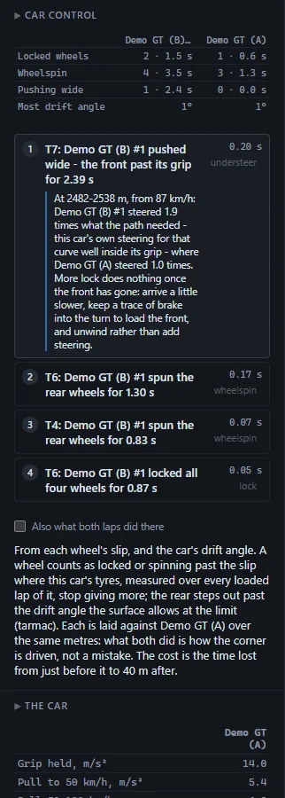

# Události ovládání vozidla

Divák sleduje, jak byl každý okruh nebo etapa projeta, a označuje místa, kde řidič nechal auto smyknout, roztočit se, do něčeho narazit nebo kde ztratil přilnavost. To je užitečné, protože chyba, která stála čas, se nejrychleji opraví.

## Srozumitelně {#in-plain-words}

- **Zablokování**: brzdíte tak silně, že se kolo přestane otáčet a smýká se. Auto brzdí hůř a nejde řídit.
- **Protáčení kol**: přidáte plyn tak silně, že hnací kola se točí rychleji, než auto jede. Ztrácíte tah.
- **Přetáčivost**: zadek auta se vysmekne do strany. Pokud se auto otočí celé dokola, je to **roztočení**.
- **Nedotáčivost**: přední část auta se smýká do strany („tlačí“); víc točit volantem nepomáhá.
- **Zásah** a **havárie**: auto se čehosi dotklo (zásah je ráz nebo škrábnutí, havárie je silný náraz).
- **ABS**, **TC**: pomocníci auta, kteří působí proti zablokování a protáčení. Nejsou to chyby.

## Sekce Ovládání vozu (co vidíte) {#the-car-control-section-what-you-see}

U zaostřeného kola se ukáže všechno, co kola nesou. Bez skluzu pneumatik a bez úhlu driftu se ukáže aspoň to, co se ještě dá najít (níže).

**Tabulka**: jeden řádek pro každý druh, který se objeví aspoň na jednom z obou kol – Zablokovaná kola, Protáčení kol, Ujíždějící záď (přetáčivost a roztočení), Tlačení přídě ven, Havárie, Zásahy, Zásah ABS, Zásah kontroly trakce, Ruční brzda, Ve vzduchu. Každá buňka ukazuje „počet · sekundy“ pro zaostřené kolo i pro kolo, s nímž se porovnává. A když je úhel driftu k dispozici, řádek *Největší úhel driftu* (největší na zemi).

**Seznam**: nesdílené chyby, které stojí aspoň 0,02 s, seřazené od nejdražší, nejvýš 12, každá s názvem a cenou (a štítkem svého druhu). Kliknutím na jednu přečtete její tip, zarovnáte auta 40 m před ní a přehrajete ji. Tlačítko **Také co obě kola tam udělala** přidá každou chybu, i sdílené (štítek „oba to udělali“, cena „—“ pod 0,01 s). Když žádná není, ukáže se: „Nic, co X udělal s pneumatikami, ho nestálo čas, který Y neudělal také.“

**Nápověda pod tabulkou** říká, s čím detekce mohla pracovat: „Ze skluzu každého kola, jeho úhlu skluzu a úhlu driftu auta.“ (nebo skluz a úhel skluzu, skluz a úhel driftu, jen skluz, nebo „Jen z úhlu driftu auta – tato kola nenesou skluz pneumatik.“). Dále říká, pro jaký povrch byly meze změřeny (asfalt, sypký, smíšený: nad 80 % vzorků sypkých je povrch sypký, pod 20 % asfalt), ke kterému kolu byly události přiřazeny a jak se počítá cena.

Bez **skluzu pneumatik a bez úhlu driftu** (soubor kola FH Companion bez telemetrie) se tabulka i seznam zobrazí stejně a nápověda řekne, co se přesto zjistilo z toho, co kola nesou: „Tato kola nenesou skluz pneumatik ani úhel driftu, takže zablokování a protáčení nejdou poznat. Přesto se najde: tlačení z natočení volantu proti dráze; zásahy a havárie z rychlosti a zrychlení.“ Smyky z rychlosti natáčení se jmenují také, kde kola tuto rychlost mají. Tlačení se ukáže jen tam, kde jsou data o volantu. Věta o mezích skluzu a driftu se vynechá a druhá nápověda říká: „Pro Forza Horizon vyberte také soubor `.tele.gz` vedle každého kola FH Companion. Je to celá telemetrie, skluz každého kola 64krát za sekundu.“

**Celkový** náklad ovládání kola (používaný v souhrnech) počítá překrývající se chyby – zablokování a smyk, který z něj vznikne, do 40 m – jednou, podle nejdražší z nich.

## Jak se to zjišťuje {#how-it-is-detected}

Zbytek stránky je příručka pravidel: každý druh, každý práh.

Kód: [`src/race/control.ts`](https://github.com/Holdi601/3DHeat/blob/main/src/race/control.ts),
[`src/race/impacts.ts`](https://github.com/Holdi601/3DHeat/blob/main/src/race/impacts.ts),
[`src/race/derive.ts`](https://github.com/Holdi601/3DHeat/blob/main/src/race/derive.ts).
Úvahy a literatura jsou v [metodě](race-analytics.md).

## Druhy {#the-kinds}

| Druh | Řádek tabulky | Je to chyba? | Nejkratší, která se počítá |
|---|---|---|---|
| `lock` | Zablokovaná kola | ano | 0,1 s |
| `wheelspin` | Protáčení kol | ano | 0,15 s |
| `oversteer` | Ujíždějící záď | ano | 0,2 s |
| `spin` | (počítáno s Ujíždějící záď) | ano | 0,1 s |
| `understeer` | Tlačení přídě ven | ano | 0,25 s |
| `crash` | Havárie | ano | - |
| `hit` | Zásahy | ano | - |
| `abs` | Zásah ABS | ne | 0,2 s |
| `tc` | Zásah kontroly trakce | ne | 0,2 s |
| `handbrake` | Ruční brzda | ne | 0,1 s |
| `airborne` | Ve vzduchu | ne | 0,15 s |

Kratší běhy jsou šum (obrubník, nerovnost, jeden vzorek). Běhy bodů mřížky (každé 2 m), které projdou testem, se spojí přes mezery až do 2 bodů. Jen **chyby** mohou být chybou a nesou cenu. Ostatní je to, co udělalo auto a řidič.

## Co platí pro každý test {#what-every-test-needs}

### Odvozené kanály {#derived-channels}

Než se cokoli posoudí, dostane každé kolo to, co jeho hra neposílá, pod kanonickými názvy. Vlastní hodnota hry má vždy přednost.

| Kanál | Z čeho |
|---|---|
| `bodySlip` (úhel driftu) | vektor rychlosti v rámci auta, `atan2(latVel, abs(longVel))`, kde ho hra posílá (0 pod 3 m/s); jinak směr auta (úhel natočení hry, přizpůsobený směru jízdy podle znaménka a posunu z vzorků rychlejších než 10 m/s, důvěryhodný jen s kruhovým rozptylem pod 0,05) proti směru jízdy (pozice aspoň 2 m od sebe), při rychlostech nad 3 m/s |
| `yawRate` (rychlost natáčení) | změna `yaw` v čase, kde je směr, ale není rychlost |
| `airborne` (ve vzduchu) | kontakt všech kol se zemí vypnutý (≤ 0,5); jinak zatížení všech kol pod 5 % jejich mediánu; jinak zdvih všech odpružení na nule nebo pod 0,02 (plně vysunuto). Jeden náhodný vzorek není let |
| `slipRatio.<W>` (poměr skluzu) | `(povrchová rychlost kola - rychlost auta) / rychlost auta` nad 3 m/s, kde hra posílá povrchové rychlosti kol; jinak z otáček kola × valivý poloměr změřený na kole: medián `rychlost / otáčky` při volném jízdě rovně (rychlost nad 10 m/s, plyn pod 0,3, brzda pod 0,05, abs(podélné zrychlení) pod 3 m/s², ne ve vzduchu; když je vzorků pod 20, všechny nad 10 m/s), přijatý mezi 0,1 a 1 m. Označeno `physical` |
| `loose` (sypký) | povrchové vibrace Forzy na aspoň 2 kolech (> 0,001) po dobu aspoň 0,33 s (obrubník je kratší), mezery pod 1 s přemostěny |

### Na zemi a ustálené {#on-the-ground-and-settled}

Nic se neposuzuje ve vzduchu nebo **0,3 s po dopadu**. Odpružení se propadne a zrychlení vyskočí, to není přilnavost, brzdění ani pohon. Vzorek musí také **jet**: rychleji než 5 m/s.

### Povrch {#the-ground}

Povrch každého vzorku je **sypký**, kde to říká kanál `loose` kola (vibrace povrchu Forzy, materiály kol v Trackmanii). Jinak je to povrch kola (viz [disciplína a povrch](race-loading-laps.md#discipline-and-surface)): asfalt, nebo sypký pro cokoli jiného. Zatáčky, návyky driftu a prahy jsou odděleny pro asfalt a sypký povrch.

### Skluz jako násobek jmenovitého vrcholu pneumatiky {#slip-as-a-multiple-of-the-tyres-nominal-peak}

Hry měří skluz různě. `meta.slip` říká jak, a každý skluz se dělí měřítkem tak, aby asi 1 byl jmenovitý vrchol pneumatiky:

| `meta.slip` | Význam | Dělí se |
|---|---|---|
| `peak` | normalizováno hrou: za 1 přilnavost mizí (Forza Data Out) | 1 |
| `scaled` | fyzický skluz dělený vrcholem na asfaltu (záznamník Kunos) | jmenovitý vrchol povrchu děleno vrcholem na asfaltu |
| `index` | měřítko 0 až 1 (SlipCoef v Trackmanii) | 0,5 |
| `physical` (nebo neznámé) | poměr skluzu jako zlomek, úhel skluzu v radiánech | jmenovitý vrchol povrchu |

Jmenovité vrcholy, když nic lepšího není známo:

| Povrch | Poměr skluzu | Úhel skluzu |
|---|---|---|
| asfalt | 0,12 | 8° |
| smíšený | 0,18 | 12° |
| sypký (štěrk) | 0,25 | 15° |
| sníh | 0,25 | 15° |
| led | 0,10 | 6° |

### Kde přilnavost končí: křivky pneumatik každého auta {#where-grip-ends-each-cars-tyre-curves}

Kde pneumatika přestane dávat víc, se měří **pro každé auto** ze všech jeho načtených kol (`measureTyres`), zvlášť pro asfalt a sypký povrch:

| Křivka | Vzorky (rychlost nad 10 m/s, ustálené, zrychlení pod 45 m/s²) | Skluz (x) | Síla (y) |
|---|---|---|---|
| brzdění | brzda nad 0,3, ruční brzda nejvýš 0,2, jízda rovně (boční pod 30 % nejtvrdšího) | abs(průměrný poměr skluzu čtyř kol) | zpomalení |
| trakce | plyn nad 0,8, brzda nejvýš 0,05, rovně, plný tah auta při té rychlosti nad 0,5 m/s² | největší poměr skluzu hnacího kola | zrychlení jako podíl plného tahu |
| přední | boční nad 30 % nejtvrdšího, přilnavost auta při té rychlosti nad 1 m/s² | větší úhel skluzu přední nápravy | boční zrychlení jako podíl té přilnavosti |
| zadní | totéž | větší úhel skluzu zadní nápravy | totéž |

„Nejtvrdší“ je 99. percentil abs(bočního zrychlení) kola na tom povrchu (všechny vzorky, když jich je méně než 50). Pohon určuje hnací kola (přední u FWD, zadní u RWD, u AWD všechna; neznámé: všechna).

Od aspoň **150 vzorků** se skluz rozdělí na 6 až 14 stejně plných přihrádek (jedna na 40 vzorků). Síla každé přihrádky je její horní kvartil, tedy to, co pneumatika dala, když řidič žádal. Vyhlazuje se přes sousední přihrádky. **Vrchol** je přihrádka s nejvíc silou. **Mez** je první přihrádka za ním, kde síla klesla o **8 %**. Křivka, která v datech nikdy neklesne, nemá mez (nekonečno). Přejet „vrchol“ v té hře nic nestojí a samotný skluz tam nic neoznačí. Kříže a trakční křivky Forza Horizon jsou takové. Když je na jednom povrchu málo vzorků, použijí se vzorky druhého povrchu. Když je málo vzorků celkem, použije se **jmenovitá** mez: 1,5násobek jmenovitého vrcholu.

Každé auto také dostane:

- svůj **návyk driftu**: horní kvartil jeho úhlu driftu všude, kde zatáčí na 60 % svého nejtvrdšího nebo víc (potřeba 100 vzorků);
- své **natočení volantu na zakřivení** (`steerGain`), po pásmech rychlosti 5 m/s: medián abs(natočení) / zakřivení dráhy při pevném zatáčení, ale hluboko uvnitř své přilnavosti (30 až 60 % nejtvrdšího, zakřivení těsnější než poloměr 400 m, natočení nad 0,02; 25 vzorků na pásmo). Zakřivení dráhy je rychlost natáčení dělená rychlostí tam, kde hra posílá rychlost natáčení. Jinak se počítá z pozic ±5 m.

### Zjišťování, druh po druhu {#detection-kind-by-kind}

| Druh | Test (na jedoucích, ustálených vzorcích) | `peak` a `limit` |
|---|---|---|
| **zablokování** | brzda nad 0,05, ruční brzda nejvýš 0,2 a poměr skluzu kteréhokoli kola pod zápornou mezí brzdění | nejzápornější skluz (násobky jmenovitého vrcholu); mez jako záporná |
| **protáčení** | plyn nad 0,2 (nebo bez kanálu plynu) a poměr skluzu hnacího kola nad mezí trakce | největší skluz hnacího kola; mez |
| **přetáčivost** (úhel driftu) | úhel driftu nad větším z podlahy povrchu a 1,5 × návyk driftu auta na tom místě | největší úhel driftu, radiány |
| **přetáčivost** (úhly skluzu, bez úhlu driftu) | větší úhel skluzu zadní nápravy nad mezí zadní a víc než o 0,25 nad větším úhlem přední | úhel skluzu zadní nápravy (násobky vrcholu) |
| **přetáčivost** (bez úhlu driftu, ale s rychlostí natáčení a bočním zrychlením) | „rychlost postoje“, tedy abs(rychlost natáčení) minus abs(boční zrychlení) / rychlost, nad 8 m/s, nad 0,2 rad/s, s volantem proti zatáčce | rad/s; mez 0,2 |
| **roztočení** | přetáčivost, jejíž úhel driftu vystoupal přes **60°** | jako přetáčivost |
| **nedotáčivost** (úhly skluzu) | neklouže, větší úhel skluzu přední nápravy nad mezí přední a víc než o 0,3 nad zadní | úhel skluzu přední nápravy; mez |
| **nedotáčivost** (bez úhlů skluzu) | rychleji než 12 m/s, neklouže, neprotiřizuje, boční zrychlení nad polovinou nejtvrdšího kola (99. percentil), dráha těsnější než poloměr 300 m a natočení víc než **1,6násobek** toho, co auto samo potřebuje na zakřivení podle svého natočení na zakřivení | násobek potřebného natočení; mez 1,6 |
| **abs**, **tc** | `absActive` / `tcActive` nad 0,5 | - |
| **ruční brzda** | `handbrake` nad 0,2 | - |
| **ve vzduchu** | `airborne` nad 0,5 | - |
| **zásah**, **havárie** | viz [Zásahy a havárie](#hits-and-crashes) | rychlost, kterou náraz vzal |

Prahy úhlu driftu podle povrchu: asfalt **7°**, smíšený **10°**, sypký a sníh **15°**, led **10°**. Vycházejí z literatury: úhel skluzu pneumatiky má vrchol při 3–10° na asfaltu a mez stability silničního auta podle úhlu skluzu karoserie je asi 12° na suchém asfaltu, zatímco rallye a drift se jezdí při 30–50° ([Analytika závodů, zdroje](race-analytics.md#sources)). Auto, které takhle jede běžně (arkádový model pneumatik, specialista na štěrk), má vlastní, vyšší práh z vlastních kol: 1,5 × jeho návyk.

**Kam se auto točí** (pro „proti zatáčce“): změna směru dráhy kola na ±6 m (aspoň 2 body mřížky). Těsnější než poloměr 600 m se počítá jako zatáčení. Vpravo nebo vlevo podle toho, zda je svět zrcadlen. Natočení je **proti** zatáčce, když abs(natočení) je nad 0,05 a jeho znaménko je opačné než směr zatáčení. Je to smyk, který je **zachycen** protiřízením.

**Pedály na začátku** (`pedal`): *brzda*, když je brzda nad 0,1; *plyn*, když je nad 0,3; *uvolněno*, když byl plyn nad 0,5 v 8 bodech mřížky (16 m) před tím; jinak *dojezd* (nebo bez kanálu plynu).

## Položeno vedle druhého kola {#laid-against-the-other-lap}

Každá událost se posuzuje proti kolu, s nímž se zaostřené kolo v tom úseku porovnává. Je to nejrychlejší kolo jeho třídy. Pro to kolo samo je to ten z jeho třídy, kdo byl v úseku nejrychlejší.

1. **Jak daleko druhé kolo zašlo** na stejných metrech, ±8 m: jeho vlastní události stejné rodiny (roztočení se počítá jako přetáčivost, havárie jako zásah) měřené ve stejných jednotkách, bez prahů, s použitím křivek pneumatik druhého auta.
2. **Sdíleno**, když druhé kolo zašlo **80 %** tak daleko nebo víc. Tak se zatáčka jede, není to chyba. Nechybové druhy jsou vždy „sdíleno“.
3. **Cena** nesdílené chyby: čas, který toto kolo ztratilo proti druhému, od 5 m před událostí do **40 m po ní**. U zásahu nebo havárie do chvíle, kdy auto zase nabere rychlost (metry, které potřebuje při vlastním tahu, 40 až 400 m; bez změřeného tahu 5 m/s²). Nikdy záporná.
4. **Rychlost, kterou dalo pryč** k limitu auta: u zablokování zpomalení, které auto při té rychlosti umí, minus to, co udělalo, sečteno přes událost. U protáčení jeho plný tah minus to, co udělalo. U nárazu rychlost, kterou vzal. Uvádí se, když je nad 0,5 m/s (1,8 km/h).

Nesdílená chyba, která stojí aspoň **0,02 s**, se vypíše. [Statistiky závodu](race-course-statistics.md) počítají jen chyby od **0,03 s**, aby chyba napočítaná přes mnoho kol byla jasná. Může se stát příčinou ztráty v zatáčce (viz [Analýza zatáčku po zatáčce](race-corner-analysis.md#car-control-faults-and-impacts)).

## Zásahy a havárie {#hits-and-crashes}

`impacts.ts` čte zásahy z **vlastních vzorků** kola, ještě před převzorkováním, protože zásah trvá zlomky sekundy. Pneumatiky nemohou vytvořit síly zásahu, takže se zásah měří proti vlastnímu autu kola:

- **Jeho přilnavost `G`**: 99. percentil jeho vodorovného zrychlení `√(lat² + long²)` přes celé kolo, na zemi a rychleji než 5 m/s. Bez kanálů zrychlení (nebo pod 3 m/s²) 15 m/s², přilnavost silničního auta.
- **Práh**: `max(1,8 G, G + 18, 30)` m/s².
- **Zasažený vzorek**: vodorovné zrychlení nad prahem *a zároveň* skok o víc než polovinu `G` oproti předchozímu vzorku; **nebo** pokles rychlosti do 0,1 s o víc, než by práh vzal za 0,1 s plus 1,5 m/s. Jen na zemi a ustálené, a jen když auto jelo rychleji než 5 m/s.
- Zasažené vzorky do **0,4 s** jsou jeden náraz.
- **Před / po**: nejvyšší rychlost 0,15 s před; nejnižší až 0,3 s po posledním zasaženém vzorku.
- **Není to náraz**: ztráta rychlosti bez síly za ní. Největší vodorovné zrychlení do 0,1 s pod větším z `G` a 25 m/s² znamená, že hra vrací nebo resetuje auto.
- **Havárie**, když vzala **30 km/h** nebo víc, nebo když auto ztratilo víc než polovinu rychlosti. Jinak **zásah**: naražení, škrábnutí podél zdi.
- **Směr**: podélné zrychlení větší než boční a záporné znamená *čelně*; kladné *zezadu*; boční větší znamená *podél boku*. Bez zrychlení čelně.

Co auto umí, se měří se všemi nárazy vynechanými, od 0,1 s před nimi do 1 s po nich (`struckMask`).

## Texty {#the-texts}

Každá událost se popisuje tak, že jmenuje obě kola, místo (metry podél reference), rychlost, se kterou začala, o kolik překročila mez proti druhému kolu, a tip. Tip vyplývá z druhu a z toho, co bylo změřeno:

| Událost | Tip |
|---|---|
| zablokování, jen přední | zablokovaná přední kola nevedou: méně tlaku na začátku zóny, na zatáčce ho pusťte |
| zablokování, jen zadní | zablokovaná zadní kola nechají auto se otáčet: brzděte víc v přímce, při zatáčení povolte; když se to opakuje, posuňte rozdělení brzd dopředu |
| zablokování, sypký povrch | zablokované kolo oře: stiskněte těsně před zablokováním |
| zablokování, jinak | příliš pedálu na přilnavost: stiskněte plynuleji |
| protáčení | přidávejte plyn, jak se volant odvíjí; při omezení trakcí řaďte dříve (na sypkém povrchu vyšší převod zmírní točivý moment) |
| roztočení / přetáčivost | podle pedálu: při brzdění (příliš silné brzdění v zatáčce, řazení dolů příliš brzy), uvolněno (přetáčivost při uvolnění plynu: držte stálý plyn), na plynu (příliš mnoho, když je ještě natočeno), žádný (zatočeno příliš rychle); „zachyceno protiřízením“, když se protiřídilo; na sypkém povrchu nebo v rallye „nějaký úhel je rychlý způsob, stačil úhel druhého jezdce“ |
| nedotáčivost | víc volantu nepomůže, když už přední kola přestala držet: přijeďte pomaleji, lehce brzděte, aby se přední zatížila, odvíjejte; na sypkém povrchu zatočte autem uvolněním plynu nebo lehkým dotykem levé nohy |
| zásah / havárie | podél boku: metr odstupu stojí míň než škrábnutí; zezadu: jiné auto nebo smýkání dozadu; čelní havárie: brzděte dřív; naražení vpředu: něčeho jste se dotkli. „X tam také narazil.“, když je to sdíleno |

V Trackmanii se smyk popisuje ještě jinak: pod asi **400 km/h** (**300** na sypkém povrchu: hlína, tráva, plast) dává smyk méně tahu než držení. Nad touto rychlostí přinese speedslide v správném úhlu zisk. Tento stál čas, takže jeho úhel byl špatný.

## Co každý zdroj umožní {#what-each-source-allows}

| Kola nesou | Zablokování / protáčení | Přetáčivost / roztočení | Nedotáčivost |
|---|---|---|---|
| skluz a úhel skluzu každého kola, rychlost auta (Forza Data Out, hry AC) | ze skluzu | z úhlu driftu, nebo z úhlu skluzu zadní nápravy | z úhlů skluzu |
| rychlosti kol, světová rychlost (rallye hry, BeamNG) | z odvozeného skluzu | z odvozeného úhlu driftu | z natočení na zakřivení |
| yaw a rychlost natáčení, bez skluzu (iRacing) | - | z úhlu driftu (natočení proti směru jízdy); z rychlosti postoje s protiřízením jen tehdy, když natočení nelze věřit | z natočení na zakřivení |
| jen směr | - | ze směru proti směru jízdy | z natočení na zakřivení |
| samotný soubor kola FH Companion (bez natočení a skluzu) | - | - | z natočení na zakřivení (má natočení a zrychlení) |

Zásahy a havárie potřebují jen rychlost (lépe se zrychlením), takže je má každý zdroj. Sekce **Ovládání vozu** ukazuje, co který zdroj umožní. Se souborem kola FH Companion samotným jsou to jeho tlačení z natočení a jeho zásahy a tip, aby se pro zbytek načetl `.tele.gz`.
