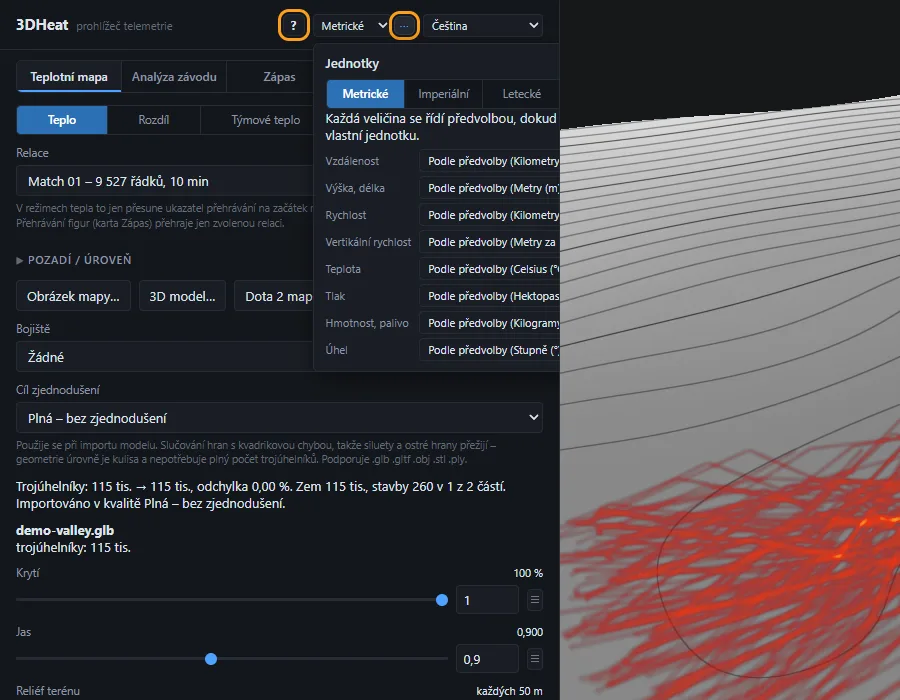
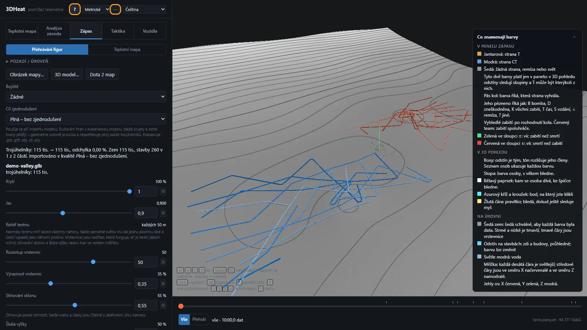

# Nastavení, jednotky a klávesy

Malá ovládání nahoře v postranním panelu mění, jak prohlížeč s vámi mluví: jazyk, jednotky (metry nebo stopy, km/h nebo uzly) a režim nápovědy, který vysvětluje barvy. Vaše volby si prohlížeč pamatuje ve vašem prohlížeči.

## Záhlaví {#the-header}

Nahoře v postranním panelu:

| Ovládání | Co dělá |
|---|---|
| **?** | Režim nápovědy: co znamená každá barva (také `?` nebo `F1`) |
| Nabídka **Jednotky** | Metrické, imperiální, letecké nebo námořní |
| Tlačítko **...** vedle **Jednotek** | Otevře „Vyberte jednotku pro každou veličinu“: jeden rozbalovací seznam pro každou veličinu |
| Nabídka **Jazyk** | Jazyk prohlížeče: [40 jazyků](languages.md), nebo jazyk prohlížeče |

Čísla, která napíšete do pole, mohou mít tečku nebo čárku (`0.35` nebo `0,35`). Prohlížeč čte obojí a zobrazuje čísla tak, jak je píše jazyk prohlížeče.

## Jednotky {#units}

1. Vyberte předvolbu v nabídce **Jednotky**. Všechny veličiny se přepnou najednou.
2. Chcete-li změnit jen jednu veličinu, klikněte na tlačítko **...** vedle ní a vyberte pro ni jednotku. Nabídka pak za předvolbou ukáže `*`.
3. Veličina, kterou jste nenastavili, se řídí předvolbou. Pro návrat vyberte „Podle předvolby“.

| Veličina | Metrické (výchozí) | Imperiální | Letecké | Námořní |
|---|---|---|---|---|
| Vzdálenost | km | mi | NM | NM |
| Výška, délka | m | ft | ft | m |
| Rychlost | km/h | mph | kt | kt |
| Vertikální rychlost | m/s | ft/min | ft/min | m/s |
| Teplota | °C | °F | °C | °C |
| Tlak | hPa | inHg | hPa | hPa |
| Hmotnost, palivo | kg, l | lb, gal | lb, gal | t, m³ |
| Úhel | stupně | stupně | stupně | stupně |

Další jednotky, které můžete vybrat pro jednu veličinu: vzdálenost km, mi, NM; rychlost km/h, m/s, kt, mph; vertikální rychlost m/s, ft/min, m/min; teplota °C, °F, K; tlak hPa, inHg, mmHg, psi; hmotnost kg, lb, t; úhel stupně nebo NATO mily (6400 na kruh). Jednotky jsou v prohlížeči všude stejné: popisky, karty, grafy, statistiky.

## Režim nápovědy {#help-mode}

Stiskněte `?` nebo `F1`, nebo klikněte na tlačítko **?**. Ukáže se *Co znamenají barvy*: legendy pro 3D zobrazení, škály tepla, barvy týmů, barvy úrovně, barvy stavů panelů, panel zápasu a zobrazení závodu. Zůstane zapnutý, dokud ho nevypnete. Na kartě Zápas vysvětlí i barvy panelu zápasu.

## Co si prohlížeč pamatuje {#what-the-browser-remembers}

Tato nastavení se uchovávají ve vašem prohlížeči mezi návštěvami (nikam se neposílají):

- jazyk, jednotky a režim nápovědy;
- nastavení figur, symbolů, popisků, kamery a taktického zobrazení přehrávání;
- rychlost přehrávání a zrcadlení;
- záložky podle záznamu, hlasitosti podle datové sady, vrstvy cílů;
- nastavení externí AI (klíč jen tehdy, když zaškrtnete *Zapamatovat*).

Nastavení tepla, filtry a režim se při každém načtení začnou od nuly. Úplný, vygenerovaný seznam: [Uložená nastavení](ref-settings-storage.md).

## Klávesy, které prohlížeč drží z prohlížeče {#keys-the-viewer-keeps-from-the-browser}

Relace s velkými daty se načítá dlouho, takže prohlížeč brání tomu, aby ji prohlížeč omylem zahodil:

- `Ctrl`/`Cmd` + písmena, která by tiskla, ukládala, otevírala, znovu načítala, zavírala nebo otevírala nová okna, nedělají nic mimo textová pole; `F1`, `F3`, `F5`, `F6` a `F7` nedělají nic.
- Zavření nebo znovunačtení karty s načtenými daty nebo úrovní se nejdřív zeptá.
- Na celou obrazovku zamkne prohlížeč klávesy, které používá (W, T, N, S, R, P, Q, Esc), aby je prohlížeč nepřevzal.

Přesný seznam: [Klávesy prohlížeče](ref-browser-keys.md). Všechny vlastní klávesy prohlížeče: [Přehled klávesnice a myši](keyboard-reference.md).
