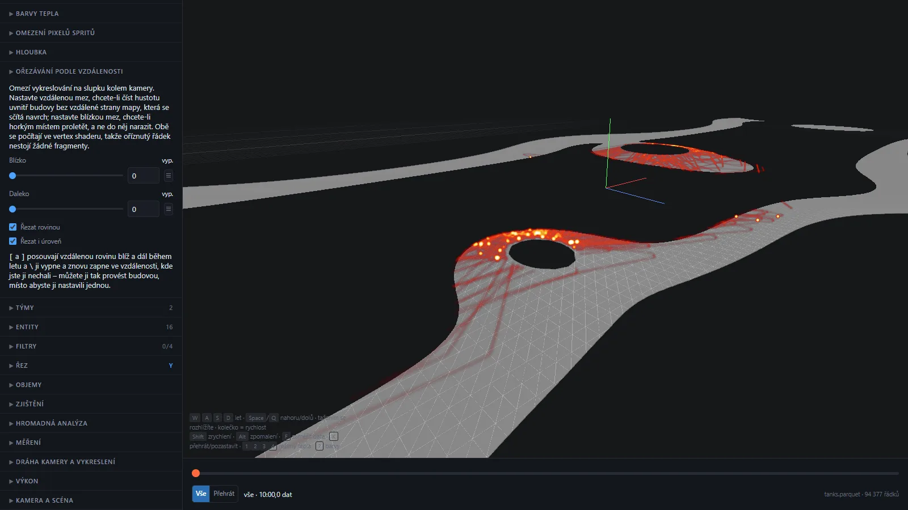

# Řez

**Řez** rozřízne svět jako krajíc dortu, takže se můžete podívat dovnitř budov. Použijte ho, když zdi schovávají zajímavé teplo, například když chcete vidět jedno patro budovy.

## Vyzkoušejte {#try-it}

1. Načtěte úroveň a nějaká data a otevřete **Řez**.
2. Zaškrtněte **Rozříznout svět**. Osa je **Výška**.
3. Táhněte **Pozici** nahoru a dolů: vrstva se pohybuje úrovní.
4. Nastavte **Tloušťku** tenkou pro půdorys, nebo širokou pro „všechno pod tímto“.
5. Nechte **Mimo vrstvu** na 0, aby se zbytek odstranil, nebo ho zvedněte, aby zůstala slabá stopa.



Vrstva řeže **geometrii úrovně i datové body společně** – řezat jen úroveň by nechalo teplo viset tam, kde býval jeho budova. Je to protějšek [hloubkového zakrytí](depth-and-culling.md): jakmile úroveň správně skrývá, co je za ní, skryje se i vnitřek budovy. Panel se ukáže, když je co řezat (datová sada nebo 3D úroveň); jeho záhlaví ukazuje osu, když je zapnuto, jinak *vypnuto*.

```
pohled z boku     Pozice = kde vrstva je
 ----------       Tloušťka = jak vysoká vrstva je
 | patro 3 |
 |=========|  <--- vrstva (zachována)
 | patro 2 |  <--- mimo: odstraněno (nebo slabě)
 | patro 1 |
 ----------
```

## Ovládání {#controls}

| Ovládání | Výchozí | Význam |
|---|---|---|
| **Rozříznout svět** | vypnuto | Zapne vrstvu. Dokud je pozice na počáteční 0 a tloušťka na počátečních 500, zapnutí je přesune na střed osy a na 15 % jejího rozsahu. |
| Osa | **Výška** | *Výška* (Y), *X* nebo *Z*. Přepnutí osy přesune vrstvu na střed nové osy. |
| **Pozice** | střed | Střed vrstvy, ve světových jednotkách, napříč rozsahem osy (kroky po 500). |
| **Tloušťka** | 15 % rozsahu | Od 1/500 rozsahu do dvojnásobku rozsahu, v logaritmických krocích. Jakmile je široká jako rozsah, ukáže *za světem*: jedna strana pak sahá za svět a je to prostý řez, ne vrstva. |
| **Mimo vrstvu** | 0, *odstraněno* | Kolik toho, co leží mimo, zůstane vidět, 0–100 %. Slabá stopa toho, co bylo odříznuto, se často čte líp než prosté odstranění. |
| **Řezat i datové body** | zapnuto | Vypnuto nechá teplo celé, takže prosvítá řezem – užitečné, když chcete vidět, co je nad a pod vrstvou. |

Rozsah osy je rozsah 3D úrovně, je-li načtena, jinak rozsah datové sady.

Řez je nezávislý na [ořezu podle vzdálenosti](depth-and-culling.md#distance-culling), který řeže podél směru pohledu, ne podle osy světa; oba se kombinují. Změna kteréhokoli nastavení řezu restartuje akumulaci tepla.

## Pro vývojáře {#for-developers}

Vrstva se testuje na světové pozici každého řádku ve vertex shaderu: řádek mimo ni má svůj příspěvek vynásobený hodnotou *Mimo*, takže při 0 je odmítnut dřív, než se nakreslí jakýkoli fragment. Shadery úrovně použijí stejný test na každý fragment terénu, konstrukcí a vody.
