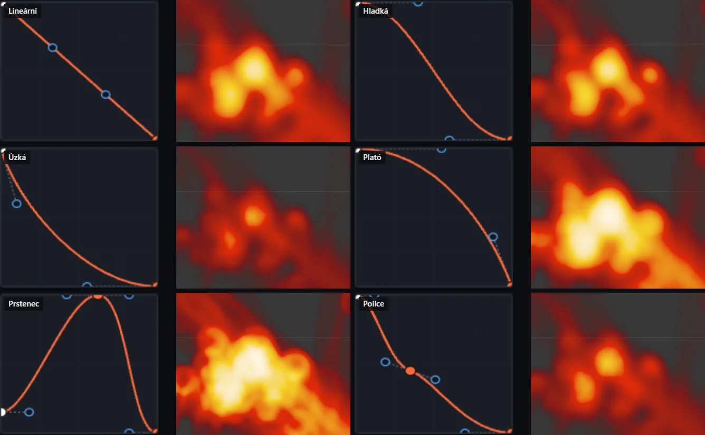

# Tvar sprite

Každý řádek se kreslí jako kulatý sprite, který je vždy otočený ke kameře. Jeho velikost a profil od středu k okraji – **útlum** – rozhodují, jestli se horké místo čte jako úzká tečka, měkký oblak, kotouč nebo prstenec. Tyto ovládací prvky jsou v sekcích **Tvar tepla** a **Omezení pixelů spritů** v postranním panelu a platí pro [Teplo](heat.md), [Rozdíl](difference.md), [Týmové teplo](team-heat.md) a jako poloviční šířka čáry pro [Teplo čar](line-heat.md).

Změna kterékoli z nich restartuje akumulaci (pole se musí překreslit s novým tvarem).

Každou tečku si představte jako měkkou skvrnu světla. Malá skvrna ukáže jednotlivé body; velká spojí sousedy do oblaku. Tvar určuje, jak měkký je okraj.



## Poloměr sprite {#sprite-radius}

Poloměr sprite v **jednotkách světa** (popsaných jako metry). Výchozí 6; při každém načtení se nastaví na vodorovný rozsah dat / 120 – dost velký, aby se sousední vzorky podél dráhy spojily do pásu, a ne aby se četly jako vlas. Logaritmický posuvník 0,05–2000, táhlo až na 50 000.


Věci vzdálené vypadají menší, takže sprite se s vzdáleností na obrazovce zmenšuje. Při rovnoběžné projekci je všude stejný, což je část důvodu, proč je rovnoběžný pohled správný na porovnávání horkých míst ([Kamera](camera.md#projection)).

## Omezení pixelů {#pixel-clamps}

**Omezení pixelů spritů** (výchozí zavřeno) ohraničí poloměr na obrazovce po předchozím převodu.

| Ovládací prvek | Výchozí | Rozsah (posun) | Proč |
|---|---|---|---|
| **Min. poloměr v pixelech** | 1 px | 0–16 (512) | Udrží vzdálená data, aby nezmizela pod jeden pixel. |
| **Max. poloměr v pixelech** | 96 px | 2–1024, logaritmicky (8192) | Pojistka proti přepisování. Sprite pokrývající N pixelů stojí N mísicích operací, takže neomezený poloměr blízko kamery je to, co z rychlého snímku udělá pomalý. Nad výškou výřezu už nic neomezuje. |

**Stejná hustota při každém přiblížení** (v sekci Tvar tepla, výchozí zapnuto) pracuje s omezeními. Sprite, který omezení zvětší (zdálky) nebo zmenší (zblízka), zachová teplo, které by přidal jeho skutečná velikost, takže barva znamená stejný počet řádků na plochu země při každém přiblížení. Když je to vypnuto, omezený sprite přidá svou plnou váhu ve své omezené velikosti a obraz se mění, jak letíte dovnitř.

## Intenzita ve středu a na okraji {#centre-and-edge-intensity}

Teplo, které sprite přidá přesně ve svém středu (**Intenzita ve středu**, výchozí 1, 0–10, posun 1000), a na okraji (**Intenzita na okraji**, výchozí 0, -2–10, posun 1000). Hodnota útlumu *t* (1 ve středu, 0 na okraji, tvarovaná útlumem nebo křivkou níže) se mezi nimi mísí (vzorec je pod [Pro vývojáře](#for-developers)).

**Záporná intenzita na okraji** způsobí, že okraj odečítá, což vyřezá chladnou záři kolem každého horkého místa a ostří shluky proti sobě. Viditelnost zahrnuje [zakrytí](depth-and-culling.md) a [řez](slice.md); mizení je [doba života](timeline.md#history); znaménko je ±1 u [Rozdílu](difference.md).

## Tvar útlumu: Útlum nebo Křivka {#ramp-shape-falloff-or-curve}

**Tvar útlumu** přepíná mezi dvěma způsoby, jak tvarovat *t* přes sprite. Když *d* je vzdálenost od středu (0) k okraji (1):

### Útlum {#falloff}

Zobrazí se, když je vybráno *Útlum* (výchozí).

- **Útlum** (výchozí 1,6, 0,1–8, posun 64): `t = (1 - d) ^ útlum`. 1 je přímý lineární přechod; vyšší hodnota stáhne teplo ke středu a zúží horké místo; pod 1 ho zploští do kotouče.
- **Hladký útlum** (výchozí zapnuto): na *t* použije S-křivku smoothstep, takže sprite na okraji mizí plynule, místo aby končil viditelnou hranou.

### Editor křivky {#the-curve-editor}

Zobrazí se, když je vybrána *Křivka*. Doslovný průřez spritem: vzdálenost od středu napříč (*střed* vlevo, *okraj* vpravo), teplo nahoru. Křivka je po částech kubická Bézierova křivka procházející řídicími body, každý se dvěma úchyty.

| Akce | Účinek |
|---|---|
| Dvojklik na graf | Přidá bod v té vzdálenosti (držený mezi 0,02 a 0,98), na křivce a se sklonem křivky v tom místě, takže přidání nic nezmění, dokud ho nepřetáhnete. |
| Tažení bodu | Přesune ho. Výšky se drží mezi 0 a 1. |
| Tažení malého kroužku | Ohne úsek vedle něj (pohne tím úchytem). |
| Alt-klik nebo pravé tlačítko na bod | Odstraní ho. Dva koncové body se odstranit nedají. |
| Tlačítko předvolby | Nahradí křivku předvolbou. |

Koncové body jsou pevné ve středu a na okraji; jejich výšku stále určujete vy.

**Předvolby** ([`curve.ts`](https://github.com/Holdi601/3DHeat/blob/main/src/state/curve.ts)):

| Předvolba | Tvar | Použití |
|---|---|---|
| **Lineární** | Přímo od 1 k 0 | Totožné s *Útlumem* 1 při vypnutém *Hladkém útlumu*. |
| **Hladká** | S-křivka | Výchozí křivka; to, co *Hladký útlum* dá při útlumu 1. |
| **Úzká** | Strmé jádro, dlouhá slabá sukně | Řídká data. |
| **Plató** | Ploché, potom rychlý pokles | Čte se jako kotouč, ne jako skvrna. |
| **Prstenec** | 0,15 ve středu, 1 při 62 % poloměru, 0 na okraji | Dutý sprite: ukazuje, kde dráhy procházejí, a ne kde se zastavují. |
| **Police** | Dvoustupňový útlum, 0,45 při 35 % | Odděluje hustý střed od okolí. |

## Zploštit na rovinu země {#flatten-onto-ground-plane}

**Zploštit na rovinu země** (výchozí vypnuto) ignoruje výšku každého řádku a kreslí všechno teplo v jedné výšce – nejnižší Y datové sady – klasická 2D teplotní mapa. Když je zapnuto, vypnou se zakrytí hloubkou a *Skrýt za terénem* (každý bod by seděl přesně na povrchu, proti kterému se testuje), a sekce Hloubka to říká.

## Pro vývojáře {#for-developers}

### Vzorce {#formulas}

Poloměr na obrazovce v pixelech: `poloměr × P[1][1] / w × výška výřezu / 2`, kde `P` je matice projekce a `w` je hloubka bodu v pohledu.

Teplo, které sprite přidá:

```
přidané teplo = mix(okraj, střed, t) × váha vzorku × znaménko × mizení × viditelnost
```

### Křivka {#the-curve}

Úchyty jsou vodorovně omezené na svůj vlastní úsek, takže křivka je vždy funkcí vzdálenosti: přetažení úchytu daleko přes další bod se o něj zploští, místo aby křivku složilo zpět, což by udělalo výsledek závislý na tom, který kořen řešitel náhodou našel.

### Jak se křivka kreslí {#how-the-curve-is-drawn}

Křivka se při každé změně zapeče do tabulky s 256 položkami, nahraje jako textura s 16bitovými plovoucími čísly a vzorkuje se na každý fragment s lineárním filtrováním a polotexelovým odsazením, aby oba konce zůstaly přesné. Řešení Bézierovy křivky pro x vyžaduje iteraci, což nepatří do nejžhavějšího shaderu programu, a vyhledání v tabulce je také levnější než `pow()`, který používá útlum. 16bitová místo 8bitové, protože 8 bitů ukazuje pruhy, jakmile se sečtou tisíce spritů; 16bitový half float je filtrovatelný v základním WebGL2, kdežto 32bitový potřebuje rozšíření.
