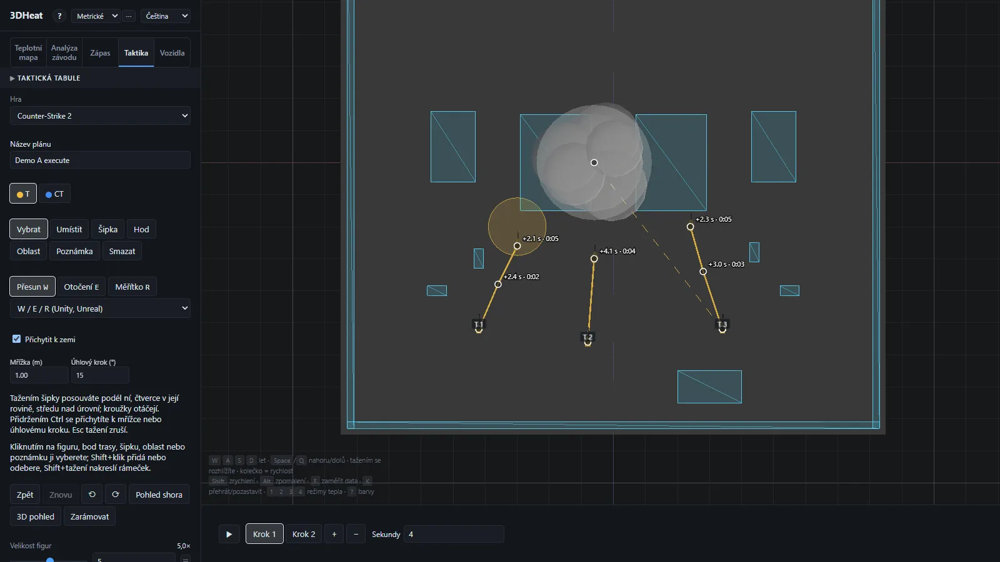

# Taktická tabule

Karta **Taktika** je kreslicí tabule pro plán týmu: na mapu položíte malé figury, nakreslíte šipky, kam mají jít, a stisknutím přehrávání uvidíte, jak se to odehraje. Slouží k naplánování kola nebo útoku dřív, než začnete hrát. Sdílí plátno, kameru a [level](levels.md) s ostatními kartami a nic jiného; plán není data a nekreslí žádné teplo.

## Váš první plán {#your-first-plan}

1. Otevřete kartu **Taktika**. Vyberte **Hra** (například Counter-Strike 2) a u Valorantu stiskněte **Načíst mapy Valorantu** a vyberte **Mapu**. Nebo nejdřív načtěte [level](levels.md).
2. Vyberte **Stranu** (určuje barvu) a stiskněte **Pohled shora**.
3. Zvolte **Místo**, vyberte figuru v **Figury** (pomocí **Hledat figury** ji najdete) a klikněte na mapu. Položte dvě nebo tři.
4. Zvolte **Šipka**, klikněte na figuru, klikněte podél cesty, kterou má jít, a stiskněte **Enter** pro ukončení šipky.
5. Stiskněte **+** pod pohledem, abyste přidali krok 2. Každá figura začíná tam, kde skončila její šipka. Nakreslete tam další šipky.
6. Stiskněte **▶** (nebo `K`), aby se plán přehrál od ukázaného kroku až do konce.
7. Pojmenujte plán v **Název plánu** a stiskněte **Uložit**.

## Začátek plánu {#starting-a-plan}

| Ovládání | Co dělá |
|---|---|
| **Hra** | Vybere strany a figury, které paleta nabízí: Counter-Strike 2 (T, CT; hráči a pomůcky), Valorant (Útok, Obrana; hráči a obecné schopnosti), Battlefield, Squad, Arma (pěchota, pozemní vozidla, letadla, čluny), DCS / War Thunder / IL-2 (proudová letadla, vrtulová letadla, vrtulníky, protiletadlová obrana, pozemní, lodě, zbraně) a Jiné. Plán, který už figury má, si při změně hry ponechá své strany. |
| **Název plánu** | Název, pod nímž se plán uloží. |
| **Mapa**, **Načíst mapy Valorantu** | Při zvoleném Valorantu: **Načíst mapy Valorantu** získá seznam map z [valorant-api.com](https://valorant-api.com); **Mapa** pak položí minimapu zvolené mapy jako level, zarámovanou shora. Obrázek se stáhne, až když se vybere, a nikdy se nedodává. Oznámení Riotu se zobrazuje, dokud je na obrazovce (viz níže). |
| **Strana** | Strana, které patří další figura, šipka nebo oblast; přebere barvu strany. |

Bez levelu je tabule plochá rovina země. Načtěte level v **Level**, chcete-li plánovat na skutečné mapě: mapu CS2 exportovanou nástrojem CS2, level z knihovny, nebo obrázek mapy.

## Nástroje {#tools}

| Nástroj | Klik | Poznámky |
|---|---|---|
| **Vybrat** | Figura, bod trasy, šipka, oblast nebo poznámka se vybere. | Shift+klik přidá nebo odebere; Shift+tažení nakreslí rámeček kolem toho, co přidat. Výběr dostane přenosové ovládání (viz níže); `Delete` nebo `Backspace` jej odstraní. `M` přesune vybranou figuru na další klik. |
| **Místo** | Položí zvolenou figuru. | Figura se vybere v paletě **Figury** (s **Hledat figury**). Když nic není vybráno, `R` otočí další figuru o 15° předtím, než se položí (`Shift+R` opačným směrem). |
| **Šipka** | Každý klik přidá bod; Enter, dvojklik nebo pravý klik ji ukončí, Esc ji zahodí. | **Posunout**, **Útok** (širší hlavice) nebo **Sledování** (tenká čára ve výšce očí). Šipka začatá na figuře je trasou této figury v tomto kroku: když se přehraje, figura po ní jde a další krok začíná tam, kde skončila. |
| **Hod** | Hodící, pak místo dopadu. | Čárkovaný oblouk mezi nimi a zvolená pomůcka (kouř, záblesk, molotov ...) se objeví tam, kde dopadne, a zůstane od tohoto kroku dál. |
| **Oblast** | Střed, pak okraj. | Kotouč barvou strany. |
| **Poznámka** | Kam poznámka patří; zeptá se na její text. | Ukáže se jako špendlík a jeho text nad ním. |
| **Smazat** | Figura, šipka, oblast nebo poznámka. | Odstraní ji od tohoto kroku dál; v jejím prvním kroku ji odstraní úplně. |

**Zpět** a **Znovu** (`Ctrl+Z`; `Ctrl+Y` nebo `Ctrl+Shift+Z`) procházejí každou změnu. Řádek pod plánem ukazuje, kolik figur, šipek a kroků má. **Pohled shora** se dívá kolmo dolů (ortograficky), **3D pohled** se vrátí k perspektivě, **Snímek** přizpůsobí plán, nebo level, když je plán prázdný.

**Velikost figur** změní měřítko všech figur na tabuli; 1× je skutečná velikost, což z velké výšky znamená pro člověka několik pixelů.

## Přesouvání, otáčení a měření {#moving-turning-and-scaling}

Všechno na tabuli se dá přesouvat jako v 3D editoru: figury, pomůcky, značky, jednotlivé body trasy a celé šipky, oblasti a poznámky. Co je vybráno, dostane ovládání uprostřed:

| Režim | Klávesy | Úchyty |
|---|---|---|
| **Posun** | W (nebo G) | Šipka pro každou osu (X červeně, Y zeleně a nahoru, Z modře) se po ní posune; čtverec se posune v její rovině; střed se posune po levelu pod ukazatelem. |
| **Otočení** | E (nebo R) | Kruh pro každou osu se otáčí kolem ní. Kruhy jediné figury jsou její vlastní natočení, sklon a náklon; skupina se otáčí kolem os světa kolem svého středu. |
| **Měřítko** | R (nebo S) | Rozšíří nebo stáhne výběr od jeho středu podél osy nebo všemi směry; poloměr oblasti roste s ním. |

**Klávesy** přepínají mezi W / E / R (Unity, Unreal) a G / R / S (Blender); klávesy vybírají režim jen tehdy, když je něco vybráno, jinak posouvají kameru. Takže `R` znamená **Měřítko** u kláves W / E / R a **Otočení** u kláves G / R / S, když je něco vybráno, a když nic není, otočí další figuru k položení. Všechny klávesy tabule jsou uvedeny v [přehledu klávesnice](keyboard-reference.md#tactics-board). Držením **Ctrl** při tažení přichytíte posun na **Mřížku** (metry) nebo otočení na **Krok úhlu**. **Přichytit k zemi** (výchozí zapnuto) položí přesunuté osoby, vozidla, značky, body trasy a oblasti na povrch levelu; letadla a vrtulníky si udrží výšku a tažení po šipce Y se nikdy nepřichytí. Tažení úchytu nikdy nepohne kamerou. **Esc** zruší tažení a každá změna je jeden krok Zpět.

Body trasy se ukazují jako tečky na šipkách ukázaného kroku: kliknutím je vyberete, tažením přesunete, Delete vyjmete. Sekce **Vybrané** ukazuje místo výběru v metrech, natočení figury (stočení, sklon, náklon) ve stupních a poloměr oblasti, každé k přepsání.

## Časování {#timing}

Trasa figury má čas: každý úsek trvá tolik, kolik je jeho délka po levelu - vzorkované na povrchu každé pár metrů, takže se počítá kopec nebo schody mezi dvěma body - rychlostí jejího **režimu** pohybu pro danou figuru v dané hře, plus případné **čekání** u bodu trasy. Pěchota se plazí, přikrčuje, jde (tiše), běží nebo sprintuje; vozidla a čluny se plazí, jedou opatrně, normálně nebo spěchají; letadla a vrtulníky letí pomalu, cestovní, bojovou nebo maximální rychlostí. Režim, který hra nemá (CS2 nemá sprint), vezme nejbližší, který má. Jak svah zpomaluje, závisí na hře: v CS2 a Valorantu se počítá jen vodorovná vzdálenost, jako ve hrách; vojenské simulátory zpomalují pěchotu do kopce (Toblerova turistická funkce) a vozidla podle stoupání.

Rychlosti pocházejí z tabulek pro jednotlivé hry se svými zdroji (viz [Rychlosti pohybu](tactics-speeds.md)): CS2 podle držené zbraně, z definic zbraní hry; Valorant podle zbraně; Battlefield, Squad, Arma a letecké hry podle typu a třídy vozidla. **Pohybuje se jako** vybere profil figury (zbraň, typ vozidla); **Vlastní (m/s)** přepíše libovolný režim pro danou figuru. Režimy se jmenují tak, jak je tabule ukazuje: *Plazení*, *Přikrčení*, *Chůze (tiše)*, *Běh*, *Sprint*; *Opatrně*, *Normálně*, *Spěch*; *Pomalu*, *Cestovní*, *Boj*, *Maximum*.

Každý bod trasy ukazuje čas od posledního bodu a čas od začátku plánu („+3,9 s · 0:12“). Trasa vybrané figury vypisuje každý úsek s jeho režimem, délkou a časem, čekáním a příjezdem. **Příchody** pod **Časomíra** dají každou figuru s trasou na jednu časovou osu, nejdřív přijíždějící nahoře. Když je zapnuto **Přehrát v reálném čase** (výchozí zapnuto), krok trvá, dokud nedorazí nejpomalejší trasa, a každá figura se pohybuje svou vlastní rychlostí; **Sekundy** je pak nejkratší délka kroku. **Jednotek úrovně na metr** říká, v čem je level měřen: 39,37 pro mapy CS2 (herní jednotky), 1 pro mapy v metrech.

## Porovnání s daty zápasů {#compare-with-match-data}

**Načíst soubory zápasů…** přečte tabulky zápasů CS2 pro mapu (soubory Parquet z nástroje CS2, kolik chcete; jen potřebné sloupce, na pozadí); **Použít načtená data** vezme data načtená v prohlížeči. Pak:

- **Nejdřívější příchod na mapě** obarví mapu podle času od začátku kola, kdy hráč každé místo poprvé dosáhl – tlačítko **Nejrychlejší** ukáže nejrychlejší přes všechna kola, **Typický (medián)** prostřední kolo – od zelené (brzy) po červenou (pozdě), pro jednu stranu nebo obě. Ukazuje, co je možné kdy.
- Vybraná trasa se porovná s tím, čeho hráči dosáhli od jejího začátku (nebo od začátku kola) do jejího konce, každý konec jako kotouč s nastaveným poloměrem: „Nejrychlejší pozorováno 14,2 s, p10 15,0 s, medián 18,3 s z 41 pokusů; váš plán 15,1 s“.
- Rychlosti, kterými se hráči skutečně pohybovali – běh, chůze, přikrčení, z sloupců tabulek pro chůzi a shýbání – v m/s.

## Kroky {#steps}

Lišta pod pohledem obsahuje kroky. Plán začíná jedním; **+** přidá další, a každá figura v něm začíná tam, kde skončila její trasa v posledním kroku; **−** odstraní ukázaný. **Sekundy** jsou, jak dlouho ukázaný krok trvá při přehrání. **▶** (K) přehraje od ukázaného kroku do konce: figury s trasou po ní jdou, figury přesunuté na nové místo v dalším kroku tam sklouznou, ostatní stojí. Když je krok ukázán, místo každé figury v dalším kroku se kreslí jako slabý duch a šipky posledního kroku slabě pod šipkami tohoto.

## Ukládání {#saving}

Sekce **Soubor** obsahuje **Uložit**, **Otevřít** a **Vymazat**. **Uložit** zapíše plán jako `<název>.h3dplan.json` (prostý JSON: strany, kroky, figury s místem v každém kroku, šipky, oblasti, poznámky); **Otevřít** jej přečte zpět. Soubor jiné verze, nebo ten, který není plán, se odmítne s důvodem. **Vymazat** vyprázdní plán; Zpět jej vrátí.

## Figury {#figures}

Každou figuru staví samotný prohlížeč: jednoduché tvary podle zveřejněné velikosti typu, s rysy, které ji odlišují od sousedů – kola a věž tanku, hlavně, rakety a radary protiletadlového vozidla, půdorys křídel, ocas a motory letadla, rotory a krátká křídla vrtulníku. Nic se nebere z hry. Konstrukce, kterou si hra vymyslela, se ukazuje jako obecná figura své třídy. Jak data najdou svou figuru, viz [Figury](figures.md#which-figure-a-unit-gets).

## Oznámení Riotu {#riots-notice}

Mapy Valorantu se ukazují podle zásad Riot Games „Legal Jibber Jabber“, které dovolují volným komunitním projektům je používat, a žádají toto oznámení všude, kde se objeví: *3DHeat vznikl podle zásad Riot Games „Legal Jibber Jabber“ s využitím aktiv vlastněných společností Riot Games. Riot Games tento projekt neschvaluje ani nesponzoruje.* Schopnosti na tabuli jsou obecné tvary, ne umění Riotu.
