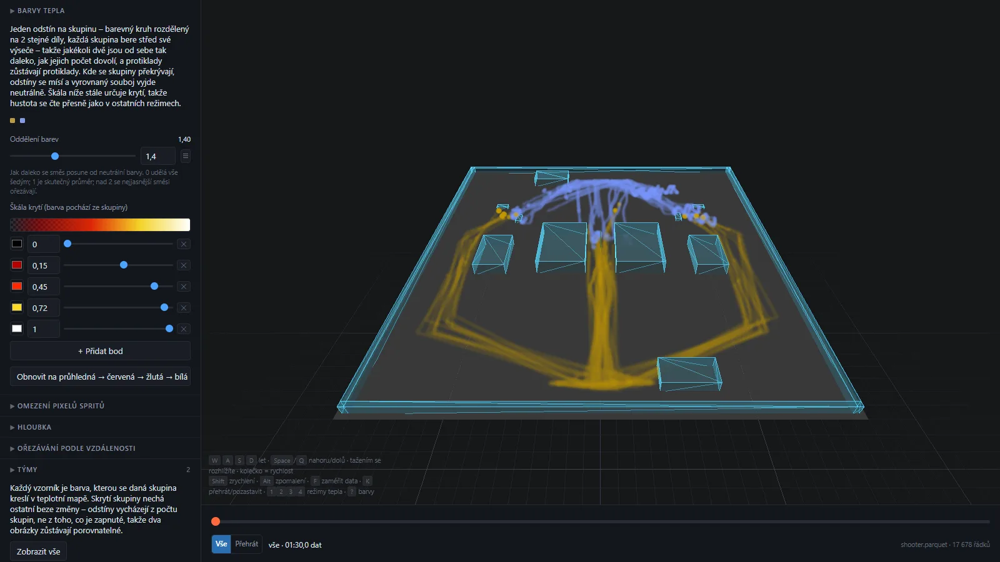

# Týmové teplo

Týmové teplo ukazuje, kde byl každý tým, každý tým svou barvou. Tam, kde se týmy překrývají, se barvy mísí.

**Týmové teplo** (klávesa 3) je hustotní pole [Tepla](heat.md), kde každá [skupina](glossary.md) dostane vlastní odstín. Kde se skupiny překrývají, jejich odstíny se mísí; vyrovnaný souboj vyjde neutrálně. Průhlednost stále nese hustotu přesně jako v ostatních režimech, takže obrázek odpovídá zároveň na *kolik* a *čí*. Potřebuje sloupec skupiny.

Není to [překryv figur](box-replay.md): ten kreslí jednu figuru na osobu; tohle je pole tepla obarvené stejným sloupcem.

## Jak to použít {#how-to-use-it}

1. Stiskněte `3` (nebo vyberte **Týmové teplo** v liště režimů).
2. Otevřete **Barvy tepla**. Vzorky ukazují barvu každé skupiny; najetím na vzorek uvidíte název týmu.
3. Když všechno vypadá šedě, zvyšte **Oddělení barev**.
4. Odškrtnutím skupiny v [Seznamu týmů](teams-list.md) ji vyřadíte; barvy ostatních zůstanou tam, kde byly.

## Ovládání {#controls}

V sekci **Barvy tepla**:

| Ovládání | Výchozí | Význam |
|---|---|---|
| Vzorky | | Barva každé skupiny, pro prvních 12 skupin, pak *+N dalších*. Najetím zobrazíte název skupiny a barvu. |
| **Oddělení barev** | 1,4 | Jak daleko se směs posune od neutrální šedi, 0–4. 0 udělá všechno šedé; 1 je skutečný průměr; nad zhruba 2 nejjasnější směsi opouštějí zobrazitelný rozsah a jsou na každém kanálu oříznuty, což posune jejich odstín. |
| **Škála krytí (barva pochází ze skupiny)** | výchozí škála tepla | Zde se používá jen **alfa** škály: průhledná tam, kde nic není, neprůhledná nahoře. Její barvy se ignorují. |

Skupina, jejíž štítek znamená „žádná skupina“ (`0`, prázdné, `none`, `unknown`, `null` nebo `-1`), se kreslí šedě.

Všechna ostatní ovládání tepla (tvar, sytost, odezva, nejmenší teplo, hloubka, ořez) fungují jako v [Teple](heat.md).

[Seznam týmů](teams-list.md) ukazuje v tomto režimu barvu týmového tepla každé skupiny jako její vzorek. Vypnutí skupiny nechá barvy ostatních skupin tam, kde byly: odstíny se berou z celkového počtu skupin, ne z toho, co je zapnuto, takže dva obrázky zůstanou srovnatelné.

## Pro vývojáře {#for-developers}

### Paleta {#the-palette}

Z [`colors.ts`](https://github.com/Holdi601/3DHeat/blob/main/src/render/colors.ts):

- Barvy žijí v barevné rovině **Oklab** při pevné světlosti (0,7) a chroma (0,115), takže každá skupina je stejně jasná a červená skupina nepůsobí teplejší než modrá.
- Při *n* skupinách se kruh odstínů rozdělí na *n* stejných dílů a skupina *i* dostane **střed** svého dílu, `(i + 0,5) / n` otáčky. Každé dvě skupiny jsou od sebe tak daleko, jak počet dovolí, a protiklady zůstávají protiklady bez ohledu na počet.
- Používá se nejvýše **16** různých odstínů. Při více skupinách se id rozmisťují opakovaným půlením (id s obráceným pořadím bitů: 0, ½, ¼, ¾, ⅛, …), aby sousední id nesdílela odstín; skupiny nad 16 nutně sdílejí.
- Skupina, jejíž štítek znamená „žádná skupina“ (`0`, prázdné, `none`, `unknown`, `null` nebo `-1`, bez ohledu na velikost písmen), se kreslí **neutrální šedí** místo toho, aby zabrala výseč kruhu. Takto se zachází jen s prvním takovým štítkem v seznamu skupin.

Výchozí oddělení je 1,4, ne 1, protože při 1 je směs pěti rovnoměrně rozložených odstínů *šedá*: správně, ale nečitelně. Něco málo nad 1 nechá shody poctivé a zároveň udělá viditelným rozdělení 60/40.

### Jak to funguje {#how-it-works}

Cíl tepla má v tomto režimu čtyři kanály. Každý sprite přičte svou hustotu *v* k prvnímu kanálu a *v* × Oklab souřadnice *a* a *b* skupiny ke druhému a třetímu. Při složení je směs v pixelu vážený průměr hustotou: *a* = G / R, *b* = B / R, škálováno oddělením barev a převedeno do sRGB při světlosti palety. Dělení nasčítanou hustotou drží odstín nezávislý na tom, kolik je dat, a proto každé ovládání hustoty působí jen na průhlednost.

Čtyřkanálový cíl stojí při stejném rozlišení čtyřnásobek paměti GPU oproti jednokanálovému cíli tepla.
