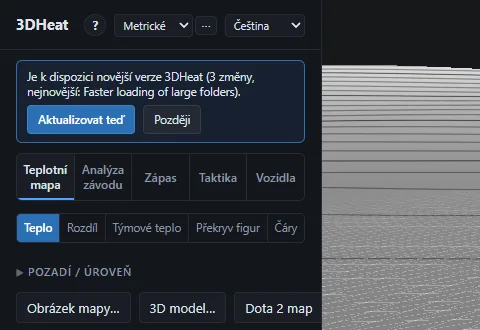

# Aktualizace

Prohlížeč vám řekne, když existuje novější verze, a aktualizuje se sám, jen když řeknete ano. Na vašem počítači se nic nemění bez vaší odpovědi.

## Aktualizace prohlížeče {#update-the-viewer}

1. **Na stránce.** Když existuje novější verze, objeví se pod jménem nahoře v postranním panelu pole: „Je k dispozici novější verze 3DHeat“. Klikněte na **Aktualizovat teď**. Stránka se po dokončení sama znovu načte. **Později** pole skryje, dokud stránku znovu nenačtete.
2. **Když se řekne spustit restart.bat**, zavřete okno serveru (černé okno, které otevřel `start.bat`) a dvakrát klikněte na `restart.bat`.
3. **Když spustíte prohlížeč.** `start.bat` kontroluje také. Když existuje novější verze, zeptá se **Update now? [Y/N]**. Stiskněte `Y` pro aktualizaci. Stiskněte `N`, nebo počkejte 60 sekund bez odpovědi, a spustí se verze, kterou máte.



Kopie s vašimi vlastními změnami se nikdy neaktualizuje za vás; pole jen říká, že čeká aktualizace, a vyzve, abyste změny uložili nebo odložili (commit nebo stash) a spustili `git pull`. Kopie nainstalovaná bez gitu (třeba zip soubor) nezobrazí nic.

Jak kontrola funguje, krok za krokem:

```
stránka ---(po 4 s, pak každých 6 h)---> vývojový server ---> git fetch
   za nimi?  ne  -> nic se nezobrazí
             ano -> vaše vlastní změny nebo commity?  ano -> jen vám to řekne
                                                     ne  -> [Aktualizovat teď] -> git pull
                                                            -> nové načtení, nebo „spusťte restart.bat“
```

## Bezpečnostní pravidla {#the-safety-rules}

- **Jen rychlý posun vpřed** (`git pull --ff-only`): aktualizace nikdy nesloučí,
  nepřeskládá ani nepřepíše nic.
- **Žádné místní změny**: kopie s nezapsanými změnami ve sledovaných souborech
  (`git status --porcelain --untracked-files=no` není prázdné) se nikdy neaktualizuje
  automaticky – něčí vlastní práci nemá aktualizace přepsat. Jen se řekne,
  že čeká aktualizace. Nesledované soubory (data, exporty) se za změny nepočítají.
- **Žádné místní commity**: kopie s commity, které nadřazená větev nemá
  („rozbíhá se“), se neaktualizuje – rychlý posun vpřed ji nemůže dostat dál,
  a sloučení patří na `git pull` ručně. Stránka i `start.bat` to říkají
  stejnými slovy a `start.bat` spustí verzi, která tam je.
- **Jen ze samotné stránky**: požadavek vývojového serveru na aktualizaci musí nést
  vlastní hlavičku a, když prohlížeč pošle `Origin`, musí přijít z hostitele
  serveru (níže).
- Aktualizuje se jen kopie z gitu s nadřazenou větví; cokoli jiného
  (kopie bez `.git`, bez nainstalovaného gitu, statický build) se nechá být
  a nic neříká.

## Co dělá start.bat {#what-startbat-does}

`start.bat` (dvakrát na něj klikněte; okno je server) dělá v tomto pořadí:

1. Najde Node.js – v `PATH`, jinak v `%ProgramFiles%\nodejs`,
   `%ProgramFiles(x86)%\nodejs` nebo `%LOCALAPPDATA%\Programs\nodejs` – a když chybí,
   nabídne instalaci příkazem `winget install -e --id OpenJS.NodeJS.LTS` (zeptá se, Y/N;
   potom je nutné okno znovu otevřít, aby Windows načetly nový `PATH`).
2. **Aktualizace**, když je nainstalován git a složka má `.git`:
   - `git fetch --quiet` (bez sítě nebo bez nadřazené větve: tiše přeskočeno);
   - spočítá `git rev-list --count HEAD..@{u}`; nic za nimi: nic se neříká;
   - místní změny: „A newer version of 3DHeat is available (N changes), but
     this copy has local changes, so it is not updated. Commit or stash them,
     then run git pull.“ – a spustí verzi, která tam je;
   - vlastní commity (`git rev-list --count @{u}..HEAD` není 0): „A newer
     version of 3DHeat is available (N changes), but this copy has commits of
     its own that the newest version does not, so it is not updated. Update it
     with git pull.“ – a spustí verzi, která tam je;
   - jinak „A newer version of 3DHeat is available (N changes).“ a otázka **Update now? [Y/N]**. `N`, nebo žádná odpověď 60 sekund, vypíše „Not updated; starting the version you have.“ a spustí verzi, která tam je. Při `Y`: „Updating...“, zaznamená, zda se mění `package.json` nebo `package-lock.json`,
     spustí `git pull --ff-only` (když to stále selže – třeba sítí:
     „The update did not go through; starting the version you have.“), pak `git submodule update --init`
     (připnuté nástroje, viz [Údržba dokumentace](maintaining.md#the-tools-under-exporters)), pak `npm install`, když se soubory balíčků změnily a
     `node_modules` existuje, a „Updated.“
3. Odmítne spustit druhý server: když už na portu **5273** něco poslouchá, řekne to a ukáže na `restart.bat` / `stop.bat`.
4. Při prvním spuštění (žádné `node_modules`) se zeptá, než stáhne závislosti (asi 300 MB do `node_modules\`, nic systémově).
5. Spustí vývojový server na `127.0.0.1:5273` (`--strictPort`) a jakmile je připraven, otevře prohlížeč.

`restart.bat` zastaví server (podle portu) a znovu spustí `start.bat`, takže se zeptá na totéž. `stop.bat` jen zastaví.


## Pro vývojáře {#for-developers}

### Za běhu: trasa aktualizace {#while-it-runs-the-update-route}

Vývojový server (plugin Vite `heat3d-self-update` v `vite.config.ts`) obsluhuje
`/__heat3d/update`. Existuje jen na vývojovém serveru – ne ve statickém buildu
a ne v `vite preview`.

**`GET /__heat3d/update`** odpoví, zda je kopie pozadu:

```json
{ "checkout": true, "upstream": "origin/main", "behind": 3, "ahead": 0, "dirty": false, "latest": "the newest commit's subject" }
```

- `checkout: false`, když složka není kopie z gitu;
- spustí `git fetch --quiet` **nejvýš jednou za 30 minut** (dotazy mezitím odpovídají
  podle toho, co se naposledy stáhlo);
- `behind` / `ahead` z `git rev-list --count HEAD..@{u}` / `@{u}..HEAD`,
  `dirty` z `git status --porcelain --untracked-files=no`, `latest` je předmět
  nejnovějšího commitu nadřazené větve;
- bez nadřazené větve `upstream: null` a `behind: 0`.

**`POST /__heat3d/update/apply`** uvede kopii do aktuálního stavu:

1. Odmítnuto s `403 { ok: false, reason: "forbidden" }`, pokud požadavek nemá
   hlavičku `X-Heat3d-Update: 1` a, když nese `Origin`, host tohoto původu
   není `Host` požadavku. Formulář z jiného webu nemůže poslat vlastní hlavičku
   bez předběžného CORS požadavku, který tento server nikdy neudělí.
2. Nic k práci (není kopie, není nadřazená větev, není pozadu):
   `{ ok: true, updated: false }`.
3. Místní změny: `{ ok: false, reason: "dirty" }`; místní commity:
   `{ ok: false, reason: "diverged" }`.
4. Jinak: zaznamená soubory, které se změní (`git diff --name-only HEAD @{u}`),
   `git pull --ff-only` (časový limit 2 min), `git submodule update --init`
   (selhání se ignoruje), `npm install`, když se změnil `package.json` nebo
   `package-lock.json` (časový limit 15 min), a odpoví
   `{ ok: true, updated: true, restart }` – `restart` říká, proč běžící
   server aktualizaci nemůže převzít: `"dependencies"`, když se závislosti
   znovu nainstalovaly, `"config"`, když se změnil jen soubor `vite.config`,
   `false`, když restart není potřeba.
5. Selhávající příkaz git nebo npm odpoví `{ ok: false, reason: "<chyba,
   nejvýš 300 znaků>" }`.

Odpovědi jsou JSON s `Cache-Control: no-store`. Server poslouchá jen na
`127.0.0.1`, takže trasa není dosažitelná ze sítě.

### Oznámení na stránce {#the-notice-in-the-page}

`UpdateBanner`, pod jménem nahoře v postranním panelu:

- Trasu se zeptá **4 sekundy** po načtení stránky (ne v prvních sekundách: stránka má datovou sadu k načtení a GPU k spuštění) a znovu
  **každých 6 hodin**, dokud stránka zůstává otevřená.
- Nezobrazí **nic**, když taková trasa neexistuje (statický build), složka není
  kopie z gitu, nebo nic není novější – oznámení při každém spuštění by se naučilo ignorovat.
- Pozadu, bez místních změn: „A newer version of 3DHeat is available (N
  changes, the newest: <předmět>).“ s **Aktualizovat teď** a **Později**
  (*Později* skryje pole, dokud se stránka znovu nenačte).
- Pozadu, s místními změnami: stejná věta a „This copy has local
  changes, so it is not updated automatically; commit or stash them, then
  run git pull.“ – bez tlačítka.
- **Aktualizovat teď** pošle požadavek na `/apply` („Updating...“). Pak:
  - „Updated. The page reloads.“ – a stránka se znovu načte o 1,5 s později (server
    už obsluhuje nové soubory);
  - když se závislosti znovu nainstalovaly: „Updated. Its dependencies
    changed: close the server window and run **restart.bat** to finish.“;
  - když se změnilo jen nastavení serveru: „Updated. Its server settings
    changed: close the server window and run **restart.bat** to finish.“;
  - nakonec nic k načtení (`updated: false` – kopii mezitím uvedl do stavu třeba `start.bat`):
    „Nothing to update: this copy is already the newest version.“ – a bez načtení znovu;
  - odmítnuto: věta o *změnách*, nebo „This copy has commits of its own that
    the newest version does not; update it with git pull.“, nebo „The update
    did not go through: <důvod>“.
