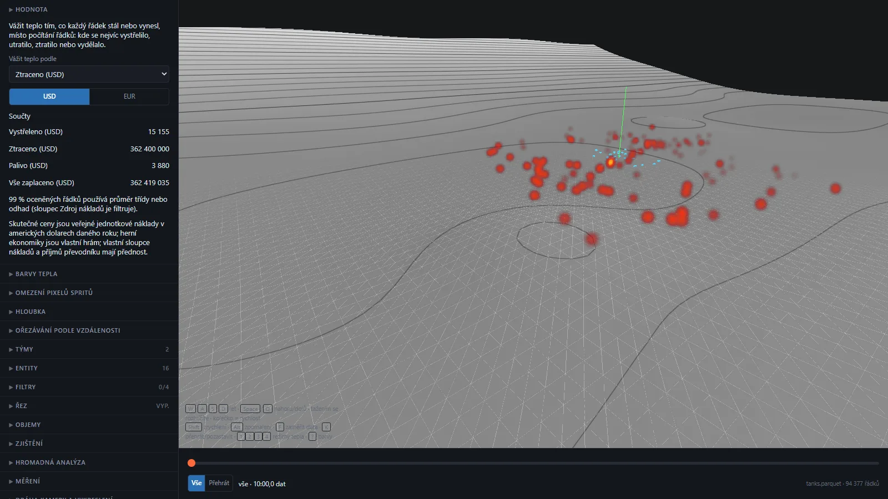

# Vážení hodnot

Každý výstřel, střelivo, ztracené vozidlo a litr paliva má cenu. Prohlížeč spočítá, co každý řádek stál nebo vynesl, a teplo podle toho umí vážit, takže mapa ukazuje **kam šly peníze**, místo kde jsou řádky.

## Jak to použít {#how-to-use-it}

1. Načtěte data s událostmi (výstřely, zabití, smrti) a názvy vozidel nebo zbraní.
2. Otevřete **Hodnota** v postranním panelu Tepla.
3. Vyberte **Vážit teplo podle**, například *Ztraceno (USD)*. Teplo teď přičítá cenu každého řádku místo 1.
4. Přečtěte si **Součty**: součet každého sloupce hodnoty pro to, co je zobrazeno (platí filtry a časové okno).
5. Tam, kde jsou ceny reálné peníze, se objeví přepínač **USD / EUR**.

Prázdná první položka nabídky řádky počítá znovu.

## Co lze vážit {#what-can-be-weighed}

Sloupce hodnoty se přidají při načtení, jeden pro každý druh a měnu:

| Druh | Na které řádky padá | Jak se oceňuje |
|---|---|---|
| **Vystřeleno** | výstřely a odpaly | zbraň, jinak průměr pro druh střeliva |
| **Utraceno** | nákupy, vznik | peněžní sloupce hry (například nákupní nabídka střílečky) |
| **Ztraceno** | smrti, zničení | vlastní vozidlo, jinak průměr jeho třídy |
| **Zničen** | zabití | cílové vozidlo |
| **Způsobené poškození** | zásahy | podíl hodnoty cíle |
| **Palivo** | pozice | spotřebované palivo, ze sloupce paliva nebo odhadnuté podle třídy a času |
| **Vše zaplaceno** | | vystřeleno + utraceno + ztraceno + palivo |
| **Získáno** | odměny | vlastní odměnové sloupce hry (`earn_…`) |
| **Čistý** | | získáno minus zaplaceno; kreslí se jako teplo se znaménkem (kladná škála tam, kde se získalo víc, záporná tam, kde se zaplatilo víc) |

Názvy sloupců jsou `cost_<druh>_<měna>`, `earn_<měna>` a `net_<měna>`. Převodník, který zná měnu samotné hry (například převodník replaye, který zapisuje herní kredity), má přednost před vestavěnými cenovými tabulkami.

## Cenové tabulky {#the-price-tables}

| Tabulka | Měna |
|---|---|
| Reálná vojenská technika: střely, bomby, náboje, protiopatření, letadla, vrtulníky, pozemní vozidla, lodě, palivo | USD (EUR = USD × 0,92, pevná hodnota `EUR_PER_USD` v [`cost.ts`](https://github.com/Holdi601/3DHeat/blob/main/src/data/cost.ts); nejde o živý kurz) |
| Nákupní nabídky stříleček a odměny za zabití | kredity hry |
| Tankové a lodní hry | kredity hry |
| Strategické hry (více zdrojů) | jeden sloupec na zdroj plus jeden souhrnný |
| Válečné hry | body |

Hra se pozná podle názvů v datech. Reálné ceny pocházejí z veřejných zdrojů (rozpočtové dokumenty, encyklopedie) nebo jsou označeny jako odhady; neupravují se o inflaci. Vygenerovaný seznam tabulek je na stránce [Cenové tabulky](ref-value-tables.md).

## Odhady {#estimates}

Sloupec kategorie navíc, **Zdroj ceny**, říká, jak byl každý řádek oceněn: `table`, `class average`, `estimate` nebo `none`. Sekce Hodnota ukazuje, jaký podíl oceněných řádků jsou průměry nebo odhady. Chcete-li nechat jen přesně oceněné řádky, odškrtněte *estimate* a *class average* v **Zdroj ceny** na stránce [Filtry](filters.md).

## Kde jinde se hodnota ukazuje {#where-else-value-shows}

- [Poznatky](insights.md): nálezy *Drahá pozemní činnost* a *Výdělečná pozemní činnost*.
- [Rozpad](breakdown.md): Získáno, Ztraceno a Čistý příjem podle týmu, hráče nebo zbraně.
- [Objemy](volumes.md): sloupce hodnoty ve statistikách a srovnání.
