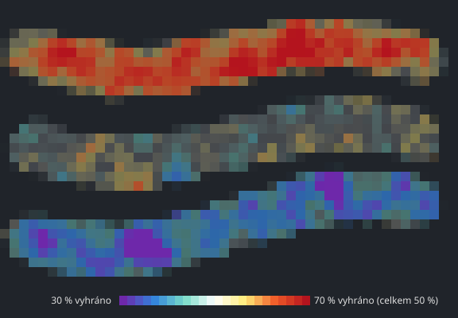

# Podíl výher: jak často vyhrává místo, trasa nebo akce

Kde hráč stojí, kudy jde, kam hází granáty – a jak často jeho strana potom vyhraje kolo. **Mapa podílu výher** obarví každé místo podle podílu řádků na tom místě, které patří ke kolům vyhraným stranou daného řádku. Porovná ho s podílem za vše zobrazené: teplá tam, kde je vyšší, studená tam, kde je nižší, nic tam, kde je stejný.

*Obrázek ukazuje vymyšlená data: tři trasy na prázdném levelu, 68 %, 50 % a 33 % jejich řádků ve vyhraných kolech.*

Potřebuje data, která říkají, kdo vyhrál: [sloupce výsledku](data-formats.md#outcome-columns) (`won`, `matchWon`, `roundEndReason`). Zapisují je převodníky pro CS2 a War Thunder, převodník Tacview pro kampaně serveru DCS ([Servery DCS](tacview-acmi.md#dcs-servers-who-won-and-how-each-sortie-ended)); může je mít jakýkoli soubor.

## Vyzkoušejte to {#try-it}

1. Načtěte zápasy se sloupcem výsledku a stiskněte `2` (**Rozdíl**).
2. V **Rozdílové rozdělení** stiskněte **Podíl vyhraných kol** (nebo **Podíl vyhraných zápasů**). Vyhraná kola se tím dají na **+** a prohraná na **−** a panel se přepne na **Podíl +**.
3. Přečtěte barvy. Panel uvádí celkový podíl: *Celkem je 52,0 % z 1 200 000 řádků na +.*
4. Zužte to [filtry](filters.md): jedna strana (T nebo CT), jeden typ události (*Pozice* pro místa, kde lidé stáli, *Výstřel* nebo *Odpal* pro místa, odkud stříleli nebo házeli), jeden nákup, jedna mapa.

Místo, které je teplé s řádky *Pozice*, je místo, jehož držitelé většinou vyhráli kolo. S řádky *Zničení cíle* je to místo, kde dosažená zabití vedla k vyhraným kolům.

## Nastavení {#the-settings}

| Nastavení | Co dělá | Výchozí |
|---|---|---|
| **Rozdíl** / **Podíl +** | samotný rozdíl, nebo podíl strany + mezi řádky obou stran | Rozdíl |
| **Plná barva při** | jak daleko nad nebo pod celkovým podílem se místo ukáže v plné barvě, v bodech | ± 20 bodů |
| **Nejméně řádků pro obarvení místa** | místo s méně řádky se neobarví; od poloviny tohoto počtu postupně naskakuje | 12 |
| **Tah k celkovému podílu (řádky)** | každé místo začíná s tolika řádky na celkovém podílu, aby se místo se 3 řádky, všemi vyhranými, neukázalo jako 100 % | 12 |

Všechna tři působí na hotový obraz: jejich tažení nikdy nespustí sčítání znovu.

Podíl platí pro jakékoli rozdělení, ne jen pro výhry: *Podíl +* s rozdělením podle strany ukazuje, kde T tvořili větší část přítomnosti, a s rozdělením podle souborů dvou map, kde řádky jednoho souboru převažují nad řádky druhého.

## Řádky, ne kola {#rows-not-rounds}

Mapa počítá řádky. Hráč, který stojí dvacet sekund na jednom místě, přidá řádek při každém vzorku, všechny z jednoho kola. Důkazem na místě jsou tedy řádky v jeho blízkosti, ne kola. Proto jsou minimum a tah v řádcích a proto jsou větší než to, co dá jedno kolo.

Pro samotná kola:

- **[Rozpis](breakdown.md)** pro bod, pohled nebo objem: *Výhry %* počítá kolo každého hráče jednou a stejně ho táhne k celkovému podílu místa (4 kola).
- Statistiky **[Objemů](volumes.md)**: *Podíl výher* – kola s hráčem uvnitř objemu, každé jednou, tažená k podílu za vše zobrazené, s počty.

## Filtry výsledku {#outcome-filters}

Panel [Filtry](filters.md) uvádí sloupce výsledku hned po vlastních sloupcích prohlížeče: **Výsledek kola** a **Výsledek zápasu** (*Libovolný*, *Vyhráno*, *Prohráno*) a **Jak kolo skončilo** (Eliminace, Bomba vybuchla, Bomba zneškodněna, Vypršel čas, Kapitulace, Remíza, Cíl, Držené zóny, Ztracené tikety, Ztracena všechna vozidla), v jazyce prohlížeče.

## Pro vývojáře {#for-developers}

Průchod tepla zapisuje tři součty do čtyřkanálového cíle, který používá teplo týmů: teplo `R = Σ|v|`, teplo strany + `P` a `S = Σ v²/w`, kde `w` je váha průchodu (váha vzorkování krát zisk snímku). Kompozice čte podíl `P/R` (průměr vážený jádrem) a řádky, na kterých stojí, `n = R²/S` (Kishova efektivní velikost vzorku). Táhne podíl k celkovému, `p = (n·P/R + m·r0)/(n + m)`, a barví `p - r0` přes rozsah na rozdílových přechodech.

`n` vykrátí každý faktor společný řádkům v pixelu – zisk snímku, váhu vzorkování, plošnou váhu omezeného spritu. Obraz je tak stejný při každém přiblížení a hustotě vzorkování a snímky z každého k-tého řádku se spojí do celku, aniž by barvy skákaly. Celkový podíl pochází z počtů stran na CPU, s přesností na desetiny procenta; nic se nečte zpět z GPU. Výpočet a jeho kontroly: [`render/rateMap.ts`](https://github.com/Holdi601/3DHeat/blob/main/src/render/rateMap.ts) a jeho test.

Stojí tolik co teplo týmů: čtyřkanálový cíl zčtyřnásobí šířku pásma prolínání v průchodu tepla, jen dokud je zapnutý *Podíl +*.
