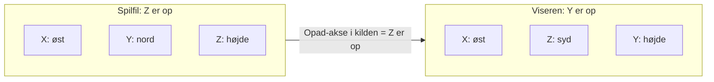

# Akser, enheder og tid

Spil og kort er ikke enige om, hvilken vej der er op, hvor lang en enhed er, eller hvordan tid skrives. Denne side viser de tre indstillinger, der får dine data til at stå, have den rigtige størrelse og afspilles den rigtige vej.

Står dit kort som en væg i stedet for at ligge som et gulv, så skift **Opad-akse i kilden**.

Med den forkerte **Opad-akse i kilden** står kortet som en væg; med den rigtige ligger det som et gulv.

## Verdenen viseren tegner i {#the-world-the-viewer-draws-in}

Viserens verden er **Y-op**: X og Z er jordplanet, Y er højde. De fleste spilmotorer er **Z-op**: for dem er X og Y jorden, og Z er højde. Nogle motorer er også spejlvendte (venstrehåndede). Afbildningen siger, hvordan filens akser drejes over til viserens. (Teknisk set er viseren højrehåndet, three.js-konventionen.)

### Opad-akse {#up-axis}

**Opad-akse i kilden** i [Kolonneafbildning](column-mapping.md):

| Indstilling | Fil (x, y, z) bliver verden (X, Y, Z) |
|---|---|
| *Z er op (de fleste spilmotorer)* - standard | (x, **z**, **y**): filens Z bliver højde, og filens Y bliver verdenens Z |
| *Y er op (grafikkonvention)* | (x, y, z) uændret |

For Z-op-data omdøbes de tre arrays i stedet for at blive kopieret ([`remapAxesInPlace`](https://github.com/Holdi601/3DHeat/blob/main/src/data/ingest.ts)), hvilket sparer hundredvis af megabyte ved store indlæsninger. Gættet laves ud fra prøven: den af Y- og Z-kolonnerne med den mindste spredning er op.

### Vendinger {#flips}

**Vend X**, **Vend Y**, **Vend Z** negerer *filens* akse med det navn, før omdøbningen - så med Z-op negerer *Vend Y* det, der ender som verdenens Z. En vending ændrer de indlæste data: koordinater vist af [linealen](measure.md), udsnittet og kameraets stilling er de vendte.

For at tegne en spejlvendt verden rigtigt rundt **uden** at ændre data, brug i stedet **Kamera og scene → Invertér verdensakse** ([Kamera](camera.md#invert-world-axis)). Det er det bedre valg for spil, hvis verden er venstrehåndet, fordi alle koordinater værktøjerne viser forbliver spillets egne.

### Enhedsskala {#unit-scale}

**Enhedsskala** ganger hver position. *1 (m)* sætter 1, *0,01 (cm→m)* sætter 0,01 (Unreal Engine-enheder er centimeter, så brug 0,01; Source-motorens enheder er tommer, så brug 0,0254; ingen af dem er meter), og boksen accepterer enhver værdi. Et skrevet 0 eller en værdi, der ikke er et tal, erstattes af 1.

Viseren mærker afstande i meter (sprite-radius, afskæringsafstande, linealen, flyvehastighed), hvilket kun passer, når den skalerede verdensenhed er en meter. Intet går i stykker, når den ikke er; mærkaterne siger bare "m" for hvad enheden end er.

## Tid {#time}

### Tidsenheder {#time-units}

Tommelfingerregel: værdier som 17000000000 (ti cifre eller flere) er et Unix-tidsstempel; værdier som 0, 0,25, 0,5 er sekunder fra start.

| Tidsenhed (menuetiket) | Læses som | Vist klokkeslæt |
|---|---|---|
| *Sekunder (relativ)* | værdi × 1 s | nej |
| *Millisekunder (relativ)* | værdi × 0,001 s | nej |
| *Mikrosekunder (relativ)* | værdi × 10^-6 s | nej |
| *Nanosekunder (relativ)* | værdi × 10^-9 s | nej |
| *Unix-tidsstempel (s)* | sekunder siden 1970-01-01 UTC | ja |
| *Unix-tidsstempel (ms)* | millisekunder siden 1970-01-01 UTC | ja |
| *ISO-8601-datostreng* | tekst som `2026-03-14T18:02:11.250Z`, læst med browserens `Date.parse` | ja |

Med en absolut enhed (de sidste tre) beholder datasættet det vægtidsøjeblik, dens tidligste række har, og tidslinjen viser det aktuelle UTC-klokkeslæt (`HH:MM:SSZ`) ved siden af afspilningshovedet.

**Parquet-kolonner af typen `TIMESTAMP` og `DATE`** afkodes til rigtige tidspunkter, så deres enhedsindstilling ignoreres, og panelet siger det. En `DATE`-kolonne er en hel dag: hver række på en dag deler ét tidspunkt, og afspilningen springer en dag ad gangen, hvilket panelet advarer om.

**ISO-8601-strenge virker lige godt i CSV og Parquet.** En tekstkolonne for tid med ISO-enheden læses én gang pr. forskellig streng; lykkes ingen, fejler indlæsningen med *Ingen læselige ISO-8601-tidsstempler i den tilknyttede tidskolonne.* - og afbildningen nægter allerede at starte, når ingen af de samplede værdier kan læses. En Parquet-kolonne af typen `TIMESTAMP` læses som et tidsstempel, uanset hvilken enhed der er valgt, og en numerisk Parquet-kolonne med ISO-enheden læses som Unix-millisekunder. En tekstkolonne for tid med en numerisk enhed afvises før indlæsning: hver værdi ville læses som NaN.

### Hvordan tid gemmes {#how-time-is-stored}

Mens filer flettes, er tider 64-bit sekunder, så en absolut epoke beholder sine brøkdele af sekunder. Når alle filer er inde, bliver den tidligste tid i hele udvalget 0, og hver række gemmer 32-bit sekunder fra den. Et 32-bit flydende tal har 24 bit mantisse: spænd på op til omkring halvanden dag opløses til bedre end 1/100 s, spænd på et halvt år til omkring et sekund. En række, hvis tid mangler eller ikke er et tal, placeres ved 0, starten.

Rækkerne sorteres derefter efter tid, hvilket gør tidslinjen billig: et tidsvindue findes med to binære søgninger (se [Sampling og budgetter](sampling-and-budgets.md)).

### Forløbet tid mod vægtid {#elapsed-time-versus-wall-clock}

En tidskolonne som `match_time` eller `round_time` tæller fra hver kamps egen start. Når du vælger den, lægges hver kamp på én fælles akse - godt til at sammenligne, hvad der sker i minut 3 i hver kamp - og panelet påpeger det. En vægtidskolonne viser kampene i den rækkefølge, de rent faktisk fandt sted, overlappende, hvor de overlappede.

## Kigretning {#look-direction}

Kigretning bruges kun af [boksreplay](box-replay.md) (strålerne fra hver boks). Den gemmes som to vinkler, gir og hældning, i radianer.

- **Gir- / hældningskolonner** læses, som de er, omregnet fra grader, når *Grader* er valgt. De justeres ikke for opad-aksen eller vendingerne.
- **Kolonner med retningsvektor** går gennem samme omdøbning og vendinger som positionerne og bliver derefter gir = atan2(x, -z) og hældning = atan2(y, √(x² + z²)) i verdensakser, så strålen også peger dér, boksen vender, i en spejlvendt kildeverden.

Hvis gir-/hældningskolonner peger den forkerte vej efter en vending, en retningsvektor eller justerede vinkler, er det løsningen.
