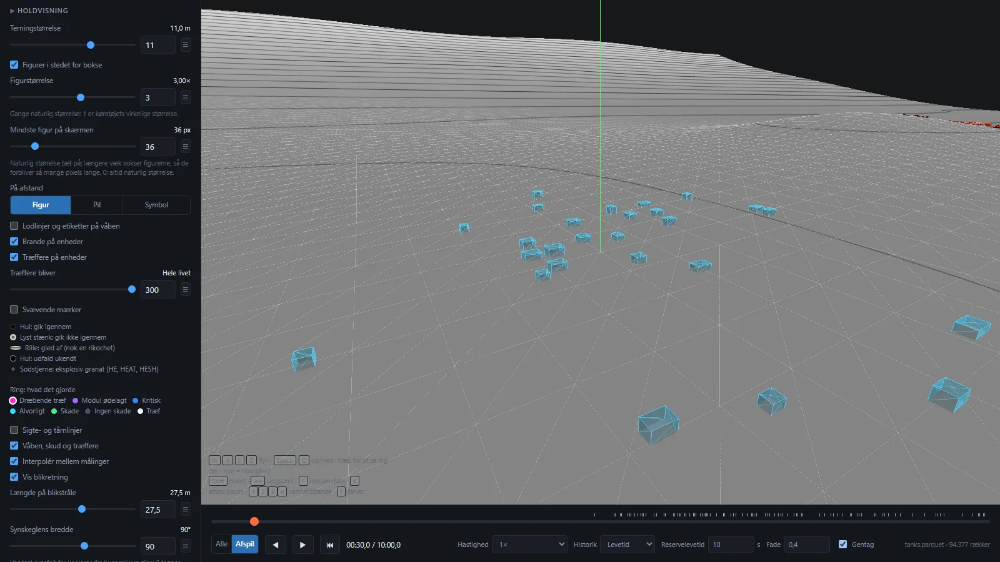

# Figuroverlejring (boksreplay)

En lille film: én figur for hver person, der bevæger sig, mens tiden løber, med et spor bag sig.

Tilstanden hedder **Figuroverlejring** på tilstandslinjen. Denne side hed tidligere "boksreplay", fordi hver person var en boks, før figurer fandtes; "figur-replay" og "boksreplay" betyder det samme. **Figuroverlejring** har ingen talltast: vælg den på tilstandslinjen. Den tegner én figur (eller boks) pr. [person](glossary.md), der bevæger sig langs [tidslinjen](timeline.md), med valgfri kigstråler og spor. Det er afspilning snarere end tæthed: *hvem var hvor, og hvornår*. Den kræver en personkolonne; uden tidskolonne tegnes hver måling på én gang.

## Sådan bruges den {#how-to-use-it}

1. Indlæs data med en personkolonne og en tidskolonne.
2. Vælg **Figuroverlejring** på tilstandslinjen.
3. Sæt tidslinjen til **Afspil** og tryk på afspil (`K`).
4. Åbn **Holdvisning** for at ændre **Sporlængde**, figurstørrelsen eller kigstrålerne.

Der tegnes ingen varme i denne tilstand, og det adaptive spritebudget er inaktivt.

Som standard tegnes hver person som figuren af det, de er, i stedet for som en boks - se [Figurer](figures.md) for hvilken figur en enhed får, og [Kamp-replay](match-replay.md) for etiketter, følgekameraet, måling mellem to enheder og hændelseslisten.

## Panelet Holdvisning {#the-team-viewer-panel}

Vises i stedet for varmepanelerne i denne tilstand.

| Indstilling | Standard | Interval (skyder) | Betydning |
|---|---|---|---|
| **Figurer i stedet for bokse** | til | | Hver person som figuren af det, de er: en soldat til fods, den tank eller det fly dataene nævner. Det, dataene ikke siger noget om, forbliver en boks. |
| **Figurstørrelse** | 1× | | 1× er rigtig størrelse. |
| **Mindste figur på skærmen** | 36 px | 0 = altid rigtig størrelse | Rigtig størrelse tæt på; længere væk vokser figurer, så de forbliver så mange pixels lange. |
| **Våben, skud og træffere** | til | | Våben i luften med røg, sporskud, nedslag, træffere og drab. Sporskud udledt af en træffer er stiplede. |
| **Terningstørrelse** | enhedens størrelse, eller udstrækning / 500, ved indlæsning | 0,05-200 m, logaritmisk (5000) | Kantlængden af hver boks. Se [enhedsstørrelse](sessions-persons-groups.md#entity-size). |
| **Interpolér mellem målinger** | til | | Mellem to målinger af samme person i samme session placeres boksen forholdsmæssigt mellem dem. Aldrig over en sessiongrænse. |
| **Vis blikretning** | til | | En stråle fra hver boks i personens blikretning (kræver [blikkolonner](axes-units-and-time.md#look-direction)). |
| **Længde på blikstråle** | enhedens størrelse × 4, eller udstrækning / 200, ved indlæsning | 0,5-500 m, logaritmisk (20.000) | Vises, mens blikretning er til. |
| **Sporlængde** | 8 s | 0-300 s (86.400); 0 = fra | Sekunder af historik tegnet bag hver person. |
| **Tegn alle rå målinger** | fra | | En boks pr. gemt måling i vinduet i stedet for én interpoleret boks pr. person. Nedsamplet for at holde det interaktivt. |

Hintene i panelet forklarer, at interpolation og spor kun forbinder målinger inden for én session, og, når indlæsningen har [delte navne](sessions-persons-groups.md#names-worn-by-several-things-at-once), hvor mange navne der tegnes som enkeltmålinger.

## Sessionen der afspilles {#the-session-being-played}

Med en sessionskolonne afgør vælgeren **Session** øverst i sidepanelet ([Sessioner](sessions-persons-groups.md#the-session-picker)), hvilken kamp der afspilles. Den travleste vælges ved indlæsning. Kun rækker fra den session bliver til bokse og spor, og tidslinjen løber over den sessions spænd i stedet for hele datasættets. *Alle sessioner* afspiller alle sessioner på én gang, og forbinder stadig aldrig målinger på tværs af sessioner.

## Hvad der tegnes hvornår {#what-is-drawn-when}

Fra [`TrackCursor`](https://github.com/Holdi601/3DHeat/blob/main/src/data/tracks.ts):

**Levende bokse** (Afspil-tilstand, rå målinger fra). For hver synlige person deres seneste måling ved eller før afspilningshovedet:

- Har personen en næste måling, den er i samme session, og navnet ikke er delt, placeres boksen mellem de to målinger i forhold til tiden, med gir interpoleret den korte vej rundt og hældningen lineært (når *Interpolér* er til).
- Ellers bliver boksen stående ved den sidste måling i tidslinjens **Reservelevetid** (standard 10 s) og fjernes derefter, så elimineret spillere ikke hænger ved.

**Alle-tilstand** ignorerer afspilningshovedet og tegner hver måling i intervallet som en boks.

**Rå målinger** tegner en boks pr. gemt måling i vinduet: *Spændet* med *Vindue*-historikken, ellers alt op til afspilningshovedet. Højst 65.536 bokse; med flere målinger tegnes hver *k*-te.

**Spor** (når sporlængden er over 0, og rå målinger ikke tegnes): en linje mellem hvert par af på hinanden følgende målinger af en person inden for de sidste *sporlængde* sekunder op til afspilningshovedet, der toner fra 80 % opacitet til gennemsigtig med alderen. Et spor stopper ved en sessionsskift og tegnes ikke for delte navne. Højst 131.072 hjørnepunkter; med flere springes rækker jævnt over.

**Hvem der er synlig:** en person skjules, når deres gruppe er fravalgt i [Holdlisten](teams-list.md) (deres gruppe er den for deres første række), når et gruppefilter udelukker dem, eller når panelet [Enheder](entities.md) har et valg, der ikke inkluderer dem. Kolonnefiltre gælder ikke for bokse.

## Farver {#colours}

Én farvefamilie pr. gruppe og én nuance pr. medlem, så et blik fortæller, hvilken side en person er på ([`teamMemberColor`](https://github.com/Holdi601/3DHeat/blob/main/src/render/colors.ts)). Gruppefarverne går i ring gennem en fast liste med ti - blå, rød, grøn, rav, violet, cyan, magenta, lime, orange, indigo - og medlemmerne af en gruppe fordeles over lyshed 42-76 % og mætning 90-65 %.

## Noter {#notes}

- Figuroverlejringen genopbygger kun sine figurer, når noget ændrer sig; et inaktivt billede tegner de sidste igen.
- Linjen *Terninger* i [statistik-overlejringen](performance-and-stats.md) tæller boksene på skærmen.
- Figuroverlejringen tegnes i samme scene som banen, så [dybdeskarphed](camera.md#depth-of-field) slører boksene, men aldrig varmen.
