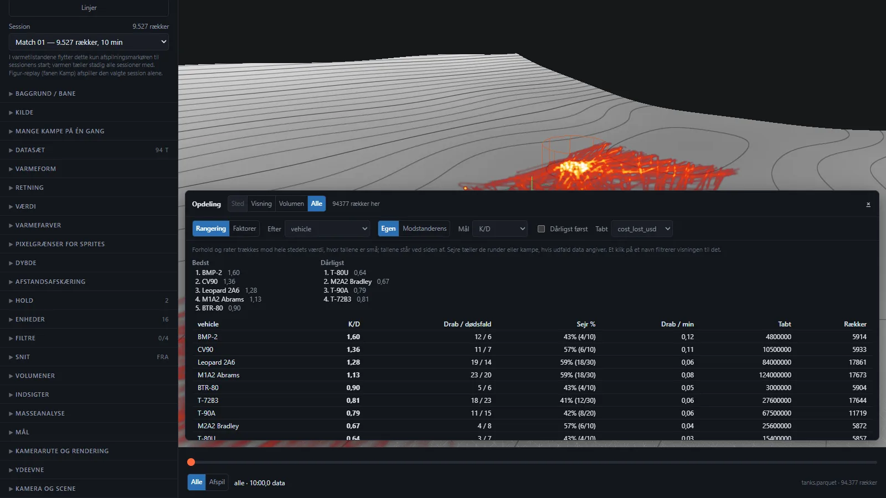
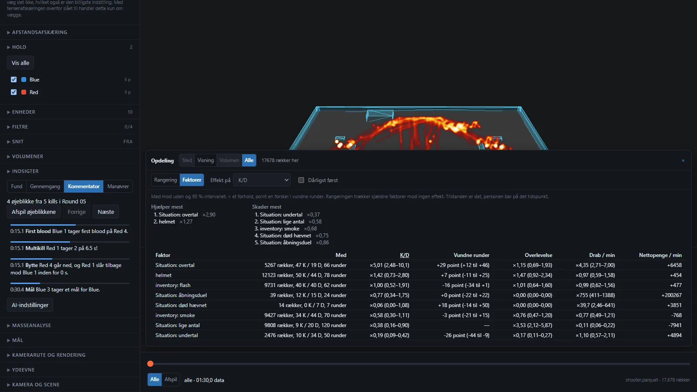

# Opdeling: hvem og hvad klarer sig bedst hvor

**Opdelingen** svarer på ét spørgsmål: hvilket køretøj, hvilken spiller eller hvilket våben klarer sig bedst her? Brug den til at finde tanken, der vinder ved broen, eller til at se, om det virkelig hjælper at have hjelm på.

Den rangerer, hvad der sker ét sted (et valgt sted, visningen, et volumen eller alt det viste) efter enhver kategori, og den måler hver tilstandsfaktor med mod uden.

## Prøv det {#try-it}

1. Indlæs en kamp med drab og dødsfald, og åbn **Volumener**.
2. Tegn et volumen om det sted, du interesseres af, og vælg det.
3. Tryk på **Opdeling...** under Statistik.
4. Under **Efter** vælger du *Køretøj*, og vælger målet *K/D* (drab pr. død).
5. Læs listen, bedste først. Tryk på **Dårligst først** for at vende den om. Klik på et navn for at filtrere visningen til det; klik igen for at slippe det.

## Åbn den {#open-it}

| Fra | Område den starter med |
| --- | --- |
| **Opdeling...** i [Volumener](volumes.md) (Statistik) | det valgte volumen |
| **Opdeling her** på valgkortet, efter at du har klikket på et punkt | en kugle omkring punktet (**Radius**, standard 3 % af datasættets størrelse) |
| det delte panel **Forskel** | visningen |

Overskriften skifter området: **Sted**, **Visning** (det kameraet så ved den sidste optælling; **Tæl igen** efter at have flyttet), **Volumen** (vælg et) eller **Alle**. Den tæller i baggrunden; statuslinjen siger, hvor mange rækker der er i området.

## Rangering {#ranking}

Vælg, hvad der skal rangeres efter, og et mål:

| Mål | Hvad det er |
| --- | --- |
| A, B | rækker på hver side af forskelskortet, delt som varmen deler dem |
| A / B, A - B, A / (A + B) | de to lag mod hinanden |
| K/D | drab mod dødsfald |
| Sejr % | runder (eller kampe) vundet, hvor dataene siger, hvem der vandt |
| Drab / min | drab pr. minut til stede (huller mellem bevægelsesmålingerne) |
| Tjent, Tabt, Netto penge | summer af kolonnerne `earn_*` og `cost_*`; en vælger vælger valutaen |

Drab, dødsfald, tilstedeværelse, sejre og penge tæller hver række, visningen viser på stedet, på begge sider af delingen eller ingen.

Kvotienter og rater trækkes mod hele stedets værdi, hvor tallene er små, så 2 drab i 1 liv ikke topper listen. Tallene vises ved siden af dem.

Du kan rangere efter grupper, spillere og kampe, enhver kategorikolonne (et køretøj, et våben, en side, en købstype, en agent eller en udrustning), enhver talkolonne i intervaller (panser, en udrustnings værdi), et våbenkolonnes **klasse** (riffel, snigskytte, SMG, pistol...) og hvor mange stykker **udstyr** en listekolonne som `inventory` indeholder.

**Egen** rangerer efter rækkens egen værdi. **Modstanderens** rangerer efter den anden parts værdi: offerets våben ved et drab, dræberens ved en død (kræver en kolonne `other` / `victim`, der nævner dem).

## Tilstand på tidspunktet {#state-at-the-time}

En rækkes værdi er dens egen, medmindre rækken ikke logger nogen (en hændelsesrække uden udstyr), eller det er en død (hvis våbenkolonne kan nævne dræberens våben); så er den det, samme person sidst bar tidligere i kampen.

## Faktorer: med mod uden {#factors-with-against-without}

Skift fra **Rangering** til **Faktorer**, vælg **Effekt på**, og læs *Hjælper mest* og *Skader mest*:

Hver faktors effekt på K/D, vundne runder, overlevelse (minutter pr. død), drab i minuttet og netto penge i minuttet, med et 95 % interval: kvotienter som x, vundne runder som en forskel i point. Rangeringen trækker hvert estimat mod ingen effekt efter dets egen usikkerhed, så en sjælden faktor skal have en tydelig effekt for at rangere højt; intervallet, der vises, er det utrukne.

Data med runder tilføjer de nærkampssituationer ([Nærkamp og runder](close-quarters.md)), der beregnes én gang pr. datasæt: *blændet* (rækkens `state_flashed`, eller en fjendtlig blænding inden for 15 m i de sidste 3 s), *dødsbytte*, *åbningsduel* og *mandstærk*, *lige antal* eller *mandsvag* (spillere i live på rækkens side mod fjenden). En død tæller i den situation, dens offer var i lige før.

Højst 256 faktorer måles i ét gennemløb.

## For udviklere {#for-developers}

### Trækning af små stikprøver {#pulling-small-samples}

Rangeringsværdien er `(n + m*r0) / (d + m)`: `n` og `d` er tallene, `r0` er hele stedets rate og `m` er vægten af den forudsætning.

### Til konverterforfattere: navngivning af faktorkolonner {#for-converter-authors-naming-factor-columns}

En konverter tilføjer en faktor ved at navngive sin kolonne:

| Kolonne | Faktor |
| --- | --- |
| `state_<navn>` tal | til, mens den ikke er nul (`state_scoped`, `state_suppressor`) |
| `state_<navn>` kategori | én faktor pr. værdi (`state_ammo` = AP, HE...) |
| `active_<navn>` | det samme, for noget der er slået til eller er brugt for nylig: en evne, en ultimate, en gadget, en buff (`active_ult`, `active_stim`) |
| listekolonne (`inventory`, `loadout`, `perks`, `abilities`, `attachments`, `modules`, `buffs`, `debuffs`, `upgrades`, eller et `state_`/`active_`-navn der ender på `s`) | én faktor pr. element i en `a\|b\|c`-værdi |
| gear-flag der allerede er almindelige (`helmet`, `defuser`, `armor`, `scoped`, `airborne`, `duck`, `flashed`...) | til, mens den ikke er nul |
| `ammoType`, `shellType`, `ammoName` | den sidst affyrede runde |

Resultater: en `won`-kolonne med 0/1 (rækkens side vandt runden eller kampen) og en `round`-kolonne. Penge: `earn_<valuta>` og `cost_<art>_<valuta>`; en indtægt pr. art alene (`earn_round_cs2`, en konverters præcise rundebelønninger) erstatter kun omkostningsmodellens indtægt af den art (`round` dækker også plantninger og afmontering), og modellen prissætter resten.

Kortlægningen indlæser disse kolonner selv, ved siden af filens egen liste: hver `state_*`, `active_*`, `won`, `round`- og listekolonne, undtagen dem en Parquet-fils statistik viser holder én værdi igennem (hver indlæst kolonne er 4 byte pr. række).
