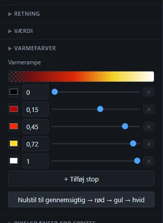

# Farve og eksponering

Disse indstillinger bestemmer, hvor meget varme der får hvilken farve. **Mætningspunkt** er, hvor meget varme der tæller som hvidglødende.

## Hurtige rettelser {#quick-fixes}

- Alt er hvidt: hæv **Mætningspunkt**, eller tryk på **Automatisk eksponering ud fra feltet**.
- Intet er synligt: sænk **Mætningspunkt**, eller tryk på **Automatisk eksponering ud fra feltet**.
- Kun få enkelte prikker vises: skru op for **Minimumsvarme**.

Alle indstillinger på denne side virker, når varmen omdannes til en farve. Når du trækker i en af dem, tegnes billedet straks om, og det **starter aldrig akkumuleringen forfra**.

## Mætningspunkt {#saturation-point}

**Mætningspunkt** (afsnittet Varmeform): den akkumulerede varme, der svarer til toppen af farverampen (med *Lineær*-responsen; se nedenfor for de andre). Logaritmisk skyder 0,1-4000, og håndtaget kan trækkes op til 10.000.000, fordi akkumuleret varme vokser med antallet af rækker. Standard er 24. Ved hver indlæsning laves først et **analytisk skøn** og derefter et **målt** skøn ud fra billedet.

At gætte forkert er forskellen mellem et varmekort og et tomt (eller hvidt) billede. Værdien kan ikke udledes pålideligt. Telemetri samler sig så kraftigt - ved en spawn, en dør eller et flaskehals - at forholdet mellem top- og gennemsnitstæthed varierer med en faktor ti mellem datasæt og mellem kameravinkler.

## Automatisk eksponering {#auto-exposure}

**Automatisk eksponering ud fra feltet** måler på det felt, skyggeren faktisk har lavet. Den ser bort fra tomme pixels, tager den 98. percentil af de oplyste pixels og sætter den på 85 % af vejen op til mætningspunktet. Dermed er toppen af rampen reserveret til de rigtige toppe.

Panelet viser derefter *målt X % af billedet; 98. percentil R placeret nær toppen af rampen*. Med responsen *Mættende* lander en værdi på 85 % af mætningspunktet på ca. 57 % af rampen i stedet for 85 %.

Den kører også **automatisk**:

- 8 renderede billeder efter at et datasæt er indlæst;
- 8 billeder efter at [filtrene](filters.md) er ændret (hvis du filtrerer hver position ned til hundrede hændelser, ændres tætheden med størrelsesordener);
- 8 billeder efter at du skifter mellem punktvarme og [linjevarme](line-heat.md), eller ændrer hvilke ruter linjevarmen tegner, fordi en linje lægger langt mindre varme pr. måling end en sprite.

Når intet er oplyst, lader den automatiske kørsel mætningen være, som den er. Knappen falder så tilbage til det analytiske skøn og skriver *intet at måle - brugte det analytiske skøn*.

### Følg visningen {#follow-the-view}

**Følg visningen** (afsnittet Varmeform, standard til) måler igen, hver gang kameraet står stille. Dermed bruger et område, du flyver ind i, hele farverampen i stedet for den skala, der er målt for hele kortet. Små ændringer ignoreres, og skalaen glider i stedet for at hoppe. Det virker i de fire varmetilstande, ikke i figuroverlægget.

Fjern markeringen for at låse skalaen og sammenligne steder på én skala. Hvis du trækker i **Mætningspunkt** selv, låses den også.

## Tæthedsrespons {#density-response}

**Tæthedsrespons** - hvordan *k* (varme / mætningspunkt) bliver til en plads på rampen:

| Respons | Formel | Brug |
|---|---|---|
| **Mættende** (standard) | t = 1 - e^(-k) | Nærmer sig toppen af rampen asymptotisk, sådan som stablede gennemskinnelige sprites gør. Intet klipper nogensinde til flad hvid, hvilket gør den til den sikre standard på ukendte data. |
| **Lineær** | t = k | Den eneste afbildning, hvor lige farve betyder lige mange. Brug den til at sammenligne to datasæt eller to tidsvinduer. |
| **Log** | t = log₂(1 + 7k) / 3 | Komprimerer en lang hale, så ét ekstremt hotspot ikke længere trykker alt andet ned i bunden af rampen. Løfter tynde områder. |

## Minimumsvarme {#minimum-heat}

**Minimumsvarme** (standard fra, 0-100 %): hver pixel med nogen varme løftes til mindst dette punkt på rampen. Skru den op og sprite-radius ned for at se, *hvor noget nogensinde er sket*. Enkelte datapunkter bliver tydelige i stedet for at ligge lige over gennemsigtig. Lad den være fra, når du vurderer tæthed, for den udjævner bunden af rampen med vilje. Tærsklen (k > 0,0001) holder virkelig tomme pixels tomme.

## Rampeeditoren {#the-ramp-editor}

I afsnittet **Varmefarver**. Dens tekst siger, hvad rampen bruges til: *Varmerampe* i Varme og Linjer, *Positiv (additive hold)* i Forskel, *Opacitetsrampe (farven kommer fra gruppen)* i [Holdvarme](team-heat.md), hvor kun dens alfa bruges.



Bjælken øverst viser en forhåndsvisning af rampen. Under den er der én række pr. stop:

| Del | Betydning |
|---|---|
| Farveprøve | Stoppets farve (browserens farvevælger). |
| Tal | Stoppets plads på rampen, 0 til 1 (0 = ingen varme). |
| Skyder | Stoppets opacitet, 0-100 %. |
| ✕ | Fjerner stoppet; deaktiveret når kun to er tilbage. |

**+ Tilføj stop** tilføjer et stop midt mellem de to sidste stop, med den sidste stops farve og opacitet. **Nulstil til gennemsigtig → rød → gul → hvid** gendanner standarden.

Stoppene kan angives i vilkårlig rækkefølge; de sorteres, når rampen bygges. **Alfa** er det, der blander varmen ind i scenen. Derfor er nulenden af standardrampen helt gennemsigtig.

### Standardrampene {#the-default-ramps}

| Position | Positiv (Varme, Linjer, Forskel +) | Negativ (Forskel −) |
|---|---|---|
| 0,00 | sort, alfa 0 | sort, alfa 0 |
| 0,15 | rgb(180, 0, 0), alfa 0,55 | rgb(0, 170, 60), alfa 0,55 |
| 0,45 | rgb(255, 40, 0), alfa 0,85 | rgb(0, 190, 200), alfa 0,85 |
| 0,72 | rgb(255, 220, 40), alfa 0,95 | rgb(40, 80, 255), alfa 0,95 |
| 1,00 | hvid, alfa 1 | rgb(170, 60, 255), alfa 1 |

## Mens kameraet bevæger sig {#while-the-camera-moves}

Når kameraet bevæger sig, starter akkumuleringen forfra for hvert billede. Med **Tegn alle rækker i hvert billede** til (standard) er hvert billede i bevægelse stadig korrekt. Med den fra er et billede i bevægelse et enkelt samplet skøn - lysere, vægtskalerede klatter - som konvergerer til det glattere, sande billede, når du stopper. Det er forventet; se [Akkumulering](accumulation.md).

## For udviklere {#for-developers}

### Sammensætningspasset {#the-composite-pass}

Når varmen er akkumuleret, omdannes hver pixels værdi til en farve i ét sammensætningspas ([`COMPOSITE_FS`](https://github.com/Holdi601/3DHeat/blob/main/src/render/webgl2/shaders.ts)). Trinene er:

```
k = |varme| / mætningspunkt
t = respons(k)                          klemt til 0..1
hvis minimumsvarme > 0 og k > 0,0001:  t = minimum + (1 - minimum) × t
farve, alfa = rampe(t)                 (den negative rampe når varme < 0, kun Forskel)
pixel = mix(scene, farve, alfa)
```

### Det analytiske skøn {#the-analytic-estimate}

**Det analytiske skøn** ([`estimateSaturation`](https://github.com/Holdi601/3DHeat/blob/main/src/data/calibrate.ts)) antager, at rækkerne er spredt over dataenes X-Z-fodaftryk: middelvarme = rækker × (π r² / fodaftryksareal) × 1/3 × centerintensitet (1/3 er diskens gennemsnit af en lineær rampe), ganget med et antaget top-til-middel-forhold på 25, klemt til 0,1-1.000.000. Det behøver kun at være inden for en størrelsesorden.

### Måling {#metering}

[`exposure.ts`](https://github.com/Holdi601/3DHeat/blob/main/src/render/exposure.ts):

1. varmemålet læses tilbage fra GPU'en, nedsamplet til højst 40.000 værdier;
2. tomme pixels (varme ≤ 0,0001) kasseres - det meste af et varmefelt er tomt, og hvis de medregnes, bliver alt for mørkt, ligesom en lysmåler rettet mod en sort baggrund;
3. den 98. percentil af de oplyste pixels er referencen;
4. mætningspunktet bliver reference / 0,85, så referencen står på 85 % af vejen op til mætningspunktet, og toppen af rampen er reserveret til de rigtige toppe.

### Farvetabellen {#the-colour-table}

Rampen bages ind i en 256 × 2 RGBA-tabel (den positive rampe i første række, den negative i anden) ([`buildColorLut`](https://github.com/Holdi601/3DHeat/blob/main/src/render/colors.ts)). Farverne interpoleres i lineært lys og gemmes som sRGB; opaciteten interpoleres lineært.
